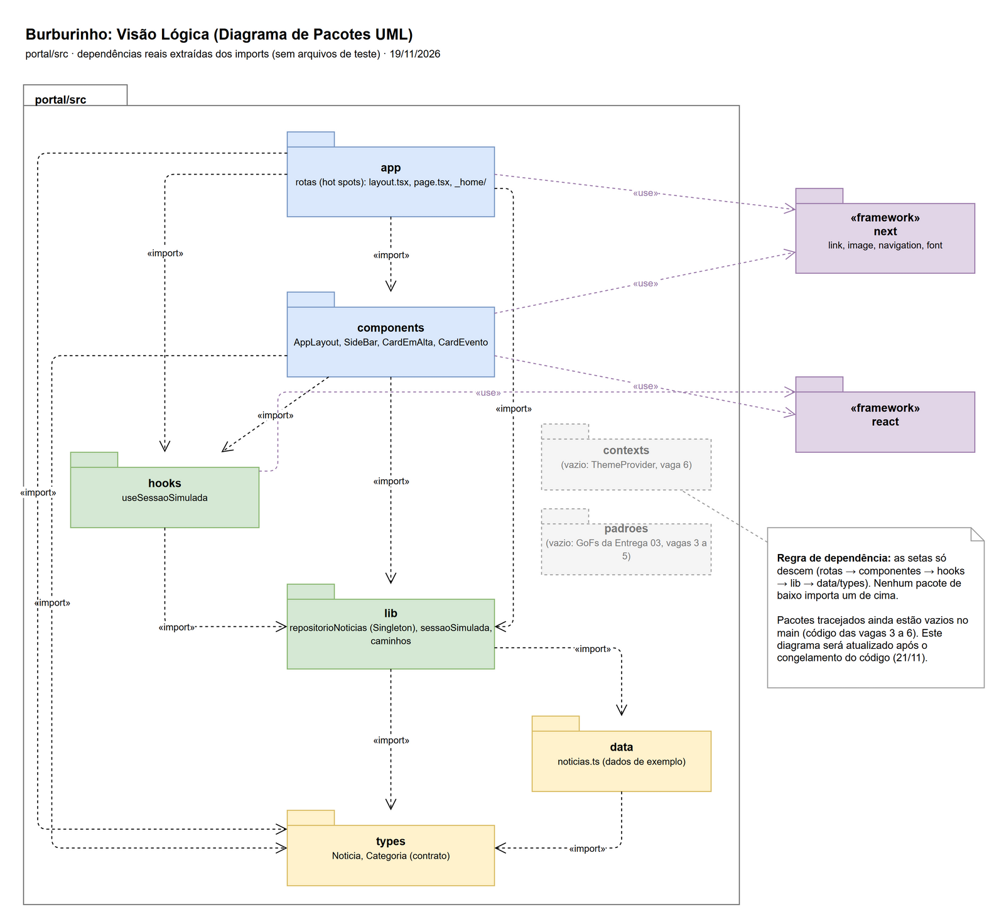
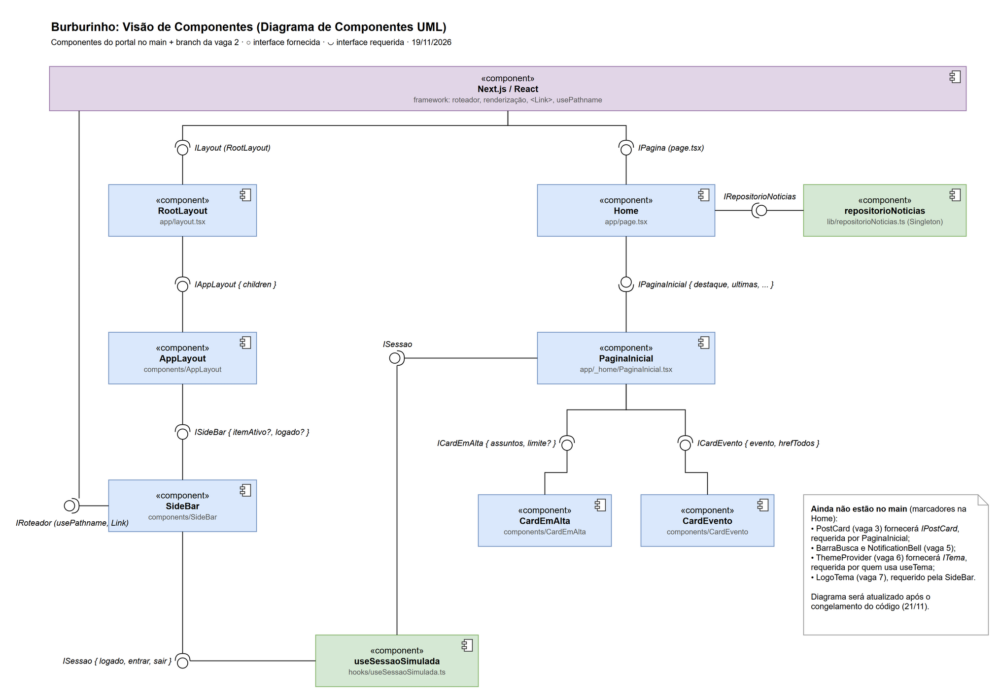

# 1.1.1. Elementos de DAS (Iniciativa Extra)

!!! info "Escopo desta página"
    A entrega mínima do Grupo 3 é a de **Reutilização** ([1.1.2](1.1.2.Reutilizacao.md)). Esta página é uma **iniciativa extra**: apresenta duas visões arquiteturais (**Visão Lógica** e **Visão de Componentes**) do **mesmo código** do portal, para mostrar como a reutilização se organiza na arquitetura. **Não é um DAS completo** segundo o [template adotado na disciplina](https://www.dca.ufrn.br/~anderson/FTP/dca0120/modelodocarquiteturasoftware.doc); as demais seções do template não foram elaboradas.

!!! warning "Versão preliminar (19/11/2026)"
    Os diagramas refletem o código que já existe: o `main` (projeto base da vaga 1) mais a branch da vaga 2. Os pacotes `contexts` e `padroes` e os componentes das vagas 3 a 7 ainda não estão no `main`; aparecem tracejados ou citados em nota. Os diagramas serão atualizados depois do congelamento do código, em 21/11.

## Participantes

| Nome do Membro | Contribuição |
| --- | --- |
| João Pedro Lopes | Diagramas de Pacotes e de Componentes, levantamento das dependências reais no código e redação desta página |

## Representação Arquitetural

O portal é uma aplicação **Next.js** (React + TypeScript) cujo código fica em [`portal/src`](https://github.com/UnBArqDsw2026-2-Turma01/2026.2-T01-_G3_ProjetoPortalNoticias_Entrega_04/tree/main/portal/src), organizado em pacotes (pastas) com responsabilidades separadas:

- `app` contém as rotas, os *hot spots* que o framework chama (`layout.tsx`, `page.tsx`);
- `components` contém os componentes reutilizáveis de interface;
- `hooks` e `contexts` contêm a lógica reutilizável que os componentes consomem;
- `lib` e `padroes` contêm a lógica sem interface, incluindo os GoFs reaproveitados da Entrega 03;
- `data` e `types` contêm os dados de exemplo e os contratos compartilhados (`Noticia`, `Categoria`).

A **regra de dependência** é que as importações só "descem": páginas usam componentes, componentes usam hooks, hooks usam `lib`, e `lib` usa `data` e `types`. Nenhum pacote de baixo importa um de cima. É isso que permite reutilizar um componente em outra tela sem levar junto a página que o usa.

## Visão Lógica: Diagrama de Pacotes

<figcaption>
    

        Figura: Diagrama de pacotes do portal Burburinho (Fonte: <a href="https://github.com/ojplc" target="_blank" rel="noopener noreferrer">João Cruz</a>, 2026) · <a href="../../../assets/diagramas/pacotes.png" target="_blank" rel="noopener noreferrer">Ver em tela cheia</a>
    

</figcaption>

Fonte editável: [`pacotes.drawio`](https://github.com/UnBArqDsw2026-2-Turma01/2026.2-T01-_G3_ProjetoPortalNoticias_Entrega_04/blob/main/docs/assets/diagramas/pacotes.drawio). Notação UML: pacote com aba; dependência tracejada com seta aberta, `«import»` entre pacotes do projeto e `«use»` para o framework.

As setas foram levantadas a partir das linhas `import` de cada pasta, desconsiderando os arquivos de teste (`*.test.ts(x)`).

| Pacote | Responsabilidade | Depende de |
| --- | --- | --- |
| `app` | Rotas e páginas: `layout.tsx` (aplica o `AppLayout`), `page.tsx` (Home) e `_home/` (parte interativa da Home) | `components`, `hooks`, `lib`, `types`, `next`, `react` |
| `components` | Componentes reutilizáveis de interface (`AppLayout`, `SideBar`, `CardEmAlta`, `CardEvento`) | `hooks`, `lib`, `types`, `next`, `react` |
| `hooks` | Lógica reutilizável com estado do React (`useSessaoSimulada`) | `lib`, `react` |
| `lib` | Lógica sem interface: `repositorioNoticias` (Singleton), `sessaoSimulada`, `caminhos` | `data`, `types` |
| `data` | Dados de exemplo (`noticias.ts`) | `types` |
| `types` | Contrato compartilhado (`Noticia`, `Categoria`, `NOMES_CATEGORIAS`) | nenhum |
| `contexts` | `ThemeProvider` (vaga 6) | ainda vazio |
| `padroes` | GoFs da Entrega 03 adaptados (vagas 3 a 5) | ainda vazio |

**Senso crítico:** não há dependência que "suba" nem ciclo entre pacotes. Dois pontos merecem atenção:

1. **`app` importa `hooks` diretamente.** A Home usa `useSessaoSimulada` em [`_home/PaginaInicial.tsx`](https://github.com/UnBArqDsw2026-2-Turma01/2026.2-T01-_G3_ProjetoPortalNoticias_Entrega_04/blob/main/portal/src/app/_home/PaginaInicial.tsx). Não viola a regra, já que as dependências continuam descendo, mas mostra que parte da lógica de tela ficou na rota e não em um componente.
2. **Os pacotes `lib` e `types` são os mais usados.** Uma mudança no contrato `Noticia` afeta o portal inteiro. O custo é aceitável justamente porque o contrato é estável e foi combinado no início do projeto (issue #1).

## Visão de Componentes: Diagrama de Componentes UML

<figcaption>
    

        Figura: Diagrama de componentes UML do portal Burburinho (Fonte: <a href="https://github.com/ojplc" target="_blank" rel="noopener noreferrer">João Cruz</a>, 2026) · <a href="../../../assets/diagramas/componentes.png" target="_blank" rel="noopener noreferrer">Ver em tela cheia</a>
    

</figcaption>

Fonte editável: [`componentes.drawio`](https://github.com/UnBArqDsw2026-2-Turma01/2026.2-T01-_G3_ProjetoPortalNoticias_Entrega_04/blob/main/docs/assets/diagramas/componentes.drawio).

**Notação (slides 60 e 61 do PDF da aula):**

- cada componente é um retângulo com o estereótipo `«component»` e o ícone de componente;
- a **interface fornecida** é a "bola" (○), do lado de quem a oferece;
- a **interface requerida** é o "soquete" (◡), do lado de quem precisa dela;
- quando os dois se encaixam, forma-se um **conector de montagem**.

Em React, a interface fornecida por um componente é o **tipo das suas props** (ex.: `ISideBar { itemAtivo?, logado? }`), e a de um hook é o **valor que ele devolve** (ex.: `ISessao { logado, entrar, sair }`).

**Como o diagrama evidencia a reutilização:**

- **Um componente atende várias telas.** O `AppLayout` é requerido uma única vez, pelo `RootLayout`, e o framework o aplica a todas as páginas.
- **Uma mesma lógica tem dois consumidores.** O `useSessaoSimulada` fornece `ISessao` para a `SideBar` e para a `PaginaInicial`.
- **O framework também é um componente.** O Next.js **requer** as interfaces `ILayout` e `IPagina`, que nós **fornecemos** (os *hot spots*, Princípio de Hollywood). Em troca, ele **fornece** `IRoteador` (`usePathname`, `Link`), que a `SideBar` requer para descobrir o item ativo.
- **Trocar uma implementação não afeta quem a usa.** Quem requer `IRepositorioNoticias` (a Home) não sabe que, por trás, existe um Singleton com dados de exemplo. Trocar por uma API só mudaria o componente provedor.

## Relação com o Código

| Elemento do diagrama | Arquivo no código |
| --- | --- |
| Pacote `app` · componentes `RootLayout`, `Home`, `PaginaInicial` | [`app/layout.tsx`](https://github.com/UnBArqDsw2026-2-Turma01/2026.2-T01-_G3_ProjetoPortalNoticias_Entrega_04/blob/main/portal/src/app/layout.tsx) · [`app/page.tsx`](https://github.com/UnBArqDsw2026-2-Turma01/2026.2-T01-_G3_ProjetoPortalNoticias_Entrega_04/blob/main/portal/src/app/page.tsx) · [`app/_home/PaginaInicial.tsx`](https://github.com/UnBArqDsw2026-2-Turma01/2026.2-T01-_G3_ProjetoPortalNoticias_Entrega_04/blob/main/portal/src/app/_home/PaginaInicial.tsx) |
| `AppLayout` · `IAppLayout { children }` | [`components/AppLayout/AppLayout.tsx`](https://github.com/UnBArqDsw2026-2-Turma01/2026.2-T01-_G3_ProjetoPortalNoticias_Entrega_04/blob/main/portal/src/components/AppLayout/AppLayout.tsx) |
| `SideBar` · `ISideBar` | [`components/SideBar/SideBar.tsx`](https://github.com/UnBArqDsw2026-2-Turma01/2026.2-T01-_G3_ProjetoPortalNoticias_Entrega_04/blob/main/portal/src/components/SideBar/SideBar.tsx) · [`itensMenu.ts`](https://github.com/UnBArqDsw2026-2-Turma01/2026.2-T01-_G3_ProjetoPortalNoticias_Entrega_04/blob/main/portal/src/components/SideBar/itensMenu.ts) |
| `CardEmAlta` · `ICardEmAlta` | [`components/CardEmAlta/CardEmAlta.tsx`](https://github.com/UnBArqDsw2026-2-Turma01/2026.2-T01-_G3_ProjetoPortalNoticias_Entrega_04/blob/main/portal/src/components/CardEmAlta/CardEmAlta.tsx) |
| `CardEvento` · `ICardEvento` | [`components/CardEvento/CardEvento.tsx`](https://github.com/UnBArqDsw2026-2-Turma01/2026.2-T01-_G3_ProjetoPortalNoticias_Entrega_04/blob/main/portal/src/components/CardEvento/CardEvento.tsx) |
| Pacote `hooks` · `useSessaoSimulada` · `ISessao` | [`hooks/useSessaoSimulada.ts`](https://github.com/UnBArqDsw2026-2-Turma01/2026.2-T01-_G3_ProjetoPortalNoticias_Entrega_04/blob/main/portal/src/hooks/useSessaoSimulada.ts) · [`lib/sessaoSimulada.ts`](https://github.com/UnBArqDsw2026-2-Turma01/2026.2-T01-_G3_ProjetoPortalNoticias_Entrega_04/blob/main/portal/src/lib/sessaoSimulada.ts) |
| Pacote `lib` · `repositorioNoticias` · `IRepositorioNoticias` | [`lib/repositorioNoticias.ts`](https://github.com/UnBArqDsw2026-2-Turma01/2026.2-T01-_G3_ProjetoPortalNoticias_Entrega_04/blob/main/portal/src/lib/repositorioNoticias.ts) |
| Pacotes `data` e `types` | [`data/noticias.ts`](https://github.com/UnBArqDsw2026-2-Turma01/2026.2-T01-_G3_ProjetoPortalNoticias_Entrega_04/blob/main/portal/src/data/noticias.ts) · [`types/noticia.ts`](https://github.com/UnBArqDsw2026-2-Turma01/2026.2-T01-_G3_ProjetoPortalNoticias_Entrega_04/blob/main/portal/src/types/noticia.ts) |
| `Next.js / React` · `IRoteador` | [`package.json`](https://github.com/UnBArqDsw2026-2-Turma01/2026.2-T01-_G3_ProjetoPortalNoticias_Entrega_04/blob/main/portal/package.json) (Next.js 16, React 19) |

## Uso da IA Generativa

Usei o **Claude Code** para levantar as dependências entre pacotes (busca das linhas `import` em `portal/src`) e para gerar os arquivos `.drawio`. Validei cada seta abrindo os arquivos e cada imagem exportada visualmente. Correções de senso crítico:

- **Dependência falsa:** a busca automática encontrou `lib → lib/repositorioNoticias`, mas era só um comentário dentro do próprio arquivo, não uma importação. A seta não entrou no diagrama.
- **Arquivos de teste:** os testes importam pacotes que o código de produção não importa. Foram desconsiderados para o diagrama mostrar a arquitetura de quem roda no navegador.
- **Notação de interfaces:** conferi um a um se a "bola" ficou no provedor e o "soquete" no consumidor (ex.: o `RootLayout` **fornece** `ILayout` e o Next.js **requer**, e não o contrário).
- **Diagrama do real, não do ideal:** os pacotes vazios (`contexts`, `padroes`) e os componentes das outras vagas não foram desenhados como se já existissem. Ficaram tracejados ou citados em nota.

## Versionamento

| Nome do Membro | Contribuição | Data |
| --- | --- | --- |
| Giovanna Felipe | Estruturação da página como iniciativa extra, com guia de preenchimento | 18/11/2026 |
| João Pedro Lopes | Versão preliminar dos diagramas de Pacotes e de Componentes e de todas as seções da página ([issue #2](https://github.com/UnBArqDsw2026-2-Turma01/2026.2-T01-_G3_ProjetoPortalNoticias_Entrega_04/issues/2)) | 19/11/2026 |

## Referências

SERRANO, Milene. **Reutilização & Framework**. Material de aula da disciplina Arquitetura e Desenho de Software. Brasília: Universidade de Brasília, 2026. Slides 11 a 14, 45 a 50, 60 e 61.

UNIVERSIDADE FEDERAL DO RIO GRANDE DO NORTE. **Modelo de Documento de Arquitetura de Software**. Disponível em: <https://www.dca.ufrn.br/~anderson/FTP/dca0120/modelodocarquiteturasoftware.doc>. Acesso em: 19 nov. 2026.

OBJECT MANAGEMENT GROUP. **OMG Unified Modeling Language (OMG UML), Version 2.5.1**. 2017. Disponível em: <https://www.omg.org/spec/UML/2.5.1>. Acesso em: 19 nov. 2026.

VERCEL. **Next.js Documentation: Layouts and Pages**. Disponível em: <https://nextjs.org/docs/app/getting-started/layouts-and-pages>. Acesso em: 19 nov. 2026.
