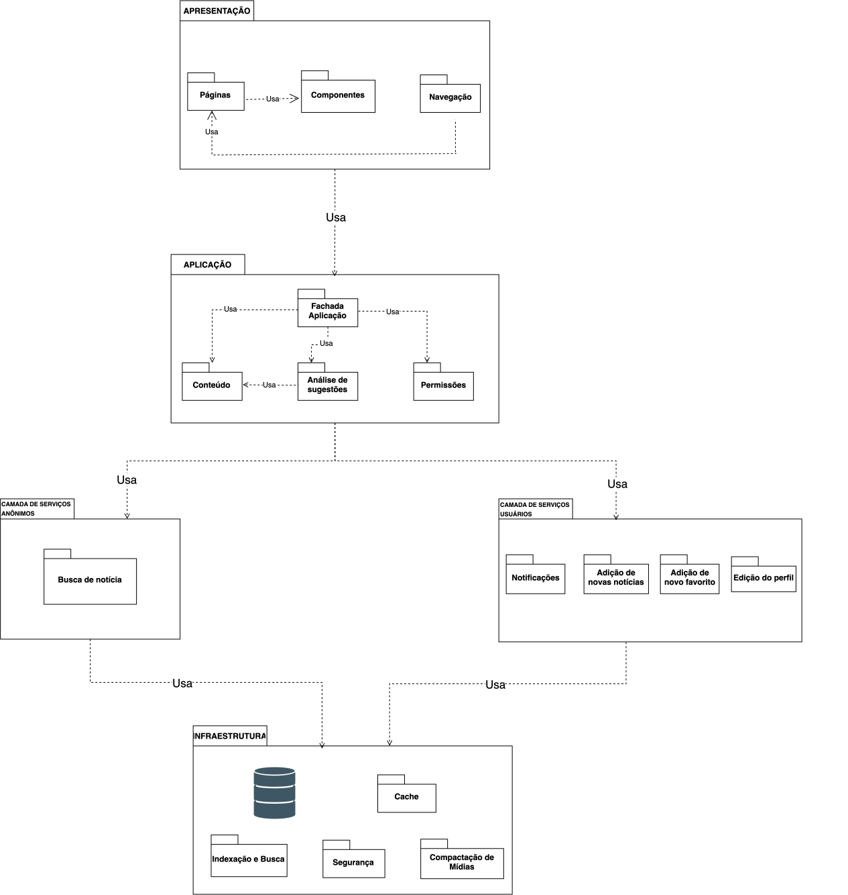
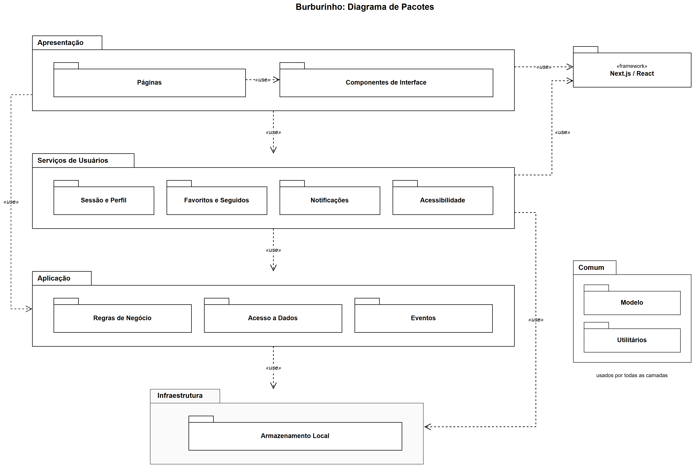
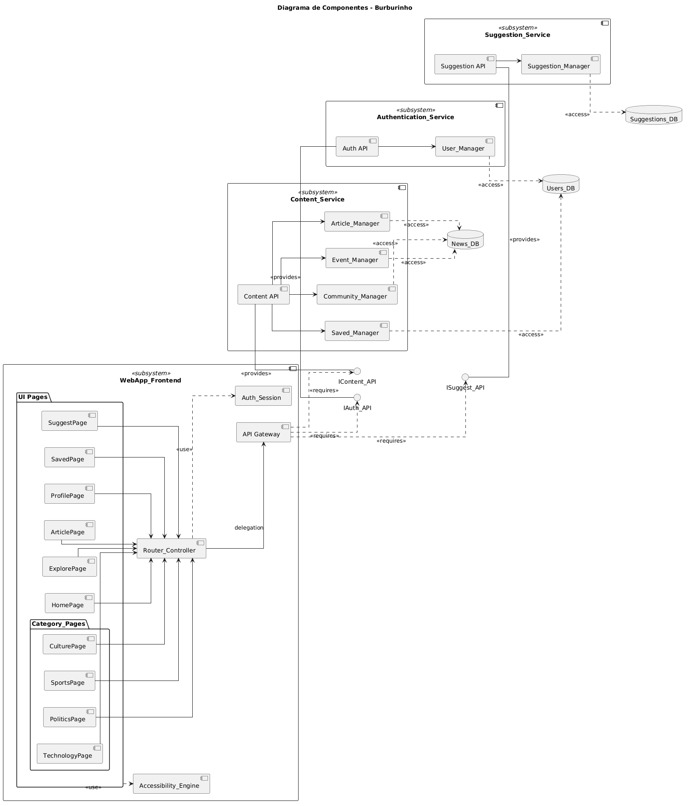
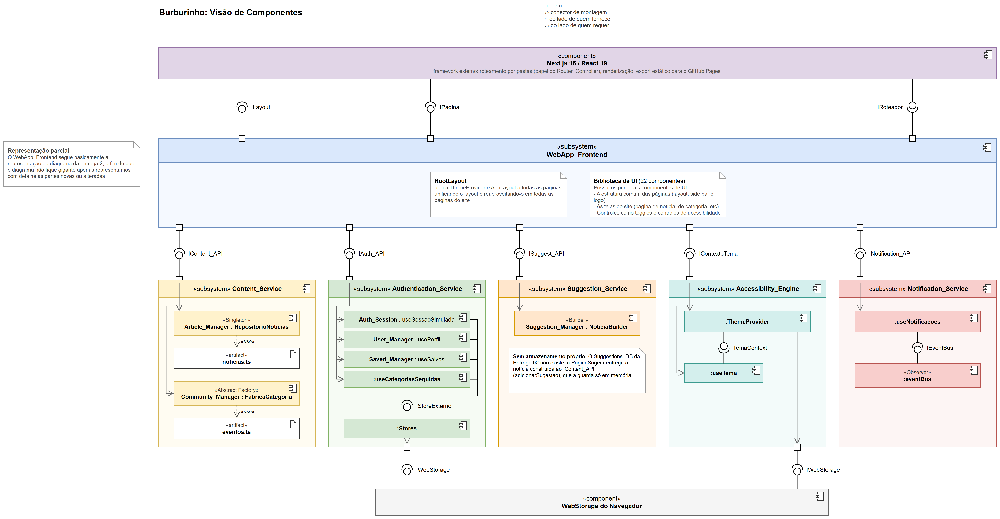

# 1.1.1. Elementos de DAS (Iniciativa Extra)

## Participantes

| Nome do Membro | Contribuição |
| --- | --- |
| João Pedro Lopes | Diagramas de Pacotes e de Componentes, levantamento das dependências reais no código e escrita desta página |

## Representação Arquitetural

O portal é uma aplicação Next.js (React + TypeScript) cujo código fica em [portal/src](https://github.com/UnBArqDsw2026-2-Turma01/2026.2-T01-_G3_ProjetoPortalNoticias_Entrega_04/tree/main/portal/src), organizado em pacotes (pastas) com responsabilidades separadas:

- app contém as rotas, os hot spots que o framework chama (layout.tsx, page.tsx)
- components contém os componentes reutilizáveis de interface
- hooks e contexts contêm a lógica reutilizável que os componentes consomem
- lib e padroes contêm a lógica sem interface, incluindo os GoFs reaproveitados da Entrega 03
- data e types contêm os dados de exemplo e os contratos compartilhados (Noticia, Categoria)

A regra de dependência é que as importações só "descem", ou seja, páginas usam componentes, componentes usam hooks, hooks usam lib, e lib usa data e types, nenhum pacote de baixo importa um de cima, tendo em vista que é isso que permite reutilizar um componente em outra tela sem levar junto a página que o usa.

## Visão Lógica: Diagrama de Pacotes

Na entrega 2, já havíamos feito um diagrama de pacotes que representa como imaginávamos a comuniação entre as diferentes partes da aplicação

<figcaption>
    

        Figura: Diagrama de pacotes do portal Burburinho na Entrega 2 (Fonte: <a href="https://unbarqdsw2026-2-turma01.github.io/2026.2-T01-_G3_ProjetoPortalNoticias_Entrega_02/Base/Relat%C3%B3rios/1.1.1.SubEquipe_01/#diagrama-de-pacotes" target="_blank" rel="noopener noreferrer">SubEquipe 01</a>, 2026) - <a href="../../../assets/diagramas/diagrama-pacotes-entrega-2.svg" target="_blank" rel="noopener noreferrer">Ver em tela cheia</a>
    

</figcaption>

<figcaption>
    

        Figura: Diagrama de pacotes do portal Burburinho em camadas, representa o escopo da Entrega 4 (Fonte: <a href="https://github.com/ojplc" target="_blank" rel="noopener noreferrer">João Cruz</a>, 2026) - <a href="../../../assets/diagramas/pacotes-camadas.png" target="_blank" rel="noopener noreferrer">Ver em tela cheia</a> - <a href="https://github.com/UnBArqDsw2026-2-Turma01/2026.2-T01-_G3_ProjetoPortalNoticias_Entrega_04/blob/main/docs/assets/diagramas/pacotes-camadas.drawio" target="_blank" rel="noopener noreferrer">Código draw.io do diagrama</a>
    

</figcaption>

Diferentemente do diagrama da entrega 2, deixamos de fora a "Camada de Serviços Anônimos". Ela continha apenas a "Busca de notícia", e no portal a busca não depende de o leitor estar logado, pois a barra de busca e a página de resultados aparecem para qualquer pessoa e usam o mesmo "Acesso a Dados" que atende a página inicial, as categorias e as notícias. Como não há backend nem autenticação real, a diferença entre leitor anônimo e logado não separa pacotes, ela é apenas uma condição verificada nas telas pela sessão. Desse modo, optamos pela a remoção da camada de serviços anônimos, uma vez que manter uma camada só para a busca criaria um pacote quase vazio e separaria o acesso às notícias em dois lugares, sem ganho real de reutilização.

Essa decisão também culminou em outra alteração no diagrama da entrega 2, chegamos a conclusão que a camada "Serviços de Usuários" deveria estar acima da camada "Aplicação", pois pensando na questão da abstração dos pacotes os "Serviços de Usuários" estão mais próximos do usuário final do que a camda de "Aplicação" que lida com o acesso a dados e com as regras de negócio do site.

Além disso, por estarmos lidando apenas com uma versão mockada da aplicação a camada de infraestrutura foi reduzida em apenas o armazenamento local das informações do site, e os modelos (data types e utilitários) são usados por todas as camadas.

## Visão de Componentes: Diagrama de Componentes UML

O primeiro diagrama de componentes que o grupo criou foi durante a entrega 2, ele separava a aplicação em 4 subsistemas principais, o frontend, o módulo de conteúdo, serviço de autenticação e o serviço de sugestões. Além disso, o diagrama deixa claro a intenção de separar em diferentes bancos as informações de acordo com a sua origem e quais subsistemas consomem aquela informação:

<figcaption>
    

        Figura: Diagrama de componentes do portal Burburinho na Entrega 2 (Fonte: <a href="https://unbarqdsw2026-2-turma01.github.io/2026.2-T01-_G3_ProjetoPortalNoticias_Entrega_02/Base/Relat%C3%B3rios/1.1.3.SubEquipe_03/#modelo-estatico" target="_blank" rel="noopener noreferrer">Giovanna</a>, 2026) - <a href="../../../assets/diagramas/componentes-entrega2.png" target="_blank" rel="noopener noreferrer">Ver em tela cheia</a>
    

</figcaption>

Partindo dessa ideia inicial, na entrega 4 optamos por detalhar mais os componentes referentes às funcionalidades do site as quais o usuário possui contato direto e que não tiveram sua devida atenção no diagrama inicial (acessibilidade e notificações). Desse modo, um novo diagrama de componentes foi feito detalhando os subsistemas já levando em conta a sua possível reutilização:

<figcaption>
    

        Figura: Diagrama de componentes do portal Burburinho por responsabilidade, a partir do diagrama da Entrega 2 (Fonte: <a href="https://github.com/ojplc" target="_blank" rel="noopener noreferrer">João Cruz</a>, 2026) - <a href="../../../assets/diagramas/componentes-responsabilidades-hooks-separados.png" target="_blank" rel="noopener noreferrer">Ver em tela cheia</a> - <a href="https://github.com/UnBArqDsw2026-2-Turma01/2026.2-T01-_G3_ProjetoPortalNoticias_Entrega_04/blob/main/docs/assets/diagramas/componentes-responsabilidades-hooks-separados.drawio" target="_blank" rel="noopener noreferrer">Código draw.io do diagrama</a>
    

</figcaption>

O novo diagrama foi criado para representar o escopo do grupo nessa entrega, ele aproveita alguns elementos do diagrama criado pela Giovanna Felipe na segunda entrega, como o subsistema "WebApp_Frontend" que é referenciado no novo diagrama e está em mais detalhes no diagrama da entrega 2. Na nomeação das partes internas de cada subsistema seguiu-se a notação UML usando da regra de nomeação de instâncias de [Instance Specification do site uml-diagrams](https://www.uml-diagrams.org/uml-core.html#instance-specification-core): antes dos dois-pontos fica o papel que a parte cumpre, reaproveitado do diagrama da entrega 2 (ex.: "Article_Manager"), e depois o tipo que a implementa no código (ex.: "RepositorioNoticias"). Quando não havia papel equivalente na entrega 2, a parte ficou anônima, apenas com o tipo após os dois-pontos (ex.: ":eventBus").

??? note "Content_Service"

    O "Content_Service" mantém o nome e o papel do diagrama inicial, concentrando as notícias e as categorias do portal. O "Article_Manager" é o "RepositorioNoticias", um Singleton que lista, busca e entrega as notícias a partir do arquivo de dados de exemplo (noticias.ts). Já o "Community_Manager" é a "FabricaCategoria", um Abstract Factory que gera o tema, a apresentação e a seção de cada categoria, permitindo que uma única página atenda as quatro categorias que antes eram páginas separadas e incorporando a agenda cultural do antigo "Event_Manager" (eventos.ts).

??? note "Authentication_Service"

    O "Authentication_Service" também mantém o nome do diagrama inicial, mas como não há backend o login é apenas simulado. Ele reúne tudo o que é próprio do usuário: a sessão, o perfil, as notícias salvas e as categorias seguidas. Todos esses hooks leem e gravam nas ":Stores" através da interface "IStoreExterno", que persistem os dados no navegador e avisam as telas a cada mudança.

??? note "Suggestion_Service"

    A nossa implementação do "Suggestion_Service" foi bem simplificada, apenas o builder da notícia para centralizar a montagem e a validação da sugestão (título, categoria, parágrafos e autor) em um só lugar. E como citado no próprio diagrama não implementamos armazenamento próprio, guardamos a notícia montada apenas em memória.

??? note "Accessibility_Engine"

    Diferentemente do diagrama inicial, optamos por colocar o "Accessibility_Engine" como um subsistema próprio fora de "WebApp_Frontend", uma vez que ele permeia todas as telas, através do RootLayout, sem necessariamente ser uma tela (pensando no "motor de acessibilidade" e não na página de configurações de acessibilidade). O "Accessibility_Engine" também possui o seu próprio estado e persistência que ficam salvos no navegdor do usuário, requerendo acesso ao "IWebStorage" assim como os serviços de autenticação.

??? note "Notification_Service"

    O subsistema "Notification_Service" não existia no diagrama inicial e representa o sino de notificações ("NotificationBell") da página inicial. Ele combina o "useNotificacoes", que guarda as notificações e conta as não lidas, com o "eventBus", uma implementação do padrão Observer.

Desse modo, percebe-se que os módulos de conteúdo relacionado ao usuário são independentes entre si, permitindo a substituição de um módulo sem afetar os demais. O único subsistema que poderia causar uma dificuldade maior em sua substituição seria a camada de frontend que aproveita o framework do React e atua requerendo dados dos demais módulos através de interfaces dedicadas.

Como a quarta entrega será apenas um site estático, o backend não foi detalhado (API Gateway e Router_Controller por exemplo), nem a camada de persistência que estaria presente na aplicação completa (separando em bancos diferentes a depender do conteúdo).

### Relação dos componentes com o Código

| Elemento do diagrama | Arquivo no código |
| --- | --- |
| Next.js 16 / React 19 - IRoteador | [package.json](https://github.com/UnBArqDsw2026-2-Turma01/2026.2-T01-_G3_ProjetoPortalNoticias_Entrega_04/blob/main/portal/package.json) (Next.js 16, React 19) |
| WebApp_Frontend - RootLayout **Como o diagrama evidencia a reutilização:** pelos estereótipos «Singleton», «Abstract Factory», «Builder» e «Observer», cada um como parte de um subsistema. ILayout | [app/layout.tsx](https://github.com/UnBArqDsw2026-2-Turma01/2026.2-T01-_G3_ProjetoPortalNoticias_Entrega_04/blob/main/portal/src/app/layout.tsx) |
| WebApp_Frontend - UI Pages - IPagina | [app/](https://github.com/UnBArqDsw2026-2-Turma01/2026.2-T01-_G3_ProjetoPortalNoticias_Entrega_04/tree/main/portal/src/app) (as 9 page.tsx e [app/_home/PaginaInicial.tsx](https://github.com/UnBArqDsw2026-2-Turma01/2026.2-T01-_G3_ProjetoPortalNoticias_Entrega_04/blob/main/portal/src/app/_home/PaginaInicial.tsx)) |
| WebApp_Frontend - Biblioteca de UI | [components/](https://github.com/UnBArqDsw2026-2-Turma01/2026.2-T01-_G3_ProjetoPortalNoticias_Entrega_04/tree/main/portal/src/components) (22 componentes) |
| Content_Service - IContent_API - Article_Manager : RepositorioNoticias «Singleton» | [lib/repositorioNoticias.ts](https://github.com/UnBArqDsw2026-2-Turma01/2026.2-T01-_G3_ProjetoPortalNoticias_Entrega_04/blob/main/portal/src/lib/repositorioNoticias.ts) - [data/noticias.ts](https://github.com/UnBArqDsw2026-2-Turma01/2026.2-T01-_G3_ProjetoPortalNoticias_Entrega_04/blob/main/portal/src/data/noticias.ts) |
| Content_Service - Community_Manager : FabricaCategoria «Abstract Factory» | [padroes/fabricaCategorias.ts](https://github.com/UnBArqDsw2026-2-Turma01/2026.2-T01-_G3_ProjetoPortalNoticias_Entrega_04/blob/main/portal/src/padroes/fabricaCategorias.ts) - [data/eventos.ts](https://github.com/UnBArqDsw2026-2-Turma01/2026.2-T01-_G3_ProjetoPortalNoticias_Entrega_04/blob/main/portal/src/data/eventos.ts) |
| Authentication_Service - IAuth_API - Auth_Session : useSessaoSimulada | [hooks/useSessaoSimulada.ts](https://github.com/UnBArqDsw2026-2-Turma01/2026.2-T01-_G3_ProjetoPortalNoticias_Entrega_04/blob/main/portal/src/hooks/useSessaoSimulada.ts) |
| Authentication_Service - User_Manager : usePerfil | [hooks/usePerfil.ts](https://github.com/UnBArqDsw2026-2-Turma01/2026.2-T01-_G3_ProjetoPortalNoticias_Entrega_04/blob/main/portal/src/hooks/usePerfil.ts) |
| Authentication_Service - Saved_Manager : useSalvos | [hooks/useSalvos.ts](https://github.com/UnBArqDsw2026-2-Turma01/2026.2-T01-_G3_ProjetoPortalNoticias_Entrega_04/blob/main/portal/src/hooks/useSalvos.ts) |
| Authentication_Service - :useCategoriasSeguidas | [hooks/useCategoriasSeguidas.ts](https://github.com/UnBArqDsw2026-2-Turma01/2026.2-T01-_G3_ProjetoPortalNoticias_Entrega_04/blob/main/portal/src/hooks/useCategoriasSeguidas.ts) |
| Authentication_Service - :Stores - IStoreExterno | [lib/sessaoSimulada.ts](https://github.com/UnBArqDsw2026-2-Turma01/2026.2-T01-_G3_ProjetoPortalNoticias_Entrega_04/blob/main/portal/src/lib/sessaoSimulada.ts) - [lib/noticiasSalvas.ts](https://github.com/UnBArqDsw2026-2-Turma01/2026.2-T01-_G3_ProjetoPortalNoticias_Entrega_04/blob/main/portal/src/lib/noticiasSalvas.ts) - [lib/categoriasSeguidas.ts](https://github.com/UnBArqDsw2026-2-Turma01/2026.2-T01-_G3_ProjetoPortalNoticias_Entrega_04/blob/main/portal/src/lib/categoriasSeguidas.ts) |
| Suggestion_Service - ISuggest_API - Suggestion_Manager : NoticiaBuilder «Builder» | [padroes/NoticiaBuilder.ts](https://github.com/UnBArqDsw2026-2-Turma01/2026.2-T01-_G3_ProjetoPortalNoticias_Entrega_04/blob/main/portal/src/padroes/NoticiaBuilder.ts) |
| Accessibility_Engine - IContextoTema - :ThemeProvider - TemaContext | [contexts/ThemeProvider.tsx](https://github.com/UnBArqDsw2026-2-Turma01/2026.2-T01-_G3_ProjetoPortalNoticias_Entrega_04/blob/main/portal/src/contexts/ThemeProvider.tsx) |
| Accessibility_Engine - :useTema | [hooks/useTema.ts](https://github.com/UnBArqDsw2026-2-Turma01/2026.2-T01-_G3_ProjetoPortalNoticias_Entrega_04/blob/main/portal/src/hooks/useTema.ts) |
| Notification_Service - INotification_API - :useNotificacoes | [hooks/useNotificacoes.ts](https://github.com/UnBArqDsw2026-2-Turma01/2026.2-T01-_G3_ProjetoPortalNoticias_Entrega_04/blob/main/portal/src/hooks/useNotificacoes.ts) |
| Notification_Service - :eventBus «Observer» - IEventBus | [padroes/eventBus.ts](https://github.com/UnBArqDsw2026-2-Turma01/2026.2-T01-_G3_ProjetoPortalNoticias_Entrega_04/blob/main/portal/src/padroes/eventBus.ts) |

## IA Generativa

| Nome do Membro | Lições Aprendidas | Uso da IA Generativa (SENSO CRÍTICO) |
| --- | --- | --- |
| João Pedro Lopes | Aprendi que a diagramação que estará no DAS deve ser viva, ou seja, atualizada constantemente assim como o código. Pensando apenas na disciplina acabou que deixamos para fazer o DAS completo apenas ao final da implementação para evitar retrabalho constante, contudo entendo que em um sistema mais complexo os diagramas seriam basicamente impossíveis de ser produzidos apenas ao final da implementação, além disso, o valor da diagramação é transmitir a arquitetura do código de forma visual, então acredito que se o diagrama tivesse sido feito como algo colaborado entre todos os colegas teria sido mais proveitoso (cada um desenhando a sua parte implementada). | Usei o Claude Code para levantar as dependências a partir das linhas import de portal/src, gerar os arquivos .drawio por script, comparar o diagrama novo com o da entrega 2 e revisar a notação com base no uml-diagrams.org. A IA acelerou a montagem, mas as decisões de modelagem foram minhas: reaproveitar os nomes da entrega 2, tirar o Accessibility_Engine de dentro do frontend, separar os hooks do Authentication_Service e simplificar as anotações do diagrama. Também testei uma versão em Mermaid e a descartei, porque ela não representa portas nem conectores bola-soquete. Validei cada ligação abrindo os imports no código e cada imagem exportada visualmente, e usei a documentação do uml-diagrams.org, e não a resposta da IA, para justificar a notação. |

## Versionamento

| Nome do Membro | Contribuição | Data |
| --- | --- | --- |
| Giovanna Felipe | Estruturação da página como iniciativa extra, com guia de preenchimento | 18/11/2026 |
| João Pedro Lopes | Versão preliminar dos diagramas de Pacotes e de Componentes e de todas as seções da página ([issue #2](https://github.com/UnBArqDsw2026-2-Turma01/2026.2-T01-_G3_ProjetoPortalNoticias_Entrega_04/issues/2)) | 19/11/2026 |
| João Pedro Lopes | Diagrama de componentes comparando com o da entrega 2 para comparação de melhorias e escopo do código | 23/11/2026 |

## Referências

UNIVERSIDADE FEDERAL DO RIO GRANDE DO NORTE. **Modelo de Documento de Arquitetura de Software**. Disponível em: <https://www.dca.ufrn.br/~anderson/FTP/dca0120/modelodocarquiteturasoftware.doc>. Acesso em: 19 nov. 2026.

OBJECT MANAGEMENT GROUP. **OMG Unified Modeling Language (OMG UML), Version 2.5.1**. 2017. Disponível em: <https://www.omg.org/spec/UML/2.5.1>. Acesso em: 19 nov. 2026.

FAKHROUTDINOV, Kirill. **UML Property**. uml-diagrams.org. Disponível em: <https://www.uml-diagrams.org/property.html>. Acesso em: 23 nov. 2026.

FAKHROUTDINOV, Kirill. **UML Core: Instance Specification**. uml-diagrams.org. Disponível em: <https://www.uml-diagrams.org/uml-core.html#instance-specification-core>. Acesso em: 23 nov. 2026.

