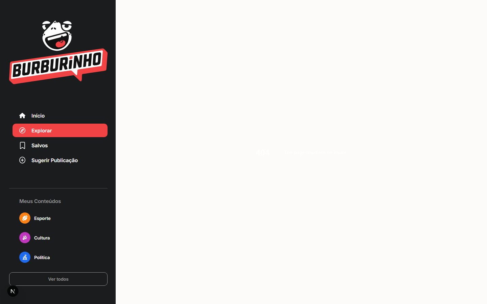
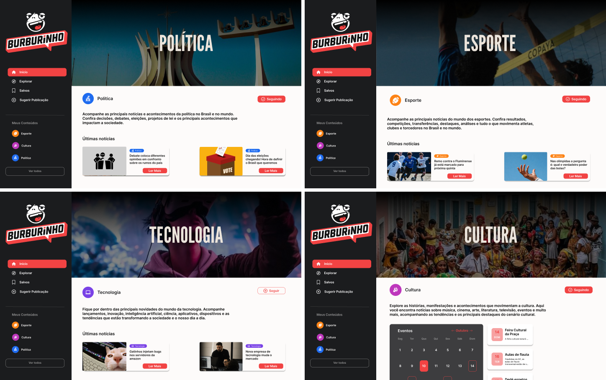
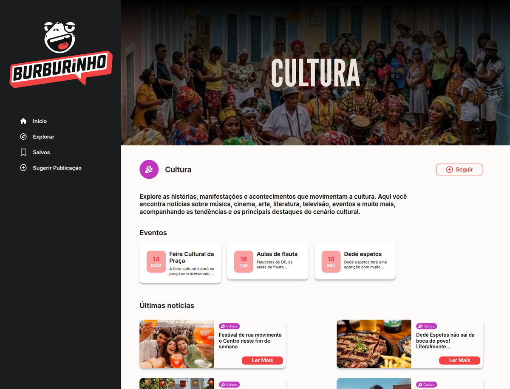
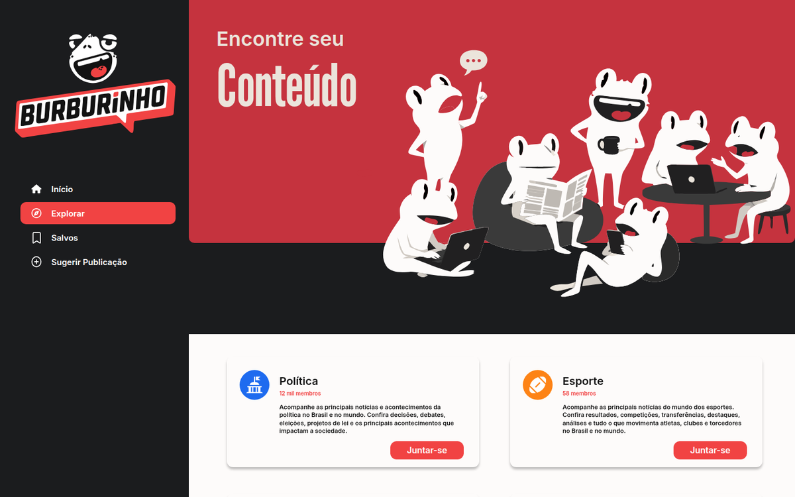
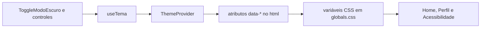
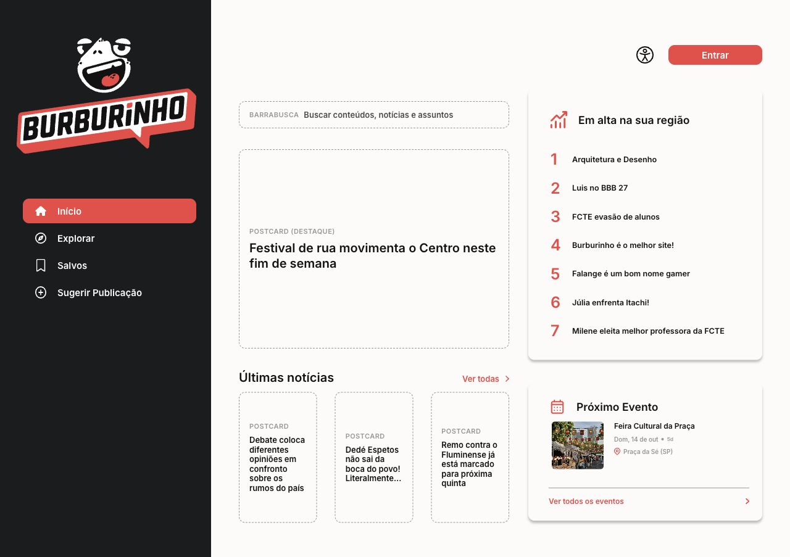
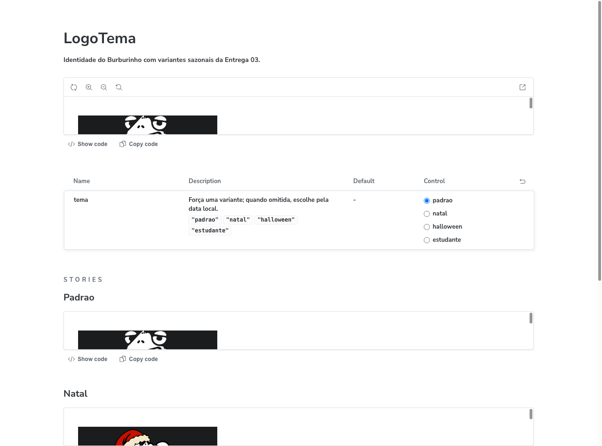

# 1.1.2. Reutilização de Software

<!--
================================================================================
GUIA DE PREENCHIMENTO: comentários HTML como este NÃO aparecem no site.
- Cada pessoa preenche a SUA frente (seções "Reutilização 1" a "Reutilização 7" ou as seções da vaga 8),
  a SUA linha no Foco_02 e a(s) SUA(s) linha(s) em Versionamentos.
- O passo a passo de cada frente está na issue correspondente no GitHub (Issues > milestone "Entrega 04").
- Apague o comentário "O QUE ESCREVER AQUI" depois de preencher. NÃO omita tópicos (orientação da professora).
- Links para código: SEMPRE absolutos (https://github.com/...). Links relativos para fora de docs/ quebram o build do site.
- Referência teórica: PDF da aula "Reutilização & Framework" (Profa. Milene Serrano, no Aprender3). Cite o número do slide.
================================================================================
-->

## Focos do Relatório

### FOCO_01: Reutilização de Software

Entrega Mínima: Evidência de Reutilização (Components do React documentados e demonstrados em uso).

### Participantes no Foco_01

<!-- O QUE ESCREVER AQUI: cada pessoa completa a própria linha (frente assumida e número da issue). -->

| Nome do Membro | Frente | Componentes / Produtos | Issue |
| --- | --- | --- | --- |
| Giovanna Aguiar | Tema e Acessibilidade (Reutilização 6) | `ThemeProvider`, `useTema`, `ToggleModoEscuro`, páginas Acessibilidade e Perfil | [#6](https://github.com/UnBArqDsw2026-2-Turma01/2026.2-T01-_G3_ProjetoPortalNoticias_Entrega_04/issues/6) |
| André Henrique | Cards e Páginas de Categoria (Reutilização 3) | `PostCard` (3 variantes), `BadgeCategoria`, `PaginaCategoria` + fábrica de categorias (Abstract Factory da Entrega 03), `BotaoSeguir`, `CardComunidade`, tela Explorar, `useCategoriasSeguidas`, `TempoPublicacao` | [#3](https://github.com/UnBArqDsw2026-2-Turma01/2026.2-T01-_G3_ProjetoPortalNoticias_Entrega_04/issues/3) |
| Giovanna Felipe | | | |
| João Pedro Lopes | Navegação e Layout (Reutilização 2) + Elementos de DAS | `SideBar` (4 variantes), `AppLayout`, Home logado/deslogado, `CardEmAlta`, `CardEvento`, `useSessaoSimulada`; diagramas de Pacotes e de Componentes | [#2](https://github.com/UnBArqDsw2026-2-Turma01/2026.2-T01-_G3_ProjetoPortalNoticias_Entrega_04/issues/2) |
| Johnnatan de Salles | | | |
| Júlia Gabriella | | | |
| Luís Cunha | Página de Notícia e Sugerir Publicação (Reutilização 4): `PaginaNoticia`, `BotaoAcao`, `CampoFormulario` e adaptação do `NoticiaBuilder`, com stories, testes e documentação | [#4](https://github.com/UnBArqDsw2026-2-Turma01/2026.2-T01-_G3_ProjetoPortalNoticias_Entrega_04/issues/4) |
| Matheus Eiki | Busca, Notificações e Salvos (Reutilização 5) | `BarraBusca` (busca com debounce 300 ms, dropdown tipo Instagram/TikTok), `NotificationBell` (sino + contador + dropdown), `useSalvos` (persistência localStorage, usado pelo botão Salvar da Notícia e pela página Salvos), `useNotificacoes` (Observer via eventBus, 3 notificações de exemplo), página `/salvos`, página `/busca`, `portal/src/padroes/eventBus.ts` | [#5](https://github.com/UnBArqDsw2026-2-Turma01/2026.2-T01-_G3_ProjetoPortalNoticias_Entrega_04/issues/5) |

### Metodologia do Foco_01

<!-- O QUE ESCREVER AQUI (vaga 8, com insumos de todos):
1. Como nos organizamos: issues no GitHub (1 por frente + cronograma), dependências entre elas e prazos escalonados até 22/11.
2. Fluxo de trabalho: branch por issue → Pull Request → revisão de outro membro → merge na main → deploy automático no GitPages.
3. Ferramentas: Figma (protótipo), Next.js/React + TypeScript, Storybook, Vitest, GitHub Actions, MkDocs, IA Generativa.
4. Reuniões: link para as atas em 1.3. Iniciativas Extras.
Um print do quadro de issues ou do histórico de PRs ajuda muito. -->

### Reutilização de Software

#### Visão Geral

<!-- O QUE ESCREVER AQUI (vaga 8): 1 parágrafo apresentando o que foi construído (portal Next.js que implementa as telas do Figma reaproveitando componentes)
e a lista dos NÍVEIS de reutilização, cada um com link para a seção abaixo:
1. Componentes com props (PostCard, BadgeCategoria, BotaoAcao, SideBar...)
2. Composição com children (AppLayout)
3. Hooks customizados (useTema, useSalvos, useNotificacoes)
4. Context API (ThemeProvider: modo escuro + acessibilidade)
5. Componente genérico parametrizado (PaginaCategoria gera as 4 telas de categoria)
6. Reaproveitamento dos GoFs da Entrega 03 (Singleton, Abstract Factory, Builder, Observer, Decorator)
Coloque também os links do portal publicado e do Storybook. -->

#### Fundamentação Teórica Aplicada ao Burburinho

<!--
O QUE ESCREVER AQUI (vaga 8): para CADA subtítulo abaixo:
(1) explique o conceito em 2 a 4 frases com suas palavras, citando o slide do PDF da aula;
(2) mostre ONDE ele aparece no NOSSO código (link absoluto para o arquivo);
(3) dê um exemplo concreto. Não copie os slides: aplique ao projeto.
-->

##### Reutilização Além do Código

<!-- Slide 4: reutilização também em requisitos e projeto. Exemplo nosso: o protótipo do Figma já definia componentes ("Menu de Opções SideBar" usado 22 vezes, "Conteúdo Menor" usado 21 vezes) e o código herdou essa decisão; os GoFs da Entrega 03 foram reaproveitados. -->

##### Framework × Biblioteca (Princípio de Hollywood)

<!-- Slides 45 a 50. Next.js/React = FRAMEWORK: ele chama o nosso código ("Don't call us, we'll call you"): roteamento por pastas (src/app), renderização dos componentes, ciclo de vida dos hooks. Bibliotecas = o que NÓS chamamos (confira o package.json, ex.: Testing Library).
Faça uma tabela: | Item | Framework ou Biblioteca | Quem chama quem | Evidência no código | -->

##### Hot Spots e Frozen Spots

<!-- Slides 11 a 15. Frozen spots = o que o Next/React fixa (motor de renderização, roteador, ciclo de vida). Hot spots = onde encaixamos o nosso código (page.tsx e layout.tsx de cada rota, componentes, props, children, hooks, Providers).
Tabela com 4 a 6 exemplos reais. Opcional: diagrama no estilo do slide 13 (kernel + plugues), feito no draw.io. -->

##### Framework Caixa Branca, Preta e Cinza

<!-- Slides 23 a 28. Nosso uso: por COMPOSIÇÃO (passamos componentes/props: caixa preta) e implementando os "contratos" que o Next espera (page.tsx, layout.tsx: hot spots, caixa branca). Conclusão esperada: uso CAIXA CINZA. Justifique com exemplos do código. -->

##### Formas de Reutilização Presentes no Projeto

<!-- Slide 52 (plugins, serviços, componentes, linhas de produto) e slides 60 e 61 (componentes e interfaces). Diga quais aparecem no Burburinho e quais NÃO aparecem (senso crítico). -->

##### Padrões de Projeto × Framework

<!-- Slides 17 a 21 e 76 a 78. Um framework CONTÉM padrões: ex. Context/Provider se parece com Observer; composição de componentes se parece com Composite/Decorator. E os GoFs da Entrega 03 viraram peças do app (link para as seções abaixo). -->

<!--
==================== MODELO DAS SEÇÕES "Reutilização 1 a 7" ====================
Cada responsável preenche os 8 subtítulos da sua seção:
- Contexto (Problema de Repetição): qual repetição existia no Figma? Em quantas telas? Link do nó no Figma + print.
- Ponto de Reutilização e Relação com a Teoria: qual nível de reutilização (props / children / hook / Context / genérico / GoF da Entrega 03)
  e por quê; cite 1 ou 2 slides. Se reaproveitou GoF da Entrega 03, link para o código antigo e diga o que mudou na adaptação para React.
- Contrato do Componente (Props): tabela | Prop | Tipo | Obrigatória? | Padrão | Descrição | (para hooks: parâmetros e retorno).
- Onde é Reutilizado: tabela | Tela/rota | Arquivo que usa (link) | Props passadas |. Mínimo 2 usos. É o CORAÇÃO da evidência.
- Implementação (Código): trecho curto (10 a 30 linhas) em bloco ```tsx + link do arquivo.
- Demonstração em Uso: link da story no Storybook publicado + prints do componente em 2 telas (GIF opcional).
- Uso da IA Generativa na Minha Solução: ferramenta, para quê, o que aceitou, o que corrigiu e POR QUÊ; 1 exemplo concreto.
- Senso Crítico: limites, o que NÃO abstraiu de propósito, o que faria com mais tempo.
===============================================================================
-->

#### Reutilização 1: Projeto Base, Camada de Dados e Identidade Visual

**Responsável:** Giovanna Felipe ([issue #1](https://github.com/UnBArqDsw2026-2-Turma01/2026.2-T01-_G3_ProjetoPortalNoticias_Entrega_04/issues/1) · [PR #11](https://github.com/UnBArqDsw2026-2-Turma01/2026.2-T01-_G3_ProjetoPortalNoticias_Entrega_04/pull/11))

##### Contexto (Problema de Repetição)

No [Figma](https://www.figma.com/design/LnkN55jPy6jk8dsjpmYJSF/Prot%C3%B3tipo?node-id=0-1), a mesma notícia aparece na Home, nas categorias, na tela de Notícia e em Salvos, e **toda tela tem versão DarkMode**. Sem uma base comum, cada tela definiria a própria forma da notícia, filtraria os dados do seu jeito e repetiria cores fixas, o que obrigaria a duplicar estilos para o modo escuro.

##### Ponto de Reutilização e Relação com a Teoria

Esta frente não é um componente visual, e sim a **base que todos os componentes reutilizam**:

| O que é reutilizado | Como | Quem reutiliza |
| --- | --- | --- |
| Contrato (`Noticia`, `Categoria`) | tipos TypeScript em um único arquivo | todo o portal |
| Dados e consultas (`repositorioNoticias`) | **Singleton reaproveitado da Entrega 03** | páginas e componentes que listam notícias |
| Estilo | variáveis CSS extraídas do Figma (`var(--cor-primaria)`) | todos os componentes; o modo escuro troca só as variáveis |

Na aula (slides 11 a 15), *frozen* e *hot spots* são conceitos do framework em relação à aplicação: para o Next.js, todo o nosso `src/` é hot spot, código que o framework chama (Princípio de Hollywood, slides 45 a 50). Dentro da nossa arquitetura, esta base é o **núcleo estável do domínio**, sobre o qual os componentes se apoiam, e o repositório é chamado por nós, não pelo framework. O Singleton mostra um padrão de projeto vivendo dentro do app (slides 76 a 78).

| Singleton na Entrega 03 (JavaScript) | Na Entrega 04 (TypeScript) |
| --- | --- |
| Truque com a flag `#liberado`: bloqueia `new` em tempo de execução | `private constructor`: o compilador impede `new`, mas só na compilação (o `private` some no JavaScript gerado) |
| Objetos sem formato definido | Notícias seguem o contrato `Noticia` |
| Devolvia a lista com os mesmos objetos internos | Devolve cópias de cada notícia (encapsulamento, slide 42) |

##### Contrato do Componente (Props)

| Método | Retorno | Quem usa |
| --- | --- | --- |
| `listarTodas()` / `listarRecentes(n)` | notícias da mais recente para a mais antiga | Home, rotas dinâmicas |
| `buscarPorId(id)` | `Noticia` ou `undefined` | Notícia, Salvos |
| `listarPorCategoria(categoria)` | notícias da categoria | `PaginaCategoria` |
| `listarDestaques()` | notícias com `destaque: true` | card de destaque da Home |
| `buscar(termo)` | busca em título, resumo e autor, sem acentos | `BarraBusca` |
| `adicionarSugestao(noticia)` / `listarSugestoes()` | sugestões de leitores, separadas das publicadas | Sugerir Publicação |

Não há métodos para editar ou apagar notícias, porque nenhuma tela do protótipo usa.

##### Onde é Reutilizado

<!-- PENDENTE (Giovanna, 21/11 à noite): refazer a contagem com o código de todos no main (Ctrl+Shift+F em portal/src por "repositorioNoticias", ignorando .test e .stories). -->

| Item | Arquivos que usam |
| --- | --- |
| `repositorioNoticias` | [`app/page.tsx`](https://github.com/UnBArqDsw2026-2-Turma01/2026.2-T01-_G3_ProjetoPortalNoticias_Entrega_04/blob/main/portal/src/app/page.tsx) (previstos: `PaginaCategoria`, Notícia, `BarraBusca`, Salvos, Sugerir Publicação) |
| `Noticia` / `Categoria` | dados, repositório, página inicial e todos os componentes de conteúdo |
| Variáveis CSS | todos os arquivos `*.module.css` |

##### Implementação (Código)

[`repositorioNoticias.ts`](https://github.com/UnBArqDsw2026-2-Turma01/2026.2-T01-_G3_ProjetoPortalNoticias_Entrega_04/blob/main/portal/src/lib/repositorioNoticias.ts) (trecho):

```ts
export class RepositorioNoticias {
  private static instancia: RepositorioNoticias | null = null;

  private constructor(noticiasIniciaisDoPortal: Noticia[]) {
    this.noticias = noticiasIniciaisDoPortal.map(copiar);
  }

  static getInstancia(): RepositorioNoticias {
    if (RepositorioNoticias.instancia === null) {
      RepositorioNoticias.instancia = new RepositorioNoticias(noticiasIniciais);
    }
    return RepositorioNoticias.instancia;
  }
}

export const repositorioNoticias = RepositorioNoticias.getInstancia();
```

Demais arquivos: [`types/noticia.ts`](https://github.com/UnBArqDsw2026-2-Turma01/2026.2-T01-_G3_ProjetoPortalNoticias_Entrega_04/blob/main/portal/src/types/noticia.ts) · [`globals.css`](https://github.com/UnBArqDsw2026-2-Turma01/2026.2-T01-_G3_ProjetoPortalNoticias_Entrega_04/blob/main/portal/src/app/globals.css) (tokens) · [`data/noticias.ts`](https://github.com/UnBArqDsw2026-2-Turma01/2026.2-T01-_G3_ProjetoPortalNoticias_Entrega_04/blob/main/portal/src/data/noticias.ts) · [workflow de deploy](https://github.com/UnBArqDsw2026-2-Turma01/2026.2-T01-_G3_ProjetoPortalNoticias_Entrega_04/blob/main/.github/workflows/deploy-mkdocs.yml)

##### Demonstração em Uso

[Portal publicado](https://unbarqdsw2026-2-turma01.github.io/2026.2-T01-_G3_ProjetoPortalNoticias_Entrega_04/portal/), atualizado automaticamente a cada merge na `main`, e [14 testes automatizados](https://github.com/UnBArqDsw2026-2-Turma01/2026.2-T01-_G3_ProjetoPortalNoticias_Entrega_04/blob/main/portal/src/lib/repositorioNoticias.test.ts) (instância única, filtros, busca, encapsulamento e sugestões).

<!-- PENDENTE (Giovanna): depois do merge, inserir 1 print do Actions verde e 1 do portal no ar, salvos em docs/assets/reutilizacao/:  -->

##### Uso da IA Generativa na Minha Solução

Usei IA generativa de duas formas. Para **produzir**, o Claude (no VS Code) gerou a configuração do projeto, o repositório, os testes e os workflows, e eu revisei antes do merge. Para **aprender**, usei o Gemini para entender as decisões do código antes de documentá-las ([conversa](https://share.gemini.google/wtrhovOXgWjN)). O que mais pesou:

1. **Versão do framework:** o Next.js 16 é mais novo do que o conhecimento da IA. A configuração foi validada na documentação do próprio pacote, e assim apareceu a regra de rotas dinâmicas (`dynamicParams = false`), testada antes de entrar no README do grupo.
2. **Bug pego por teste:** a primeira versão devolvia uma cópia da lista, mas com os mesmos objetos internos. O teste de encapsulamento falhou e a correção foi copiar cada notícia. Com o Gemini entendi que isso é uma *cópia rasa direcionada*: basta porque a `Noticia` não tem objetos aninhados.
3. **Uma IA corrigindo a outra:** o primeiro rascunho deste relatório chamava a nossa base de "frozen spot". Perguntando ao Gemini, entendi que frozen/hot spot é um conceito do framework em relação à aplicação, então o texto foi corrigido.
4. **E a IA também deixou passar algo:** o Gemini explicou o modo escuro dizendo que `[data-tema="escuro"]` "sobrescreve" o `:root`. Conferindo, os dois seletores têm a mesma especificidade, e quem vence é só a ordem no arquivo. Troquei por `:root[data-tema="escuro"]`, que vence independentemente da ordem.

##### Senso Crítico

- **Sem back-end, o Singleton é único por contexto de execução**, e não no portal: há uma instância no build e uma em cada aba de cada leitor. Por isso uma sugestão some ao recarregar. Com uma API, só este arquivo mudaria, porque as telas falam apenas com os métodos do repositório.
- **Proteções com limites:** o `private constructor` só vale na compilação, e a `copiar` deixaria escapar objetos aninhados se a `Noticia` ganhasse algum (aí valeria `structuredClone` ou tipos `Readonly`).
- **Os tokens dependem de disciplina:** nada impede alguém de usar cor fixa, e toda cor nova precisa ser conferida nos dois temas. Um lint de CSS resolveria a primeira parte.
- Os parágrafos das notícias que o Figma não mostra foram completados para a demonstração.

#### Reutilização 2: Navegação e Layout (SideBar, AppLayout, Home)

**Responsável:** João Pedro Lopes ([issue #2](https://github.com/UnBArqDsw2026-2-Turma01/2026.2-T01-_G3_ProjetoPortalNoticias_Entrega_04/issues/2) · branch [`feat/2-navegacao`](https://github.com/UnBArqDsw2026-2-Turma01/2026.2-T01-_G3_ProjetoPortalNoticias_Entrega_04/tree/feat/2-navegacao))

##### Contexto (Problema de Repetição)

No [Figma](https://www.figma.com/design/LnkN55jPy6jk8dsjpmYJSF/Prot%C3%B3tipo?node-id=115-68), **todas as telas** têm a mesma barra lateral escura: logo, os quatro itens do menu (Início, Explorar, Salvos, Sugerir Publicação) e, para quem está logado, a seção "Meus Conteúdos". O menu é o componente [Menu de Opções SideBar](https://www.figma.com/design/LnkN55jPy6jk8dsjpmYJSF/Prot%C3%B3tipo?node-id=46-573), **usado 22 vezes** no protótipo em **4 variantes**. Comparando as variantes, a única diferença é **qual item fica destacado** (Padrão = Início, Variante 2 = Explorar, Variante 3 = Salvos, Variante 4 = Sugerir Publicação).

Sem reutilização, cada uma das cerca de 10 rotas do portal repetiria a barra lateral e o próprio menu repetiria quatro blocos de JSX quase iguais. Uma mudança simples (um item novo, outra cor de destaque) teria de ser feita em todos os lugares.

A Home tem duas versões no Figma, [logado](https://www.figma.com/design/LnkN55jPy6jk8dsjpmYJSF/Prot%C3%B3tipo?node-id=6-5) e [deslogado](https://www.figma.com/design/LnkN55jPy6jk8dsjpmYJSF/Prot%C3%B3tipo?node-id=115-144), que diferem em poucos pontos: saudação, avatar ou botão "Entrar", quantidade de assuntos em alta e a seção "Meus Conteúdos" da SideBar.

##### Ponto de Reutilização e Relação com a Teoria

Esta frente mostra **dois níveis diferentes** de reutilização de componentes:

| Nível | Onde | Como funciona |
| --- | --- | --- |
| **Props e variantes** | `SideBar` | Um só componente; a prop `itemAtivo` escolhe uma das 4 variantes do Figma. Sem a prop, o item ativo é descoberto pela URL (`usePathname`). |
| **Configuração como dados** | `ITENS_MENU` | Os itens do menu são um array `{ id, rotulo, href, icone }`. O JSX percorre o array uma única vez; incluir uma opção no menu é acrescentar uma linha, sem mexer no componente. |
| **Composição com `children`** | `AppLayout` | Recebe a página como `children` e a coloca ao lado da SideBar. O `AppLayout` não sabe qual página vai receber. |
| **Lógica em hook** | `useSessaoSimulada` | O mesmo hook informa o login simulado à `SideBar` ("Meus Conteúdos") e à Home (saudação, Entrar/Sair). |

**Relação com a teoria:**

- **Hot spot do framework (slides 11 a 14):** o `layout.tsx` raiz é um ponto que o Next.js chama e nós preenchemos. Ao colocar o `AppLayout` ali, a barra lateral aparece em todas as rotas sem que nenhuma `page.tsx` a importe. É o Princípio de Hollywood (slides 45 a 50): não chamamos o layout; o framework chama e encaixa cada página em `{children}`.
- **Composição como reutilização caixa preta (slides 23 a 26):** quem usa o `AppLayout` não conhece nem altera o seu interior; só entrega um conteúdo. Já a `SideBar` é configurada por props, também sem herança nem alteração do código interno.
- **Componentes e interfaces (slides 60 e 61):** cada componente expõe um contrato (as props) e depende de contratos de outros. Isso está desenhado no [diagrama de componentes](1.1.1.DAS.md#visao-de-componentes-diagrama-de-componentes-uml) da página 1.1.1.

##### Contrato do Componente (Props)

**`SideBar`** ([código](https://github.com/UnBArqDsw2026-2-Turma01/2026.2-T01-_G3_ProjetoPortalNoticias_Entrega_04/blob/main/portal/src/components/SideBar/SideBar.tsx))

| Prop | Tipo | Obrigatória? | Padrão | Descrição |
| --- | --- | --- | --- | --- |
| `itemAtivo` | `'inicio' \| 'explorar' \| 'salvos' \| 'sugerir'` | Não | item da URL atual | Força a variante do Figma (item destacado). |
| `logado` | `boolean` | Não | login simulado | Mostra ou esconde "Meus Conteúdos". |
| `categoriasSeguidas` | `Categoria[]` | Não | as do usuário de exemplo | Categorias listadas em "Meus Conteúdos". |

**`AppLayout`** ([código](https://github.com/UnBArqDsw2026-2-Turma01/2026.2-T01-_G3_ProjetoPortalNoticias_Entrega_04/blob/main/portal/src/components/AppLayout/AppLayout.tsx))

| Prop | Tipo | Obrigatória? | Padrão | Descrição |
| --- | --- | --- | --- | --- |
| `children` | `ReactNode` | Sim | — | A página atual, encaixada à direita da SideBar. |

**Componentes da Home**

| Componente | Prop | Tipo | Obrigatória? | Descrição |
| --- | --- | --- | --- | --- |
| [`CardEmAlta`](https://github.com/UnBArqDsw2026-2-Turma01/2026.2-T01-_G3_ProjetoPortalNoticias_Entrega_04/blob/main/portal/src/components/CardEmAlta/CardEmAlta.tsx) | `assuntos` | `string[]` | Sim | Assuntos em alta, em ordem. Cada um leva à busca. |
| | `limite` | `number` | Não (padrão: todos) | Quantos mostrar (logado: 5; deslogado: 7). |
| | `titulo` | `string` | Não (padrão: "Em alta na sua região") | Título do card. |
| [`CardEvento`](https://github.com/UnBArqDsw2026-2-Turma01/2026.2-T01-_G3_ProjetoPortalNoticias_Entrega_04/blob/main/portal/src/components/CardEvento/CardEvento.tsx) | `evento` | `{ titulo, data, publicadoHa, local, imagemUrl, href }` | Sim | Evento exibido no card. |
| | `hrefTodos` | `string` | Sim | Destino de "Ver todos os eventos". |

**Hook `useSessaoSimulada()`** ([código](https://github.com/UnBArqDsw2026-2-Turma01/2026.2-T01-_G3_ProjetoPortalNoticias_Entrega_04/blob/main/portal/src/hooks/useSessaoSimulada.ts)): não recebe parâmetros e devolve `{ logado: boolean, usuario: UsuarioExemplo | null, entrar(), sair() }`.

##### Onde é Reutilizado

| Tela/rota | Arquivo que usa | Como |
| --- | --- | --- |
| **Todas as rotas** | [`app/layout.tsx`](https://github.com/UnBArqDsw2026-2-Turma01/2026.2-T01-_G3_ProjetoPortalNoticias_Entrega_04/blob/main/portal/src/app/layout.tsx) | `<AppLayout>{children}</AppLayout>`: uma única linha leva a SideBar a todas as páginas. |
| Home (`/`) | [`app/page.tsx`](https://github.com/UnBArqDsw2026-2-Turma01/2026.2-T01-_G3_ProjetoPortalNoticias_Entrega_04/blob/main/portal/src/app/page.tsx) | SideBar com `itemAtivo` = Início (pela URL). |
| Explorar (`/explorar`) e Categorias (`/categoria/[categoria]`) | rotas da vaga 3 | SideBar com Explorar ativo, sem nenhuma linha extra na página. |
| Salvos (`/salvos`) e Busca (`/busca`) | rotas da vaga 5 | SideBar com Salvos ativo em `/salvos`. |
| Sugerir Publicação (`/sugerir`) e Notícia (`/noticia/[id]`) | rotas da vaga 4 | SideBar com Sugerir ativo em `/sugerir`. |
| Acessibilidade (`/acessibilidade`) e Perfil (`/perfil`) | rotas da vaga 6 | SideBar presente; nenhum item do menu fica ativo (como no Figma). |
| Storybook (pendente: o Storybook da vaga 7 ainda não está no main) | `SideBar.stories.tsx` | Uma story por variante do Figma (prop `itemAtivo`). |

| Lógica reutilizada | Quem usa |
| --- | --- |
| `useSessaoSimulada` | [`SideBar`](https://github.com/UnBArqDsw2026-2-Turma01/2026.2-T01-_G3_ProjetoPortalNoticias_Entrega_04/blob/main/portal/src/components/SideBar/SideBar.tsx) ("Meus Conteúdos") e [`PaginaInicial`](https://github.com/UnBArqDsw2026-2-Turma01/2026.2-T01-_G3_ProjetoPortalNoticias_Entrega_04/blob/main/portal/src/app/_home/PaginaInicial.tsx) (saudação, avatar, Entrar/Sair, assuntos em alta) |
| `ITENS_MENU` / `itemAtivoPelaRota` | `SideBar` e os testes da SideBar |
| `caminhoPublico` (da vaga 1) | ícones da SideBar, da Home e dos cards, para funcionarem dentro da subpasta do GitHub Pages |

<!-- PENDENTE (João Pedro, 21/11): conferir as rotas acima com o código de todos no main e trocar os marcadores da Home pelos componentes das vagas 3 e 5. -->

##### Implementação (Código)

O menu inteiro sai de um array de configuração ([`itensMenu.ts`](https://github.com/UnBArqDsw2026-2-Turma01/2026.2-T01-_G3_ProjetoPortalNoticias_Entrega_04/blob/main/portal/src/components/SideBar/itensMenu.ts) e [`SideBar.tsx`](https://github.com/UnBArqDsw2026-2-Turma01/2026.2-T01-_G3_ProjetoPortalNoticias_Entrega_04/blob/main/portal/src/components/SideBar/SideBar.tsx), trechos):

```tsx
export const ITENS_MENU: readonly ItemMenu[] = [
  { id: "inicio", rotulo: "Início", href: "/", icone: { /* ... */ } },
  { id: "explorar", rotulo: "Explorar", href: "/explorar", icone: { /* ... */ } },
  { id: "salvos", rotulo: "Salvos", href: "/salvos", icone: { /* ... */ } },
  { id: "sugerir", rotulo: "Sugerir Publicação", href: "/sugerir", icone: { /* ... */ } },
];

// SideBar.tsx: a variante do Figma é só uma prop; sem ela, vem da URL.
const ativo = itemAtivo ?? itemAtivoPelaRota(usePathname());

{ITENS_MENU.map((item) => (
  <Link key={item.id} href={item.href} aria-current={item.id === ativo ? "page" : undefined}>
    {/* ícone + rótulo */}
  </Link>
))}
```

E a composição que leva a SideBar a todas as telas ([`AppLayout.tsx`](https://github.com/UnBArqDsw2026-2-Turma01/2026.2-T01-_G3_ProjetoPortalNoticias_Entrega_04/blob/main/portal/src/components/AppLayout/AppLayout.tsx) e [`layout.tsx`](https://github.com/UnBArqDsw2026-2-Turma01/2026.2-T01-_G3_ProjetoPortalNoticias_Entrega_04/blob/main/portal/src/app/layout.tsx)):

```tsx
export function AppLayout({ children }: AppLayoutProps) {
  return (
    <div className={styles.layout}>
      <div className={styles.lateral}><SideBar /></div>
      <main className={styles.conteudo}>{children}</main>
    </div>
  );
}

// app/layout.tsx: o Next chama este hot spot e encaixa cada página em {children}.
<body>
  <AppLayout>{children}</AppLayout>
</body>
```

##### Demonstração em Uso

- [Portal publicado](https://unbarqdsw2026-2-turma01.github.io/2026.2-T01-_G3_ProjetoPortalNoticias_Entrega_04/portal/): o botão **Entrar** da Home alterna entre as duas versões do Figma.
- Testes automatizados: [`SideBar.test.tsx`](https://github.com/UnBArqDsw2026-2-Turma01/2026.2-T01-_G3_ProjetoPortalNoticias_Entrega_04/blob/main/portal/src/components/SideBar/SideBar.test.tsx) (marca o item ativo pela URL, a prop `itemAtivo` tem prioridade, um link por item da configuração, "Meus Conteúdos" só logado) e [`PaginaInicial.test.tsx`](https://github.com/UnBArqDsw2026-2-Turma01/2026.2-T01-_G3_ProjetoPortalNoticias_Entrega_04/blob/main/portal/src/app/_home/PaginaInicial.test.tsx) (Home logado × deslogado, Entrar e Sair).

<!-- PENDENTE (João Pedro): link das stories da SideBar no Storybook publicado, assim que a vaga 7 publicar o Storybook. -->

| Home logado | Home deslogado |
| --- | --- |
|  |  |

| Mesma SideBar em outra rota (`/explorar`) | Tela menor: a SideBar vira barra no topo |
| --- | --- |
|  |  |

Os retângulos tracejados da Home são **marcadores provisórios** dos componentes das vagas 3 (`PostCard`) e 5 (`BarraBusca`, `NotificationBell`), combinados no cronograma (#10). No print de `/explorar` a página ainda é 404 porque a rota é da vaga 3, mas a SideBar já aparece com o item certo, sem nenhuma linha extra.

##### Uso da IA Generativa na Minha Solução

Usei o **Claude Code** (no VS Code), conectado ao Figma por MCP, para ler o protótipo, gerar os componentes e os testes, e para esboçar os diagramas da página 1.1.1. Revisei o resultado comparando com o Figma, com prints do portal rodando e com a documentação do Next.js instalada no projeto. O que mais pesou:

1. **Variantes do Figma:** a issue sugeria que as 4 variantes podiam ser "expandida/recolhida". Lendo os nós do Figma, a IA confirmou que a única diferença é o item ativo. Por isso não existe prop `recolhida`.
2. **Bug pego ao conferir o build:** a IA usou `next/image` acreditando que ele aplica sozinho o `basePath` do GitHub Pages (o README do portal diz isso). Ao inspecionar o HTML gerado com o `basePath`, os ícones apontavam para `/icones/...`, sem a subpasta, e iam quebrar no site publicado. Com `images.unoptimized`, o Next não prefixa o caminho; a correção foi usar o `caminhoPublico()` da vaga 1.
3. **URL com barra no final:** como o projeto usa `trailingSlash: true`, a rota chega como `/salvos/`. A comparação do item ativo foi feita ignorando a barra final, e há um teste para isso.
4. **Teste que falhou por motivo errado:** o primeiro teste da Home procurava o link de uma notícia na página inteira e achou dois (a mesma notícia estava no destaque). O código estava certo; o teste foi restringido à seção "Últimas notícias".
5. **Notação UML:** conferi um a um, no diagrama de componentes, se a "bola" ficou do lado de quem **fornece** a interface e o "soquete" do lado de quem **requer**.

##### Senso Crítico

- **Login simulado:** a sessão é só uma flag no `localStorage`; serve para alternar as duas versões do Figma, não para autenticar ninguém. Login e Cadastro reais estão fora do escopo da entrega.
- **Um item que não está no Figma:** o link "Sair" ao lado do avatar não existe no protótipo, mas sem ele não seria possível voltar ao estado deslogado na demonstração.
- **Responsividade decidida por nós:** o Figma só tem telas de 1440 px. Abaixo de 900 px a SideBar vira uma barra no topo e, abaixo de 600 px, mostra só os ícones (o nome continua acessível a leitores de tela). Essa decisão não foi validada com o protótipo.
- **Não abstraí de propósito:** os cards "Em alta" e "Próximo Evento" só aparecem na Home, por isso não ganharam variantes nem configurações extras. Os assuntos em alta e o evento são dados fixos, porque o repositório de notícias não tem eventos nem métricas de popularidade.
- **Dependência de outras vagas:** a Home só fica completa com o `PostCard` (vaga 3) e a `BarraBusca`/`NotificationBell` (vaga 5); até lá, usa marcadores. O logo da SideBar é estático e será trocado pelo `LogoTema` da vaga 7.

#### Reutilização 3: Cards e Páginas de Categoria (PostCard, BadgeCategoria, PaginaCategoria)

**Responsável:** André Henrique ([issue #3](https://github.com/UnBArqDsw2026-2-Turma01/2026.2-T01-_G3_ProjetoPortalNoticias_Entrega_04/issues/3))

##### Contexto (Problema de Repetição)

No Figma existem **4 telas de categoria quase iguais**: [Política](https://www.figma.com/design/LnkN55jPy6jk8dsjpmYJSF/Prot%C3%B3tipo?node-id=280-1284), [Esporte](https://www.figma.com/design/LnkN55jPy6jk8dsjpmYJSF/Prot%C3%B3tipo?node-id=183-639), [Tecnologia](https://www.figma.com/design/LnkN55jPy6jk8dsjpmYJSF/Prot%C3%B3tipo?node-id=183-1647) e [Cultura](https://www.figma.com/design/LnkN55jPy6jk8dsjpmYJSF/Prot%C3%B3tipo?node-id=230-737). Todas têm banner com foto e título, ícone e nome da categoria, botão Seguir, descrição e "Últimas notícias". O que muda são só os **dados**: cor, ícone, foto, textos e notícias.

<figure style="text-align: center;">
    
    <figcaption>
        <p style="text-align: center; font-size: 10pt;">
            Figura: as 4 telas de categoria do protótipo têm a mesma estrutura (Fonte: protótipo do Grupo 3 no Figma, 2026)
        </p>
    </figcaption>
</figure>

O card de notícia também se repete: aparece em **3 formatos** e em várias telas. O card grande de [destaque](https://www.figma.com/design/LnkN55jPy6jk8dsjpmYJSF/Prot%C3%B3tipo?node-id=6-254) e os [cards compactos](https://www.figma.com/design/LnkN55jPy6jk8dsjpmYJSF/Prot%C3%B3tipo?node-id=230-1153) estão na Home; os [cards horizontais](https://www.figma.com/design/LnkN55jPy6jk8dsjpmYJSF/Prot%C3%B3tipo?node-id=183-654), nas 4 categorias. No protótipo esses cards são frames soltos, copiados de tela em tela, e não um componente. A [tela Explorar](https://www.figma.com/design/LnkN55jPy6jk8dsjpmYJSF/Prot%C3%B3tipo?node-id=15-1956) repete pela quinta vez os mesmos dados das categorias (ícone, cor, nome, descrição e membros).

##### Ponto de Reutilização e Relação com a Teoria

| Antes (no Figma) | Depois (no código) |
| --- | --- |
| 4 telas de categoria desenhadas uma a uma | 1 componente `PaginaCategoria` + 1 rota `/categoria/[categoria]` + 4 famílias na fábrica |
| Card de notícia copiado em cada tela, em 3 formatos | 1 componente `PostCard` com a prop `variante` |
| Cor, ícone e textos da categoria repetidos em badge, página e Explorar | 1 fábrica de categorias consultada por todos |

Nesta frente aparecem três níveis de reutilização:

1. **Componentes com props:** `PostCard` (`variante`, `mostrarResumo`, `acoes`), `BadgeCategoria` (`categoria`, `tamanho`) e `BotaoSeguir` (`rotuloSeguir`, `convite`), este último usado nas categorias e no Explorar.
2. **Componente genérico parametrizado:** a `PaginaCategoria` recebe só a fábrica da categoria e não cita nenhuma categoria pelo nome. É o mesmo raciocínio do **slide 18**: um *hot spot* abstrato com várias especializações. O núcleo comum com variações também é a ideia de **linha de produto** (slides 62 a 69): as 4 categorias são produtos da mesma linha, que diferem só nos dados.
3. **GoF reaproveitado da Entrega 03:** o [Abstract Factory de comunidades](https://github.com/UnBArqDsw2026-2-Turma01/2026.2-T01-_G3_ProjetoPortalNoticias_Entrega_03/tree/main/demonstracao_codigos/SubGrupo1/abstract-factory) virou a [`fabricaCategorias.ts`](https://github.com/UnBArqDsw2026-2-Turma01/2026.2-T01-_G3_ProjetoPortalNoticias_Entrega_04/blob/main/portal/src/padroes/fabricaCategorias.ts). É um padrão de projeto vivendo dentro do app que usa o framework (slides 76 a 78).

**O que mudou na adaptação do Abstract Factory (JavaScript → TypeScript/React):**

| Entrega 03 | Entrega 04 | Por quê |
| --- | --- | --- |
| `TemaVisual.aplicar(pagina)` pintava a página com as cores da família | `TemaCategoria.estilo()` devolve as variáveis CSS da família (`--cor-categoria`, `--posicao-banner`), aplicadas no elemento raiz de cada componente | No React o componente desenha; o tema decide as cores e o recorte do banner. |
| `PoliticaModeracao.moderar()` | `ApresentacaoCategoria`: nome, descrição e membros | A moderação não faz parte das telas de categoria; os textos sim. |
| `WidgetPadrao.renderizar()`, diferente em cada família | `SecaoCategoria.renderizar()`: `SecaoEventos` em Cultura (bloco "Eventos" do Figma) e `SecaoVazia` nas outras | É o produto com comportamento diferente por família, como na Entrega 03. A `SecaoVazia` é um *Null Object*: não desenha nada e evita um `if` na página. |
| `definirFactory(categoria)` com um mapa | `FabricaCategoria.para(categoria)` com um `Record<Categoria, ...>` | Se o grupo criar uma categoria nova no contrato, o TypeScript acusa a fábrica que falta. |
| O `CriadorDeComunidade` recebia a fábrica no construtor | A rota e o Explorar escolhem a fábrica e a entregam pronta à `PaginaCategoria` e ao `CardComunidade` (prop `fabrica`) | Quem usa a fábrica não decide qual família criar, só pede os produtos. |

##### Contrato do Componente (Props)

**`PostCard`** ([código](https://github.com/UnBArqDsw2026-2-Turma01/2026.2-T01-_G3_ProjetoPortalNoticias_Entrega_04/blob/main/portal/src/components/PostCard/PostCard.tsx))

| Prop | Tipo | Obrigatória? | Padrão | Descrição |
| --- | --- | --- | --- | --- |
| `noticia` | `Noticia` | Sim | | A notícia exibida; o card inteiro leva a `/noticia/<id>`. |
| `variante` | `"destaque" \| "compacto" \| "horizontal"` | Não | `"compacto"` | Formato do Figma: destaque e compacto na Home, horizontal nas categorias. |
| `mostrarResumo` | `boolean` | Não | só no destaque | Exibe o resumo da notícia. |
| `acoes` | `ReactNode` | Não | | Espaço para botões de outras vagas (ex.: Salvar, vaga 5), por composição. |

**`BadgeCategoria`** ([código](https://github.com/UnBArqDsw2026-2-Turma01/2026.2-T01-_G3_ProjetoPortalNoticias_Entrega_04/blob/main/portal/src/components/BadgeCategoria/BadgeCategoria.tsx))

| Prop | Tipo | Obrigatória? | Padrão | Descrição |
| --- | --- | --- | --- | --- |
| `categoria` | `Categoria` | Sim | | Define nome, ícone e cor (vindos da fábrica). |
| `tamanho` | `"p" \| "m"` | Não | `"m"` | `"p"` nos cards compactos, `"m"` nos horizontais. |

**`PaginaCategoria`** ([código](https://github.com/UnBArqDsw2026-2-Turma01/2026.2-T01-_G3_ProjetoPortalNoticias_Entrega_04/blob/main/portal/src/components/PaginaCategoria/PaginaCategoria.tsx))

| Prop | Tipo | Obrigatória? | Padrão | Descrição |
| --- | --- | --- | --- | --- |
| `fabrica` | `FabricaCategoria` | Sim | | A fábrica concreta da categoria. A página pede a ela o tema, os textos e a seção própria; as notícias vêm do `repositorioNoticias`. |

**Componentes de apoio**

| Componente / Hook | Contrato | Descrição |
| --- | --- | --- |
| [`BotaoSeguir`](https://github.com/UnBArqDsw2026-2-Turma01/2026.2-T01-_G3_ProjetoPortalNoticias_Entrega_04/blob/main/portal/src/components/BotaoSeguir/BotaoSeguir.tsx) | `categoria`, `rotuloSeguir?` (padrão "Seguir"), `convite?: "contorno" \| "preenchido"` | Seguir/Seguindo das categorias e Juntar-se do Explorar. |
| [`CardComunidade`](https://github.com/UnBArqDsw2026-2-Turma01/2026.2-T01-_G3_ProjetoPortalNoticias_Entrega_04/blob/main/portal/src/components/CardComunidade/CardComunidade.tsx) | `fabrica` | Card do Explorar; leva à página da categoria. |
| [`AgendaEventos`](https://github.com/UnBArqDsw2026-2-Turma01/2026.2-T01-_G3_ProjetoPortalNoticias_Entrega_04/blob/main/portal/src/components/AgendaEventos/AgendaEventos.tsx) | `eventos` | Bloco "Eventos" de Cultura, desenhado pela `SecaoEventos`. |
| [`TempoPublicacao`](https://github.com/UnBArqDsw2026-2-Turma01/2026.2-T01-_G3_ProjetoPortalNoticias_Entrega_04/blob/main/portal/src/components/TempoPublicacao/TempoPublicacao.tsx) | `iso`, `className?` | "10min", "2h", "5d" (calculado no navegador para não congelar no build). |
| [`useCategoriasSeguidas()`](https://github.com/UnBArqDsw2026-2-Turma01/2026.2-T01-_G3_ProjetoPortalNoticias_Entrega_04/blob/main/portal/src/hooks/useCategoriasSeguidas.ts) | devolve `{ seguidas, segue(c), definir(c, seguir) }` | Categorias seguidas, salvas no `localStorage`. |
| [`FabricaCategoria.para(c)`](https://github.com/UnBArqDsw2026-2-Turma01/2026.2-T01-_G3_ProjetoPortalNoticias_Entrega_04/blob/main/portal/src/padroes/fabricaCategorias.ts) | `criarTema()`, `criarApresentacao()`, `criarSecao()` | Escolhe a fábrica concreta da categoria. |

##### Onde é Reutilizado

| Componente | Tela / rota | Arquivo que usa | Como | Usos |
| --- | --- | --- | --- | --- |
| `PaginaCategoria` | `/categoria/politica`, `/esporte`, `/tecnologia`, `/cultura` | [`app/categoria/[categoria]/page.tsx`](https://github.com/UnBArqDsw2026-2-Turma01/2026.2-T01-_G3_ProjetoPortalNoticias_Entrega_04/blob/main/portal/src/app/categoria/%5Bcategoria%5D/page.tsx) | `<PaginaCategoria fabrica={FabricaCategoria.para(categoria)} />` | 4 telas |
| `PostCard` | Home (vaga 2) | previsto em [`app/_home/PaginaInicial.tsx`](https://github.com/UnBArqDsw2026-2-Turma01/2026.2-T01-_G3_ProjetoPortalNoticias_Entrega_04/blob/main/portal/src/app/_home/PaginaInicial.tsx): o João troca os marcadores quando o `PostCard` entrar no main, como combinado no cronograma (#10) | `variante="destaque"` e `variante="compacto"` | 4 cards previstos |
| `PostCard` | 4 categorias | [`PaginaCategoria.tsx`](https://github.com/UnBArqDsw2026-2-Turma01/2026.2-T01-_G3_ProjetoPortalNoticias_Entrega_04/blob/main/portal/src/components/PaginaCategoria/PaginaCategoria.tsx) | `variante="horizontal"` | 13 cards |
| `PostCard` | Salvos (vaga 5) | previsto na [issue #5](https://github.com/UnBArqDsw2026-2-Turma01/2026.2-T01-_G3_ProjetoPortalNoticias_Entrega_04/issues/5) | | |
| `BadgeCategoria` | 4 categorias | dentro do `PostCard` (compacto e horizontal) | `tamanho="m"` (e `"p"` na Home) | 13 badges; previsto também na Home (vaga 2) e na Notícia (vaga 4) |
| `BotaoSeguir` | 4 categorias e Explorar | `PaginaCategoria` e `CardComunidade` | "Seguir" com contorno; "Juntar-se" preenchido | 8 botões |
| Fábrica de categorias | categorias e Explorar | `BadgeCategoria`, `PostCard`, `PaginaCategoria`, `CardComunidade` | `criarTema()` nos 4; `criarApresentacao()` em 3; `criarSecao()` na página | 4 componentes |
| `useCategoriasSeguidas` | todas as rotas | `BotaoSeguir` e `SideBar` (vaga 2) | seguir em uma tela atualiza o "Meus Conteúdos" | 2 componentes |

Nenhum desses componentes cita uma categoria pelo nome: quem conhece as 4 categorias é só a fábrica.

##### Implementação (Código)

A fábrica: cada categoria é uma família ([`fabricaCategorias.ts`](https://github.com/UnBArqDsw2026-2-Turma01/2026.2-T01-_G3_ProjetoPortalNoticias_Entrega_04/blob/main/portal/src/padroes/fabricaCategorias.ts), trecho):

```ts
export abstract class FabricaCategoria {
  abstract criarTema(): TemaCategoria;
  abstract criarApresentacao(): ApresentacaoCategoria;
  abstract criarSecao(): SecaoCategoria;

  static para(categoria: Categoria): FabricaCategoria {
    return new FABRICAS[categoria]();
  }
}

// Produto com comportamento diferente em cada família
export abstract class SecaoCategoria {
  abstract renderizar(): ReactNode;
}
export class SecaoEventos extends SecaoCategoria {
  renderizar() { return createElement(AgendaEventos, { eventos: eventosCulturais }); }
}
export class SecaoVazia extends SecaoCategoria {
  renderizar() { return null; } // Null Object
}

class FabricaCultura extends FabricaCategoria {
  criarTema() {
    return new TemaCategoria("cultura", "var(--cor-cultura)", { /* ícone */ }, { src: "/categorias/banner-cultura.jpg", posicao: "center" });
  }
  criarApresentacao() { /* nome, descrição e membros, com os textos do Figma */ }
  criarSecao() { return new SecaoEventos(); } // nas outras 3 fábricas: new SecaoVazia()
}

// O TypeScript exige uma fábrica para cada categoria do contrato.
const FABRICAS: Record<Categoria, new () => FabricaCategoria> = {
  politica: FabricaPolitica, esporte: FabricaEsporte, tecnologia: FabricaTecnologia, cultura: FabricaCultura,
};
```

A página genérica não conhece nenhuma categoria ([`PaginaCategoria.tsx`](https://github.com/UnBArqDsw2026-2-Turma01/2026.2-T01-_G3_ProjetoPortalNoticias_Entrega_04/blob/main/portal/src/components/PaginaCategoria/PaginaCategoria.tsx), trecho):

```tsx
export function PaginaCategoria({ fabrica }: PaginaCategoriaProps) {
  const tema = fabrica.criarTema();
  const apresentacao = fabrica.criarApresentacao();
  const secao = fabrica.criarSecao().renderizar();
  const noticias = repositorioNoticias.listarPorCategoria(tema.categoria);

  return (
    <div className={styles.pagina} style={tema.estilo()}>
      <header className={styles.banner}>{/* foto tema.banner + título apresentacao.nome */}</header>
      {/* ícone, <BotaoSeguir categoria={tema.categoria} />, apresentacao.descricao */}
      {secao}
      <ul className={styles.lista}>
        {noticias.map((noticia) => (
          <li key={noticia.id}><PostCard noticia={noticia} variante="horizontal" /></li>
        ))}
      </ul>
    </div>
  );
}
```

E a rota única que gera as 4 telas no export estático ([`page.tsx`](https://github.com/UnBArqDsw2026-2-Turma01/2026.2-T01-_G3_ProjetoPortalNoticias_Entrega_04/blob/main/portal/src/app/categoria/%5Bcategoria%5D/page.tsx)):

```tsx
export const dynamicParams = false;

export function generateStaticParams() {
  return CATEGORIAS.map((categoria) => ({ categoria }));
}

export default async function Categoria({ params }: Props) {
  const { categoria } = await params;
  if (!ehCategoria(categoria)) notFound();
  return <PaginaCategoria fabrica={FabricaCategoria.para(categoria)} />;
}
```

##### Demonstração em Uso

- [Portal publicado](https://unbarqdsw2026-2-turma01.github.io/2026.2-T01-_G3_ProjetoPortalNoticias_Entrega_04/portal/): [Política](https://unbarqdsw2026-2-turma01.github.io/2026.2-T01-_G3_ProjetoPortalNoticias_Entrega_04/portal/categoria/politica/), [Esporte](https://unbarqdsw2026-2-turma01.github.io/2026.2-T01-_G3_ProjetoPortalNoticias_Entrega_04/portal/categoria/esporte/), [Tecnologia](https://unbarqdsw2026-2-turma01.github.io/2026.2-T01-_G3_ProjetoPortalNoticias_Entrega_04/portal/categoria/tecnologia/), [Cultura](https://unbarqdsw2026-2-turma01.github.io/2026.2-T01-_G3_ProjetoPortalNoticias_Entrega_04/portal/categoria/cultura/) e [Explorar](https://unbarqdsw2026-2-turma01.github.io/2026.2-T01-_G3_ProjetoPortalNoticias_Entrega_04/portal/explorar/).
- Testes automatizados: [`fabricaCategorias.test.ts`](https://github.com/UnBArqDsw2026-2-Turma01/2026.2-T01-_G3_ProjetoPortalNoticias_Entrega_04/blob/main/portal/src/padroes/fabricaCategorias.test.ts) (cada fábrica cria uma família completa; a seção própria é `SecaoEventos` em Cultura e `SecaoVazia` nas outras), [`PostCard.test.tsx`](https://github.com/UnBArqDsw2026-2-Turma01/2026.2-T01-_G3_ProjetoPortalNoticias_Entrega_04/blob/main/portal/src/components/PostCard/PostCard.test.tsx) (título e link corretos, o que cada variante mostra), [`PaginaCategoria.test.tsx`](https://github.com/UnBArqDsw2026-2-Turma01/2026.2-T01-_G3_ProjetoPortalNoticias_Entrega_04/blob/main/portal/src/components/PaginaCategoria/PaginaCategoria.test.tsx) (o mesmo componente monta as 4 telas; só Cultura mostra o bloco Eventos; Seguir continua salvo ao recarregar e aparece na SideBar), [`BadgeCategoria.test.tsx`](https://github.com/UnBArqDsw2026-2-Turma01/2026.2-T01-_G3_ProjetoPortalNoticias_Entrega_04/blob/main/portal/src/components/BadgeCategoria/BadgeCategoria.test.tsx), [`categoriasSeguidas.test.ts`](https://github.com/UnBArqDsw2026-2-Turma01/2026.2-T01-_G3_ProjetoPortalNoticias_Entrega_04/blob/main/portal/src/lib/categoriasSeguidas.test.ts) e [`formatarData.test.ts`](https://github.com/UnBArqDsw2026-2-Turma01/2026.2-T01-_G3_ProjetoPortalNoticias_Entrega_04/blob/main/portal/src/lib/formatarData.test.ts).

- **Stories** pedidas na issue #3, cada uma ligada ao nó do Figma de onde saiu: [`Conteúdo/PostCard`](https://github.com/UnBArqDsw2026-2-Turma01/2026.2-T01-_G3_ProjetoPortalNoticias_Entrega_04/blob/main/portal/src/components/PostCard/PostCard.stories.tsx) (destaque, destaque sem resumo, compacto, horizontal, com ação Salvar e uma por categoria), [`Conteúdo/BadgeCategoria`](https://github.com/UnBArqDsw2026-2-Turma01/2026.2-T01-_G3_ProjetoPortalNoticias_Entrega_04/blob/main/portal/src/components/BadgeCategoria/BadgeCategoria.stories.tsx) (4 categorias e o tamanho pequeno), [`Conteúdo/PaginaCategoria`](https://github.com/UnBArqDsw2026-2-Turma01/2026.2-T01-_G3_ProjetoPortalNoticias_Entrega_04/blob/main/portal/src/components/PaginaCategoria/PaginaCategoria.stories.tsx) (as 4 telas), [`Conteúdo/CardComunidade`](https://github.com/UnBArqDsw2026-2-Turma01/2026.2-T01-_G3_ProjetoPortalNoticias_Entrega_04/blob/main/portal/src/components/CardComunidade/CardComunidade.stories.tsx), [`Conteúdo/AgendaEventos`](https://github.com/UnBArqDsw2026-2-Turma01/2026.2-T01-_G3_ProjetoPortalNoticias_Entrega_04/blob/main/portal/src/components/AgendaEventos/AgendaEventos.stories.tsx) e [`Interação/BotaoSeguir`](https://github.com/UnBArqDsw2026-2-Turma01/2026.2-T01-_G3_ProjetoPortalNoticias_Entrega_04/blob/main/portal/src/components/BotaoSeguir/BotaoSeguir.stories.tsx) (Seguir, Seguindo e Juntar-se). Enquanto o Storybook não é publicado, o teste [`stories.test.tsx`](https://github.com/UnBArqDsw2026-2-Turma01/2026.2-T01-_G3_ProjetoPortalNoticias_Entrega_04/blob/main/portal/src/components/stories.test.tsx) renderiza as 27 stories como o Storybook faria.

<!-- PENDENTE (André): link das stories no Storybook publicado, quando ele for publicado. -->

| Mesma `PaginaCategoria`: Esporte | Mesma `PaginaCategoria`: Cultura |
| --- | --- |
|  |  |

<figure style="text-align: center;">
    
    <figcaption>
        <p style="text-align: center; font-size: 10pt;">
            Figura: Explorar, com o CardComunidade e o BotaoSeguir alimentados pela mesma fábrica (Fonte: portal Burburinho, 2026)
        </p>
    </figcaption>
</figure>

##### Uso da IA Generativa na Minha Solução

Usei o **Claude Code** (no terminal), conectado ao Figma por MCP, para ler as telas do protótipo, gerar os componentes e os testes e redigir esta seção. Revisei o resultado comparando com o Figma, com prints do portal rodando, com os testes e com a documentação do Next.js.

**O que aceitei da IA**, depois de conferir: o `Record<Categoria, ...>` que obriga uma fábrica por categoria; o link do título cobrindo o card inteiro, que evita colocar botões dentro de um link; e os testes, que só mantive depois de vê-los falhar quando o código estava errado (como nos itens 3 e 4 abaixo).

**O que precisei corrigir ou decidir:**

1. **A própria issue estava errada, e a IA seguiu até conferir:** os nós indicados para o `PostCard` ("Conteúdos" e "Conteúdo Menor") são as listas de categorias da SideBar, e não cards de notícia. Lendo os nós do Figma, encontramos os 3 cards reais, e por isso o `PostCard` tem 3 variantes, e não 2.
2. **O `switch` gigante que a issue avisava:** a validação foi uma busca no código. Nenhum componente nem página tem `switch` ou cita uma categoria pelo nome; só a fábrica conhece as 4 categorias.
3. **Bugs pegos por teste:** a data saía "01 de nov" (faltava converter o dia para número); e o teste do badge falhou porque o jsdom descarta `background: var(...)`. A cor passou a ir por uma variável CSS (`--cor-badge`).
4. **Ferramenta que não funciona fora do Next:** a IA colocou a fonte League Gothic (`next/font`) dentro do componente, mas essa importação só existe quando o Next compila, e os testes do Vitest quebrariam. A fonte foi para o `layout.tsx`, como a Inter.
5. **O que só apareceu usando o portal:** testando, percebi que as páginas tinham largura fixa de 1098px (a medida do Figma) e sobrava espaço em telas maiores, e que o "Seguir" se perdia ao recarregar. As duas coisas foram corrigidas (largura total e o hook `useCategoriasSeguidas` com `localStorage`). A IA também comentava demais o código, e pedi para enxugar.
6. **A fábrica, revisada por mim:** na primeira versão, os produtos da fábrica eram só dados (cor, textos), e as 4 famílias diferiam apenas nos valores. Isso contrariava o que aprendi na Entrega 03 (os produtos devem ter comportamento próprio em cada família). Pedi a correção: o tema passou a ter `estilo()`, a página e o Explorar passaram a receber a fábrica pronta e voltou o terceiro produto, `SecaoCategoria`, que em Cultura desenha o bloco "Eventos" do Figma e nas outras categorias não desenha nada.

##### Senso Crítico

- **Por que não criamos 4 componentes:** as 4 telas diferem nos dados, não na estrutura. Com 4 componentes, cada ajuste (um botão novo, outro espaçamento) teria de ser repetido 4 vezes, e uma categoria nova seria uma tela inteira. Agora é uma fábrica a mais.
- **Quando a abstração começa a atrapalhar:** Cultura já é diferente (tem o bloco Eventos). Em vez de um `if (categoria === "cultura")` dentro da página, a diferença virou um produto da família (`SecaoEventos`). Se outras categorias pedirem layouts muito diferentes, a página vai acumular seções, e aí valeria compor páginas próprias a partir de peças menores (banner, cabeçalho, lista).
- **Custos da fábrica:** a `SecaoEventos` faz a camada `padroes` importar um componente (`AgendaEventos`), uma dependência que "sobe" na arquitetura. A alternativa seria a seção devolver só dados e um componente desenhá-los, mas aí o comportamento voltaria para a página. Do bloco Eventos do Figma, ficou de fora o calendário mensal: implementei a lista de eventos, com dados de exemplo (dia e dia da semana como no protótipo).
- **Desvios do Figma, de propósito:** textos de 5,9px a 7px (badge pequeno, autor e tempo do card compacto) subiram para 8 a 10px, por legibilidade. A data segue o Figma ("2h", "5d") em vez do "Hoje, 09:42" sugerido na issue. No Explorar, só a faixa sob a ilustração é escura. As fotos dos banners foram convertidas de PNG para JPEG (de 4,5 MB para 0,5 MB).
- **Limites da persistência:** seguir uma categoria fica salvo só no navegador (`localStorage`): não vale em outro dispositivo e não existe back-end. A página Explorar usa, para Tecnologia, a descrição da tela da categoria, porque o card do Figma tinha um texto provisório.
- **Stories escritas antes do Storybook:** como o Storybook ainda não está instalado no projeto, as stories foram escritas sem importar os tipos dele (`Meta`, `StoryObj`), para não quebrar o build. Assim que ele entrar no main, falta só acrescentar esses tipos. Até lá, um teste renderiza todas elas. As versões DarkMode do Figma viram stories quando o seletor de tema da vaga 6 existir.

#### Reutilização 4: Notícia e Sugerir Publicação (BotaoAcao, CampoFormulario, NoticiaBuilder)

**Responsável: Luís Cunha**

##### Contexto (Problema de Repetição)

No Figma, várias ações têm a mesma estrutura visual: Voltar, Compartilhar, Salvar e Enviar aparecem como botões com rótulo e, em alguns casos, ícone. O formulário de Sugerir Publicação repete o mesmo padrão rótulo, entrada, placeholder e validação em quatro campos obrigatórios e um campo opcional. Sem abstração, essas combinações seriam copiadas em diferentes telas e ficariam sujeitas a divergências de cor, tamanho, estado ativo e acessibilidade.

##### Ponto de Reutilização e Relação com a Teoria

Os componentes `BotaoAcao` e `CampoFormulario` aplicam customização por props, um ponto de variação da reutilização de frameworks discutido no material da disciplina. O Builder da Entrega 03 foi adaptado de JavaScript para `NoticiaBuilder` em TypeScript: o formulário atua como Director, chama passos encadeados e o método `construir()` cria e valida o produto `Noticia`.

O `PostCard` da vaga 3 é reutilizado na pré-visualização de Sugerir Publicação. Assim, dados UGC e dados da redação passam pelo mesmo componente de apresentação, variando apenas a notícia e a chamada da rota.

##### Contrato do Componente (Props)

`BotaoAcao` recebe `rotulo`, `icone`, `variante` (`primario`, `secundario` ou `texto`), `ativo`, `onClick`, `href` e `type`. Quando recebe `href`, usa `Link` ou `<a>`; caso contrário, renderiza `<button>`. `CampoFormulario` recebe `rotulo`, `nome`, `tipo`, `opcoes`, `valor`, `aoMudar`, `erro`, `obrigatorio` e `placeholder`, usando `useId()` para conectar o rótulo ao campo.

`NoticiaBuilder` expõe `comTitulo`, `comCategoria`, `comParagrafos`, `comAutor`, `comResumo` e `comImagem`. `construir()` valida as informações obrigatórias e lança `ErroNoticiaBuilder` com o campo correspondente.

##### Onde é Reutilizado

`BotaoAcao` aparece quatro vezes na tela de notícia (Voltar, Compartilhar e Salvar, além de estados derivados) e duas vezes no fluxo de Sugerir (Enviar outra sugestão e Enviar sugestão). `CampoFormulario` aparece cinco vezes em Sugerir Publicação: categoria, título, texto, autor e localização opcional. Com isso, o formulário mantém um único padrão visual e de acessibilidade.

`NoticiaBuilder` é usado pela tela de sugestão e seus testes. `PostCard` continua sendo usado pela Home, categorias e prévia UGC, demonstrando reutilização entre componentes de vagas diferentes.

##### Implementação (Código)

- Página dinâmica de notícia: [`PaginaNoticia.tsx`](https://github.com/UnBArqDsw2026-2-Turma01/2026.2-T01-_G3_ProjetoPortalNoticias_Entrega_04/blob/main/portal/src/components/PaginaNoticia/PaginaNoticia.tsx) e [`page.tsx`](https://github.com/UnBArqDsw2026-2-Turma01/2026.2-T01-_G3_ProjetoPortalNoticias_Entrega_04/blob/main/portal/src/app/noticia/[id]/page.tsx).
- Botão reutilizável: [`BotaoAcao.tsx`](https://github.com/UnBArqDsw2026-2-Turma01/2026.2-T01-_G3_ProjetoPortalNoticias_Entrega_04/blob/main/portal/src/components/BotaoAcao/BotaoAcao.tsx).
- Campo reutilizável: [`CampoFormulario.tsx`](https://github.com/UnBArqDsw2026-2-Turma01/2026.2-T01-_G3_ProjetoPortalNoticias_Entrega_04/blob/main/portal/src/components/CampoFormulario/CampoFormulario.tsx).
- Builder adaptado: [`NoticiaBuilder.ts`](https://github.com/UnBArqDsw2026-2-Turma01/2026.2-T01-_G3_ProjetoPortalNoticias_Entrega_04/blob/main/portal/src/padroes/NoticiaBuilder.ts).
- Tela UGC: [`PaginaSugerir.tsx`](https://github.com/UnBArqDsw2026-2-Turma01/2026.2-T01-_G3_ProjetoPortalNoticias_Entrega_04/blob/main/portal/src/components/PaginaSugerir/PaginaSugerir.tsx).

##### Demonstração em Uso

- A rota `/noticia/[id]` usa `generateStaticParams()` e `dynamicParams = false`, exigências do Next.js 16 para export estático. Cada card pode abrir a notícia correspondente.
- Compartilhar usa `navigator.share`; quando indisponível, copia o endereço com `navigator.clipboard`.
- O formulário valida os campos, monta `Noticia` com o Builder, adiciona a sugestão ao repositório em memória e mostra a prévia com `PostCard`.
- Stories cobrem variantes dos dois componentes e a tela Sugerir nos modos claro e escuro.

##### Uso da IA Generativa na Minha Solução

IA Generativa foi usada para acelerar a leitura dos frames do Figma, escrever a primeira versão dos componentes e localizar integrações no projeto. Eu revisei o resultado contra o protótipo, os contratos da issue e o Next.js 16, não aceitei código gerado sem validação. O build e os testes verificaram os contratos; a inspeção visual encontrou diferenças de largura, título, espaçamento e campos visíveis no Figma.

##### Senso Crítico

Não existe back-end real nesta vaga: sugestões ficam no repositório em memória da sessão e desaparecem ao recarregar. Isso atende à demonstração, mas não equivale a moderação pública. Como próximo passo, os padrões State e Chain of Responsibility da Entrega 03 podem controlar estados como enviada, em revisão, publicada ou rejeitada. O upload mostrado no protótipo ainda pode permanecer como interface visual até existir armazenamento de mídia.

#### Reutilização 5: Busca, Notificações e Salvos (BarraBusca, NotificationBell, useSalvos)

<!-- Responsável: vaga 5. Itens: BarraBusca, NotificationBell + useNotificacoes (Observer da Entrega 03), página Salvos + useSalvos. -->

**Responsável:** Matheus Eiki

##### Contexto (Problema de Repetição)

No Figma, a mesma notícia aparece na Home, nas categorias, na tela de Notícia, em Salvos e nos resultados de busca. Cada tela precisaria buscar e filtrar notícias do seu jeito, além de ter um campo de busca (Home) e um sino de notificações (topo da Home logado). Sem hooks customizados, a lógica de salvar/remover notícias (localStorage) e de assinar/publicar eventos (notificações) seria duplicada em cada componente que precisar dela.

##### Ponto de Reutilização e Relação com a Teoria

O ponto de reutilização está em dois níveis:

1. **Reutilização de interface (componente):** `BarraBusca`, `NotificationBell` e a página `Salvos` são componentes React com props bem definidas, renderizados na Home e em outras rotas.
2. **Reutilização de lógica (hook):** `useSalvos` e `useNotificacoes` são hooks customizados que encapsulam regras de negócio independentemente da interface. O mesmo `useSalvos` é usado tanto pelo botão "Salvar" da Notícia (vaga 4) quanto pela página Salvos — ou seja, a lógica de ler/gravar no localStorage, alternar e remover está escrita uma única vez e reaproveitada em dois contextos diferentes.

O padrão Observer foi reaproveitado da Entrega 03 através de um `eventBus` enxuto só no front-end.

Relação com a teoria (slides da aula "Reutilização & Framework"):
- **Slide 18**: reutilização de lógica via hooks customizados evita duplicar regras de negócio entre componentes.
- **Observer (GoF da Entrega 03)**: `eventBus` permite pub/sub desacoplado entre partes do portal que não se conhecem diretamente.

##### Contrato do Componente (Props)

| Componente | Props | Descrição |
|---|---|---|
| `BarraBusca` | `placeholder?`, `valorInicial?` | Campo de busca com debounce 300 ms. Exibe dropdown de resultados abaixo da barra, sem sair da página. Clicar em um resultado abre a notícia. |
| `NotificationBell` | (sem props) | Sino com contador de não lidas e dropdown. Usa `useNotificacoes`. |
**Contrato dos hooks customizados:**

| Hook | Retorno | Tipo | Descrição |
|---|---|---|---|
| `useSalvos` | `{ idsSalvos, estaSalvo(id), alternar(id), remover(id) }` | `string[]`, `(id: string) => boolean`, `(id: string) => void`, `(id: string) => void` | Lista de IDs salvos, verifica se uma notícia está salva, alterna (salva/remove) e remove um ID específico. Persiste em `localStorage`. |
| `useNotificacoes` | `{ notificacoes, naoLidas, marcarComoLidas }` | `Notificacao[]`, `number`, `() => void` | Lista de notificações, contador de não lidas e marca todas como lidas. Assina o `eventBus` (Observer). |

##### Onde é Reutilizado

| Item | Onde é usado |
|---|---|
| `useSalvos` | Página `/salvos` (lista de salvos) e botão Salvar na Notícia (vaga 4) |
| `useNotificacoes` | `NotificationBell` (Home, topo da Home logado), qualquer vaga que publique `sugestao-enviada` ou `noticia-publicada` |
| `BarraBusca` | Home (topo da página principal), dropdown de resultados em tempo real |
| `eventBus` | `useNotificacoes` (assina), vaga 4 (publica `sugestao-enviada`) |
| Página `/salvos` | SideBar item "Salvos" → `/salvos` |
| Página `/busca` | Acesso direto via URL (`/busca/?q=<termo>`) |

##### Implementação (Código)

**`portal/src/padroes/eventBus.ts`** — EventBus enxuto com `assinar(evento, callback)`, `publicar(evento, dados)`, `cancelar(evento, callback)`. Eventos: `'noticia-publicada'`, `'sugestao-enviada'`.

**`portal/src/hooks/useSalvos.ts`** (`'use client'`):
```ts
export function useSalvos() {
  const [idsSalvos, setIdsSalvos] = useState<string[]>([]);
  useEffect(() => { setIdsSalvos(lerIdsSalvos()); }, []); // só no navegador
  useEffect(() => { try { localStorage.setItem(CHAVE, JSON.stringify(idsSalvos)); } catch {} }, [idsSalvos]);
  return { idsSalvos, estaSalvo(id), alternar(id), remover(id) };
}
```
Persistência dentro de `useEffect` (não quebra o export estático), protegida por `try/catch`. O mesmo hook alimenta o botão Salvar da Notícia e a página Salvos.

**`portal/src/hooks/useNotificacoes.ts`** (`'use client'`): assina `eventBus` no `useEffect` e cancela no cleanup (evita vazamento de memória e callbacks em componentes desmontados). Começa com 3 notificações de exemplo.

**`portal/src/components/BarraBusca/BarraBusca.tsx`** (`'use client'`): debounce simples de 300 ms, props `placeholder?`, `valorInicial?`. Busca no `repositorioNoticias` e mostra resultados em dropdown abaixo da barra. Não navega para outra página.

**`portal/src/components/NotificationBell/NotificationBell.tsx`** (`'use client'`): sino com contador, dropdown suspenso, marca como lidas ao abrir.

**`portal/src/app/salvos/page.tsx`** (`'use client'`): lista `PostCard` (vaga 3) das notícias salvas + estado vazio "Você ainda não salvou nenhuma publicação".

**`portal/src/app/busca/page.tsx`** (`'use client'` dentro de `<Suspense>`): lê `?q=` com `useSearchParams`, mostra resultados com `PostCard`.

##### Demonstração em Uso

- Salvar em uma notícia faz ela aparecer em `/salvos`, e continua lá após recarregar a página (localStorage).
- Na Home, digitar na BarraBusca exibe resultados em dropdown após 300 ms (tipo Instagram/TikTok), sem sumir com a barra.
- O sino mostra o contador (ex.: "2") e zera ao abrir a lista.
- Publicar `evento 'sugestao-enviada'` no `eventBus` incrementa `naoLidas` no `useNotificacoes`.

##### Uso da IA Generativa na Minha Solução

Usada para gerar o esqueleto inicial dos componentes (CSS, estrutura JSX) e dos testes, sempre com revisão manual. A decisão de acessar `localStorage` somente dentro de `useEffect` (para não quebrar o build estático) e de proteger com `try/catch` veio da análise do código existente (`categoriasSeguidas.ts`), não da IA.

##### Senso Crítico

O `eventBus` é um módulo com estado global simples — suficiente para o portal, mas não escala para múltiplas abas/usuários simultâneos (usaria um backend real ou Broadcast Channel para multi-aba). O debounce de 300 ms da `BarraBusca` é simples e não cancela requisições em flight, o que é aceitável para busca em memória no `repositorioNoticias`.

**Observer: antes × depois.** Na Entrega 03, o Observer era implementado no back-end (servidor + SSE — Server-Sent Events), com conexões persistentes entre cliente e servidor. Nesta entrega, reutilizamos a ideia de publicar/assinar eventos, mas em uma versão enxuta só no front-end (`portal/src/padroes/eventBus.ts`), sem servidor, sem SSE e sem WebSocket. Simplificamos porque o portal é estático (Next.js `output: "export"`, sem Node.js rodando no servidor), então não há como manter conexões SSE. A versão front-end resolve o problema de desacoplar o `NotificationBell` de quem dispara eventos (ex.: vaga 4 ao enviar sugestão), com custo perto de zero.

**Limites da persistência:** `localStorage` grava só no navegador do usuário. Não sincroniza entre dispositivos (celular vs computador) e não existe back-end central — se o usuário abrir o portal em outro navegador ou dispositivo, os salvos não aparecem. Notificações são simuladas (3 exemplos fixos no código); em produção viriam de uma API real.

#### Reutilização 6: Tema e Acessibilidade (ThemeProvider, useTema, ToggleModoEscuro)

**Responsável:** Giovanna Aguiar ([issue #6](https://github.com/UnBArqDsw2026-2-Turma01/2026.2-T01-_G3_ProjetoPortalNoticias_Entrega_04/issues/6) · commit: [5633092](https://github.com/UnBArqDsw2026-2-Turma01/2026.2-T01-_G3_ProjetoPortalNoticias_Entrega_04/commit/5633092f7e607016ba8ced40aad8dfbfcd9b7865))

##### Contexto (Problema de Repetição)

No Figma, a página Protótipo tem **10 telas nomeadas DarkMode**: Home, Notícia, Salvos, Acessibilidade, Profile, Sugerir Publicação, Tecnologia, Política, Esporte e Cultura. Ou seja, quase todas as telas existem em duas versões, que mudam só as cores.
 
Se eu implementasse cada uma separadamente, o portal acabaria com duas versões de cada página, e cada componente teria que saber em qual tema está. Qualquer ajuste de estilo teria de ser feito duas vezes, e a cada tela nova o trabalho dobraria. O mesmo vale para as preferências de acessibilidade (fonte maior, alto contraste, menos animações): sem um ponto central, cada tela teria que tratar isso por conta própria.
 
Resolvi isso concentrando **tema e preferências em um único estado**, que vale para o portal inteiro.
 
<!-- PENDENTE (Giovanna): colocar o link do nó do Figma do componente "Modo Escuro" e um print de uma tela clara ao lado da versão DarkMode dela. -->
**Componente no Figma:** [Modo Escuro](https://www.figma.com/design/LnkN55jPy6jk8dsjpmYJSF/Prot%C3%B3tipo?node-id=273-550&t=8EPz5E3qPHDgzlje-4)

| Tela | Claro | Escuro |
| --- | --- | --- |
| Acessibilidade |  |  |

##### Ponto de Reutilização e Relação com a Teoria

O nível de reutilização desta frente é o **estado transversal**: **Context API + variáveis CSS**.
 
O fluxo é este:
 
1. O `ThemeProvider` guarda o estado (tema, fonte, alto contraste, reduzir animações).
2. A cada mudança, ele escreve atributos `data-*` no `<html>`.
3. O `globals.css` troca o valor das variáveis CSS conforme esses atributos.
4. Todos os componentes já usam `var(--cor-...)`, então mudam de aparência sem saber que o tema existe.

 **Relação com a teoria:**
 
- **Parte fixa × pontos flexíveis:** o Provider faz parte da estrutura compartilhada da minha aplicação, e o que varia de rota para rota é o conteúdo que entra por `children`. Isso não quer dizer que o Provider seja parte interna do Next.js; ele é código nosso, encaixado no `layout.tsx`, que é o hot spot que o framework chama.
- **Extensível:** para criar uma nova preferência (por exemplo, o cursor maior que acrescentei depois), eu só adiciono um campo ao estado e uma regra no CSS. Nenhum componente existente muda.
- **Seguro, por encapsulamento:** ninguém lê o Context diretamente; o acesso é só pelo `useTema`. O hook lança um erro claro se for usado fora do Provider, em vez de devolver um valor errado em silêncio.

##### Contrato do Componente (Props)

| Elemento | Contrato |
| --- | --- |
| `ThemeProvider` | Recebe `children: ReactNode`. Deve envolver o `AppLayout` **uma única vez**, no layout raiz. |
| `useTema()` | Retorna `tema`, `fonte`, `altoContraste`, `reduzirAnimacoes` e as funções `definirTema`, `definirFonte`, `definirAltoContraste` e `definirReduzirAnimacoes`, além de `cursorMaior`/`definirCursorMaior` e `dicasFerramenta`/`definirDicasFerramenta`. |
| `tema` | `claro` ou `escuro`. Sem preferência salva, usa o `prefers-color-scheme` do sistema ao montar no navegador. |
| `fonte` | `normal` (16px), `grande` (18px) ou `muito-grande` (22px). O valor de 22px foi definido por mim nesta implementação, porque o Figma não o especifica. |
| `ToggleModoEscuro` | Consome o `useTema`. Por padrão, é um `role="switch"` com `aria-checked`. Com a prop `selecionar`, aplica diretamente o modo escuro, usando um botão com `aria-pressed`, ao lado do Modo Claro. |
 
**Persistência:** as preferências ficam no `localStorage`, na chave `burburinho:preferencias`. Tomei três cuidados:
 
- a leitura valida cada campo antes de aceitar o valor salvo;
- a gravação só começa **depois** da recuperação inicial, para o valor padrão não sobrescrever a escolha anterior do usuário;
- se o armazenamento falhar (por exemplo, navegação privada), o portal continua funcionando na sessão.
Fora do Provider, `useTema` lança `useTema deve ser usado dentro de um ThemeProvider.`
 

##### Onde é Reutilizado

| Tela/rota | Arquivo que usa | Como |
| --- | --- | --- |
| **Todas as rotas** | [`app/layout.tsx`](https://github.com/UnBArqDsw2026-2-Turma01/2026.2-T01-_G3_ProjetoPortalNoticias_Entrega_04/blob/main/portal/src/app/layout.tsx) | `<ThemeProvider><AppLayout>{children}</AppLayout></ThemeProvider>`: uma linha leva o tema a todo o portal. |
| Acessibilidade (`/acessibilidade`) | [`app/acessibilidade`](https://github.com/UnBArqDsw2026-2-Turma01/2026.2-T01-_G3_ProjetoPortalNoticias_Entrega_04/tree/main/portal/src/app/acessibilidade) | Reaproveita o `ToggleModoEscuro` e usa `useTema` nos controles de fonte, contraste, animações, cursor e dicas. |
| Home (`/`) e Perfil (`/perfil`) | [`app/page.tsx`](https://github.com/UnBArqDsw2026-2-Turma01/2026.2-T01-_G3_ProjetoPortalNoticias_Entrega_04/blob/main/portal/src/app/page.tsx) e [`app/perfil`](https://github.com/UnBArqDsw2026-2-Turma01/2026.2-T01-_G3_ProjetoPortalNoticias_Entrega_04/tree/main/portal/src/app/perfil) | Não consomem o hook: recebem as cores só pelas variáveis CSS. |
| Storybook | [`ToggleModoEscuro.stories.tsx`](https://github.com/UnBArqDsw2026-2-Turma01/2026.2-T01-_G3_ProjetoPortalNoticias_Entrega_04/blob/main/portal/src/components/ToggleModoEscuro/ToggleModoEscuro.stories.tsx) | Story do toggle com o mesmo contrato (pendente: depende da configuração do Storybook pela vaga 7). |
 

##### Implementação (Código)

Arquivos principais:
 
- [`ThemeProvider.tsx`](https://github.com/UnBArqDsw2026-2-Turma01/2026.2-T01-_G3_ProjetoPortalNoticias_Entrega_04/blob/main/portal/src/contexts/ThemeProvider.tsx) e [`useTema.ts`](https://github.com/UnBArqDsw2026-2-Turma01/2026.2-T01-_G3_ProjetoPortalNoticias_Entrega_04/blob/main/portal/src/hooks/useTema.ts)
- [`ToggleModoEscuro`](https://github.com/UnBArqDsw2026-2-Turma01/2026.2-T01-_G3_ProjetoPortalNoticias_Entrega_04/tree/main/portal/src/components/ToggleModoEscuro) (componente, estilos, `index.ts` e story)
- [Página Acessibilidade](https://github.com/UnBArqDsw2026-2-Turma01/2026.2-T01-_G3_ProjetoPortalNoticias_Entrega_04/tree/main/portal/src/app/acessibilidade) e [Página Perfil](https://github.com/UnBArqDsw2026-2-Turma01/2026.2-T01-_G3_ProjetoPortalNoticias_Entrega_04/tree/main/portal/src/app/perfil)
- Integração em [`layout.tsx`](https://github.com/UnBArqDsw2026-2-Turma01/2026.2-T01-_G3_ProjetoPortalNoticias_Entrega_04/blob/main/portal/src/app/layout.tsx) e regras em [`globals.css`](https://github.com/UnBArqDsw2026-2-Turma01/2026.2-T01-_G3_ProjetoPortalNoticias_Entrega_04/blob/main/portal/src/app/globals.css)
- Testes: [`ThemeProvider.test.tsx`](https://github.com/UnBArqDsw2026-2-Turma01/2026.2-T01-_G3_ProjetoPortalNoticias_Entrega_04/blob/main/portal/src/contexts/ThemeProvider.test.tsx) e [`useTema.test.tsx`](https://github.com/UnBArqDsw2026-2-Turma01/2026.2-T01-_G3_ProjetoPortalNoticias_Entrega_04/blob/main/portal/src/hooks/useTema.test.tsx)
Trecho do hook, que é o ponto de encapsulamento:
 
```ts
import { useContext } from "react";
import { TemaContext } from "@/contexts/ThemeProvider";
 
export function useTema() {
  const contexto = useContext(TemaContext);
  if (contexto === undefined) {
    throw new Error("useTema deve ser usado dentro de um ThemeProvider.");
  }
  return contexto;
}
```
 
Trecho do `globals.css`, que reage aos atributos `data-*` escritos pelo Provider:
 
```css
:root[data-tema="escuro"] {
  --cor-fundo: #0f172a;
  --cor-texto-sobre-fundo: #ffffff;
}
 
:root[data-fonte="grande"] { --tamanho-fonte-base: 18px; }
:root[data-fonte="muito-grande"] { --tamanho-fonte-base: 22px; }
 
:root[data-contraste="alto"] {
  --cor-fundo: #000000;
  --cor-texto-sobre-fundo: #ffffff;
  --cor-primaria: #ffff00;
  --cor-sobre-primaria: #000000;
  /* ... demais variáveis */
}
 
:root[data-animacoes="reduzidas"],
:root[data-animacoes="reduzidas"] *,
:root[data-animacoes="reduzidas"] *::before,
:root[data-animacoes="reduzidas"] *::after {
  transition: none !important;
  animation: none !important;
  scroll-behavior: auto !important;
}
```
 
O seletor é `:root[data-tema="escuro"]` porque `[data-tema="escuro"]` sozinho tem a mesma especificidade de `:root`, e aí só a ordem no arquivo decidiria qual regra vence.
 
 
##### Demonstração em Uso

Comparação do build local nas duas aparências. 
 
| Tela | Claro | Escuro |
| --- | --- | --- |
| Home |  |  |
| Perfil |  |  |
 
**O que validei:**
 
- **45 testes passaram**, dos quais 9 são casos novos da vaga 6 (inclusive "alternar muda `data-tema` no `html`" e "`useTema` fora do Provider lança erro");
- o lint passou sem avisos e o build estático foi concluído;
- no navegador, conferi a alternância de tema, a persistência após recarregar, as fontes de 18px e 22px, os atributos de contraste e animações e a navegação da Home para Acessibilidade e Perfil;
- varri o CSS procurando cores fixas fora do `globals.css` e não encontrei nenhuma, então não precisei abrir aviso para ninguém.

##### Uso da IA Generativa na Minha Solução

Usei o **OpenAI Codex** para ler a issue e o repositório, inspecionar o Figma e gerar o Provider, o hook, o toggle, as duas páginas, os estilos, a story, os testes e o rascunho desta documentação, além de ajustes pontuais no layout e no CSS global. Não aceitei o resultado sem conferir: rodei testes, lint e build e comparei no navegador com as telas do Figma que consegui acessar.

##### Senso Crítico

- **Context × Decorator (Entrega 03):** os dois evitam duplicação, mas fazem coisas diferentes. O Decorator **acrescenta comportamento** a um objeto por composição, e foi o que usamos para os temas da Home. O Context **fornece estado compartilhado**. Aqui, usar Decorator exigiria decorar cada página; com Context, nenhuma página precisa saber do tema, nem receber o tema por props.
- **Risco de colocar coisas demais no Context:** quando o valor do Context muda, todos os consumidores renderizam de novo. Por isso o meu Context guarda **só as preferências**, sem notícias nem dados de sessão. Os componentes que usam só variáveis CSS nem assinam esse estado (conforme a documentação de [useContext](https://react.dev/reference/react/useContext)).
- **Possível flash de tema claro:** a leitura do `localStorage` fica num `useEffect`, para o primeiro render ser compatível com a exportação estática do Next. O custo é que o tema claro pode aparecer por um instante antes da preferência ser recuperada. **Não garanto ausência de flash.** Os efeitos rodam no cliente, como explica a documentação de [useEffect](https://react.dev/reference/react/useEffect).
- **O hook não é uma barreira de segurança:** ele melhora o diagnóstico de uso incorreto, mas nada impede alguém de importar o Context direto.
- **Alto contraste não é auditoria:** defini o alto contraste separado do modo escuro, mas isso não equivale a uma auditoria completa de acessibilidade.
- **O que eu faria com mais tempo:** evitar o flash com um script inline no `<head>`, validar o contraste com uma ferramenta de acessibilidade e criar um lint de CSS que barre cor fixa.


#### Reutilização 7: Catálogo e Identidade Temática (Storybook, LogoTema)

**Responsável:** Johnnatan de Salles ([issue #7](https://github.com/UnBArqDsw2026-2-Turma01/2026.2-T01-_G3_ProjetoPortalNoticias_Entrega_04/issues/7)).

##### Contexto (Problema de Repetição)

Sem catálogo, cada integrante precisa descobrir props e estados lendo código ou
perguntando ao autor. As variantes sazonais também não deveriam exigir uma
SideBar diferente para cada data.

##### Ponto de Reutilização e Relação com a Teoria

O Storybook torna os componentes **usáveis e compreensíveis** antes de serem
reutilizados (slide 40): stories exemplificam entradas, Autodocs extrai a
tabela do código e controles permitem experimentação. O addon de documentação
é um exemplo de extensão por plugin (slide 52). No
[Decorator da Entrega 03](https://github.com/UnBArqDsw2026-2-Turma01/2026.2-T01-_G3_ProjetoPortalNoticias_Entrega_03/tree/main/demonstracao_codigos/SubGrupo3/decorator),
classes envolviam a página e substituíam o arquivo do logo no HTML. No portal,
`LogoTema` compõe `LogoBase` e seleciona uma das imagens originais por prop ou
data, sem alterar strings HTML nem herdar das classes antigas. As opções de
`tema` são alternativas de variabilidade (slides 70–72).

##### Contrato do Componente (Props)

| Prop | Tipo | Padrão | Efeito |
| --- | --- | --- | --- |
| `tema` | `"padrao" \| "natal" \| "halloween" \| "estudante"` | omitida: data local automática | Força a imagem escolhida; `padrao` também pode ser forçado. |

O automático usa 25/12, 31/10 e 11/08, respectivamente, e `padrao` nos demais
dias. A escolha é atualizada à meia-noite e quando a aba volta a ficar visível.
Na exportação estática o primeiro HTML usa o logo padrão; após a hidratação é
aplicada a data do navegador.

##### Onde é Reutilizado

`LogoTema` aparece na `SideBar`, fornecida pelo `AppLayout` raiz a todas as
rotas. O catálogo também permite visualizar as quatro variantes isoladamente.

##### Implementação (Código)

[LogoTema e seleção de data](https://github.com/UnBArqDsw2026-2-Turma01/2026.2-T01-_G3_ProjetoPortalNoticias_Entrega_04/blob/main/portal/src/components/LogoTema/LogoTema.tsx) ·
[stories](https://github.com/UnBArqDsw2026-2-Turma01/2026.2-T01-_G3_ProjetoPortalNoticias_Entrega_04/blob/main/portal/src/components/LogoTema/LogoTema.stories.tsx) ·
[configuração Storybook](https://github.com/UnBArqDsw2026-2-Turma01/2026.2-T01-_G3_ProjetoPortalNoticias_Entrega_04/tree/main/portal/.storybook) ·
[workflow](https://github.com/UnBArqDsw2026-2-Turma01/2026.2-T01-_G3_ProjetoPortalNoticias_Entrega_04/blob/main/.github/workflows/deploy-mkdocs.yml).
O Storybook usa `@storybook/nextjs-vite`, recomendado pela documentação atual,
`@storybook/addon-docs`, `staticDirs` e o mesmo CSS e `ThemeProvider` do portal.
No build do Pages, `NEXT_PUBLIC_BASE_PATH` aponta para `/storybook`, não para
`/portal`, para que os assets também funcionem no catálogo.

##### Demonstração em Uso



Captura do build local com o caminho de Pages. O
[catálogo publicado](https://unbarqdsw2026-2-turma01.github.io/2026.2-T01-_G3_ProjetoPortalNoticias_Entrega_04/storybook/?path=/docs/tema-logotema--docs)
depende do merge e de uma execução bem-sucedida do workflow; não é evidência
de publicação antecipada. Os testes cobrem as datas, a troca à meia-noite e a
prop forçada.

##### Uso da IA Generativa na Minha Solução

O Copilot SDK no VS Code foi usado para inspecionar o código, implementar e
redigir este rascunho. A versão e as APIs foram confrontadas com a documentação
oficial; testes, lint, builds e verificação local no navegador servem de
evidência. O responsável deve revisar o texto e as decisões antes da entrega.

##### Senso Crítico

Os SVGs temáticos originais são imagens completas, não ornamentos separados.
Reaproveitá-los preserva o desenho, mas não implementa a composição independente
de `LogoBase` com um ornamento por tema pedida na issue; para isso seria
necessário separar e validar os vetores no Figma. A data é a do dispositivo e
há um breve logo padrão antes da hidratação. A conferência final e o mapa devem
ser refeitos após o congelamento do código; stories de componentes adicionados
por outras vagas ainda precisam ser incluídas.

#### Mapa de Reutilização

Levantamento **provisório de 19/11/2026**, antes da vaga 4 e do congelamento.
Os números são **pontos de chamada no código**, não instâncias renderizadas:
excluem stories, testes e comentários; um `.map` ou rota dinâmica conta uma
vez. Para hooks contam-se chamadas, não declarações. A agenda é criada com
`createElement`, portanto não aparece na busca por JSX. Os usos indiretos pelo
layout e pelos componentes são indicados, mas não somados novamente.
Nó “—” indica ausência de nó identificado, não inexistência no Figma. Hooks não
têm story própria: a coluna aponta para a demonstração do consumidor.

| Componente/Hook | Nível | Props principais | Telas / pontos de uso | Nó no Figma | Story | Código | Autor(a) |
| --- | --- | --- | --- | --- | --- | --- | --- |
| AppLayout | Composição | `children` | Layout raiz, todas as rotas (1) | [SideBar 115:68][fig-sidebar] | [Docs][s-applayout] | [Código][c-applayout] | João Pedro |
| SideBar | Props / composição | `itemAtivo`, `logado`, `categoriasSeguidas` | AppLayout, todas as rotas (1) | [115:68][fig-sidebar] | [Docs][s-sidebar] | [Código][c-sidebar] | João Pedro |
| LogoTema | Props / composição | `tema` | SideBar, todas as rotas (1) | [520:810][fig-logo] | [Docs][s-logo] | [Código][c-logo] | Johnnatan |
| PaginaInicial | Props | `destaque`, `ultimas`, `evento` | Home (1) | [6:5][fig-home] | [Docs][s-home] | [Código][c-home] | João Pedro |
| Marcador | Composição | `componente`, `href`, `children` | Home (2; um dentro de lista) | — | [Docs][s-marcador] | [Código][c-marcador] | João Pedro |
| CardEmAlta | Props | `assuntos`, `limite`, `titulo` | Home (1) | [15:1349][fig-alta] | [Docs][s-alta] | [Código][c-alta] | João Pedro |
| CardEvento | Props | `evento`, `hrefTodos` | Home (1) | [230:1005][fig-evento] | [Docs][s-evento] | [Código][c-evento] | João Pedro |
| BarraBusca | Props / estado | `placeholder`, `valorInicial` | Home (1) | — | [Docs][s-busca] | [Código][c-busca] | Matheus |
| NotificationBell | Hook / estado | — | Home logada (1) | — | [Docs][s-bell] | [Código][c-bell] | Matheus |
| PostCard | Props / composição | `noticia`, `variante`, `acoes` | Busca, Salvos e categorias (3) | [183:654][fig-post] | [Docs][s-post] | [Código][c-post] | André |
| BadgeCategoria | Props | `categoria`, `tamanho` | PostCard: Busca, Salvos e categorias (1) | [230:1212][fig-badge] | [Docs][s-badge] | [Código][c-badge] | André |
| TempoPublicacao | Hook / props | `iso`, `className` | PostCard: Busca, Salvos e categorias (1) | — | [Docs][s-tempo] | [Código][c-tempo] | André |
| PaginaCategoria | Componente genérico | `fabrica` | Rota dinâmica de 4 categorias (1) | [230:737][fig-categoria] | [Docs][s-categoria] | [Código][c-categoria] | André |
| AgendaEventos | Props / fábrica | `eventos` | Categoria Cultura via fábrica (1) | [250:1678][fig-agenda] | [Docs][s-agenda] | [Código][c-agenda] | André |
| CardComunidade | Props / fábrica | `fabrica` | Explorar (1 dentro de lista) | [143:443][fig-comunidade] | [Docs][s-comunidade] | [Código][c-comunidade] | André |
| BotaoSeguir | Props / hooks | `categoria`, `rotuloSeguir`, `convite` | Categorias e Explorar (2) | [183:1654][fig-seguir] | [Docs][s-seguir] | [Código][c-seguir] | André |
| ControleAcessibilidade | Props / composição | `rotulo`, `descricao`, `ativo`, `onClick` | Acessibilidade (11) e ToggleModoEscuro (1): 12 | — | [Docs][s-controle] | [Código][c-controle] | Giovanna Aguiar |
| ToggleModoEscuro | Context | `selecionar` | Acessibilidade (1) | — | [Docs][s-toggle] | [Código][c-toggle] | Giovanna Aguiar |
| ThemeProvider | Context / composição | `children`, `temaInicial` | Layout raiz, todas as rotas (1) | — | [Toggle][s-toggle] | [Código][c-provider] | Giovanna Aguiar |
| useTema | Context / hook | — | Acessibilidade, ControleAcessibilidade e ToggleModoEscuro (3) | — | [Toggle][s-toggle] | [Código][c-usetema] | Giovanna Aguiar |
| useSessaoSimulada | Hook | — | Home, SideBar, BotaoSeguir (3) | — | [Home][s-home] | [Código][c-sessao] | João Pedro |
| useCategoriasSeguidas | Hook | — | SideBar e BotaoSeguir (2) | — | [Seguir][s-seguir] | [Código][c-seguidas] | André |
| useNotificacoes | Hook / Observer | — | NotificationBell (1) | — | [Sino][s-bell] | [Código][c-notificacoes] | Matheus |
| useSalvos | Hook | — | Salvos (1) | — | Sem story de Salvos | [Código][c-salvos] | Matheus |

Os 12 pontos de `ControleAcessibilidade` evitam repetir estrutura e estado
acessível; `PostCard` compartilha três pontos entre telas e `PaginaCategoria`
gera quatro rotas a partir de uma chamada. Não se deve confundir essas
chamadas com o número de cartões efetivamente renderizados. Os marcadores da
Home ainda não são usos de `PostCard`. A agenda existe apenas em Cultura: não
há evidência suficiente para generalizá-la em outra abstração agora.

[fig-sidebar]: https://www.figma.com/design/LnkN55jPy6jk8dsjpmYJSF/Prot%C3%B3tipo?node-id=115-68
[fig-logo]: https://www.figma.com/design/LnkN55jPy6jk8dsjpmYJSF/Prot%C3%B3tipo?node-id=520-810
[fig-home]: https://www.figma.com/design/LnkN55jPy6jk8dsjpmYJSF/Prot%C3%B3tipo?node-id=6-5
[fig-alta]: https://www.figma.com/design/LnkN55jPy6jk8dsjpmYJSF/Prot%C3%B3tipo?node-id=15-1349
[fig-evento]: https://www.figma.com/design/LnkN55jPy6jk8dsjpmYJSF/Prot%C3%B3tipo?node-id=230-1005
[fig-post]: https://www.figma.com/design/LnkN55jPy6jk8dsjpmYJSF/Prot%C3%B3tipo?node-id=183-654
[fig-badge]: https://www.figma.com/design/LnkN55jPy6jk8dsjpmYJSF/Prot%C3%B3tipo?node-id=230-1212
[fig-categoria]: https://www.figma.com/design/LnkN55jPy6jk8dsjpmYJSF/Prot%C3%B3tipo?node-id=230-737
[fig-agenda]: https://www.figma.com/design/LnkN55jPy6jk8dsjpmYJSF/Prot%C3%B3tipo?node-id=250-1678
[fig-comunidade]: https://www.figma.com/design/LnkN55jPy6jk8dsjpmYJSF/Prot%C3%B3tipo?node-id=143-443
[fig-seguir]: https://www.figma.com/design/LnkN55jPy6jk8dsjpmYJSF/Prot%C3%B3tipo?node-id=183-1654
[s-applayout]: https://unbarqdsw2026-2-turma01.github.io/2026.2-T01-_G3_ProjetoPortalNoticias_Entrega_04/storybook/?path=/docs/layout-applayout--docs
[s-sidebar]: https://unbarqdsw2026-2-turma01.github.io/2026.2-T01-_G3_ProjetoPortalNoticias_Entrega_04/storybook/?path=/docs/layout-sidebar--docs
[s-logo]: https://unbarqdsw2026-2-turma01.github.io/2026.2-T01-_G3_ProjetoPortalNoticias_Entrega_04/storybook/?path=/docs/tema-logotema--docs
[s-home]: https://unbarqdsw2026-2-turma01.github.io/2026.2-T01-_G3_ProjetoPortalNoticias_Entrega_04/storybook/?path=/docs/layout-paginainicial--docs
[s-marcador]: https://unbarqdsw2026-2-turma01.github.io/2026.2-T01-_G3_ProjetoPortalNoticias_Entrega_04/storybook/?path=/docs/layout-marcador--docs
[s-alta]: https://unbarqdsw2026-2-turma01.github.io/2026.2-T01-_G3_ProjetoPortalNoticias_Entrega_04/storybook/?path=/docs/conte%C3%BAdo-cardemalta--docs
[s-evento]: https://unbarqdsw2026-2-turma01.github.io/2026.2-T01-_G3_ProjetoPortalNoticias_Entrega_04/storybook/?path=/docs/conte%C3%BAdo-cardevento--docs
[s-busca]: https://unbarqdsw2026-2-turma01.github.io/2026.2-T01-_G3_ProjetoPortalNoticias_Entrega_04/storybook/?path=/docs/intera%C3%A7%C3%A3o-barrabusca--docs
[s-bell]: https://unbarqdsw2026-2-turma01.github.io/2026.2-T01-_G3_ProjetoPortalNoticias_Entrega_04/storybook/?path=/docs/intera%C3%A7%C3%A3o-notificationbell--docs
[s-post]: https://unbarqdsw2026-2-turma01.github.io/2026.2-T01-_G3_ProjetoPortalNoticias_Entrega_04/storybook/?path=/docs/conte%C3%BAdo-postcard--docs
[s-badge]: https://unbarqdsw2026-2-turma01.github.io/2026.2-T01-_G3_ProjetoPortalNoticias_Entrega_04/storybook/?path=/docs/conte%C3%BAdo-badgecategoria--docs
[s-tempo]: https://unbarqdsw2026-2-turma01.github.io/2026.2-T01-_G3_ProjetoPortalNoticias_Entrega_04/storybook/?path=/docs/conte%C3%BAdo-tempopublicacao--docs
[s-categoria]: https://unbarqdsw2026-2-turma01.github.io/2026.2-T01-_G3_ProjetoPortalNoticias_Entrega_04/storybook/?path=/docs/conte%C3%BAdo-paginacategoria--docs
[s-agenda]: https://unbarqdsw2026-2-turma01.github.io/2026.2-T01-_G3_ProjetoPortalNoticias_Entrega_04/storybook/?path=/docs/conte%C3%BAdo-agendaeventos--docs
[s-comunidade]: https://unbarqdsw2026-2-turma01.github.io/2026.2-T01-_G3_ProjetoPortalNoticias_Entrega_04/storybook/?path=/docs/conte%C3%BAdo-cardcomunidade--docs
[s-seguir]: https://unbarqdsw2026-2-turma01.github.io/2026.2-T01-_G3_ProjetoPortalNoticias_Entrega_04/storybook/?path=/docs/intera%C3%A7%C3%A3o-botaoseguir--docs
[s-controle]: https://unbarqdsw2026-2-turma01.github.io/2026.2-T01-_G3_ProjetoPortalNoticias_Entrega_04/storybook/?path=/docs/tema-controleacessibilidade--docs
[s-toggle]: https://unbarqdsw2026-2-turma01.github.io/2026.2-T01-_G3_ProjetoPortalNoticias_Entrega_04/storybook/?path=/docs/tema-togglemodoescuro--docs
[c-applayout]: https://github.com/UnBArqDsw2026-2-Turma01/2026.2-T01-_G3_ProjetoPortalNoticias_Entrega_04/blob/main/portal/src/components/AppLayout/AppLayout.tsx
[c-sidebar]: https://github.com/UnBArqDsw2026-2-Turma01/2026.2-T01-_G3_ProjetoPortalNoticias_Entrega_04/blob/main/portal/src/components/SideBar/SideBar.tsx
[c-logo]: https://github.com/UnBArqDsw2026-2-Turma01/2026.2-T01-_G3_ProjetoPortalNoticias_Entrega_04/blob/main/portal/src/components/LogoTema/LogoTema.tsx
[c-home]: https://github.com/UnBArqDsw2026-2-Turma01/2026.2-T01-_G3_ProjetoPortalNoticias_Entrega_04/blob/main/portal/src/app/_home/PaginaInicial.tsx
[c-marcador]: https://github.com/UnBArqDsw2026-2-Turma01/2026.2-T01-_G3_ProjetoPortalNoticias_Entrega_04/blob/main/portal/src/app/_home/Marcador.tsx
[c-alta]: https://github.com/UnBArqDsw2026-2-Turma01/2026.2-T01-_G3_ProjetoPortalNoticias_Entrega_04/blob/main/portal/src/components/CardEmAlta/CardEmAlta.tsx
[c-evento]: https://github.com/UnBArqDsw2026-2-Turma01/2026.2-T01-_G3_ProjetoPortalNoticias_Entrega_04/blob/main/portal/src/components/CardEvento/CardEvento.tsx
[c-busca]: https://github.com/UnBArqDsw2026-2-Turma01/2026.2-T01-_G3_ProjetoPortalNoticias_Entrega_04/blob/main/portal/src/components/BarraBusca/BarraBusca.tsx
[c-bell]: https://github.com/UnBArqDsw2026-2-Turma01/2026.2-T01-_G3_ProjetoPortalNoticias_Entrega_04/blob/main/portal/src/components/NotificationBell/NotificationBell.tsx
[c-post]: https://github.com/UnBArqDsw2026-2-Turma01/2026.2-T01-_G3_ProjetoPortalNoticias_Entrega_04/blob/main/portal/src/components/PostCard/PostCard.tsx
[c-badge]: https://github.com/UnBArqDsw2026-2-Turma01/2026.2-T01-_G3_ProjetoPortalNoticias_Entrega_04/blob/main/portal/src/components/BadgeCategoria/BadgeCategoria.tsx
[c-tempo]: https://github.com/UnBArqDsw2026-2-Turma01/2026.2-T01-_G3_ProjetoPortalNoticias_Entrega_04/blob/main/portal/src/components/TempoPublicacao/TempoPublicacao.tsx
[c-categoria]: https://github.com/UnBArqDsw2026-2-Turma01/2026.2-T01-_G3_ProjetoPortalNoticias_Entrega_04/blob/main/portal/src/components/PaginaCategoria/PaginaCategoria.tsx
[c-agenda]: https://github.com/UnBArqDsw2026-2-Turma01/2026.2-T01-_G3_ProjetoPortalNoticias_Entrega_04/blob/main/portal/src/components/AgendaEventos/AgendaEventos.tsx
[c-comunidade]: https://github.com/UnBArqDsw2026-2-Turma01/2026.2-T01-_G3_ProjetoPortalNoticias_Entrega_04/blob/main/portal/src/components/CardComunidade/CardComunidade.tsx
[c-seguir]: https://github.com/UnBArqDsw2026-2-Turma01/2026.2-T01-_G3_ProjetoPortalNoticias_Entrega_04/blob/main/portal/src/components/BotaoSeguir/BotaoSeguir.tsx
[c-controle]: https://github.com/UnBArqDsw2026-2-Turma01/2026.2-T01-_G3_ProjetoPortalNoticias_Entrega_04/blob/main/portal/src/components/ControleAcessibilidade/ControleAcessibilidade.tsx
[c-toggle]: https://github.com/UnBArqDsw2026-2-Turma01/2026.2-T01-_G3_ProjetoPortalNoticias_Entrega_04/blob/main/portal/src/components/ToggleModoEscuro/ToggleModoEscuro.tsx
[c-provider]: https://github.com/UnBArqDsw2026-2-Turma01/2026.2-T01-_G3_ProjetoPortalNoticias_Entrega_04/blob/main/portal/src/contexts/ThemeProvider.tsx
[c-usetema]: https://github.com/UnBArqDsw2026-2-Turma01/2026.2-T01-_G3_ProjetoPortalNoticias_Entrega_04/blob/main/portal/src/hooks/useTema.ts
[c-sessao]: https://github.com/UnBArqDsw2026-2-Turma01/2026.2-T01-_G3_ProjetoPortalNoticias_Entrega_04/blob/main/portal/src/hooks/useSessaoSimulada.ts
[c-seguidas]: https://github.com/UnBArqDsw2026-2-Turma01/2026.2-T01-_G3_ProjetoPortalNoticias_Entrega_04/blob/main/portal/src/hooks/useCategoriasSeguidas.ts
[c-notificacoes]: https://github.com/UnBArqDsw2026-2-Turma01/2026.2-T01-_G3_ProjetoPortalNoticias_Entrega_04/blob/main/portal/src/hooks/useNotificacoes.ts
[c-salvos]: https://github.com/UnBArqDsw2026-2-Turma01/2026.2-T01-_G3_ProjetoPortalNoticias_Entrega_04/blob/main/portal/src/hooks/useSalvos.ts

#### Linha de Produto: Feature Model do Burburinho

<!-- O QUE ESCREVER AQUI (vaga 8): slides 62 a 74. Desenhe o Feature Model com a notação do slide 71 (obrigatória ●, opcional ○, alternativa, or-feature).
Sugestão: Portal Burburinho → Navegação (obrigatória: SideBar, Busca); Conteúdo (obrigatória: Home, Notícia, Categorias [or: Política, Esporte, Tecnologia, Cultura]);
Personalização (opcional: Modo Escuro, Acessibilidade, Tema Sazonal [alternativa: Natal, Halloween, Estudante]); UGC (opcional: Sugerir Publicação); Interação (opcional: Salvos, Notificações).
Ferramenta: draw.io. Salve o .drawio E o .png em docs/assets/diagramas/ e insira a imagem aqui: 
Depois, 1 parágrafo: como as props implementam essa variabilidade (ex.: prop `tema` do LogoTema = feature alternativa; `categoria` da PaginaCategoria = or-feature). -->

### Vídeo Demonstrando o Uso

<!-- O QUE ESCREVER AQUI (vaga 8): vídeo de 4 a 7 min (YouTube não listado ou Google Drive público) mostrando:
1. o portal rodando: Home → categoria → notícia → salvar → modo escuro → acessibilidade → logo temático → sugerir publicação;
2. o Storybook mostrando o MESMO componente com props diferentes;
3. o código de um componente e os 2 lugares onde ele é usado.
Baixe o vídeo para o notebook da apresentação (a internet da UnB pode falhar). -->

### FOCO_02: IA Generativa

Entrega Mínima: pontos de vista de cada membro da equipe sobre as lições aprendidas e uso da IA Generativa. TODOS DEVEM PARTICIPAR.

### Participantes no Foco_02

<!-- O QUE ESCREVER AQUI: cada um escreve a PRÓPRIA linha, em 1ª pessoa, com 3 a 6 frases por coluna.
- Lições Aprendidas: sobre REUTILIZAÇÃO (o que você entendeu na prática ao construir/usar componentes reutilizáveis).
- Uso da IA Generativa (SENSO CRÍTICO): onde ajudou, onde errou, como você validou (testes, Figma, documentação oficial, slides).
Exemplo do template: "A IA Generativa ajudou a identificar pontos de reutilização no sistema, mas demandou refinamentos na implementação para atendimento adequado do domínio." -->

| Nome do Membro | Lições Aprendidas | Uso da IA Generativa (SENSO CRÍTICO) |
| --- | --- | --- |
| Giovanna Aguiar | Aprendi na prática que dá para compartilhar preferências com o portal inteiro sem passar props por todas as páginas. O hook deixa explícita a dependência do Provider, e as variáveis CSS evitam que cada componente precise saber qual tema está ativo. Também aprendi que a persistência precisa ser recuperada antes da primeira gravação, senão o valor padrão apaga a escolha anterior. Por fim, vi que reutilizar bem depende de manter o Context pequeno, só com preferências. | Usei o OpenAI Codex para ler a issue e o repositório, inspecionar o Figma e gerar o Provider, o hook, o toggle, as páginas, os estilos, a story, os testes e o rascunho da documentação. A IA ajudou a montar rápido a estrutura, mas eu não aceitei o resultado sem validar: rodei testes, lint e build e conferi no navegador e no Figma. Eu mesma decidi o que o protótipo não cobria. Percebi que a inteligência artificial consegue seguir bem as instruções, mas muitas vezes deixa passar detalhes importantes, o que exige correções. Conversas com a IA: [conversa 1](https://chatgpt.com/c/6afedd90-af64-83e8-b3bb-f88520e85ffd) · [conversa 2](https://chatgpt.com/s/cx_6aff258fcd708191aea6780a77dd7f2d). |
| André Henrique | Na prática, reutilizar foi separar estrutura de dados: as 4 telas de categoria do Figma viraram 1 componente (`PaginaCategoria`) e 1 rota (`/categoria/[categoria]`, com `generateStaticParams` gerando as 4 páginas no build), e o que muda entre elas ficou na fábrica de categorias. Revisando a fábrica, percebi que a primeira versão só devolvia dados, o que é uma tabela de configuração e não um Abstract Factory. Corrigi para os produtos terem comportamento (`TemaCategoria.estilo()` e `SecaoCategoria.renderizar()`, com `SecaoEventos` em Cultura e `SecaoVazia` nas outras), retomando a lição da Entrega 03. O `PostCard` mostrou o valor das props: a prop `variante` cobre os 3 formatos do Figma, e o slot `acoes` deixa a vaga 5 encaixar o botão Salvar sem mexer no card. Também aprendi quando não abstrair: o bloco Eventos só existe em Cultura, então virou um produto daquela família e não um `if` na página. O hot spot da aula ficou concreto: a rota `[categoria]` é o ponto que o Next.js chama, e a fábrica é o ponto que nós especializamos. | Usei o Claude Code, ligado ao Figma por MCP, como ferramenta para ler o protótipo e acelerar a escrita de componentes, testes e texto, sempre com a minha revisão. As decisões de escopo e as correções de projeto passaram por mim: manter a troca dos marcadores da Home com a vaga 2 (regra da issue #10), salvar o Seguir no `localStorage` e ligá-lo à SideBar, deixar as páginas com largura total e refazer a fábrica com produtos que têm comportamento. Validei rodando o portal ao lado do Figma, com os testes (que pegaram a data "01 de nov" e a cor do badge descartada pelo jsdom) e com uma busca no código para garantir que nenhum componente cita uma categoria pelo nome. Os problemas mais importantes só apareceram na revisão: a largura fixa, o Seguir que não persistia e a fábrica sem comportamento. A IA não deve ser usada sem revisão para decidir o escopo de outra pessoa nem para afirmar que algo funciona sem rodar. |
| Giovanna Felipe | | |
| João Pedro Lopes | | |
| Johnnatan de Salles | O catálogo aproxima a documentação dos componentes reais e permite observar as variações sem duplicar telas. Uma contagem de chamadas não é a mesma coisa que contar instâncias renderizadas ou rotas geradas. A seleção de tema ilustra uma alternativa de variabilidade. | O Copilot SDK no VS Code auxiliou na implementação e no rascunho. A documentação oficial, testes, builds e uma conferência local foram usados para validar o resultado. O catálogo publicado e o mapa final ainda dependem do merge e do congelamento; a separação dos ornamentos também permanece pendente. Texto sujeito à revisão do responsável. |
| Júlia Gabriella | | |
| Luís Cunha | Na prática, separar o comportamento variável das ações em props mostrou como um mesmo componente pode atender Voltar, Compartilhar, Salvar e Enviar sem duplicar markup. No formulário, `CampoFormulario` centralizou rótulo, erro e `useId()`, enquanto o `NoticiaBuilder` mostrou que o padrão de montagem deve validar o produto no final e não distribuir validações em 10 parâmetros. | Usei IA para interpretar os frames do Figma e acelerar componentes e testes, mas validei o código com build, 141 testes e inspeção visual em navegador. Corrigi diferenças que a implementação inicial não havia identificado, como larguras, espaçamento da notícia e campos visíveis no Sugerir. Não considerei a primeira sugestão da IA como pronta: a revisão localizou assets incorretos, tipografia desalinhada e documentação pendente. |
| Matheus Eiki | | |

## Versionamentos

<!-- Cada contribuição relevante = 1 linha, com o link do commit ou PR na coluna Contribuição (é o comprobatório que a professora pede). -->

| Nome do Membro | Contribuição | Data |
| --- | --- | --- |
| Giovanna Felipe | Estruturação do relatório com guia de preenchimento por seção | 18/11/2026 |
| João Pedro Lopes | Seção "Reutilização 2: Navegação e Layout" (SideBar, AppLayout, Home) e linha no Foco_01 ([issue #2](https://github.com/UnBArqDsw2026-2-Turma01/2026.2-T01-_G3_ProjetoPortalNoticias_Entrega_04/issues/2)) | 19/11/2026 |
| Giovanna Aguiar | Implementação e documentação da vaga 6: Context de tema e preferências, toggle, Acessibilidade, Perfil, story e testes; evidências locais em Reutilização 6. [Issue #6](https://github.com/UnBArqDsw2026-2-Turma01/2026.2-T01-_G3_ProjetoPortalNoticias_Entrega_04/issues/6). Commit comprobatório: [5633092](https://github.com/UnBArqDsw2026-2-Turma01/2026.2-T01-_G3_ProjetoPortalNoticias_Entrega_04/commit/5633092f7e607016ba8ced40aad8dfbfcd9b7865). | 19/11/2026 |
| André Henrique | Seção "Reutilização 3: Cards e Páginas de Categoria" (PostCard, BadgeCategoria, PaginaCategoria, fábrica de categorias, Explorar) e linhas no Foco_01 e no Foco_02 ([issue #3](https://github.com/UnBArqDsw2026-2-Turma01/2026.2-T01-_G3_ProjetoPortalNoticias_Entrega_04/issues/3)) | 19/11/2026 |
| Luís Cunha | Implementação da vaga 4 (BotaoAcao, CampoFormulario, PaginaNoticia, NoticiaBuilder e PaginaSugerir), correções visuais comparadas ao Figma e seção "Reutilização 4" ([issue #4](https://github.com/UnBArqDsw2026-2-Turma01/2026.2-T01-_G3_ProjetoPortalNoticias_Entrega_04/issues/4)) | 20/11/2026 |
| Matheus Eiki | Seção "Reutilização 5: Busca, Notificações e Salvos" (BarraBusca, NotificationBell + useNotificacoes via eventBus, página Salvos + useSalvos) e linha no Foco_01 ([issue #5](https://github.com/UnBArqDsw2026-2-Turma01/2026.2-T01-_G3_ProjetoPortalNoticias_Entrega_04/issues/5)) | 19/11/2026 |
| Johnnatan de Salles | Catálogo Storybook, logo sazonal e mapa provisório ([issue #7](https://github.com/UnBArqDsw2026-2-Turma01/2026.2-T01-_G3_ProjetoPortalNoticias_Entrega_04/issues/7)); link do PR/commit a adicionar após publicação. | 19/11/2026 |

## Referências

<!-- ABNT. Mínimo: PDF da aula "Reutilização & Framework"; documentação do React (https://react.dev), do Next.js (https://nextjs.org/docs) e do Storybook (https://storybook.js.org/docs);
referências do slide 84 que forem usadas (Markiewicz & Lucena; Sommerville; Pressman). Cada pessoa acrescenta o que consultou. -->

META PLATFORMS. **React: Passing JSX as children**. Disponível em: <https://react.dev/learn/passing-props-to-a-component#passing-jsx-as-children>. Acesso em: 19 nov. 2026.

STORYBOOK. **Storybook for Next.js with Vite**. Disponível em: <https://storybook.js.org/docs/get-started/frameworks/nextjs-vite>. Acesso em: 19 nov. 2026.

STORYBOOK. **Automatic documentation and Storybook**. Disponível em: <https://storybook.js.org/docs/writing-docs/autodocs>. Acesso em: 19 nov. 2026.

VERCEL. **Next.js Documentation: Layouts and Pages**. Disponível em: <https://nextjs.org/docs/app/getting-started/layouts-and-pages>. Acesso em: 19 nov. 2026.

VERCEL. **Next.js Documentation: usePathname**. Disponível em: <https://nextjs.org/docs/app/api-reference/functions/use-pathname>. Acesso em: 19 nov. 2026.

SERRANO, Milene. **Reutilização & Framework**. Material de aula da disciplina Arquitetura e Desenho de Software. Brasília: Universidade de Brasília, 2026. Slides 18, 62 a 69 e 76 a 78.

GAMMA, Erich; HELM, Richard; JOHNSON, Ralph; VLISSIDES, John. **Design Patterns: Elements of Reusable Object-Oriented Software**. Boston: Addison-Wesley, 1994. (Abstract Factory, p. 87.)

META PLATFORMS. **React: Passing Props to a Component**. Disponível em: <https://react.dev/learn/passing-props-to-a-component>. Acesso em: 19 nov. 2026.

META PLATFORMS. **React: useSyncExternalStore**. Disponível em: <https://react.dev/reference/react/useSyncExternalStore>. Acesso em: 19 nov. 2026.

VERCEL. **Next.js Documentation: Dynamic Routes e generateStaticParams**. Disponível em: <https://nextjs.org/docs/app/api-reference/file-conventions/dynamic-routes>. Acesso em: 19 nov. 2026.

VERCEL. **Next.js Documentation: basePath (Images)**. Disponível em: <https://nextjs.org/docs/app/api-reference/config/next-config-js/basePath#images>. Acesso em: 19 nov. 2026.
