# 1.1.2. Reutilização de Software

<!--
================================================================================
GUIA DE PREENCHIMENTO: comentários HTML como este NÃO aparecem no site.
- Cada pessoa preenche a SUA frente (seções "Reutilização 1" a "Reutilização 7" ou as seções da vaga 8),
  a SUA linha no Foco_02 e a(s) SUA(s) linha(s) em Versionamentos.
- O passo a passo de cada frente está na issue correspondente no GitHub (Issues > milestone "Entrega 04").
- Apague o comentário "O QUE ESCREVER AQUI" depois de preencher. NÃO omita tópicos (orientação da professora).
- Links para código: SEMPRE absolutos (https://github.com/...). Links relativos para fora de docs/ quebram o build do site.
- Referência teórica: PDF da aula "Reutilização & Framework" (Profa. Milene Serrano, no Aprender3). Cite o número do slide.
================================================================================
-->

## Focos do Relatório

### FOCO_01: Reutilização de Software

Entrega Mínima: Evidência de Reutilização (Components do React documentados e demonstrados em uso).

### Participantes no Foco_01

<!-- O QUE ESCREVER AQUI: cada pessoa completa a própria linha (frente assumida e número da issue). -->

| Nome do Membro | Frente | Componentes / Produtos | Issue |
| --- | --- | --- | --- |
| Giovanna Aguiar | Tema e Acessibilidade (Reutilização 6) | `ThemeProvider`, `useTema`, `ToggleModoEscuro`, páginas Acessibilidade e Perfil | [#6](https://github.com/UnBArqDsw2026-2-Turma01/2026.2-T01-_G3_ProjetoPortalNoticias_Entrega_04/issues/6) |
| André Henrique | Cards e Páginas de Categoria (Reutilização 3) | `PostCard` (3 variantes), `BadgeCategoria`, `PaginaCategoria` + fábrica de categorias (Abstract Factory da Entrega 03), `BotaoSeguir`, `CardComunidade`, tela Explorar, `useCategoriasSeguidas`, `TempoPublicacao` | [#3](https://github.com/UnBArqDsw2026-2-Turma01/2026.2-T01-_G3_ProjetoPortalNoticias_Entrega_04/issues/3) |
| Giovanna Felipe | Projeto Base, Camada de Dados e Identidade Visual (Reutilização 1) + organização da entrega | Projeto Next.js com export estático para o GitPages; tipos `Noticia`/`Categoria`; notícias de exemplo do Figma; `repositorioNoticias` (Singleton da Entrega 03) com testes; variáveis CSS do Figma (base do modo escuro); deploy automático e CI; README do portal; issues #1 a #10 e estrutura do relatório | [#1](https://github.com/UnBArqDsw2026-2-Turma01/2026.2-T01-_G3_ProjetoPortalNoticias_Entrega_04/issues/1) |
| João Pedro Lopes | Navegação e Layout (Reutilização 2) + Elementos de DAS | `SideBar` (4 variantes), `AppLayout`, Home logado/deslogado, `CardEmAlta`, `CardEvento`, `useSessaoSimulada`; diagramas de Pacotes e de Componentes | [#2](https://github.com/UnBArqDsw2026-2-Turma01/2026.2-T01-_G3_ProjetoPortalNoticias_Entrega_04/issues/2) |
| Pedro Henrique Ferreira Xavier | Revisão comparativa e correções transversais | Estado compartilhado de `useSalvos`, `useNotificacoes` e `eventBus`; módulo `noticiasSalvas`; integração da `NotificationBell` e da `BarraBusca`; correção da fábrica de categorias e da `PaginaCategoria`; testes e documentação antes/depois | — |
| Johnnatan de Salles Sanches | Catálogo e Identidade Temática (Reutilização 7) | Storybook com Autodocs, stories dos componentes, `LogoTema` com variantes padrão/Natal/Halloween/Estudante, configuração de tema global e testes | [#7](https://github.com/UnBArqDsw2026-2-Turma01/2026.2-T01-_G3_ProjetoPortalNoticias_Entrega_04/issues/7) |
| Júlia Gabriella | Fundamentação, Feature Model e consolidação (vaga 8) + Responsividade no Celular (Reutilização 8) | Fundamentação Teórica Aplicada (6 subtítulos), Feature Model (`.drawio` + `.png`), Visão Geral, Metodologia, Rastreabilidade com as Entregas Anteriores, consolidação da 1.3. Iniciativas Extras, ata de 22/11 e vídeo de demonstração; tokens `--alvo-toque-minimo`, `--fonte-minima` e `--fonte-minima-campo` consumidos por 17 arquivos CSS | [#8](https://github.com/UnBArqDsw2026-2-Turma01/2026.2-T01-_G3_ProjetoPortalNoticias_Entrega_04/issues/8) |
| Luís Cunha | Página de Notícia e Sugerir Publicação (Reutilização 4): `PaginaNoticia`, `BotaoAcao`, `CampoFormulario` e adaptação do `NoticiaBuilder`, com stories, testes e documentação | [#4](https://github.com/UnBArqDsw2026-2-Turma01/2026.2-T01-_G3_ProjetoPortalNoticias_Entrega_04/issues/4) |
| Matheus Eiki | Busca, Notificações e Salvos (Reutilização 5) | `BarraBusca` (busca com debounce 300 ms, dropdown tipo Instagram/TikTok), `NotificationBell` (sino + contador + dropdown), `useSalvos` (persistência localStorage, usado pelo botão Salvar da Notícia e pela página Salvos), `useNotificacoes` (Observer via eventBus, 3 notificações de exemplo), página `/salvos`, página `/busca`, `portal/src/padroes/eventBus.ts` | [#5](https://github.com/UnBArqDsw2026-2-Turma01/2026.2-T01-_G3_ProjetoPortalNoticias_Entrega_04/issues/5) |

### Metodologia do Foco_01

A Entrega 04 foi organizada como um pequeno projeto de software, com tarefas, dependências e prazos explícitos no próprio repositório.

**1. Organização por issues.** A issue [#10 (Cronograma da Entrega 04)](https://github.com/UnBArqDsw2026-2-Turma01/2026.2-T01-_G3_ProjetoPortalNoticias_Entrega_04/issues/10) dividiu o trabalho em 8 vagas, uma por issue ([#1](https://github.com/UnBArqDsw2026-2-Turma01/2026.2-T01-_G3_ProjetoPortalNoticias_Entrega_04/issues/1) a [#8](https://github.com/UnBArqDsw2026-2-Turma01/2026.2-T01-_G3_ProjetoPortalNoticias_Entrega_04/issues/8)), mais a [#9](https://github.com/UnBArqDsw2026-2-Turma01/2026.2-T01-_G3_ProjetoPortalNoticias_Entrega_04/issues/9) para o relatório individual de todos. Cada pessoa escolheu a vaga compatível com os dias em que podia trabalhar. Cada issue trouxe contexto, passo a passo, arquivos, referências e critério de pronto.

**2. Prazos encadeados por dependência.** As vagas foram escalonadas para que ninguém ficasse bloqueado:

| Data | Marco | Issues |
| --- | --- | --- |
| 19/11 | Projeto base Next.js, tipos, dados (Singleton) e deploy: **bloqueante** para as demais | #1 |
| 20/11 | `SideBar` + `AppLayout`, `ThemeProvider` e Storybook publicado | #2, #6, #7 |
| 21/11 | **Congelamento do código**: todas as telas e componentes na `main`, com story e teste | #2 a #7 |
| 22/11 | Mapa de Reutilização, relatórios individuais, vídeo, fundamentação e consolidação | #7, #8, #9 |

**3. Fluxo de trabalho.** Cada issue foi desenvolvida numa branch própria (`feat/<nº>-<nome>` ou `docs/<nº>-<nome>`), com commits pequenos no formato `tipo: descrição`. A integração aconteceu por Pull Request com `Closes #<nº>`, revisão de outro membro e merge apenas com o GitHub Actions verde. Todo merge na `main` publica automaticamente o GitPages, o portal e o Storybook. As regras estão no [CONTRIBUTING.md](https://github.com/UnBArqDsw2026-2-Turma01/2026.2-T01-_G3_ProjetoPortalNoticias_Entrega_04/blob/main/CONTRIBUTING.md), e o histórico está na [lista de Pull Requests](https://github.com/UnBArqDsw2026-2-Turma01/2026.2-T01-_G3_ProjetoPortalNoticias_Entrega_04/pulls?q=is%3Apr).

**4. Ferramentas.**

| Ferramenta | Uso |
| --- | --- |
| [Figma](https://www.figma.com/design/LnkN55jPy6jk8dsjpmYJSF/Prot%C3%B3tipo?node-id=0-1) | Protótipo de referência: telas, componentes e tokens visuais |
| Next.js + React + TypeScript | Implementação do portal ([`portal/`](https://github.com/UnBArqDsw2026-2-Turma01/2026.2-T01-_G3_ProjetoPortalNoticias_Entrega_04/tree/main/portal)) |
| Storybook | Catálogo e documentação viva dos componentes |
| Vitest + Testing Library | Testes automatizados dos componentes, hooks e padrões |
| GitHub Actions | Lint, testes e build a cada PR ([`ci.yml`](https://github.com/UnBArqDsw2026-2-Turma01/2026.2-T01-_G3_ProjetoPortalNoticias_Entrega_04/blob/main/.github/workflows/ci.yml)) e publicação a cada merge ([`deploy-mkdocs.yml`](https://github.com/UnBArqDsw2026-2-Turma01/2026.2-T01-_G3_ProjetoPortalNoticias_Entrega_04/blob/main/.github/workflows/deploy-mkdocs.yml)) |
| MkDocs (GitPages) | Este relatório, publicado com `mkdocs build --strict` |
| draw.io | Diagramas de pacotes, de componentes e o Feature Model |
| IA Generativa | Apoio à implementação e à redação, registrado no Foco_02 |

**5. Reuniões e comunicação.** A coordenação do dia a dia aconteceu pelas próprias issues e pelo grupo de mensagens da equipe. Na reunião de 22/11, gravada, cada integrante relatou a própria contribuição, a equipe revisou o GitPages e definiu os últimos encaminhamentos, entre eles a responsividade no celular ([ata em 1.3. Iniciativas Extras](../1.3.IniciativasExtras.md#reuniao-22-11-2026)).

### Reutilização de Software

#### Visão Geral

O Grupo 3 construiu o **portal Burburinho** em Next.js, implementando as telas do [protótipo no Figma](https://www.figma.com/design/LnkN55jPy6jk8dsjpmYJSF/Prot%C3%B3tipo?node-id=0-1) a partir de componentes React reutilizáveis. Em vez de repetir o mesmo trecho de interface em cada tela, cada repetição identificada no protótipo virou um componente, um hook ou um padrão, documentado no Storybook, coberto por testes e usado em mais de uma tela. O portal é publicado como site estático no GitHub Pages:

- **Portal rodando:** [abrir o Burburinho](https://unbarqdsw2026-2-turma01.github.io/2026.2-T01-_G3_ProjetoPortalNoticias_Entrega_04/portal/)
- **Catálogo de componentes:** [abrir o Storybook](https://unbarqdsw2026-2-turma01.github.io/2026.2-T01-_G3_ProjetoPortalNoticias_Entrega_04/storybook/)
- **Código-fonte:** [pasta `portal/`](https://github.com/UnBArqDsw2026-2-Turma01/2026.2-T01-_G3_ProjetoPortalNoticias_Entrega_04/tree/main/portal)

A reutilização aparece em seis níveis, do mais simples ao mais abrangente:

| Nível | O que é reutilizado | Exemplos | Onde ler |
| --- | --- | --- | --- |
| 1. Componentes com props | A mesma interface com dados ou variantes diferentes | `PostCard` (3 variantes), `BadgeCategoria`, `BotaoAcao`, `SideBar` | [Reutilização 2](#reutilizacao-2-navegacao-e-layout-sidebar-applayout-home), [3](#reutilizacao-3-cards-e-paginas-de-categoria-postcard-badgecategoria-paginacategoria) e [4](#reutilizacao-4-noticia-e-sugerir-publicacao-botaoacao-campoformulario-noticiabuilder) |
| 2. Composição com `children` | Uma estrutura que recebe qualquer conteúdo | `AppLayout` envolve todas as páginas | [Reutilização 2](#reutilizacao-2-navegacao-e-layout-sidebar-applayout-home) |
| 3. Hooks customizados | Lógica e estado, sem interface | `useSalvos`, `useNotificacoes`, `useTema`, `useCategoriasSeguidas` | [Reutilização 5](#reutilizacao-5-busca-notificacoes-e-salvos-barrabusca-notificationbell-usesalvos) e [6](#reutilizacao-6-tema-e-acessibilidade-themeprovider-usetema-togglemodoescuro) |
| 4. Context API | Estado transversal, disponível em toda a árvore | `ThemeProvider`: modo escuro e acessibilidade em todas as telas | [Reutilização 6](#reutilizacao-6-tema-e-acessibilidade-themeprovider-usetema-togglemodoescuro) |
| 5. Componente genérico parametrizado | Uma página inteira gerando várias telas | `PaginaCategoria` gera as 4 telas de categoria | [Reutilização 3](#reutilizacao-3-cards-e-paginas-de-categoria-postcard-badgecategoria-paginacategoria) |
| 6. Padrões da Entrega 03 | Soluções de projeto reaproveitadas como peças do produto | Singleton, Abstract Factory, Builder, Observer e Decorator | [Padrões de Projeto × Framework](#padroes-de-projeto-framework) e [Rastreabilidade](../1.DAS_Reutilizacao.md#rastreabilidade-com-as-entregas-anteriores) |

A quantidade de usos de cada componente está no [Mapa de Reutilização](#mapa-de-reutilizacao), e a variabilidade do portal como linha de produto, no [Feature Model](#linha-de-produto-feature-model-do-burburinho).

#### Fundamentação Teórica Aplicada ao Burburinho

Esta seção liga os conceitos da aula "Reutilização & Framework" (Profa. Milene Serrano, slides citados entre parênteses) ao código do portal. Cada afirmação aponta para um arquivo real do repositório.

##### Reutilização Além do Código

A reutilização de software não acontece apenas no nível do código, mas também nos níveis de requisitos, de projeto e outros; padrões de projeto, bibliotecas e frameworks são formas dessa reutilização (slide 4). No Burburinho, boa parte da reutilização foi decidida **antes** de qualquer linha de código, no protótipo e nas entregas anteriores.

| Artefato reutilizado | De onde veio | Onde aparece agora |
| --- | --- | --- |
| Componentes do protótipo | Figma (Entregas 01/02): o [Menu de Opções SideBar](https://www.figma.com/design/LnkN55jPy6jk8dsjpmYJSF/Prot%C3%B3tipo?node-id=46-573) é usado 22 vezes em 4 variantes | Virou um único componente que destaca o item ativo: [`SideBar.tsx`](https://github.com/UnBArqDsw2026-2-Turma01/2026.2-T01-_G3_ProjetoPortalNoticias_Entrega_04/blob/main/portal/src/components/SideBar/SideBar.tsx) ([Reutilização 2](#reutilizacao-2-navegacao-e-layout-sidebar-applayout-home)) |
| Tokens visuais (cores, fontes) | Figma | Variáveis CSS em [`globals.css`](https://github.com/UnBArqDsw2026-2-Turma01/2026.2-T01-_G3_ProjetoPortalNoticias_Entrega_04/blob/main/portal/src/app/globals.css), usadas por todos os componentes |
| Padrões de projeto (GoF) | Entrega 03 | Singleton, Abstract Factory, Builder e Observer em [`lib/`](https://github.com/UnBArqDsw2026-2-Turma01/2026.2-T01-_G3_ProjetoPortalNoticias_Entrega_04/tree/main/portal/src/lib) e [`padroes/`](https://github.com/UnBArqDsw2026-2-Turma01/2026.2-T01-_G3_ProjetoPortalNoticias_Entrega_04/tree/main/portal/src/padroes) |
| Modelo de domínio (notícia, categoria) | Modelagem das entregas anteriores | Contrato único `Noticia` em [`types/noticia.ts`](https://github.com/UnBArqDsw2026-2-Turma01/2026.2-T01-_G3_ProjetoPortalNoticias_Entrega_04/blob/main/portal/src/types/noticia.ts), compartilhado por páginas, componentes e testes |

**Exemplo:** como o Figma já mostrava que as 4 telas de categoria tinham a mesma estrutura, o código não precisou "descobrir" essa repetição: a decisão de projeto foi herdada e implementada uma única vez na `PaginaCategoria`.

##### Framework × Biblioteca (Princípio de Hollywood)

Um framework captura a funcionalidade comum a várias aplicações de um mesmo domínio (slide 5); para Fayad et al. (1999), é um conjunto de classes que constitui um projeto abstrato para a solução de uma família de problemas, e para Johnson (1991), um conjunto de objetos que colaboram para atender às responsabilidades de uma aplicação ou de um domínio (slide 8). A diferença para uma **biblioteca de classes** está em quem controla a colaboração: na biblioteca, cada classe é independente e é a aplicação que cria as colaborações, chamando o que precisa; no framework, as colaborações já vêm embutidas, o framework impõe um modelo de colaboração e é ele que chama o código da aplicação. É o Princípio de Hollywood: *"Don't call us, we'll call you"* (slides 45 a 50). No Burburinho, o **Next.js** (com o React por baixo) é o framework: não escrevemos o ponto de entrada da aplicação, nem o roteador, nem o laço de renderização.

| Item | Framework ou Biblioteca | Quem chama quem | Evidência no código |
| --- | --- | --- | --- |
| Next.js: roteamento por pastas | Framework | O Next encontra `src/app/salvos/page.tsx` e o chama quando o usuário abre `/salvos` | [`app/salvos/page.tsx`](https://github.com/UnBArqDsw2026-2-Turma01/2026.2-T01-_G3_ProjetoPortalNoticias_Entrega_04/blob/main/portal/src/app/salvos/page.tsx): nenhum arquivo nosso importa ou chama essa função |
| Next.js: layout raiz | Framework | O Next chama `RootLayout` e injeta a página atual em `children` | [`app/layout.tsx`](https://github.com/UnBArqDsw2026-2-Turma01/2026.2-T01-_G3_ProjetoPortalNoticias_Entrega_04/blob/main/portal/src/app/layout.tsx) |
| Next.js: geração estática | Framework | No build, o Next chama `generateStaticParams` para saber quais categorias gerar | [`app/categoria/[categoria]/page.tsx`](https://github.com/UnBArqDsw2026-2-Turma01/2026.2-T01-_G3_ProjetoPortalNoticias_Entrega_04/blob/main/portal/src/app/categoria/%5Bcategoria%5D/page.tsx) |
| React: hooks e ciclo de vida | Framework | O React decide quando executar `useEffect` e quando renderizar de novo | [`contexts/ThemeProvider.tsx`](https://github.com/UnBArqDsw2026-2-Turma01/2026.2-T01-_G3_ProjetoPortalNoticias_Entrega_04/blob/main/portal/src/contexts/ThemeProvider.tsx) |
| Storybook | Framework (de documentação) | O Storybook descobre os arquivos `*.stories.tsx` e os renderiza | [`PostCard.stories.tsx`](https://github.com/UnBArqDsw2026-2-Turma01/2026.2-T01-_G3_ProjetoPortalNoticias_Entrega_04/blob/main/portal/src/components/PostCard/PostCard.stories.tsx) |
| Testing Library (`render`, `screen`) | Biblioteca | O nosso teste chama `render(...)` e `screen.getBy...` quando quer | [`PostCard.test.tsx`](https://github.com/UnBArqDsw2026-2-Turma01/2026.2-T01-_G3_ProjetoPortalNoticias_Entrega_04/blob/main/portal/src/components/PostCard/PostCard.test.tsx) |
| `next/image`, `next/link`, `usePathname` | Biblioteca (fornecida pelo framework) | O nosso componente importa e chama | `usePathname()` em [`SideBar.tsx`](https://github.com/UnBArqDsw2026-2-Turma01/2026.2-T01-_G3_ProjetoPortalNoticias_Entrega_04/blob/main/portal/src/components/SideBar/SideBar.tsx) |

**Senso crítico:** a fronteira nem sempre é nítida. O Vitest descobre e executa os nossos testes (comportamento de framework), mas as funções do Testing Library são chamadas por nós (biblioteca). O mesmo pacote `next` traz o framework (roteador) e funções de biblioteca (`next/image`). O critério que adotamos é sempre **quem detém o fluxo de controle**.

##### Hot Spots e Frozen Spots

Os **frozen spots** definem a arquitetura geral do sistema (seus componentes básicos e os relacionamentos entre eles), permanecem fixos em todas as instanciações e formam o *core* do framework. Os **hot spots** são as partes específicas de cada sistema: são projetados de forma genérica para que a aplicação os adapte às suas necessidades e, normalmente, são representados por classes abstratas (slides 11 a 15, definições no slide 12).

| Frozen spot (fixado pelo Next/React) | Hot spot (onde o Burburinho encaixa código) | Exemplo no nosso código |
| --- | --- | --- |
| Roteador baseado em pastas | Criar uma pasta com `page.tsx` | [`app/sugerir/page.tsx`](https://github.com/UnBArqDsw2026-2-Turma01/2026.2-T01-_G3_ProjetoPortalNoticias_Entrega_04/blob/main/portal/src/app/sugerir/page.tsx) cria a rota `/sugerir` |
| Montagem da árvore de layouts | `layout.tsx` + `children` | [`app/layout.tsx`](https://github.com/UnBArqDsw2026-2-Turma01/2026.2-T01-_G3_ProjetoPortalNoticias_Entrega_04/blob/main/portal/src/app/layout.tsx) envolve todas as páginas com `ThemeProvider` e `AppLayout` |
| Geração estática do site | `generateStaticParams` e `generateMetadata` | Rota dinâmica de [categoria](https://github.com/UnBArqDsw2026-2-Turma01/2026.2-T01-_G3_ProjetoPortalNoticias_Entrega_04/blob/main/portal/src/app/categoria/%5Bcategoria%5D/page.tsx): gera as 4 páginas e o título de cada uma |
| Motor de renderização | Componentes que recebem props | [`PostCard.tsx`](https://github.com/UnBArqDsw2026-2-Turma01/2026.2-T01-_G3_ProjetoPortalNoticias_Entrega_04/blob/main/portal/src/components/PostCard/PostCard.tsx) com `variante` = `destaque`, `compacto` ou `horizontal` |
| Ciclo de vida e estado do React | Hooks customizados | [`useSalvos.ts`](https://github.com/UnBArqDsw2026-2-Turma01/2026.2-T01-_G3_ProjetoPortalNoticias_Entrega_04/blob/main/portal/src/hooks/useSalvos.ts), [`useNotificacoes.ts`](https://github.com/UnBArqDsw2026-2-Turma01/2026.2-T01-_G3_ProjetoPortalNoticias_Entrega_04/blob/main/portal/src/hooks/useNotificacoes.ts) |
| Propagação de contexto pela árvore | `createContext` + Provider | [`ThemeProvider.tsx`](https://github.com/UnBArqDsw2026-2-Turma01/2026.2-T01-_G3_ProjetoPortalNoticias_Entrega_04/blob/main/portal/src/contexts/ThemeProvider.tsx), consumido por [`useTema.ts`](https://github.com/UnBArqDsw2026-2-Turma01/2026.2-T01-_G3_ProjetoPortalNoticias_Entrega_04/blob/main/portal/src/hooks/useTema.ts) |

O mesmo raciocínio se repete **dentro** do nosso código: os componentes reutilizáveis também têm partes congeladas e pontos de extensão. No `PostCard`, a estrutura do cartão (imagem, badge, título, tempo de publicação) é congelada; os hot spots são as props `variante`, `acoes` (onde outras vagas encaixaram o botão Salvar) e `href`. Na `PaginaCategoria`, o leiaute é congelado e o hot spot é a `fabrica` recebida.

##### Framework Caixa Branca, Preta e Cinza

Num framework **caixa branca**, a reutilização vem de pontos flexíveis, normalmente por **herança** e padrões de projeto: é um framework orientado a hot spots. Num framework **caixa preta**, a reutilização vem da **composição** de serviços prontos do *core*: é orientado a frozen spots. O **caixa cinza** é um híbrido, que permite reutilizar por hot spots e por composição (slide 23). As formas de instanciação vão da herança (caixa branca), passando por composição e interfaces, até o consumo de programação pronta (caixa preta) (slide 28).

| Forma de uso | Característica | Onde acontece no Burburinho |
| --- | --- | --- |
| Caixa preta (composição) | Usamos peças prontas só pela interface pública | `<Image>`, `<Link>` e `usePathname()` do Next em [`PostCard.tsx`](https://github.com/UnBArqDsw2026-2-Turma01/2026.2-T01-_G3_ProjetoPortalNoticias_Entrega_04/blob/main/portal/src/components/PostCard/PostCard.tsx) e [`SideBar.tsx`](https://github.com/UnBArqDsw2026-2-Turma01/2026.2-T01-_G3_ProjetoPortalNoticias_Entrega_04/blob/main/portal/src/components/SideBar/SideBar.tsx); composição com `children` no [`AppLayout.tsx`](https://github.com/UnBArqDsw2026-2-Turma01/2026.2-T01-_G3_ProjetoPortalNoticias_Entrega_04/blob/main/portal/src/components/AppLayout/AppLayout.tsx) |
| Caixa branca (conhecer e cumprir o contrato interno) | Precisamos saber as convenções do framework e preencher seus ganchos | `page.tsx`, `layout.tsx`, `generateStaticParams`, `dynamicParams = false`, `"use client"`; e a configuração `output: "export"` + `basePath` em [`next.config.ts`](https://github.com/UnBArqDsw2026-2-Turma01/2026.2-T01-_G3_ProjetoPortalNoticias_Entrega_04/blob/main/portal/next.config.ts) para publicar no GitHub Pages |

**Conclusão: usamos o Next.js como caixa cinza.** Não há herança de classes do framework (o React moderno trocou `class extends Component` por funções e hooks), mas também não é caixa preta pura: o funcionamento depende de cumprirmos convenções internas que o framework espera, como o nome dos arquivos e os ganchos de build. A herança no sentido clássico aparece no **nosso** código: as fábricas concretas estendem `FabricaCategoria` em [`fabricaCategorias.ts`](https://github.com/UnBArqDsw2026-2-Turma01/2026.2-T01-_G3_ProjetoPortalNoticias_Entrega_04/blob/main/portal/src/padroes/fabricaCategorias.ts), um pequeno framework caixa branca dentro do portal: para criar uma nova categoria, basta estender a classe e implementar `criarTema`, `criarApresentacao` e `criarSecao`.

##### Formas de Reutilização Presentes no Projeto

Além de frameworks e bibliotecas, a aula apresenta outras formas comuns de reutilização: plugins, serviços, componentes e linhas de produto (slide 52), com o princípio básico dos componentes e sua representação na notação da UML nos slides 60 e 61. Nem todas fazem sentido para um portal estático; registramos as que aparecem e as que **não** aparecem.

| Forma de reutilização | Presente? | Evidência ou justificativa |
| --- | --- | --- |
| Componentes | Sim, é o foco | Mais de 20 componentes em [`components/`](https://github.com/UnBArqDsw2026-2-Turma01/2026.2-T01-_G3_ProjetoPortalNoticias_Entrega_04/tree/main/portal/src/components), cada um com props tipadas e story; ver o [Mapa de Reutilização](#mapa-de-reutilizacao) |
| Framework | Sim | Next.js, React e Storybook (seções acima) |
| Padrões de projeto | Sim | GoFs da Entrega 03 adaptados (próxima seção) |
| Linha de produto | Parcial | Variabilidade planejada: 4 categorias geradas pela mesma página e 4 logos sazonais; ver o [Feature Model](#linha-de-produto-feature-model-do-burburinho) |
| Bibliotecas | Sim | Testing Library e Vitest (`portal/package.json`) |
| Plugins | Não | O portal não tem mecanismo para terceiros adicionarem funcionalidades em tempo de execução |
| Serviços (web services, APIs) | Não | O portal é exportado como site estático, sem back-end; os dados vêm de [`data/noticias.ts`](https://github.com/UnBArqDsw2026-2-Turma01/2026.2-T01-_G3_ProjetoPortalNoticias_Entrega_04/blob/main/portal/src/data/noticias.ts) por meio do Singleton |

**Componentes e interfaces (slides 60 e 61):** na notação de componentes da UML, cada componente expõe as interfaces que fornece e as que requer. O `PostCard` **fornece** a interface `PostCardProps` e **requer** o `BadgeCategoria`, o `TempoPublicacao` e a `FabricaCategoria`; a `PaginaCategoria` requer uma `FabricaCategoria` e o `repositorioNoticias`. Essas dependências estão desenhadas no diagrama de componentes de [1.1.1. Elementos de DAS](1.1.1.DAS.md).

**Senso crítico:** a ausência de serviços foi uma escolha consciente. Como o `repositorioNoticias` concentra o acesso aos dados, trocar o array local por uma API exigiria mudar só esse arquivo: o projeto está preparado para essa forma de reutilização sem implementá-la agora.

##### Padrões de Projeto × Framework

A aula compara os dois em três eixos (slides 76 a 78): padrões de projeto são **mais abstratos** (um framework inclui código e pode ser executado e reutilizado diretamente; um padrão não), **menores** (um framework típico contém vários padrões de projeto, mas o contrário nunca ocorre) e **menos especializados** (um framework sempre tem um domínio de aplicação, enquanto um padrão não dita uma arquitetura particular). Nos slides 17 a 21, os padrões aparecem como o mecanismo interno dos frameworks, por exemplo na customização por herança, em que a aplicação implementa os métodos abstratos deixados pelo framework (slide 20).

**Padrões que o próprio framework usa:**

| Padrão | Como aparece no React/Next | Onde usamos |
| --- | --- | --- |
| Template Method | O Next define o algoritmo (rotear, gerar, renderizar) e deixa passos para nós preenchermos (`page.tsx`, `generateStaticParams`, `generateMetadata`) | [rota de categoria](https://github.com/UnBArqDsw2026-2-Turma01/2026.2-T01-_G3_ProjetoPortalNoticias_Entrega_04/blob/main/portal/src/app/categoria/%5Bcategoria%5D/page.tsx) |
| Observer | Context/Provider: quando o valor muda, todos os consumidores renderizam de novo | `ThemeProvider` → `useTema` → `ToggleModoEscuro` e `ControleAcessibilidade` |
| Composite | A árvore de componentes: cada componente pode conter outros, tratados da mesma forma | `RootLayout` → `ThemeProvider` → `AppLayout` → página |
| Strategy | Passar um comportamento como parâmetro | A `PaginaCategoria` passa a função que renderiza a agenda para `SecaoCategoria.renderizar` em [`PaginaCategoria.tsx`](https://github.com/UnBArqDsw2026-2-Turma01/2026.2-T01-_G3_ProjetoPortalNoticias_Entrega_04/blob/main/portal/src/components/PaginaCategoria/PaginaCategoria.tsx) |

**Padrões da Entrega 03 que viraram peças do produto:**

| GoF (Entrega 03) | Arquivo no portal | Seção |
| --- | --- | --- |
| Singleton | [`lib/repositorioNoticias.ts`](https://github.com/UnBArqDsw2026-2-Turma01/2026.2-T01-_G3_ProjetoPortalNoticias_Entrega_04/blob/main/portal/src/lib/repositorioNoticias.ts) | [Reutilização 1](#reutilizacao-1-projeto-base-camada-de-dados-e-identidade-visual) |
| Abstract Factory | [`padroes/fabricaCategorias.ts`](https://github.com/UnBArqDsw2026-2-Turma01/2026.2-T01-_G3_ProjetoPortalNoticias_Entrega_04/blob/main/portal/src/padroes/fabricaCategorias.ts) | [Reutilização 3](#reutilizacao-3-cards-e-paginas-de-categoria-postcard-badgecategoria-paginacategoria) |
| Builder | [`padroes/NoticiaBuilder.ts`](https://github.com/UnBArqDsw2026-2-Turma01/2026.2-T01-_G3_ProjetoPortalNoticias_Entrega_04/blob/main/portal/src/padroes/NoticiaBuilder.ts) | [Reutilização 4](#reutilizacao-4-noticia-e-sugerir-publicacao-botaoacao-campoformulario-noticiabuilder) |
| Observer | [`padroes/eventBus.ts`](https://github.com/UnBArqDsw2026-2-Turma01/2026.2-T01-_G3_ProjetoPortalNoticias_Entrega_04/blob/main/portal/src/padroes/eventBus.ts) + [`hooks/useNotificacoes.ts`](https://github.com/UnBArqDsw2026-2-Turma01/2026.2-T01-_G3_ProjetoPortalNoticias_Entrega_04/blob/main/portal/src/hooks/useNotificacoes.ts) | [Reutilização 5](#reutilizacao-5-busca-notificacoes-e-salvos-barrabusca-notificationbell-usesalvos) |
| Decorator | [`components/LogoTema/LogoTema.tsx`](https://github.com/UnBArqDsw2026-2-Turma01/2026.2-T01-_G3_ProjetoPortalNoticias_Entrega_04/blob/main/portal/src/components/LogoTema/LogoTema.tsx) | [Reutilização 7](#reutilizacao-7-catalogo-e-identidade-tematica-storybook-logotema) |

**Senso crítico:** a adaptação para React mudou a forma de alguns padrões. O Observer da Entrega 03 continua explícito no `eventBus`, mas no tema ele foi substituído pelo mecanismo nativo do Context, que já cumpre o mesmo papel. O Builder perdeu o Director, porque o próprio formulário de Sugerir Publicação conduz os passos. E o Decorator ficou **incompleto**: o `LogoTema` troca imagens inteiras conforme a data, em vez de envolver um `LogoBase` com ornamentos, como registrado no Senso Crítico da Reutilização 7. Preferimos declarar essa diferença a afirmar um padrão que o código não implementa por completo.

<!--
==================== MODELO DAS SEÇÕES "Reutilização 1 a 7" ====================
Cada responsável preenche os 8 subtítulos da sua seção:
- Contexto (Problema de Repetição): qual repetição existia no Figma? Em quantas telas? Link do nó no Figma + print.
- Ponto de Reutilização e Relação com a Teoria: qual nível de reutilização (props / children / hook / Context / genérico / GoF da Entrega 03)
  e por quê; cite 1 ou 2 slides. Se reaproveitou GoF da Entrega 03, link para o código antigo e diga o que mudou na adaptação para React.
- Contrato do Componente (Props): tabela | Prop | Tipo | Obrigatória? | Padrão | Descrição | (para hooks: parâmetros e retorno).
- Onde é Reutilizado: tabela | Tela/rota | Arquivo que usa (link) | Props passadas |. Mínimo 2 usos. É o CORAÇÃO da evidência.
- Implementação (Código): trecho curto (10 a 30 linhas) em bloco ```tsx + link do arquivo.
- Demonstração em Uso: link da story no Storybook publicado + prints do componente em 2 telas (GIF opcional).
- Uso da IA Generativa na Minha Solução: ferramenta, para quê, o que aceitou, o que corrigiu e POR QUÊ; 1 exemplo concreto.
- Senso Crítico: limites, o que NÃO abstraiu de propósito, o que faria com mais tempo.
===============================================================================
-->

#### Reutilização 1: Projeto Base, Camada de Dados e Identidade Visual

**Responsável:** Giovanna Felipe ([issue #1](https://github.com/UnBArqDsw2026-2-Turma01/2026.2-T01-_G3_ProjetoPortalNoticias_Entrega_04/issues/1) · [PR #11](https://github.com/UnBArqDsw2026-2-Turma01/2026.2-T01-_G3_ProjetoPortalNoticias_Entrega_04/pull/11))

##### Contexto (Problema de Repetição)

No [Figma](https://www.figma.com/design/LnkN55jPy6jk8dsjpmYJSF/Prot%C3%B3tipo?node-id=0-1), a mesma notícia aparece na Home, nas categorias, na tela de Notícia e em Salvos, e **toda tela tem versão DarkMode**. Sem uma base comum, cada tela definiria a própria forma da notícia, filtraria os dados do seu jeito e repetiria cores fixas, o que obrigaria a duplicar estilos para o modo escuro.

##### Ponto de Reutilização e Relação com a Teoria

Esta frente não é um componente visual, e sim a **base que todos os componentes reutilizam**:

| O que é reutilizado | Como | Quem reutiliza |
| --- | --- | --- |
| Contrato (`Noticia`, `Categoria`) | tipos TypeScript em um único arquivo | todo o portal |
| Dados e consultas (`repositorioNoticias`) | **Singleton reaproveitado da Entrega 03** | páginas e componentes que listam notícias |
| Estilo | variáveis CSS extraídas do Figma (`var(--cor-primaria)`) | todos os componentes; o modo escuro troca só as variáveis |

Na aula (slides 11 a 15), *frozen* e *hot spots* são conceitos do framework em relação à aplicação: para o Next.js, todo o nosso `src/` é hot spot, código que o framework chama (Princípio de Hollywood, slides 45 a 50). Dentro da nossa arquitetura, esta base é o **núcleo estável do domínio**, sobre o qual os componentes se apoiam, e o repositório é chamado por nós, não pelo framework. O Singleton mostra um padrão de projeto vivendo dentro do app (slides 76 a 78).

| Singleton na Entrega 03 (JavaScript) | Na Entrega 04 (TypeScript) |
| --- | --- |
| Truque com a flag `#liberado`: bloqueia `new` em tempo de execução | `private constructor`: o compilador impede `new`, mas só na compilação (o `private` some no JavaScript gerado) |
| Objetos sem formato definido | Notícias seguem o contrato `Noticia` |
| Devolvia a lista com os mesmos objetos internos | Devolve cópias de cada notícia (encapsulamento, slide 42) |

##### Contrato do Componente (Props)

| Método | Retorno | Quem usa |
| --- | --- | --- |
| `listarTodas()` / `listarRecentes(n)` | notícias da mais recente para a mais antiga | Home, rotas dinâmicas |
| `buscarPorId(id)` | `Noticia` ou `undefined` | Notícia, Salvos |
| `listarPorCategoria(categoria)` | notícias da categoria | `PaginaCategoria` |
| `listarDestaques()` | notícias com `destaque: true` | card de destaque da Home |
| `buscar(termo)` | busca em título, resumo e autor, sem acentos | `BarraBusca` |
| `adicionarSugestao(noticia)` / `listarSugestoes()` | sugestões de leitores, separadas das publicadas | Sugerir Publicação |

Não há métodos para editar ou apagar notícias, porque nenhuma tela do protótipo usa.

##### Onde é Reutilizado

Contagem feita em 22/11/2026 com o código de todos na `main` (busca em `portal/src`, sem contar `.test` e `.stories`). O `repositorioNoticias` é chamado em **8 arquivos, de 4 vagas diferentes**:

| Tela/rota | Arquivo que usa | Método chamado |
| --- | --- | --- |
| Home (`/`) | [`app/page.tsx`](https://github.com/UnBArqDsw2026-2-Turma01/2026.2-T01-_G3_ProjetoPortalNoticias_Entrega_04/blob/main/portal/src/app/page.tsx) | `listarDestaques()`, `listarRecentes(4)` |
| Categorias (`/categoria/[categoria]`) | [`PaginaCategoria.tsx`](https://github.com/UnBArqDsw2026-2-Turma01/2026.2-T01-_G3_ProjetoPortalNoticias_Entrega_04/blob/main/portal/src/components/PaginaCategoria/PaginaCategoria.tsx) | `listarPorCategoria(categoria)` |
| Notícia (`/noticia/[id]`) | [`app/noticia/[id]/page.tsx`](https://github.com/UnBArqDsw2026-2-Turma01/2026.2-T01-_G3_ProjetoPortalNoticias_Entrega_04/blob/main/portal/src/app/noticia/%5Bid%5D/page.tsx) | `listarTodas()` (gera as rotas no build), `buscarPorId(id)` |
| Busca no topo (todas as telas) | [`BarraBusca.tsx`](https://github.com/UnBArqDsw2026-2-Turma01/2026.2-T01-_G3_ProjetoPortalNoticias_Entrega_04/blob/main/portal/src/components/BarraBusca/BarraBusca.tsx) | `buscar(termo)` |
| Resultados da busca (`/busca`) | [`app/busca/page.tsx`](https://github.com/UnBArqDsw2026-2-Turma01/2026.2-T01-_G3_ProjetoPortalNoticias_Entrega_04/blob/main/portal/src/app/busca/page.tsx) | `buscar(termo)` |
| Salvos (`/salvos`) | [`app/salvos/page.tsx`](https://github.com/UnBArqDsw2026-2-Turma01/2026.2-T01-_G3_ProjetoPortalNoticias_Entrega_04/blob/main/portal/src/app/salvos/page.tsx) | `buscarPorId(id)` |
| Sugerir Publicação | [`PaginaSugerir.tsx`](https://github.com/UnBArqDsw2026-2-Turma01/2026.2-T01-_G3_ProjetoPortalNoticias_Entrega_04/blob/main/portal/src/components/PaginaSugerir/PaginaSugerir.tsx) | `adicionarSugestao(noticia)` |
| (fonte dos dados) | [`data/noticias.ts`](https://github.com/UnBArqDsw2026-2-Turma01/2026.2-T01-_G3_ProjetoPortalNoticias_Entrega_04/blob/main/portal/src/data/noticias.ts) | nenhum: só fornece a lista inicial ao repositório |

Nenhuma página importa o array de `data/noticias.ts` direto: todas passam pelo repositório.

| Outro item reutilizado | Onde |
| --- | --- |
| `Noticia` / `Categoria` ([`types/noticia.ts`](https://github.com/UnBArqDsw2026-2-Turma01/2026.2-T01-_G3_ProjetoPortalNoticias_Entrega_04/blob/main/portal/src/types/noticia.ts)) | 19 arquivos além do próprio tipo, entre eles `PostCard`, `BadgeCategoria`, `PaginaNoticia`, `PaginaSugerir`, `SideBar`, `BotaoSeguir`, a fábrica de categorias e o `NoticiaBuilder` |
| Variáveis CSS ([`globals.css`](https://github.com/UnBArqDsw2026-2-Turma01/2026.2-T01-_G3_ProjetoPortalNoticias_Entrega_04/blob/main/portal/src/app/globals.css)) | os 23 arquivos `*.module.css` do portal usam `var(--...)` |

##### Implementação (Código)

[`repositorioNoticias.ts`](https://github.com/UnBArqDsw2026-2-Turma01/2026.2-T01-_G3_ProjetoPortalNoticias_Entrega_04/blob/main/portal/src/lib/repositorioNoticias.ts) (trecho):

```ts
export class RepositorioNoticias {
  private static instancia: RepositorioNoticias | null = null;

  private constructor(noticiasIniciaisDoPortal: Noticia[]) {
    this.noticias = noticiasIniciaisDoPortal.map(copiar);
  }

  static getInstancia(): RepositorioNoticias {
    if (RepositorioNoticias.instancia === null) {
      RepositorioNoticias.instancia = new RepositorioNoticias(noticiasIniciais);
    }
    return RepositorioNoticias.instancia;
  }
}

export const repositorioNoticias = RepositorioNoticias.getInstancia();
```

Demais arquivos: [`types/noticia.ts`](https://github.com/UnBArqDsw2026-2-Turma01/2026.2-T01-_G3_ProjetoPortalNoticias_Entrega_04/blob/main/portal/src/types/noticia.ts) · [`globals.css`](https://github.com/UnBArqDsw2026-2-Turma01/2026.2-T01-_G3_ProjetoPortalNoticias_Entrega_04/blob/main/portal/src/app/globals.css) (tokens) · [`data/noticias.ts`](https://github.com/UnBArqDsw2026-2-Turma01/2026.2-T01-_G3_ProjetoPortalNoticias_Entrega_04/blob/main/portal/src/data/noticias.ts) · [workflow de deploy](https://github.com/UnBArqDsw2026-2-Turma01/2026.2-T01-_G3_ProjetoPortalNoticias_Entrega_04/blob/main/.github/workflows/deploy-mkdocs.yml)

##### Demonstração em Uso

[Portal publicado](https://unbarqdsw2026-2-turma01.github.io/2026.2-T01-_G3_ProjetoPortalNoticias_Entrega_04/portal/), atualizado automaticamente a cada merge na `main`, e [14 testes automatizados](https://github.com/UnBArqDsw2026-2-Turma01/2026.2-T01-_G3_ProjetoPortalNoticias_Entrega_04/blob/main/portal/src/lib/repositorioNoticias.test.ts) (instância única, filtros, busca, encapsulamento e sugestões).

Execuções do GitHub Actions: o deploy roda a cada merge na `main` e a CI do portal (lint, testes e build) roda em todo PR, todos com sucesso.

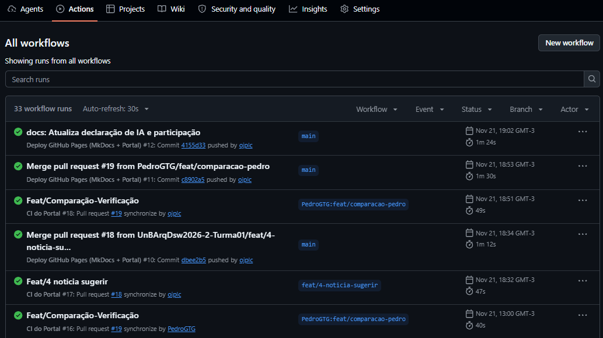

Portal publicado no GitPages, na subpasta `/portal`:

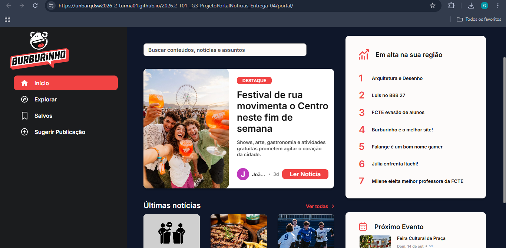

##### Uso da IA Generativa na Minha Solução

Usei IA generativa de duas formas. Para **produzir**, o Claude (no VS Code) gerou a configuração do projeto, o repositório, os testes e os workflows, e eu revisei antes do merge. Para **aprender**, usei o Gemini para entender as decisões do código antes de documentá-las ([conversa](https://share.gemini.google/wtrhovOXgWjN)). O que mais pesou:

1. **Versão do framework:** o Next.js 16 é mais novo do que o conhecimento da IA. A configuração foi validada na documentação do próprio pacote, e assim apareceu a regra de rotas dinâmicas (`dynamicParams = false`), testada antes de entrar no README do grupo.
2. **Bug pego por teste:** a primeira versão devolvia uma cópia da lista, mas com os mesmos objetos internos. O teste de encapsulamento falhou e a correção foi copiar cada notícia. Com o Gemini entendi que isso é uma *cópia rasa direcionada*: basta porque a `Noticia` não tem objetos aninhados.
3. **Uma IA corrigindo a outra:** o primeiro rascunho deste relatório chamava a nossa base de "frozen spot". Perguntando ao Gemini, entendi que frozen/hot spot é um conceito do framework em relação à aplicação, então o texto foi corrigido.
4. **E a IA também deixou passar algo:** o Gemini explicou o modo escuro dizendo que `[data-tema="escuro"]` "sobrescreve" o `:root`. Conferindo, os dois seletores têm a mesma especificidade, e quem vence é só a ordem no arquivo. Troquei por `:root[data-tema="escuro"]`, que vence independentemente da ordem.

##### Senso Crítico

- **Sem back-end, o Singleton é único por contexto de execução**, e não no portal: há uma instância no build e uma em cada aba de cada leitor. Por isso uma sugestão some ao recarregar. Com uma API, só este arquivo mudaria, porque as telas falam apenas com os métodos do repositório.
- **Proteções com limites:** o `private constructor` só vale na compilação, e a `copiar` deixaria escapar objetos aninhados se a `Noticia` ganhasse algum (aí valeria `structuredClone` ou tipos `Readonly`).
- **Os tokens dependem de disciplina:** nada impede alguém de usar cor fixa, e toda cor nova precisa ser conferida nos dois temas. Um lint de CSS resolveria a primeira parte.
- Os parágrafos das notícias que o Figma não mostra foram completados para a demonstração.

#### Reutilização 2: Navegação e Layout (SideBar, AppLayout, Home)

**Responsável:** João Pedro Lopes ([issue #2](https://github.com/UnBArqDsw2026-2-Turma01/2026.2-T01-_G3_ProjetoPortalNoticias_Entrega_04/issues/2) · branch [`feat/2-navegacao`](https://github.com/UnBArqDsw2026-2-Turma01/2026.2-T01-_G3_ProjetoPortalNoticias_Entrega_04/tree/feat/2-navegacao))

##### Contexto (Problema de Repetição)

No [Figma](https://www.figma.com/design/LnkN55jPy6jk8dsjpmYJSF/Prot%C3%B3tipo?node-id=115-68), **todas as telas** têm a mesma barra lateral escura: logo, os quatro itens do menu (Início, Explorar, Salvos, Sugerir Publicação) e, para quem está logado, a seção "Meus Conteúdos". O menu é o componente [Menu de Opções SideBar](https://www.figma.com/design/LnkN55jPy6jk8dsjpmYJSF/Prot%C3%B3tipo?node-id=46-573), **usado 22 vezes** no protótipo em **4 variantes**. Comparando as variantes, a única diferença é **qual item fica destacado** (Padrão = Início, Variante 2 = Explorar, Variante 3 = Salvos, Variante 4 = Sugerir Publicação).

Sem reutilização, cada uma das cerca de 10 rotas do portal repetiria a barra lateral e o próprio menu repetiria quatro blocos de JSX quase iguais. Uma mudança simples (um item novo, outra cor de destaque) teria de ser feita em todos os lugares.

A Home tem duas versões no Figma, [logado](https://www.figma.com/design/LnkN55jPy6jk8dsjpmYJSF/Prot%C3%B3tipo?node-id=6-5) e [deslogado](https://www.figma.com/design/LnkN55jPy6jk8dsjpmYJSF/Prot%C3%B3tipo?node-id=115-144), que diferem em poucos pontos: saudação, avatar ou botão "Entrar", quantidade de assuntos em alta e a seção "Meus Conteúdos" da SideBar.

##### Ponto de Reutilização e Relação com a Teoria

Esta frente mostra **dois níveis diferentes** de reutilização de componentes:

| Nível | Onde | Como funciona |
| --- | --- | --- |
| **Props e variantes** | `SideBar` | Um só componente; a prop `itemAtivo` escolhe uma das 4 variantes do Figma. Sem a prop, o item ativo é descoberto pela URL (`usePathname`). |
| **Configuração como dados** | `ITENS_MENU` | Os itens do menu são um array `{ id, rotulo, href, icone }`. O JSX percorre o array uma única vez; incluir uma opção no menu é acrescentar uma linha, sem mexer no componente. |
| **Composição com `children`** | `AppLayout` | Recebe a página como `children` e a coloca ao lado da SideBar. O `AppLayout` não sabe qual página vai receber. |
| **Lógica em hook** | `useSessaoSimulada` | O mesmo hook informa o login simulado à `SideBar` ("Meus Conteúdos") e à Home (saudação, Entrar/Sair). |

**Relação com a teoria:**

- **Hot spot do framework (slides 11 a 14):** o `layout.tsx` raiz é um ponto que o Next.js chama e nós preenchemos. Ao colocar o `AppLayout` ali, a barra lateral aparece em todas as rotas sem que nenhuma `page.tsx` a importe. É o Princípio de Hollywood (slides 45 a 50): não chamamos o layout; o framework chama e encaixa cada página em `{children}`.
- **Composição como reutilização caixa preta (slides 23 a 26):** quem usa o `AppLayout` não conhece nem altera o seu interior; só entrega um conteúdo. Já a `SideBar` é configurada por props, também sem herança nem alteração do código interno.
- **Componentes e interfaces (slides 60 e 61):** cada componente expõe um contrato (as props) e depende de contratos de outros. Isso está desenhado no [diagrama de componentes](1.1.1.DAS.md#visao-de-componentes-diagrama-de-componentes-uml) da página 1.1.1.

##### Contrato do Componente (Props)

**`SideBar`** ([código](https://github.com/UnBArqDsw2026-2-Turma01/2026.2-T01-_G3_ProjetoPortalNoticias_Entrega_04/blob/main/portal/src/components/SideBar/SideBar.tsx))

| Prop | Tipo | Obrigatória? | Padrão | Descrição |
| --- | --- | --- | --- | --- |
| `itemAtivo` | `'inicio' \| 'explorar' \| 'salvos' \| 'sugerir'` | Não | item da URL atual | Força a variante do Figma (item destacado). |
| `logado` | `boolean` | Não | login simulado | Mostra ou esconde "Meus Conteúdos". |
| `categoriasSeguidas` | `Categoria[]` | Não | as do usuário de exemplo | Categorias listadas em "Meus Conteúdos". |

**`AppLayout`** ([código](https://github.com/UnBArqDsw2026-2-Turma01/2026.2-T01-_G3_ProjetoPortalNoticias_Entrega_04/blob/main/portal/src/components/AppLayout/AppLayout.tsx))

| Prop | Tipo | Obrigatória? | Padrão | Descrição |
| --- | --- | --- | --- | --- |
| `children` | `ReactNode` | Sim | — | A página atual, encaixada à direita da SideBar. |

**Componentes da Home**

| Componente | Prop | Tipo | Obrigatória? | Descrição |
| --- | --- | --- | --- | --- |
| [`CardEmAlta`](https://github.com/UnBArqDsw2026-2-Turma01/2026.2-T01-_G3_ProjetoPortalNoticias_Entrega_04/blob/main/portal/src/components/CardEmAlta/CardEmAlta.tsx) | `assuntos` | `string[]` | Sim | Assuntos em alta, em ordem. Cada um leva à busca. |
| | `limite` | `number` | Não (padrão: todos) | Quantos mostrar (logado: 5; deslogado: 7). |
| | `titulo` | `string` | Não (padrão: "Em alta na sua região") | Título do card. |
| [`CardEvento`](https://github.com/UnBArqDsw2026-2-Turma01/2026.2-T01-_G3_ProjetoPortalNoticias_Entrega_04/blob/main/portal/src/components/CardEvento/CardEvento.tsx) | `evento` | `{ titulo, data, publicadoHa, local, imagemUrl, href }` | Sim | Evento exibido no card. |
| | `hrefTodos` | `string` | Sim | Destino de "Ver todos os eventos". |

**Hook `useSessaoSimulada()`** ([código](https://github.com/UnBArqDsw2026-2-Turma01/2026.2-T01-_G3_ProjetoPortalNoticias_Entrega_04/blob/main/portal/src/hooks/useSessaoSimulada.ts)): não recebe parâmetros e devolve `{ logado: boolean, usuario: UsuarioExemplo | null, entrar(), sair() }`.

##### Onde é Reutilizado

| Tela/rota | Arquivo que usa | Como |
| --- | --- | --- |
| **Todas as rotas** | [`app/layout.tsx`](https://github.com/UnBArqDsw2026-2-Turma01/2026.2-T01-_G3_ProjetoPortalNoticias_Entrega_04/blob/main/portal/src/app/layout.tsx) | `<AppLayout>{children}</AppLayout>`: uma única linha leva a SideBar a todas as páginas. |
| Home (`/`) | [`app/page.tsx`](https://github.com/UnBArqDsw2026-2-Turma01/2026.2-T01-_G3_ProjetoPortalNoticias_Entrega_04/blob/main/portal/src/app/page.tsx) | SideBar com `itemAtivo` = Início (pela URL). |
| Explorar (`/explorar`) e Categorias (`/categoria/[categoria]`) | rotas da vaga 3 | SideBar com Explorar ativo, sem nenhuma linha extra na página. |
| Salvos (`/salvos`) e Busca (`/busca`) | rotas da vaga 5 | SideBar com Salvos ativo em `/salvos`. |
| Sugerir Publicação (`/sugerir`) e Notícia (`/noticia/[id]`) | rotas da vaga 4 | SideBar com Sugerir ativo em `/sugerir`. |
| Acessibilidade (`/acessibilidade`) e Perfil (`/perfil`) | rotas da vaga 6 | SideBar presente; nenhum item do menu fica ativo (como no Figma). |
| Storybook (pendente: o Storybook da vaga 7 ainda não está no main) | `SideBar.stories.tsx` | Uma story por variante do Figma (prop `itemAtivo`). |

| Lógica reutilizada | Quem usa |
| --- | --- |
| `useSessaoSimulada` | [`SideBar`](https://github.com/UnBArqDsw2026-2-Turma01/2026.2-T01-_G3_ProjetoPortalNoticias_Entrega_04/blob/main/portal/src/components/SideBar/SideBar.tsx) ("Meus Conteúdos") e [`PaginaInicial`](https://github.com/UnBArqDsw2026-2-Turma01/2026.2-T01-_G3_ProjetoPortalNoticias_Entrega_04/blob/main/portal/src/app/_home/PaginaInicial.tsx) (saudação, avatar, Entrar/Sair, assuntos em alta) |
| `ITENS_MENU` / `itemAtivoPelaRota` | `SideBar` e os testes da SideBar |
| `caminhoPublico` (da vaga 1) | ícones da SideBar, da Home e dos cards, para funcionarem dentro da subpasta do GitHub Pages |

<!-- PENDENTE (João Pedro, 21/11): conferir as rotas acima com o código de todos no main e trocar os marcadores da Home pelos componentes das vagas 3 e 5. -->

##### Implementação (Código)

O menu inteiro sai de um array de configuração ([`itensMenu.ts`](https://github.com/UnBArqDsw2026-2-Turma01/2026.2-T01-_G3_ProjetoPortalNoticias_Entrega_04/blob/main/portal/src/components/SideBar/itensMenu.ts) e [`SideBar.tsx`](https://github.com/UnBArqDsw2026-2-Turma01/2026.2-T01-_G3_ProjetoPortalNoticias_Entrega_04/blob/main/portal/src/components/SideBar/SideBar.tsx), trechos):

```tsx
export const ITENS_MENU: readonly ItemMenu[] = [
  { id: "inicio", rotulo: "Início", href: "/", icone: { /* ... */ } },
  { id: "explorar", rotulo: "Explorar", href: "/explorar", icone: { /* ... */ } },
  { id: "salvos", rotulo: "Salvos", href: "/salvos", icone: { /* ... */ } },
  { id: "sugerir", rotulo: "Sugerir Publicação", href: "/sugerir", icone: { /* ... */ } },
];

// SideBar.tsx: a variante do Figma é só uma prop; sem ela, vem da URL.
const ativo = itemAtivo ?? itemAtivoPelaRota(usePathname());

{ITENS_MENU.map((item) => (
  <Link key={item.id} href={item.href} aria-current={item.id === ativo ? "page" : undefined}>
    {/* ícone + rótulo */}
  </Link>
))}
```

E a composição que leva a SideBar a todas as telas ([`AppLayout.tsx`](https://github.com/UnBArqDsw2026-2-Turma01/2026.2-T01-_G3_ProjetoPortalNoticias_Entrega_04/blob/main/portal/src/components/AppLayout/AppLayout.tsx) e [`layout.tsx`](https://github.com/UnBArqDsw2026-2-Turma01/2026.2-T01-_G3_ProjetoPortalNoticias_Entrega_04/blob/main/portal/src/app/layout.tsx)):

```tsx
export function AppLayout({ children }: AppLayoutProps) {
  return (
    <div className={styles.layout}>
      <div className={styles.lateral}><SideBar /></div>
      <main className={styles.conteudo}>{children}</main>
    </div>
  );
}

// app/layout.tsx: o Next chama este hot spot e encaixa cada página em {children}.
<body>
  <AppLayout>{children}</AppLayout>
</body>
```

##### Demonstração em Uso

- [Portal publicado](https://unbarqdsw2026-2-turma01.github.io/2026.2-T01-_G3_ProjetoPortalNoticias_Entrega_04/portal/): o botão **Entrar** da Home alterna entre as duas versões do Figma.
- Testes automatizados: [`SideBar.test.tsx`](https://github.com/UnBArqDsw2026-2-Turma01/2026.2-T01-_G3_ProjetoPortalNoticias_Entrega_04/blob/main/portal/src/components/SideBar/SideBar.test.tsx) (marca o item ativo pela URL, a prop `itemAtivo` tem prioridade, um link por item da configuração, "Meus Conteúdos" só logado) e [`PaginaInicial.test.tsx`](https://github.com/UnBArqDsw2026-2-Turma01/2026.2-T01-_G3_ProjetoPortalNoticias_Entrega_04/blob/main/portal/src/app/_home/PaginaInicial.test.tsx) (Home logado × deslogado, Entrar e Sair).

<!-- PENDENTE (João Pedro): link das stories da SideBar no Storybook publicado, assim que a vaga 7 publicar o Storybook. -->

| Home logado | Home deslogado |
| --- | --- |
|  |  |

| Mesma SideBar em outra rota (`/explorar`) | Tela menor: a SideBar vira barra no topo |
| --- | --- |
|  | 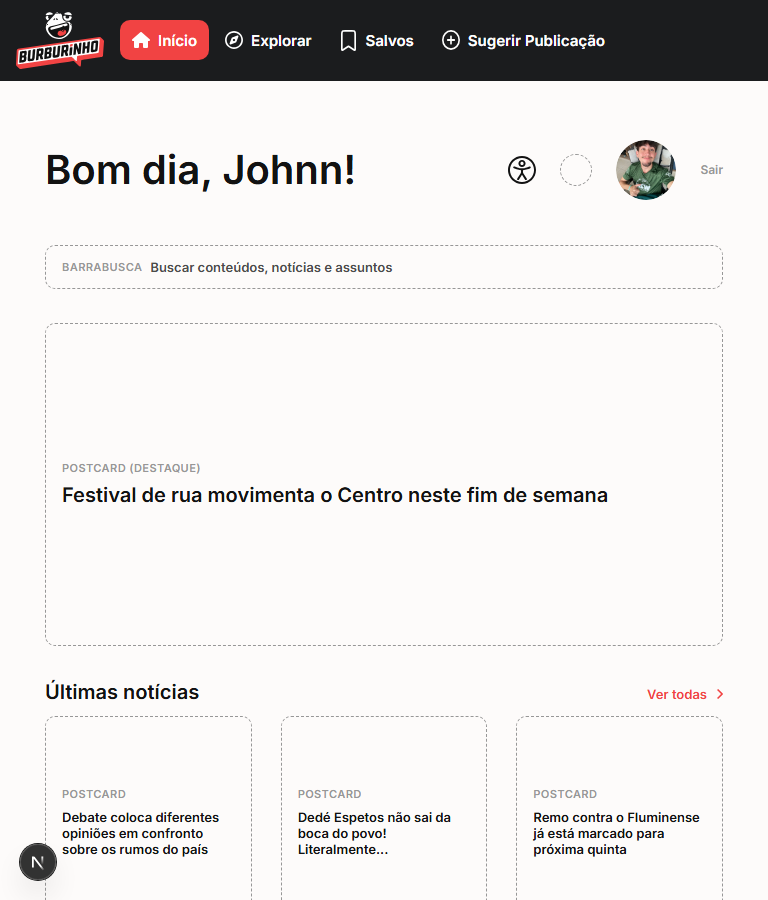 |

Os retângulos tracejados da Home são **marcadores provisórios** dos componentes das vagas 3 (`PostCard`) e 5 (`BarraBusca`, `NotificationBell`), combinados no cronograma (#10). No print de `/explorar` a página ainda é 404 porque a rota é da vaga 3, mas a SideBar já aparece com o item certo, sem nenhuma linha extra.

##### Uso da IA Generativa na Minha Solução

Usei o **Claude Code** (no VS Code), conectado ao Figma por MCP, para ler o protótipo, gerar os componentes e os testes, e para esboçar os diagramas da página 1.1.1. Revisei o resultado comparando com o Figma, com prints do portal rodando e com a documentação do Next.js instalada no projeto. O que mais pesou:

1. **Variantes do Figma:** a issue sugeria que as 4 variantes podiam ser "expandida/recolhida". Lendo os nós do Figma, a IA confirmou que a única diferença é o item ativo. Por isso não existe prop `recolhida`.
2. **Bug pego ao conferir o build:** a IA usou `next/image` acreditando que ele aplica sozinho o `basePath` do GitHub Pages (o README do portal diz isso). Ao inspecionar o HTML gerado com o `basePath`, os ícones apontavam para `/icones/...`, sem a subpasta, e iam quebrar no site publicado. Com `images.unoptimized`, o Next não prefixa o caminho; a correção foi usar o `caminhoPublico()` da vaga 1.
3. **URL com barra no final:** como o projeto usa `trailingSlash: true`, a rota chega como `/salvos/`. A comparação do item ativo foi feita ignorando a barra final, e há um teste para isso.
4. **Teste que falhou por motivo errado:** o primeiro teste da Home procurava o link de uma notícia na página inteira e achou dois (a mesma notícia estava no destaque). O código estava certo; o teste foi restringido à seção "Últimas notícias".
5. **Notação UML:** conferi um a um, no diagrama de componentes, se a "bola" ficou do lado de quem **fornece** a interface e o "soquete" do lado de quem **requer**.

##### Senso Crítico

- **Login simulado:** a sessão é só uma flag no `localStorage`; serve para alternar as duas versões do Figma, não para autenticar ninguém. Login e Cadastro reais estão fora do escopo da entrega.
- **Um item que não está no Figma:** o link "Sair" ao lado do avatar não existe no protótipo, mas sem ele não seria possível voltar ao estado deslogado na demonstração.
- **Responsividade decidida por nós:** o Figma só tem telas de 1440 px. Abaixo de 900 px a SideBar vira uma barra no topo e, abaixo de 600 px, mostra só os ícones (o nome continua acessível a leitores de tela). Essa decisão não foi validada com o protótipo.
- **Não abstraí de propósito:** os cards "Em alta" e "Próximo Evento" só aparecem na Home, por isso não ganharam variantes nem configurações extras. Os assuntos em alta e o evento são dados fixos, porque o repositório de notícias não tem eventos nem métricas de popularidade.
- **Dependência de outras vagas:** a Home só fica completa com o `PostCard` (vaga 3) e a `BarraBusca`/`NotificationBell` (vaga 5); até lá, usa marcadores. O logo da SideBar é estático e será trocado pelo `LogoTema` da vaga 7.

#### Reutilização 3: Cards e Páginas de Categoria (PostCard, BadgeCategoria, PaginaCategoria)

**Responsável:** André Henrique ([issue #3](https://github.com/UnBArqDsw2026-2-Turma01/2026.2-T01-_G3_ProjetoPortalNoticias_Entrega_04/issues/3))

##### Contexto (Problema de Repetição)

No Figma existem **4 telas de categoria quase iguais**: [Política](https://www.figma.com/design/LnkN55jPy6jk8dsjpmYJSF/Prot%C3%B3tipo?node-id=280-1284), [Esporte](https://www.figma.com/design/LnkN55jPy6jk8dsjpmYJSF/Prot%C3%B3tipo?node-id=183-639), [Tecnologia](https://www.figma.com/design/LnkN55jPy6jk8dsjpmYJSF/Prot%C3%B3tipo?node-id=183-1647) e [Cultura](https://www.figma.com/design/LnkN55jPy6jk8dsjpmYJSF/Prot%C3%B3tipo?node-id=230-737). Todas têm banner com foto e título, ícone e nome da categoria, botão Seguir, descrição e "Últimas notícias". O que muda são só os **dados**: cor, ícone, foto, textos e notícias.

<figure style="text-align: center;">
    
    <figcaption>
        <p style="text-align: center; font-size: 10pt;">
            Figura: as 4 telas de categoria do protótipo têm a mesma estrutura (Fonte: protótipo do Grupo 3 no Figma, 2026)
        </p>
    </figcaption>
</figure>

O card de notícia também se repete: aparece em **3 formatos** e em várias telas. O card grande de [destaque](https://www.figma.com/design/LnkN55jPy6jk8dsjpmYJSF/Prot%C3%B3tipo?node-id=6-254) e os [cards compactos](https://www.figma.com/design/LnkN55jPy6jk8dsjpmYJSF/Prot%C3%B3tipo?node-id=230-1153) estão na Home; os [cards horizontais](https://www.figma.com/design/LnkN55jPy6jk8dsjpmYJSF/Prot%C3%B3tipo?node-id=183-654), nas 4 categorias. No protótipo esses cards são frames soltos, copiados de tela em tela, e não um componente. A [tela Explorar](https://www.figma.com/design/LnkN55jPy6jk8dsjpmYJSF/Prot%C3%B3tipo?node-id=15-1956) repete pela quinta vez os mesmos dados das categorias (ícone, cor, nome, descrição e membros).

##### Ponto de Reutilização e Relação com a Teoria

| Antes (no Figma) | Depois (no código) |
| --- | --- |
| 4 telas de categoria desenhadas uma a uma | 1 componente `PaginaCategoria` + 1 rota `/categoria/[categoria]` + 4 famílias na fábrica |
| Card de notícia copiado em cada tela, em 3 formatos | 1 componente `PostCard` com a prop `variante` |
| Cor, ícone e textos da categoria repetidos em badge, página e Explorar | 1 fábrica de categorias consultada por todos |

Nesta frente aparecem três níveis de reutilização:

1. **Componentes com props:** `PostCard` (`variante`, `mostrarResumo`, `acoes`), `BadgeCategoria` (`categoria`, `tamanho`) e `BotaoSeguir` (`rotuloSeguir`, `convite`), este último usado nas categorias e no Explorar.
2. **Componente genérico parametrizado:** a `PaginaCategoria` recebe só a fábrica da categoria e não cita nenhuma categoria pelo nome. É o mesmo raciocínio do **slide 18**: um *hot spot* abstrato com várias especializações. O núcleo comum com variações também é a ideia de **linha de produto** (slides 62 a 69): as 4 categorias são produtos da mesma linha, que diferem só nos dados.
3. **GoF reaproveitado da Entrega 03:** o [Abstract Factory de comunidades](https://github.com/UnBArqDsw2026-2-Turma01/2026.2-T01-_G3_ProjetoPortalNoticias_Entrega_03/tree/main/demonstracao_codigos/SubGrupo1/abstract-factory) virou a [`fabricaCategorias.ts`](https://github.com/UnBArqDsw2026-2-Turma01/2026.2-T01-_G3_ProjetoPortalNoticias_Entrega_04/blob/main/portal/src/padroes/fabricaCategorias.ts). É um padrão de projeto vivendo dentro do app que usa o framework (slides 76 a 78).

**O que mudou na adaptação do Abstract Factory (JavaScript → TypeScript/React):**

| Entrega 03 | Entrega 04 | Por quê |
| --- | --- | --- |
| `TemaVisual.aplicar(pagina)` pintava a página com as cores da família | `TemaCategoria.estilo()` devolve as variáveis CSS da família (`--cor-categoria`, `--posicao-banner`), aplicadas no elemento raiz de cada componente | No React o componente desenha; o tema decide as cores e o recorte do banner. |
| `PoliticaModeracao.moderar()` | `ApresentacaoCategoria`: nome, descrição e membros | A moderação não faz parte das telas de categoria; os textos sim. |
| `WidgetPadrao.renderizar()`, diferente em cada família | `SecaoCategoria.renderizar(renderizador)`: `SecaoEventos` em Cultura (bloco "Eventos" do Figma) e `SecaoVazia` nas outras | É o produto com comportamento diferente por família, como na Entrega 03. A `SecaoVazia` é um *Null Object*: não desenha nada e evita um `if` na página. |
| `definirFactory(categoria)` com um mapa | `FabricaCategoria.para(categoria)` com um `Record<Categoria, ...>` | Se o grupo criar uma categoria nova no contrato, o TypeScript acusa a fábrica que falta. |
| O `CriadorDeComunidade` recebia a fábrica no construtor | A rota e o Explorar escolhem a fábrica e a entregam pronta à `PaginaCategoria` e ao `CardComunidade` (prop `fabrica`) | Quem usa a fábrica não decide qual família criar, só pede os produtos. |

##### Contrato do Componente (Props)

**`PostCard`** ([código](https://github.com/UnBArqDsw2026-2-Turma01/2026.2-T01-_G3_ProjetoPortalNoticias_Entrega_04/blob/main/portal/src/components/PostCard/PostCard.tsx))

| Prop | Tipo | Obrigatória? | Padrão | Descrição |
| --- | --- | --- | --- | --- |
| `noticia` | `Noticia` | Sim | | A notícia exibida; o card inteiro leva a `/noticia/<id>`. |
| `variante` | `"destaque" \| "compacto" \| "horizontal"` | Não | `"compacto"` | Formato do Figma: destaque e compacto na Home, horizontal nas categorias. |
| `mostrarResumo` | `boolean` | Não | só no destaque | Exibe o resumo da notícia. |
| `acoes` | `ReactNode` | Não | | Espaço para botões de outras vagas (ex.: Salvar, vaga 5), por composição. |

**`BadgeCategoria`** ([código](https://github.com/UnBArqDsw2026-2-Turma01/2026.2-T01-_G3_ProjetoPortalNoticias_Entrega_04/blob/main/portal/src/components/BadgeCategoria/BadgeCategoria.tsx))

| Prop | Tipo | Obrigatória? | Padrão | Descrição |
| --- | --- | --- | --- | --- |
| `categoria` | `Categoria` | Sim | | Define nome, ícone e cor (vindos da fábrica). |
| `tamanho` | `"p" \| "m"` | Não | `"m"` | `"p"` nos cards compactos, `"m"` nos horizontais. |

**`PaginaCategoria`** ([código](https://github.com/UnBArqDsw2026-2-Turma01/2026.2-T01-_G3_ProjetoPortalNoticias_Entrega_04/blob/main/portal/src/components/PaginaCategoria/PaginaCategoria.tsx))

| Prop | Tipo | Obrigatória? | Padrão | Descrição |
| --- | --- | --- | --- | --- |
| `fabrica` | `FabricaCategoria` | Sim | | A fábrica concreta da categoria. A página pede a ela o tema, os textos e a seção própria; as notícias vêm do `repositorioNoticias`. |

**Componentes de apoio**

| Componente / Hook | Contrato | Descrição |
| --- | --- | --- |
| [`BotaoSeguir`](https://github.com/UnBArqDsw2026-2-Turma01/2026.2-T01-_G3_ProjetoPortalNoticias_Entrega_04/blob/main/portal/src/components/BotaoSeguir/BotaoSeguir.tsx) | `categoria`, `rotuloSeguir?` (padrão "Seguir"), `convite?: "contorno" \| "preenchido"` | Seguir/Seguindo das categorias e Juntar-se do Explorar. |
| [`CardComunidade`](https://github.com/UnBArqDsw2026-2-Turma01/2026.2-T01-_G3_ProjetoPortalNoticias_Entrega_04/blob/main/portal/src/components/CardComunidade/CardComunidade.tsx) | `fabrica` | Card do Explorar; leva à página da categoria. |
| [`AgendaEventos`](https://github.com/UnBArqDsw2026-2-Turma01/2026.2-T01-_G3_ProjetoPortalNoticias_Entrega_04/blob/main/portal/src/components/AgendaEventos/AgendaEventos.tsx) | `eventos` | Bloco "Eventos" de Cultura, desenhado pela `SecaoEventos`. |
| [`TempoPublicacao`](https://github.com/UnBArqDsw2026-2-Turma01/2026.2-T01-_G3_ProjetoPortalNoticias_Entrega_04/blob/main/portal/src/components/TempoPublicacao/TempoPublicacao.tsx) | `iso`, `className?` | "10min", "2h", "5d" (calculado no navegador para não congelar no build). |
| [`useCategoriasSeguidas()`](https://github.com/UnBArqDsw2026-2-Turma01/2026.2-T01-_G3_ProjetoPortalNoticias_Entrega_04/blob/main/portal/src/hooks/useCategoriasSeguidas.ts) | devolve `{ seguidas, segue(c), definir(c, seguir) }` | Categorias seguidas, salvas no `localStorage`. |
| [`FabricaCategoria.para(c)`](https://github.com/UnBArqDsw2026-2-Turma01/2026.2-T01-_G3_ProjetoPortalNoticias_Entrega_04/blob/main/portal/src/padroes/fabricaCategorias.ts) | `criarTema()`, `criarApresentacao()`, `criarSecao()` | Escolhe a fábrica concreta da categoria. |

##### Onde é Reutilizado

| Componente | Tela / rota | Arquivo que usa | Como | Usos |
| --- | --- | --- | --- | --- |
| `PaginaCategoria` | `/categoria/politica`, `/esporte`, `/tecnologia`, `/cultura` | [`app/categoria/[categoria]/page.tsx`](https://github.com/UnBArqDsw2026-2-Turma01/2026.2-T01-_G3_ProjetoPortalNoticias_Entrega_04/blob/main/portal/src/app/categoria/%5Bcategoria%5D/page.tsx) | `<PaginaCategoria fabrica={FabricaCategoria.para(categoria)} />` | 4 telas |
| `PostCard` | Home (vaga 2) | previsto em [`app/_home/PaginaInicial.tsx`](https://github.com/UnBArqDsw2026-2-Turma01/2026.2-T01-_G3_ProjetoPortalNoticias_Entrega_04/blob/main/portal/src/app/_home/PaginaInicial.tsx): o João troca os marcadores quando o `PostCard` entrar no main, como combinado no cronograma (#10) | `variante="destaque"` e `variante="compacto"` | 4 cards previstos |
| `PostCard` | 4 categorias | [`PaginaCategoria.tsx`](https://github.com/UnBArqDsw2026-2-Turma01/2026.2-T01-_G3_ProjetoPortalNoticias_Entrega_04/blob/main/portal/src/components/PaginaCategoria/PaginaCategoria.tsx) | `variante="horizontal"` | 13 cards |
| `PostCard` | Salvos (vaga 5) | previsto na [issue #5](https://github.com/UnBArqDsw2026-2-Turma01/2026.2-T01-_G3_ProjetoPortalNoticias_Entrega_04/issues/5) | | |
| `BadgeCategoria` | 4 categorias | dentro do `PostCard` (compacto e horizontal) | `tamanho="m"` (e `"p"` na Home) | 13 badges; previsto também na Home (vaga 2) e na Notícia (vaga 4) |
| `BotaoSeguir` | 4 categorias e Explorar | `PaginaCategoria` e `CardComunidade` | "Seguir" com contorno; "Juntar-se" preenchido | 8 botões |
| Fábrica de categorias | categorias e Explorar | `BadgeCategoria`, `PostCard`, `PaginaCategoria`, `CardComunidade` | `criarTema()` nos 4; `criarApresentacao()` em 3; `criarSecao()` na página | 4 componentes |
| `useCategoriasSeguidas` | todas as rotas | `BotaoSeguir` e `SideBar` (vaga 2) | seguir em uma tela atualiza o "Meus Conteúdos" | 2 componentes |

Nenhum desses componentes cita uma categoria pelo nome: quem conhece as 4 categorias é só a fábrica.

##### Implementação (Código)

A fábrica: cada categoria é uma família ([`fabricaCategorias.ts`](https://github.com/UnBArqDsw2026-2-Turma01/2026.2-T01-_G3_ProjetoPortalNoticias_Entrega_04/blob/main/portal/src/padroes/fabricaCategorias.ts), trecho):

```ts
export abstract class FabricaCategoria {
  abstract criarTema(): TemaCategoria;
  abstract criarApresentacao(): ApresentacaoCategoria;
  abstract criarSecao(): SecaoCategoria;

  static para(categoria: Categoria): FabricaCategoria {
    return new FABRICAS[categoria]();
  }
}

// Produto com comportamento diferente em cada família
export abstract class SecaoCategoria {
  abstract renderizar<T>(renderizador: RenderizadorSecao<T>): T | null;
}
export class SecaoEventos extends SecaoCategoria {
  renderizar<T>(renderizador: RenderizadorSecao<T>) { return renderizador.eventos(eventosCulturais); }
}
export class SecaoVazia extends SecaoCategoria {
  renderizar() { return null; } // Null Object
}

class FabricaCultura extends FabricaCategoria {
  criarTema() {
    return new TemaCategoria("cultura", "var(--cor-cultura)", { /* ícone */ }, { src: "/categorias/banner-cultura.jpg", posicao: "center" });
  }
  criarApresentacao() { /* nome, descrição e membros, com os textos do Figma */ }
  criarSecao() { return new SecaoEventos(); } // nas outras 3 fábricas: new SecaoVazia()
}

// O TypeScript exige uma fábrica para cada categoria do contrato.
const FABRICAS: Record<Categoria, new () => FabricaCategoria> = {
  politica: FabricaPolitica, esporte: FabricaEsporte, tecnologia: FabricaTecnologia, cultura: FabricaCultura,
};
```

A página genérica não conhece nenhuma categoria ([`PaginaCategoria.tsx`](https://github.com/UnBArqDsw2026-2-Turma01/2026.2-T01-_G3_ProjetoPortalNoticias_Entrega_04/blob/main/portal/src/components/PaginaCategoria/PaginaCategoria.tsx), trecho):

```tsx
export function PaginaCategoria({ fabrica }: PaginaCategoriaProps) {
  const tema = fabrica.criarTema();
  const apresentacao = fabrica.criarApresentacao();
  const secao = fabrica.criarSecao().renderizar({
    eventos: (eventos) => <AgendaEventos eventos={eventos} />,
  });
  const noticias = repositorioNoticias.listarPorCategoria(tema.categoria);

  return (
    <div className={styles.pagina} style={tema.estilo()}>
      <header className={styles.banner}>{/* foto tema.banner + título apresentacao.nome */}</header>
      {/* ícone, <BotaoSeguir categoria={tema.categoria} />, apresentacao.descricao */}
      {secao}
      <ul className={styles.lista}>
        {noticias.map((noticia) => (
          <li key={noticia.id}><PostCard noticia={noticia} variante="horizontal" /></li>
        ))}
      </ul>
    </div>
  );
}
```

E a rota única que gera as 4 telas no export estático ([`page.tsx`](https://github.com/UnBArqDsw2026-2-Turma01/2026.2-T01-_G3_ProjetoPortalNoticias_Entrega_04/blob/main/portal/src/app/categoria/%5Bcategoria%5D/page.tsx)):

```tsx
export const dynamicParams = false;

export function generateStaticParams() {
  return CATEGORIAS.map((categoria) => ({ categoria }));
}

export default async function Categoria({ params }: Props) {
  const { categoria } = await params;
  if (!ehCategoria(categoria)) notFound();
  return <PaginaCategoria fabrica={FabricaCategoria.para(categoria)} />;
}
```

##### Demonstração em Uso

- [Portal publicado](https://unbarqdsw2026-2-turma01.github.io/2026.2-T01-_G3_ProjetoPortalNoticias_Entrega_04/portal/): [Política](https://unbarqdsw2026-2-turma01.github.io/2026.2-T01-_G3_ProjetoPortalNoticias_Entrega_04/portal/categoria/politica/), [Esporte](https://unbarqdsw2026-2-turma01.github.io/2026.2-T01-_G3_ProjetoPortalNoticias_Entrega_04/portal/categoria/esporte/), [Tecnologia](https://unbarqdsw2026-2-turma01.github.io/2026.2-T01-_G3_ProjetoPortalNoticias_Entrega_04/portal/categoria/tecnologia/), [Cultura](https://unbarqdsw2026-2-turma01.github.io/2026.2-T01-_G3_ProjetoPortalNoticias_Entrega_04/portal/categoria/cultura/) e [Explorar](https://unbarqdsw2026-2-turma01.github.io/2026.2-T01-_G3_ProjetoPortalNoticias_Entrega_04/portal/explorar/).
- Testes automatizados: [`fabricaCategorias.test.ts`](https://github.com/UnBArqDsw2026-2-Turma01/2026.2-T01-_G3_ProjetoPortalNoticias_Entrega_04/blob/main/portal/src/padroes/fabricaCategorias.test.ts) (cada fábrica cria uma família completa; a seção própria é `SecaoEventos` em Cultura e `SecaoVazia` nas outras), [`PostCard.test.tsx`](https://github.com/UnBArqDsw2026-2-Turma01/2026.2-T01-_G3_ProjetoPortalNoticias_Entrega_04/blob/main/portal/src/components/PostCard/PostCard.test.tsx) (título e link corretos, o que cada variante mostra), [`PaginaCategoria.test.tsx`](https://github.com/UnBArqDsw2026-2-Turma01/2026.2-T01-_G3_ProjetoPortalNoticias_Entrega_04/blob/main/portal/src/components/PaginaCategoria/PaginaCategoria.test.tsx) (o mesmo componente monta as 4 telas; só Cultura mostra o bloco Eventos; Seguir continua salvo ao recarregar e aparece na SideBar), [`BadgeCategoria.test.tsx`](https://github.com/UnBArqDsw2026-2-Turma01/2026.2-T01-_G3_ProjetoPortalNoticias_Entrega_04/blob/main/portal/src/components/BadgeCategoria/BadgeCategoria.test.tsx), [`categoriasSeguidas.test.ts`](https://github.com/UnBArqDsw2026-2-Turma01/2026.2-T01-_G3_ProjetoPortalNoticias_Entrega_04/blob/main/portal/src/lib/categoriasSeguidas.test.ts) e [`formatarData.test.ts`](https://github.com/UnBArqDsw2026-2-Turma01/2026.2-T01-_G3_ProjetoPortalNoticias_Entrega_04/blob/main/portal/src/lib/formatarData.test.ts).

- **Stories** pedidas na issue #3, cada uma ligada ao nó do Figma de onde saiu: [`Conteúdo/PostCard`](https://github.com/UnBArqDsw2026-2-Turma01/2026.2-T01-_G3_ProjetoPortalNoticias_Entrega_04/blob/main/portal/src/components/PostCard/PostCard.stories.tsx) (destaque, destaque sem resumo, compacto, horizontal, com ação Salvar e uma por categoria), [`Conteúdo/BadgeCategoria`](https://github.com/UnBArqDsw2026-2-Turma01/2026.2-T01-_G3_ProjetoPortalNoticias_Entrega_04/blob/main/portal/src/components/BadgeCategoria/BadgeCategoria.stories.tsx) (4 categorias e o tamanho pequeno), [`Conteúdo/PaginaCategoria`](https://github.com/UnBArqDsw2026-2-Turma01/2026.2-T01-_G3_ProjetoPortalNoticias_Entrega_04/blob/main/portal/src/components/PaginaCategoria/PaginaCategoria.stories.tsx) (as 4 telas), [`Conteúdo/CardComunidade`](https://github.com/UnBArqDsw2026-2-Turma01/2026.2-T01-_G3_ProjetoPortalNoticias_Entrega_04/blob/main/portal/src/components/CardComunidade/CardComunidade.stories.tsx), [`Conteúdo/AgendaEventos`](https://github.com/UnBArqDsw2026-2-Turma01/2026.2-T01-_G3_ProjetoPortalNoticias_Entrega_04/blob/main/portal/src/components/AgendaEventos/AgendaEventos.stories.tsx) e [`Interação/BotaoSeguir`](https://github.com/UnBArqDsw2026-2-Turma01/2026.2-T01-_G3_ProjetoPortalNoticias_Entrega_04/blob/main/portal/src/components/BotaoSeguir/BotaoSeguir.stories.tsx) (Seguir, Seguindo e Juntar-se). Enquanto o Storybook não é publicado, o teste [`stories.test.tsx`](https://github.com/UnBArqDsw2026-2-Turma01/2026.2-T01-_G3_ProjetoPortalNoticias_Entrega_04/blob/main/portal/src/components/stories.test.tsx) renderiza as 27 stories como o Storybook faria.

<!-- PENDENTE (André): link das stories no Storybook publicado, quando ele for publicado. -->

| Mesma `PaginaCategoria`: Esporte | Mesma `PaginaCategoria`: Cultura |
| --- | --- |
| 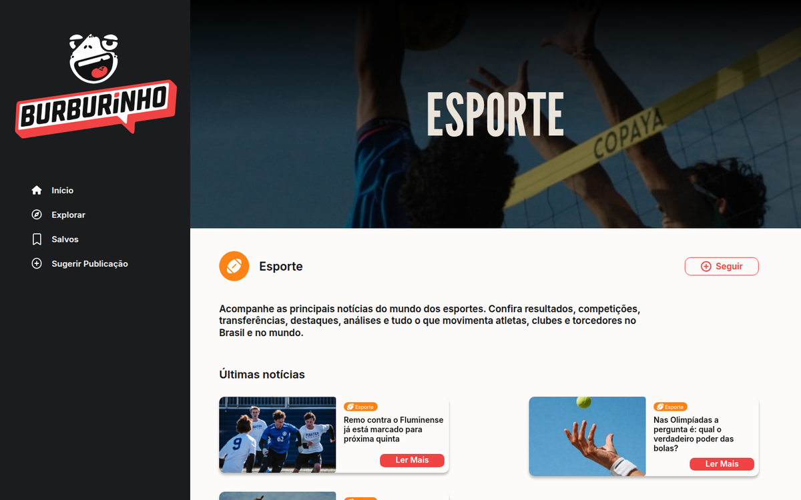 |  |

<figure style="text-align: center;">
    
    <figcaption>
        <p style="text-align: center; font-size: 10pt;">
            Figura: Explorar, com o CardComunidade e o BotaoSeguir alimentados pela mesma fábrica (Fonte: portal Burburinho, 2026)
        </p>
    </figcaption>
</figure>

##### Uso da IA Generativa na Minha Solução

Usei o **Claude Code** (no terminal), conectado ao Figma por MCP, para ler as telas do protótipo, gerar os componentes e os testes e redigir esta seção. Revisei o resultado comparando com o Figma, com prints do portal rodando, com os testes e com a documentação do Next.js.

**O que aceitei da IA**, depois de conferir: o `Record<Categoria, ...>` que obriga uma fábrica por categoria; o link do título cobrindo o card inteiro, que evita colocar botões dentro de um link; e os testes, que só mantive depois de vê-los falhar quando o código estava errado (como nos itens 3 e 4 abaixo).

**O que precisei corrigir ou decidir:**

1. **A própria issue estava errada, e a IA seguiu até conferir:** os nós indicados para o `PostCard` ("Conteúdos" e "Conteúdo Menor") são as listas de categorias da SideBar, e não cards de notícia. Lendo os nós do Figma, encontramos os 3 cards reais, e por isso o `PostCard` tem 3 variantes, e não 2.
2. **O `switch` gigante que a issue avisava:** a validação foi uma busca no código. Nenhum componente nem página tem `switch` ou cita uma categoria pelo nome; só a fábrica conhece as 4 categorias.
3. **Bugs pegos por teste:** a data saía "01 de nov" (faltava converter o dia para número); e o teste do badge falhou porque o jsdom descarta `background: var(...)`. A cor passou a ir por uma variável CSS (`--cor-badge`).
4. **Ferramenta que não funciona fora do Next:** a IA colocou a fonte League Gothic (`next/font`) dentro do componente, mas essa importação só existe quando o Next compila, e os testes do Vitest quebrariam. A fonte foi para o `layout.tsx`, como a Inter.
5. **O que só apareceu usando o portal:** testando, percebi que as páginas tinham largura fixa de 1098px (a medida do Figma) e sobrava espaço em telas maiores, e que o "Seguir" se perdia ao recarregar. As duas coisas foram corrigidas (largura total e o hook `useCategoriasSeguidas` com `localStorage`). A IA também comentava demais o código, e pedi para enxugar.
6. **A fábrica, revisada por mim:** na primeira versão, os produtos da fábrica eram só dados (cor, textos), e as 4 famílias diferiam apenas nos valores. Isso contrariava o que aprendi na Entrega 03 (os produtos devem ter comportamento próprio em cada família). Pedi a correção: o tema passou a ter `estilo()`, a página e o Explorar passaram a receber a fábrica pronta e voltou o terceiro produto, `SecaoCategoria`, que em Cultura desenha o bloco "Eventos" do Figma e nas outras categorias não desenha nada.

##### Senso Crítico

- **Por que não criamos 4 componentes:** as 4 telas diferem nos dados, não na estrutura. Com 4 componentes, cada ajuste (um botão novo, outro espaçamento) teria de ser repetido 4 vezes, e uma categoria nova seria uma tela inteira. Agora é uma fábrica a mais.
- **Quando a abstração começa a atrapalhar:** Cultura já é diferente (tem o bloco Eventos). Em vez de um `if (categoria === "cultura")` dentro da página, a diferença virou um produto da família (`SecaoEventos`). Se outras categorias pedirem layouts muito diferentes, a página vai acumular seções, e aí valeria compor páginas próprias a partir de peças menores (banner, cabeçalho, lista).
- **Custos da fábrica (revisão de 20/11):** a importação de `AgendaEventos` por `SecaoEventos` foi removida. A seção continua decidindo o comportamento da família, mas recebe um `RenderizadorSecao<T>`; `PaginaCategoria` fornece a função que monta a agenda. Isso remove a dependência `padroes → components` e preserva o Abstract Factory e o Null Object, sem condicional por categoria na página. Há um contrato adicional entre produto e renderizador, coberto por testes. Do bloco Eventos do Figma, ficou de fora o calendário mensal: implementei a lista de eventos, com dados de exemplo (dia e dia da semana como no protótipo).
- **Desvios do Figma, de propósito:** textos de 5,9px a 7px (badge pequeno, autor e tempo do card compacto) subiram para 8 a 10px, por legibilidade. A data segue o Figma ("2h", "5d") em vez do "Hoje, 09:42" sugerido na issue. No Explorar, só a faixa sob a ilustração é escura. As fotos dos banners foram convertidas de PNG para JPEG (de 4,5 MB para 0,5 MB).
- **Limites da persistência:** seguir uma categoria fica salvo só no navegador (`localStorage`): não vale em outro dispositivo e não existe back-end. A página Explorar usa, para Tecnologia, a descrição da tela da categoria, porque o card do Figma tinha um texto provisório.
- **Stories escritas antes do Storybook:** como o Storybook ainda não está instalado no projeto, as stories foram escritas sem importar os tipos dele (`Meta`, `StoryObj`), para não quebrar o build. Assim que ele entrar no main, falta só acrescentar esses tipos. Até lá, um teste renderiza todas elas. As versões DarkMode do Figma viram stories quando o seletor de tema da vaga 6 existir.

#### Reutilização 4: Notícia e Sugerir Publicação (BotaoAcao, CampoFormulario, NoticiaBuilder)

**Responsável: Luís Cunha**

##### Contexto (Problema de Repetição)

No Figma, várias ações têm a mesma estrutura visual: Voltar, Compartilhar, Salvar e Enviar aparecem como botões com rótulo e, em alguns casos, ícone. O formulário de Sugerir Publicação repete o mesmo padrão rótulo, entrada, placeholder e validação em quatro campos obrigatórios e um campo opcional. Sem abstração, essas combinações seriam copiadas em diferentes telas e ficariam sujeitas a divergências de cor, tamanho, estado ativo e acessibilidade.

##### Ponto de Reutilização e Relação com a Teoria

Os componentes `BotaoAcao` e `CampoFormulario` aplicam customização por props, um ponto de variação da reutilização de frameworks discutido no material da disciplina. O Builder da Entrega 03 foi adaptado de JavaScript para `NoticiaBuilder` em TypeScript: o formulário atua como Director, chama passos encadeados e o método `construir()` cria e valida o produto `Noticia`.

O `PostCard` da vaga 3 é reutilizado na pré-visualização de Sugerir Publicação. Assim, dados UGC e dados da redação passam pelo mesmo componente de apresentação, variando apenas a notícia e a chamada da rota.

##### Contrato do Componente (Props)

`BotaoAcao` recebe `rotulo`, `icone`, `variante` (`primario`, `secundario` ou `texto`), `ativo`, `onClick`, `href` e `type`. Quando recebe `href`, usa `Link` ou `<a>`; caso contrário, renderiza `<button>`. `CampoFormulario` recebe `rotulo`, `nome`, `tipo`, `opcoes`, `valor`, `aoMudar`, `erro`, `obrigatorio` e `placeholder`, usando `useId()` para conectar o rótulo ao campo.

`NoticiaBuilder` expõe `comTitulo`, `comCategoria`, `comParagrafos`, `comAutor`, `comResumo` e `comImagem`. `construir()` valida as informações obrigatórias e lança `ErroNoticiaBuilder` com o campo correspondente.

##### Onde é Reutilizado

`BotaoAcao` aparece quatro vezes na tela de notícia (Voltar, Compartilhar e Salvar, além de estados derivados) e duas vezes no fluxo de Sugerir (Enviar outra sugestão e Enviar sugestão). `CampoFormulario` aparece cinco vezes em Sugerir Publicação: categoria, título, texto, autor e localização opcional. Com isso, o formulário mantém um único padrão visual e de acessibilidade.

`NoticiaBuilder` é usado pela tela de sugestão e seus testes. `PostCard` continua sendo usado pela Home, categorias e prévia UGC, demonstrando reutilização entre componentes de vagas diferentes.

##### Implementação (Código)

- Página dinâmica de notícia: [`PaginaNoticia.tsx`](https://github.com/UnBArqDsw2026-2-Turma01/2026.2-T01-_G3_ProjetoPortalNoticias_Entrega_04/blob/main/portal/src/components/PaginaNoticia/PaginaNoticia.tsx) e [`page.tsx`](https://github.com/UnBArqDsw2026-2-Turma01/2026.2-T01-_G3_ProjetoPortalNoticias_Entrega_04/blob/main/portal/src/app/noticia/[id]/page.tsx).
- Botão reutilizável: [`BotaoAcao.tsx`](https://github.com/UnBArqDsw2026-2-Turma01/2026.2-T01-_G3_ProjetoPortalNoticias_Entrega_04/blob/main/portal/src/components/BotaoAcao/BotaoAcao.tsx).
- Campo reutilizável: [`CampoFormulario.tsx`](https://github.com/UnBArqDsw2026-2-Turma01/2026.2-T01-_G3_ProjetoPortalNoticias_Entrega_04/blob/main/portal/src/components/CampoFormulario/CampoFormulario.tsx).
- Builder adaptado: [`NoticiaBuilder.ts`](https://github.com/UnBArqDsw2026-2-Turma01/2026.2-T01-_G3_ProjetoPortalNoticias_Entrega_04/blob/main/portal/src/padroes/NoticiaBuilder.ts).
- Tela UGC: [`PaginaSugerir.tsx`](https://github.com/UnBArqDsw2026-2-Turma01/2026.2-T01-_G3_ProjetoPortalNoticias_Entrega_04/blob/main/portal/src/components/PaginaSugerir/PaginaSugerir.tsx).

##### Demonstração em Uso

- A rota `/noticia/[id]` usa `generateStaticParams()` e `dynamicParams = false`, exigências do Next.js 16 para export estático. Cada card pode abrir a notícia correspondente.
- Compartilhar usa `navigator.share`; quando indisponível, copia o endereço com `navigator.clipboard`.
- O formulário valida os campos, monta `Noticia` com o Builder, adiciona a sugestão ao repositório em memória e mostra a prévia com `PostCard`.
- Stories cobrem variantes dos dois componentes e a tela Sugerir nos modos claro e escuro.

##### Uso da IA Generativa na Minha Solução

IA Generativa foi usada para acelerar a leitura dos frames do Figma, escrever a primeira versão dos componentes e localizar integrações no projeto. Eu revisei o resultado contra o protótipo, os contratos da issue e o Next.js 16, não aceitei código gerado sem validação. O build e os testes verificaram os contratos; a inspeção visual encontrou diferenças de largura, título, espaçamento e campos visíveis no Figma.

##### Senso Crítico

Não existe back-end real nesta vaga: sugestões ficam no repositório em memória da sessão e desaparecem ao recarregar. Isso atende à demonstração, mas não equivale a moderação pública. Como próximo passo, os padrões State e Chain of Responsibility da Entrega 03 podem controlar estados como enviada, em revisão, publicada ou rejeitada. O upload mostrado no protótipo ainda pode permanecer como interface visual até existir armazenamento de mídia.

#### Reutilização 5: Busca, Notificações e Salvos (BarraBusca, NotificationBell, useSalvos)

<!-- Responsável: vaga 5. Itens: BarraBusca, NotificationBell + useNotificacoes (Observer da Entrega 03), página Salvos + useSalvos. -->

**Responsável:** Matheus Eiki

##### Contexto (Problema de Repetição)

No Figma, a mesma notícia aparece na Home, nas categorias, na tela de Notícia, em Salvos e nos resultados de busca. Cada tela precisaria buscar e filtrar notícias do seu jeito, além de ter um campo de busca (Home) e um sino de notificações (topo da Home logado). Sem hooks customizados, a lógica de salvar/remover notícias (localStorage) e de assinar/publicar eventos (notificações) seria duplicada em cada componente que precisar dela.

##### Ponto de Reutilização e Relação com a Teoria

O ponto de reutilização está em dois níveis:

1. **Reutilização de interface (componente):** `BarraBusca`, `NotificationBell` e a página `Salvos` são componentes React com props bem definidas, renderizados na Home e em outras rotas.
2. **Reutilização de lógica (hook):** `useSalvos` e `useNotificacoes` são hooks customizados que encapsulam regras de negócio independentemente da interface. No corte desta revisão, `useSalvos` é consumido pela página Salvos; o botão da Notícia (vaga 4) ainda é uma integração planejada. A revisão de Pedro centraliza a leitura, gravação e assinatura em `lib/noticiasSalvas.ts`, permitindo que consumidores simultâneos compartilhem o mesmo estado sem sobrescrever alterações. Os testes exercitam dois consumidores, mas não devem ser contados como duas telas implementadas.

O padrão Observer foi reaproveitado da Entrega 03 através de um `eventBus` enxuto só no front-end.

Relação com a teoria (slides da aula "Reutilização & Framework"):
- **Slide 18**: reutilização de lógica via hooks customizados evita duplicar regras de negócio entre componentes.
- **Observer (GoF da Entrega 03)**: `eventBus` permite pub/sub desacoplado entre partes do portal que não se conhecem diretamente.

##### Contrato do Componente (Props)

| Componente | Props | Descrição |
|---|---|---|
| `BarraBusca` | `placeholder?`, `valorInicial?` | Campo de busca com debounce 300 ms. Exibe dropdown de resultados abaixo da barra, sem sair da página. Clicar em um resultado abre a notícia. |
| `NotificationBell` | (sem props) | Sino com contador de não lidas e dropdown. Usa `useNotificacoes`. |
**Contrato dos hooks customizados:**

| Hook | Retorno | Tipo | Descrição |
|---|---|---|---|
| `useSalvos` | `{ idsSalvos, estaSalvo(id), alternar(id), remover(id) }` | `readonly string[]`, `(id: string) => boolean`, `(id: string) => void`, `(id: string) => void` | Lista de IDs salvos, verifica se uma notícia está salva, alterna (salva/remove) e remove um ID específico. Persiste em `localStorage`. |
| `useNotificacoes` | `{ notificacoes, naoLidas, marcarComoLidas }` | `Notificacao[]`, `number`, `() => void` | Lista de notificações, contador de não lidas e marca todas como lidas. Assina o `eventBus` (Observer). |

##### Onde é Reutilizado

| Item | Onde é usado |
|---|---|
| `useSalvos` | Página `/salvos`; botão Salvar na Notícia ainda pendente |
| `useNotificacoes` | `NotificationBell` (topo da Home logado); produção real dos eventos ainda pendente |
| `BarraBusca` | Home (topo da página principal), dropdown de resultados em tempo real |
| `eventBus` | `useNotificacoes` (assina); a publicação pela vaga 4 ainda é planejada |
| Página `/salvos` | SideBar item "Salvos" → `/salvos` |
| Página `/busca` | Acesso direto via URL (`/busca/?q=<termo>`) |

##### Implementação (Código)

**`portal/src/padroes/eventBus.ts`** — EventBus enxuto com `assinar(evento, callback)`, `publicar(evento, dados)`, `cancelar(evento, callback)`. Eventos: `'noticia-publicada'`, `'sugestao-enviada'`.

**`portal/src/hooks/useSalvos.ts`** (`'use client'`):
```ts
export function useSalvos() {
  const idsSalvos = useSyncExternalStore(
    assinarNoticiasSalvas,
    lerNoticiasSalvas,
    salvosNoServidor,
  );
  return {
    idsSalvos,
    estaSalvo: (id: string) => idsSalvos.includes(id),
    alternar: alternarNoticiaSalva,
    remover: removerNoticiaSalva,
  };
}
```
O snapshot do servidor é vazio e estável; na hidratação, React consulta o estado do navegador. Apenas ações de salvar/remover escrevem no armazenamento. Evento local sincroniza consumidores da mesma aba; `storage` sincroniza outras abas da mesma origem. Se a gravação falhar, a alteração permanece apenas na memória da aba.

**`portal/src/hooks/useNotificacoes.ts`** (`'use client'`): assina `eventBus` no `useEffect` e cancela no cleanup (evita vazamento de memória e callbacks em componentes desmontados). Começa com 3 notificações de exemplo.

**`portal/src/components/BarraBusca/BarraBusca.tsx`** (`'use client'`): debounce simples de 300 ms, props `placeholder?`, `valorInicial?`. Busca no `repositorioNoticias` e mostra resultados em dropdown abaixo da barra. Não navega para outra página.

**`portal/src/components/NotificationBell/NotificationBell.tsx`** (`'use client'`): sino com botão nativo, contador e painel suspenso; marca como lidas somente ao acionar "Marcar todas como lidas". Escape fecha o painel e devolve o foco ao sino.

**`portal/src/app/salvos/page.tsx`** (`'use client'`): lista `PostCard` (vaga 3) das notícias salvas + estado vazio "Você ainda não salvou nenhuma publicação".

**`portal/src/app/busca/page.tsx`** (`'use client'` dentro de `<Suspense>`): lê `?q=` com `useSearchParams`, mostra resultados com `PostCard`.

##### Demonstração em Uso

- O hook salva IDs, recupera-os após remontagem e sincroniza consumidores, conforme os testes. A jornada pela página de notícia depende da integração da vaga 4 e não é apresentada como concluída.
- Na Home, digitar na BarraBusca exibe resultados em dropdown após 300 ms (tipo Instagram/TikTok), sem sumir com a barra.
- O sino mostra o contador (ex.: "2"); abrir a lista não altera a leitura. O botão "Marcar todas como lidas" zera o contador sem fechar o painel.
- Publicar `evento 'sugestao-enviada'` no `eventBus` incrementa `naoLidas` no `useNotificacoes`.

##### Uso da IA Generativa na Minha Solução

Usada para gerar o esqueleto inicial dos componentes (CSS, estrutura JSX) e dos testes, sempre com revisão manual. A decisão de acessar `localStorage` somente dentro de `useEffect` (para não quebrar o build estático) e de proteger com `try/catch` veio da análise do código existente (`categoriasSeguidas.ts`), não da IA.

##### Senso Crítico

O `eventBus` é um módulo com estado global simples — suficiente para o portal, mas não escala para múltiplas abas/usuários simultâneos (usaria um backend real ou Broadcast Channel para multi-aba). O debounce de 300 ms da `BarraBusca` é simples e não cancela requisições em flight, o que é aceitável para busca em memória no `repositorioNoticias`.

**Observer: antes × depois.** Na Entrega 03, o Observer era implementado no back-end (servidor + SSE — Server-Sent Events), com conexões persistentes entre cliente e servidor. Nesta entrega, reutilizamos a ideia de publicar/assinar eventos, mas em uma versão enxuta só no front-end (`portal/src/padroes/eventBus.ts`), sem servidor, sem SSE e sem WebSocket. Simplificamos porque o portal é estático (Next.js `output: "export"`, sem Node.js rodando no servidor), então não há como manter conexões SSE. A versão front-end resolve o problema de desacoplar o `NotificationBell` de quem dispara eventos (ex.: vaga 4 ao enviar sugestão), com custo perto de zero.

**Limites da persistência:** `localStorage` grava só no navegador do usuário. Não sincroniza entre dispositivos (celular vs computador) e não existe back-end central — se o usuário abrir o portal em outro navegador ou dispositivo, os salvos não aparecem. Notificações são simuladas (3 exemplos fixos no código); em produção viriam de uma API real.

#### Reutilização 6: Tema e Acessibilidade (ThemeProvider, useTema, ToggleModoEscuro)

**Responsável:** Giovanna Aguiar ([issue #6](https://github.com/UnBArqDsw2026-2-Turma01/2026.2-T01-_G3_ProjetoPortalNoticias_Entrega_04/issues/6) · commit: [5633092](https://github.com/UnBArqDsw2026-2-Turma01/2026.2-T01-_G3_ProjetoPortalNoticias_Entrega_04/commit/5633092f7e607016ba8ced40aad8dfbfcd9b7865))

##### Contexto (Problema de Repetição)

No Figma, a página Protótipo tem **10 telas nomeadas DarkMode**: Home, Notícia, Salvos, Acessibilidade, Profile, Sugerir Publicação, Tecnologia, Política, Esporte e Cultura. Ou seja, quase todas as telas existem em duas versões, que mudam só as cores.
 
Se eu implementasse cada uma separadamente, o portal acabaria com duas versões de cada página, e cada componente teria que saber em qual tema está. Qualquer ajuste de estilo teria de ser feito duas vezes, e a cada tela nova o trabalho dobraria. O mesmo vale para as preferências de acessibilidade (fonte maior, alto contraste, menos animações): sem um ponto central, cada tela teria que tratar isso por conta própria.
 
Resolvi isso concentrando **tema e preferências em um único estado**, que vale para o portal inteiro.
 
<!-- PENDENTE (Giovanna): colocar o link do nó do Figma do componente "Modo Escuro" e um print de uma tela clara ao lado da versão DarkMode dela. -->
**Componente no Figma:** [Modo Escuro](https://www.figma.com/design/LnkN55jPy6jk8dsjpmYJSF/Prot%C3%B3tipo?node-id=273-550&t=8EPz5E3qPHDgzlje-4)

| Tela | Claro | Escuro |
| --- | --- | --- |
| Acessibilidade |  | 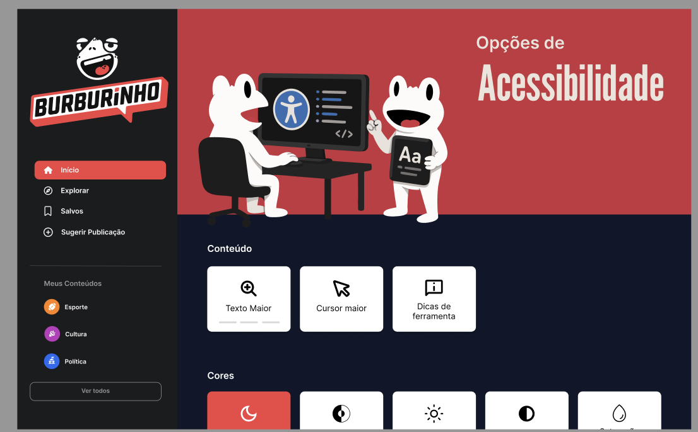 |

##### Ponto de Reutilização e Relação com a Teoria

O nível de reutilização desta frente é o **estado transversal**: **Context API + variáveis CSS**.
 
O fluxo é este:
 
1. O `ThemeProvider` guarda o estado (tema, fonte, alto contraste, reduzir animações).
2. A cada mudança, ele escreve atributos `data-*` no `<html>`.
3. O `globals.css` troca o valor das variáveis CSS conforme esses atributos.
4. Todos os componentes já usam `var(--cor-...)`, então mudam de aparência sem saber que o tema existe.
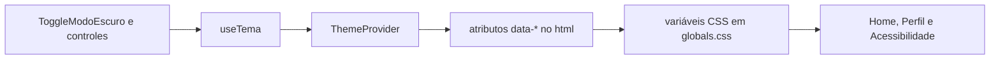
 **Relação com a teoria:**
 
- **Parte fixa × pontos flexíveis:** o Provider faz parte da estrutura compartilhada da minha aplicação, e o que varia de rota para rota é o conteúdo que entra por `children`. Isso não quer dizer que o Provider seja parte interna do Next.js; ele é código nosso, encaixado no `layout.tsx`, que é o hot spot que o framework chama.
- **Extensível:** para criar uma nova preferência (por exemplo, o cursor maior que acrescentei depois), eu só adiciono um campo ao estado e uma regra no CSS. Nenhum componente existente muda.
- **Seguro, por encapsulamento:** ninguém lê o Context diretamente; o acesso é só pelo `useTema`. O hook lança um erro claro se for usado fora do Provider, em vez de devolver um valor errado em silêncio.

##### Contrato do Componente (Props)

| Elemento | Contrato |
| --- | --- |
| `ThemeProvider` | Recebe `children: ReactNode`. Deve envolver o `AppLayout` **uma única vez**, no layout raiz. |
| `useTema()` | Retorna `tema`, `fonte`, `altoContraste`, `reduzirAnimacoes` e as funções `definirTema`, `definirFonte`, `definirAltoContraste` e `definirReduzirAnimacoes`, além de `cursorMaior`/`definirCursorMaior` e `dicasFerramenta`/`definirDicasFerramenta`. |
| `tema` | `claro` ou `escuro`. Sem preferência salva, usa o `prefers-color-scheme` do sistema ao montar no navegador. |
| `fonte` | `normal` (16px), `grande` (18px) ou `muito-grande` (22px). O valor de 22px foi definido por mim nesta implementação, porque o Figma não o especifica. |
| `ToggleModoEscuro` | Consome o `useTema`. Por padrão, é um `role="switch"` com `aria-checked`. Com a prop `selecionar`, aplica diretamente o modo escuro, usando um botão com `aria-pressed`, ao lado do Modo Claro. |
 
**Persistência:** as preferências ficam no `localStorage`, na chave `burburinho:preferencias`. Tomei três cuidados:
 
- a leitura valida cada campo antes de aceitar o valor salvo;
- a gravação só começa **depois** da recuperação inicial, para o valor padrão não sobrescrever a escolha anterior do usuário;
- se o armazenamento falhar (por exemplo, navegação privada), o portal continua funcionando na sessão.
Fora do Provider, `useTema` lança `useTema deve ser usado dentro de um ThemeProvider.`
 

##### Onde é Reutilizado

| Tela/rota | Arquivo que usa | Como |
| --- | --- | --- |
| **Todas as rotas** | [`app/layout.tsx`](https://github.com/UnBArqDsw2026-2-Turma01/2026.2-T01-_G3_ProjetoPortalNoticias_Entrega_04/blob/main/portal/src/app/layout.tsx) | `<ThemeProvider><AppLayout>{children}</AppLayout></ThemeProvider>`: uma linha leva o tema a todo o portal. |
| Acessibilidade (`/acessibilidade`) | [`app/acessibilidade`](https://github.com/UnBArqDsw2026-2-Turma01/2026.2-T01-_G3_ProjetoPortalNoticias_Entrega_04/tree/main/portal/src/app/acessibilidade) | Reaproveita o `ToggleModoEscuro` e usa `useTema` nos controles de fonte, contraste, animações, cursor e dicas. |
| Home (`/`) e Perfil (`/perfil`) | [`app/page.tsx`](https://github.com/UnBArqDsw2026-2-Turma01/2026.2-T01-_G3_ProjetoPortalNoticias_Entrega_04/blob/main/portal/src/app/page.tsx) e [`app/perfil`](https://github.com/UnBArqDsw2026-2-Turma01/2026.2-T01-_G3_ProjetoPortalNoticias_Entrega_04/tree/main/portal/src/app/perfil) | Não consomem o hook: recebem as cores só pelas variáveis CSS. |
| Storybook | [`ToggleModoEscuro.stories.tsx`](https://github.com/UnBArqDsw2026-2-Turma01/2026.2-T01-_G3_ProjetoPortalNoticias_Entrega_04/blob/main/portal/src/components/ToggleModoEscuro/ToggleModoEscuro.stories.tsx) | Story do toggle com o mesmo contrato (pendente: depende da configuração do Storybook pela vaga 7). |
 

##### Implementação (Código)

Arquivos principais:
 
- [`ThemeProvider.tsx`](https://github.com/UnBArqDsw2026-2-Turma01/2026.2-T01-_G3_ProjetoPortalNoticias_Entrega_04/blob/main/portal/src/contexts/ThemeProvider.tsx) e [`useTema.ts`](https://github.com/UnBArqDsw2026-2-Turma01/2026.2-T01-_G3_ProjetoPortalNoticias_Entrega_04/blob/main/portal/src/hooks/useTema.ts)
- [`ToggleModoEscuro`](https://github.com/UnBArqDsw2026-2-Turma01/2026.2-T01-_G3_ProjetoPortalNoticias_Entrega_04/tree/main/portal/src/components/ToggleModoEscuro) (componente, estilos, `index.ts` e story)
- [Página Acessibilidade](https://github.com/UnBArqDsw2026-2-Turma01/2026.2-T01-_G3_ProjetoPortalNoticias_Entrega_04/tree/main/portal/src/app/acessibilidade) e [Página Perfil](https://github.com/UnBArqDsw2026-2-Turma01/2026.2-T01-_G3_ProjetoPortalNoticias_Entrega_04/tree/main/portal/src/app/perfil)
- Integração em [`layout.tsx`](https://github.com/UnBArqDsw2026-2-Turma01/2026.2-T01-_G3_ProjetoPortalNoticias_Entrega_04/blob/main/portal/src/app/layout.tsx) e regras em [`globals.css`](https://github.com/UnBArqDsw2026-2-Turma01/2026.2-T01-_G3_ProjetoPortalNoticias_Entrega_04/blob/main/portal/src/app/globals.css)
- Testes: [`ThemeProvider.test.tsx`](https://github.com/UnBArqDsw2026-2-Turma01/2026.2-T01-_G3_ProjetoPortalNoticias_Entrega_04/blob/main/portal/src/contexts/ThemeProvider.test.tsx) e [`useTema.test.tsx`](https://github.com/UnBArqDsw2026-2-Turma01/2026.2-T01-_G3_ProjetoPortalNoticias_Entrega_04/blob/main/portal/src/hooks/useTema.test.tsx)
Trecho do hook, que é o ponto de encapsulamento:
 
```ts
import { useContext } from "react";
import { TemaContext } from "@/contexts/ThemeProvider";
 
export function useTema() {
  const contexto = useContext(TemaContext);
  if (contexto === undefined) {
    throw new Error("useTema deve ser usado dentro de um ThemeProvider.");
  }
  return contexto;
}
```
 
Trecho do `globals.css`, que reage aos atributos `data-*` escritos pelo Provider:
 
```css
:root[data-tema="escuro"] {
  --cor-fundo: #0f172a;
  --cor-texto-sobre-fundo: #ffffff;
}
 
:root[data-fonte="grande"] { --tamanho-fonte-base: 18px; }
:root[data-fonte="muito-grande"] { --tamanho-fonte-base: 22px; }
 
:root[data-contraste="alto"] {
  --cor-fundo: #000000;
  --cor-texto-sobre-fundo: #ffffff;
  --cor-primaria: #ffff00;
  --cor-sobre-primaria: #000000;
  /* ... demais variáveis */
}
 
:root[data-animacoes="reduzidas"],
:root[data-animacoes="reduzidas"] *,
:root[data-animacoes="reduzidas"] *::before,
:root[data-animacoes="reduzidas"] *::after {
  transition: none !important;
  animation: none !important;
  scroll-behavior: auto !important;
}
```
 
O seletor é `:root[data-tema="escuro"]` porque `[data-tema="escuro"]` sozinho tem a mesma especificidade de `:root`, e aí só a ordem no arquivo decidiria qual regra vence.
 
 
##### Demonstração em Uso

Comparação do build local nas duas aparências. 
 
| Tela | Claro | Escuro |
| --- | --- | --- |
| Home |  | 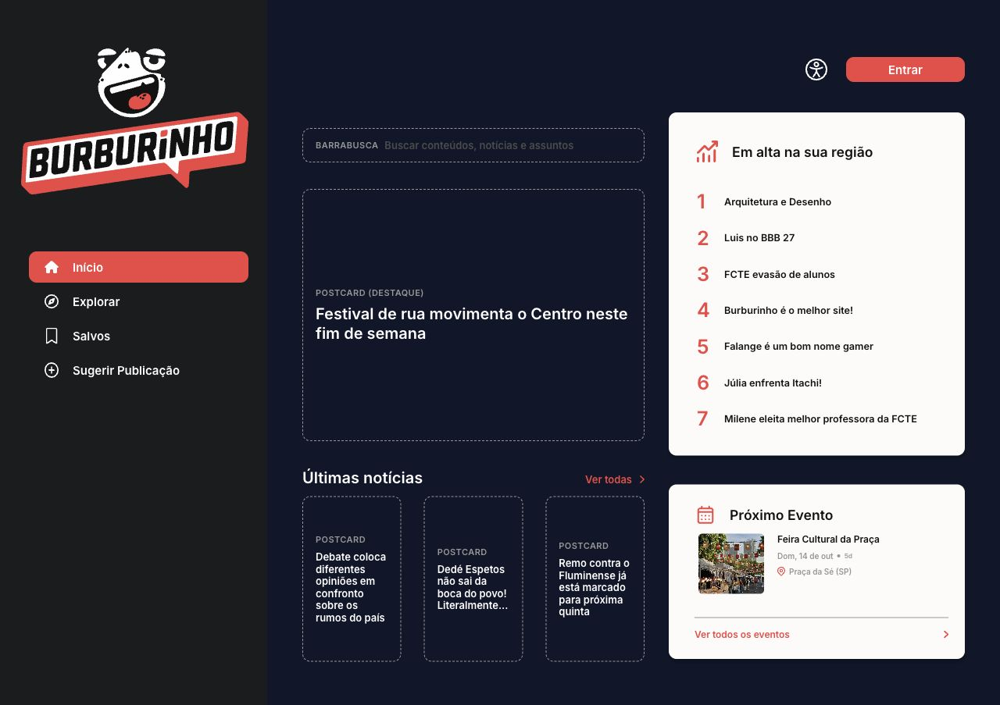 |
| Perfil |  |  |
 
**O que validei:**
 
- **45 testes passaram**, dos quais 9 são casos novos da vaga 6 (inclusive "alternar muda `data-tema` no `html`" e "`useTema` fora do Provider lança erro");
- o lint passou sem avisos e o build estático foi concluído;
- no navegador, conferi a alternância de tema, a persistência após recarregar, as fontes de 18px e 22px, os atributos de contraste e animações e a navegação da Home para Acessibilidade e Perfil;
- varri o CSS procurando cores fixas fora do `globals.css` e não encontrei nenhuma, então não precisei abrir aviso para ninguém.

##### Uso da IA Generativa na Minha Solução

Usei o **OpenAI Codex** para ler a issue e o repositório, inspecionar o Figma e gerar o Provider, o hook, o toggle, as duas páginas, os estilos, a story, os testes e o rascunho desta documentação, além de ajustes pontuais no layout e no CSS global. Não aceitei o resultado sem conferir: rodei testes, lint e build e comparei no navegador com as telas do Figma que consegui acessar.

##### Senso Crítico

- **Context × Decorator (Entrega 03):** os dois evitam duplicação, mas fazem coisas diferentes. O Decorator **acrescenta comportamento** a um objeto por composição, e foi o que usamos para os temas da Home. O Context **fornece estado compartilhado**. Aqui, usar Decorator exigiria decorar cada página; com Context, nenhuma página precisa saber do tema, nem receber o tema por props.
- **Risco de colocar coisas demais no Context:** quando o valor do Context muda, todos os consumidores renderizam de novo. Por isso o meu Context guarda **só as preferências**, sem notícias nem dados de sessão. Os componentes que usam só variáveis CSS nem assinam esse estado (conforme a documentação de [useContext](https://react.dev/reference/react/useContext)).
- **Possível flash de tema claro:** a leitura do `localStorage` fica num `useEffect`, para o primeiro render ser compatível com a exportação estática do Next. O custo é que o tema claro pode aparecer por um instante antes da preferência ser recuperada. **Não garanto ausência de flash.** Os efeitos rodam no cliente, como explica a documentação de [useEffect](https://react.dev/reference/react/useEffect).
- **O hook não é uma barreira de segurança:** ele melhora o diagnóstico de uso incorreto, mas nada impede alguém de importar o Context direto.
- **Alto contraste não é auditoria:** defini o alto contraste separado do modo escuro, mas isso não equivale a uma auditoria completa de acessibilidade.
- **O que eu faria com mais tempo:** evitar o flash com um script inline no `<head>`, validar o contraste com uma ferramenta de acessibilidade e criar um lint de CSS que barre cor fixa.


#### Reutilização 7: Catálogo e Identidade Temática (Storybook, LogoTema)

**Responsável:** Johnnatan de Salles Sanches ([issue #7](https://github.com/UnBArqDsw2026-2-Turma01/2026.2-T01-_G3_ProjetoPortalNoticias_Entrega_04/issues/7) · [commit 5639613](https://github.com/UnBArqDsw2026-2-Turma01/2026.2-T01-_G3_ProjetoPortalNoticias_Entrega_04/commit/5639613d855060d80dd68efbd57b573ff3801cc8)).

##### Contexto (Problema de Repetição)

Sem catálogo, cada integrante precisa descobrir props e estados lendo código ou
perguntando ao autor. As variantes sazonais também não deveriam exigir uma
SideBar diferente para cada data.

##### Ponto de Reutilização e Relação com a Teoria

O Storybook torna os componentes **usáveis e compreensíveis** antes de serem
reutilizados (slide 40): stories exemplificam entradas, Autodocs extrai a
tabela do código e controles permitem experimentação. O addon de documentação
é um exemplo de extensão por plugin (slide 52). No
[Decorator da Entrega 03](https://github.com/UnBArqDsw2026-2-Turma01/2026.2-T01-_G3_ProjetoPortalNoticias_Entrega_03/tree/main/demonstracao_codigos/SubGrupo3/decorator),
classes envolviam a página e substituíam o arquivo do logo no HTML. No portal,
`LogoTema` compõe `LogoBase` e seleciona uma das imagens originais por prop ou
data, sem alterar strings HTML nem herdar das classes antigas. As opções de
`tema` são alternativas de variabilidade (slides 70–72).

##### Contrato do Componente (Props)

| Prop | Tipo | Padrão | Efeito |
| --- | --- | --- | --- |
| `tema` | `"padrao" \| "natal" \| "halloween" \| "estudante"` | omitida: data local automática | Força a imagem escolhida; `padrao` também pode ser forçado. |

O automático usa 25/12, 31/10 e 11/08, respectivamente, e `padrao` nos demais
dias. A escolha é atualizada à meia-noite e quando a aba volta a ficar visível.
Na exportação estática o primeiro HTML usa o logo padrão; após a hidratação é
aplicada a data do navegador.

##### Onde é Reutilizado

| Recurso | Onde é reutilizado | Evidência |
| --- | --- | --- |
| `LogoTema` | `SideBar`, fornecida pelo `AppLayout` raiz a todas as rotas | [`SideBar.tsx`](https://github.com/UnBArqDsw2026-2-Turma01/2026.2-T01-_G3_ProjetoPortalNoticias_Entrega_04/blob/main/portal/src/components/SideBar/SideBar.tsx) |
| `LogoTema` | Catálogo, nas variantes padrão, Natal, Halloween e Estudante | [`LogoTema.stories.tsx`](https://github.com/UnBArqDsw2026-2-Turma01/2026.2-T01-_G3_ProjetoPortalNoticias_Entrega_04/blob/main/portal/src/components/LogoTema/LogoTema.stories.tsx) |
| Stories e Autodocs | Componentes de layout, conteúdo, formulário, interação e tema | [`portal/.storybook`](https://github.com/UnBArqDsw2026-2-Turma01/2026.2-T01-_G3_ProjetoPortalNoticias_Entrega_04/tree/main/portal/.storybook) e [`stories`](https://github.com/UnBArqDsw2026-2-Turma01/2026.2-T01-_G3_ProjetoPortalNoticias_Entrega_04/tree/main/portal/src) |

##### Implementação (Código)

[LogoTema e seleção de data](https://github.com/UnBArqDsw2026-2-Turma01/2026.2-T01-_G3_ProjetoPortalNoticias_Entrega_04/blob/main/portal/src/components/LogoTema/LogoTema.tsx) ·
[stories](https://github.com/UnBArqDsw2026-2-Turma01/2026.2-T01-_G3_ProjetoPortalNoticias_Entrega_04/blob/main/portal/src/components/LogoTema/LogoTema.stories.tsx) ·
[configuração Storybook](https://github.com/UnBArqDsw2026-2-Turma01/2026.2-T01-_G3_ProjetoPortalNoticias_Entrega_04/tree/main/portal/.storybook) ·
[workflow](https://github.com/UnBArqDsw2026-2-Turma01/2026.2-T01-_G3_ProjetoPortalNoticias_Entrega_04/blob/main/.github/workflows/deploy-mkdocs.yml).
O Storybook usa `@storybook/nextjs-vite`, recomendado pela documentação atual,
`@storybook/addon-docs`, `staticDirs` e o mesmo CSS e `ThemeProvider` do portal.
No build do Pages, `NEXT_PUBLIC_BASE_PATH` aponta para `/storybook`, não para
`/portal`, para que os assets também funcionem no catálogo.

##### Demonstração em Uso


Captura do build local com o caminho de Pages. O
[catálogo publicado](https://unbarqdsw2026-2-turma01.github.io/2026.2-T01-_G3_ProjetoPortalNoticias_Entrega_04/storybook/?path=/docs/tema-logotema--docs)
depende do merge e de uma execução bem-sucedida do workflow; não é evidência
de publicação antecipada. Os testes cobrem as datas, a troca à meia-noite e a
prop forçada.

##### Uso da IA Generativa na Minha Solução

Usei o Copilot SDK no VS Code para inspecionar o código, implementar a
configuração do Storybook, criar as stories e redigir o rascunho desta seção.
Conferi a versão e as APIs na documentação oficial do Storybook e validei a
implementação com testes, lint, build do portal, build do Storybook e
verificação local no navegador. Mantive a decisão de usar `LogoTema` por
composição, pois as variantes sazonais são selecionadas por uma prop sem
duplicar a `SideBar`.

##### Senso Crítico

Os SVGs temáticos originais são imagens completas, não ornamentos separados.
Reaproveitá-los preserva o desenho, mas não implementa a composição independente
de `LogoBase` com um ornamento por tema pedida na issue; para isso seria
necessário separar e validar os vetores no Figma. A data é a do dispositivo e
há um breve logo padrão antes da hidratação. A conferência final e o mapa devem
ser refeitos após o congelamento do código; stories de componentes adicionados
por outras vagas ainda precisam ser incluídas.

#### Reutilização 8: Responsividade no Celular (tokens de alvo de toque e fonte mínima)

**Responsável:** Júlia Gabriella ([issue #8](https://github.com/UnBArqDsw2026-2-Turma01/2026.2-T01-_G3_ProjetoPortalNoticias_Entrega_04/issues/8) · commits: [cc180a5](https://github.com/UnBArqDsw2026-2-Turma01/2026.2-T01-_G3_ProjetoPortalNoticias_Entrega_04/commit/cc180a58ed65415765af27a8f0425f25e6ef8d63) e [0b912de](https://github.com/UnBArqDsw2026-2-Turma01/2026.2-T01-_G3_ProjetoPortalNoticias_Entrega_04/commit/0b912dea1cbc32c5b5ed15f97df3b3711d495eb3)). Frente definida na [reunião de 22/11](../1.3.IniciativasExtras.md#reuniao-22-11-2026), para que a vaga de documentação também tivesse contribuição de código.

##### Contexto (Problema de Repetição)

O protótipo do Figma foi desenhado em 1440 × 900, e cada vaga adaptou a própria tela para telas estreitas com `@media`. O portal já não rolava para os lados na maioria das telas, mas, ao testar todas as rotas em 320 px e 375 px, encontrei problemas que se **repetiam em vários componentes**:

| Problema encontrado | Onde | Medida no celular |
| --- | --- | --- |
| **Transbordamento horizontal** | Home logada (saudação + acessibilidade + sino + avatar + Sair numa linha só) e Busca (título e contagem lado a lado) | "Sair" cortado em 375 px; "1 publicação" cortado e menu empurrado em 320 px |
| **Alvos de toque pequenos** | ícone de Acessibilidade, botão Entrar, "Sair", "Ver todas", sino, botões Salvar e Seguir, "Ler Notícia", campos do formulário, "Cancelar", "‹ Voltar", itens de "Em alta" | de 16 a 40 px de altura |
| **Fonte miúda** | selos de categoria (`BadgeCategoria`), metadados de `PostCard`, `CardEvento`, `CardComunidade`, dicas do formulário | de 8 a 11 px |
| **Busca por cima da barra do topo** | Home: ao rolar, o campo "Buscar conteúdos, notícias e assuntos" passava por cima da barra fixa | a barra e a `BarraBusca` tinham o mesmo `z-index` (10), e a busca vencia por vir depois no HTML |
| **Zoom automático no iPhone** | campos de texto de 14 px (`CampoFormulario`, `BarraBusca`) | o Safari do iOS amplia a página ao focar campos com menos de 16 px |

Corrigir cada componente com um número fixo no seu próprio `@media` repetiria o mesmo valor (44 px, 12 px, 16 px) em mais de 15 arquivos, e uma mudança futura teria de ser feita em todos.

##### Ponto de Reutilização e Relação com a Teoria

O nível de reutilização é o mesmo do tema (Reutilização 6): **estado transversal por variáveis CSS**. Criei três tokens no [`globals.css`](https://github.com/UnBArqDsw2026-2-Turma01/2026.2-T01-_G3_ProjetoPortalNoticias_Entrega_04/blob/main/portal/src/app/globals.css), **neutros no desktop** e com valor só abaixo de 600 px:

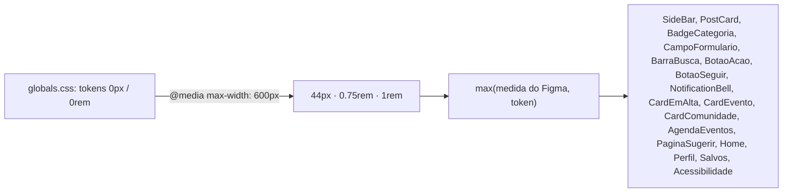

Cada componente usa `max(medida do Figma, token)`. No desktop, o token vale zero e vence a medida do Figma, então **nenhuma tela de 1440 px mudou**; no celular, vence o maior dos dois. A regra fica num lugar só, e os componentes só a consomem.

**Relação com a teoria:**

- **Frozen spot × hot spot (slides 11 a 15):** a regra "alvo mínimo de 44 px no celular" é parte fixa, decidida uma vez no `globals.css`; o que varia em cada componente é a medida própria do Figma, que entra como o primeiro argumento do `max()`.
- **Reutilização além do código (slide 4):** reaproveitei um **requisito não funcional** já registrado na Entrega 01 (usabilidade e acessibilidade no SIG) e o transformei em token, em vez de reescrevê-lo como número em cada tela.
- **Extensível:** um componente novo só precisa escrever `min-height: max(32px, var(--alvo-toque-minimo))` para herdar o comportamento; se o grupo decidir que o mínimo é 48 px, muda uma linha.

##### Contrato do Componente (Props)

Não criei componente novo: o contrato é o dos **tokens**.

| Token | Desktop | Abaixo de 600 px | Uso nos componentes |
| --- | --- | --- | --- |
| `--alvo-toque-minimo` | `0px` | `44px` (WCAG 2.5.5 e Apple Human Interface Guidelines) | `min-height: max(<Figma>, var(--alvo-toque-minimo))` em botões, links e campos |
| `--fonte-minima` | `0rem` | `0.75rem` (12 px com fonte padrão) | `font-size: max(<Figma>, var(--fonte-minima))` em selos, metadados e dicas |
| `--fonte-minima-campo` | `0rem` | `1rem` (16 px) | `font-size: max(0.875rem, var(--fonte-minima-campo))` nos campos de texto |

Como os valores são em `rem`, eles **acompanham a fonte escolhida em Acessibilidade** (18 px e 22 px): a correção não briga com a Reutilização 6.

Encontrei ainda um erro de **camadas** durante o ensaio do vídeo: a barra fixa no topo (o [`AppLayout`](https://github.com/UnBArqDsw2026-2-Turma01/2026.2-T01-_G3_ProjetoPortalNoticias_Entrega_04/blob/main/portal/src/components/AppLayout/AppLayout.module.css) abaixo de 900 px) tinha o mesmo `z-index` da `BarraBusca`. Organizei a ordem das camadas: cards (1 e 2), busca (10), lista do sino (50), **barra do topo (60)** e modal de edição de perfil (100), que deve cobrir a tela inteira.

Além dos tokens, ajustei o layout de duas telas só abaixo de 600 px: na Home, o cabeçalho passa a quebrar linha (saudação em cima, ícones embaixo) e o avatar vai para 44 px; na Busca, a contagem desce para baixo do título.

##### Onde é Reutilizado

| Token | Arquivos que consomem |
| --- | --- |
| `--alvo-toque-minimo` | [`SideBar`](https://github.com/UnBArqDsw2026-2-Turma01/2026.2-T01-_G3_ProjetoPortalNoticias_Entrega_04/blob/main/portal/src/components/SideBar/SideBar.module.css), [`PostCard`](https://github.com/UnBArqDsw2026-2-Turma01/2026.2-T01-_G3_ProjetoPortalNoticias_Entrega_04/blob/main/portal/src/components/PostCard/PostCard.module.css), [`CampoFormulario`](https://github.com/UnBArqDsw2026-2-Turma01/2026.2-T01-_G3_ProjetoPortalNoticias_Entrega_04/blob/main/portal/src/components/CampoFormulario/CampoFormulario.module.css), [`BarraBusca`](https://github.com/UnBArqDsw2026-2-Turma01/2026.2-T01-_G3_ProjetoPortalNoticias_Entrega_04/blob/main/portal/src/components/BarraBusca/BarraBusca.module.css), [`BotaoAcao`](https://github.com/UnBArqDsw2026-2-Turma01/2026.2-T01-_G3_ProjetoPortalNoticias_Entrega_04/blob/main/portal/src/components/BotaoAcao/BotaoAcao.module.css), [`BotaoSeguir`](https://github.com/UnBArqDsw2026-2-Turma01/2026.2-T01-_G3_ProjetoPortalNoticias_Entrega_04/blob/main/portal/src/components/BotaoSeguir/BotaoSeguir.module.css), [`NotificationBell`](https://github.com/UnBArqDsw2026-2-Turma01/2026.2-T01-_G3_ProjetoPortalNoticias_Entrega_04/blob/main/portal/src/components/NotificationBell/NotificationBell.module.css), [`CardEmAlta`](https://github.com/UnBArqDsw2026-2-Turma01/2026.2-T01-_G3_ProjetoPortalNoticias_Entrega_04/blob/main/portal/src/components/CardEmAlta/CardEmAlta.module.css), [`CardEvento`](https://github.com/UnBArqDsw2026-2-Turma01/2026.2-T01-_G3_ProjetoPortalNoticias_Entrega_04/blob/main/portal/src/components/CardEvento/CardEvento.module.css), [`PaginaSugerir`](https://github.com/UnBArqDsw2026-2-Turma01/2026.2-T01-_G3_ProjetoPortalNoticias_Entrega_04/blob/main/portal/src/components/PaginaSugerir/PaginaSugerir.module.css), [Home](https://github.com/UnBArqDsw2026-2-Turma01/2026.2-T01-_G3_ProjetoPortalNoticias_Entrega_04/blob/main/portal/src/app/_home/PaginaInicial.module.css), [Perfil](https://github.com/UnBArqDsw2026-2-Turma01/2026.2-T01-_G3_ProjetoPortalNoticias_Entrega_04/blob/main/portal/src/app/perfil/page.module.css) e [Salvos](https://github.com/UnBArqDsw2026-2-Turma01/2026.2-T01-_G3_ProjetoPortalNoticias_Entrega_04/blob/main/portal/src/app/salvos/page.module.css) |
| `--fonte-minima` | [`BadgeCategoria`](https://github.com/UnBArqDsw2026-2-Turma01/2026.2-T01-_G3_ProjetoPortalNoticias_Entrega_04/blob/main/portal/src/components/BadgeCategoria/BadgeCategoria.module.css), [`PostCard`](https://github.com/UnBArqDsw2026-2-Turma01/2026.2-T01-_G3_ProjetoPortalNoticias_Entrega_04/blob/main/portal/src/components/PostCard/PostCard.module.css), [`CardEvento`](https://github.com/UnBArqDsw2026-2-Turma01/2026.2-T01-_G3_ProjetoPortalNoticias_Entrega_04/blob/main/portal/src/components/CardEvento/CardEvento.module.css), [`CardComunidade`](https://github.com/UnBArqDsw2026-2-Turma01/2026.2-T01-_G3_ProjetoPortalNoticias_Entrega_04/blob/main/portal/src/components/CardComunidade/CardComunidade.module.css), [`AgendaEventos`](https://github.com/UnBArqDsw2026-2-Turma01/2026.2-T01-_G3_ProjetoPortalNoticias_Entrega_04/blob/main/portal/src/components/AgendaEventos/AgendaEventos.module.css), [`PaginaSugerir`](https://github.com/UnBArqDsw2026-2-Turma01/2026.2-T01-_G3_ProjetoPortalNoticias_Entrega_04/blob/main/portal/src/components/PaginaSugerir/PaginaSugerir.module.css), [Perfil](https://github.com/UnBArqDsw2026-2-Turma01/2026.2-T01-_G3_ProjetoPortalNoticias_Entrega_04/blob/main/portal/src/app/perfil/page.module.css) e [Acessibilidade](https://github.com/UnBArqDsw2026-2-Turma01/2026.2-T01-_G3_ProjetoPortalNoticias_Entrega_04/blob/main/portal/src/app/acessibilidade/page.module.css) (subtítulo do banner, que encolhia com a largura) |
| `--fonte-minima-campo` | [`CampoFormulario`](https://github.com/UnBArqDsw2026-2-Turma01/2026.2-T01-_G3_ProjetoPortalNoticias_Entrega_04/blob/main/portal/src/components/CampoFormulario/CampoFormulario.module.css) e [`BarraBusca`](https://github.com/UnBArqDsw2026-2-Turma01/2026.2-T01-_G3_ProjetoPortalNoticias_Entrega_04/blob/main/portal/src/components/BarraBusca/BarraBusca.module.css) |

Como `BadgeCategoria`, `PostCard` e `CampoFormulario` já são reutilizados em várias telas, uma linha em cada um corrige Home, Busca, Salvos, categorias, notícia e Sugerir Publicação de uma vez.

##### Implementação (Código)

Os tokens, em [`globals.css`](https://github.com/UnBArqDsw2026-2-Turma01/2026.2-T01-_G3_ProjetoPortalNoticias_Entrega_04/blob/main/portal/src/app/globals.css):

```css
:root {
  /* No desktop os valores são neutros e o layout do Figma não muda. */
  --alvo-toque-minimo: 0px;
  --fonte-minima: 0rem;
  --fonte-minima-campo: 0rem;
}

@media (max-width: 600px) {
  :root {
    --alvo-toque-minimo: 44px;
    --fonte-minima: 0.75rem;
    --fonte-minima-campo: 1rem;
  }
}
```

Exemplos de consumo:

```css
/* BadgeCategoria: 8px no desktop (Figma), 12px no celular */
.p { font-size: max(0.5rem, var(--fonte-minima)); }

/* CampoFormulario: 32px de altura e 14px de texto no desktop; 44px e 16px no celular */
.entrada {
  min-height: max(32px, var(--alvo-toque-minimo));
  font-size: max(0.875rem, var(--fonte-minima-campo));
}
```

E o cabeçalho da Home, que deixou de transbordar:

```css
@media (max-width: 600px) {
  .cabecalho { flex-wrap: wrap; gap: 12px 16px; }
  .saudacao  { flex: 1 1 100%; font-size: 1.75rem; }
  .avatar    { flex-shrink: 0; width: 44px; height: 44px; }
}
```

Testes: [`responsividade.test.ts`](https://github.com/UnBArqDsw2026-2-Turma01/2026.2-T01-_G3_ProjetoPortalNoticias_Entrega_04/blob/main/portal/src/app/responsividade.test.ts), com **29 casos**. Como o jsdom não calcula layout, o teste confere o **contrato**: os tokens são neutros no desktop, ganham 44 px / 12 px / 16 px abaixo de 600 px, cada componente da tabela acima continua consumindo o token e os cabeçalhos da Home e da Busca quebram linha no celular. Dois casos travam a ordem das camadas: a barra do topo precisa ficar acima da busca e do sino e abaixo do modal de perfil. Se alguém remover o token de um componente, o teste falha.

##### Demonstração em Uso

Antes: portal publicado (sem a correção). Depois: build local com a correção.

| Tela | Antes | Depois |
| --- | --- | --- |
| Home logada (375 px) | 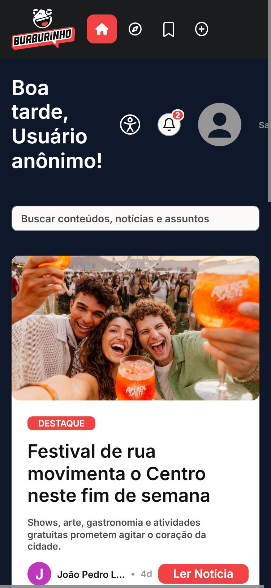 | 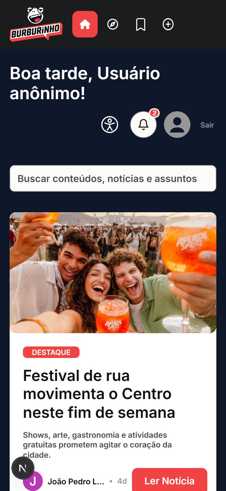 |
| Home rolada (375 px) | 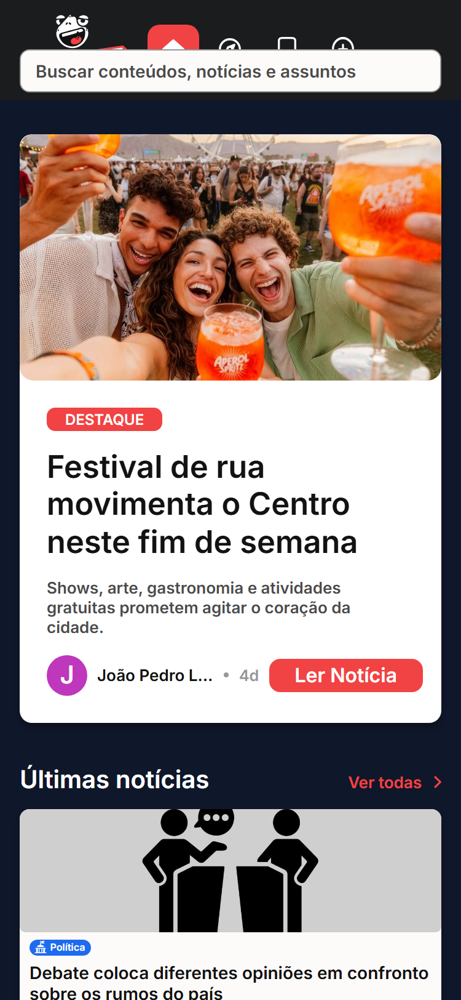 | 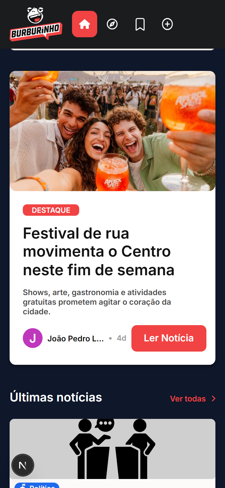 |
| Busca (320 px) | 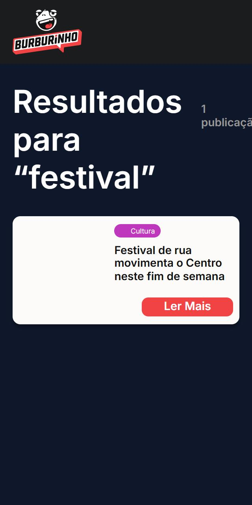 | 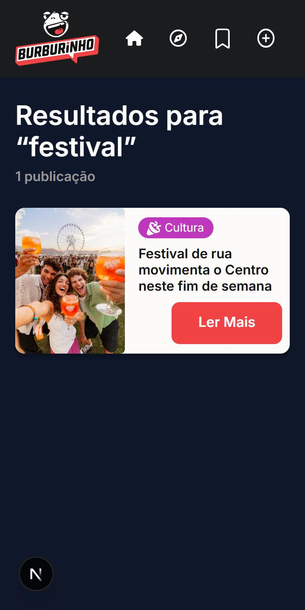 |

**O que validei:**

- varredura automática de 8 rotas (Home, Explorar, Busca, Salvos, Acessibilidade, Sugerir, Perfil e Cultura) em 320 px e 375 px, antes e depois: o transbordamento horizontal caiu de 2 telas para **nenhuma**, a busca deixou de cobrir a barra do topo ao rolar (conferido pelo elemento que fica no ponto da barra), e as fontes abaixo de 12 px ficaram só no contador do sino e na inicial do avatar dos cards, que funcionam como ícones e não como texto corrido;
- no desktop (1440 px), conferi que os tokens valem `0px` e `0rem` e que o ícone de Acessibilidade (28 px) e o avatar (60 px) mantêm as medidas do Figma;
- a suíte completa de testes, o lint e o build estático passaram.

##### Uso da IA Generativa na Minha Solução

Usei o **Claude Code (Anthropic)** como ferramenta de apoio ao longo do desenvolvimento, sempre sob a minha condução. Assumi a frente de responsividade na reunião de 22/11 e defini o escopo do trabalho: auditar todas as telas em largura de celular e corrigir o que fosse encontrado, em vez de ajustar só o menu, documentando o resultado no mesmo formato das demais seções.

A IA me ajudou nas tarefas mais operacionais: inspecionar o CSS dos componentes, automatizar a varredura das rotas em 320 px e 375 px, sugerir a abordagem por tokens, agilizar as edições repetitivas nos arquivos e estruturar o teste e o rascunho desta seção. Nenhuma sugestão entrou sem a minha avaliação: analisei cada proposta antes de aplicá-la, revisei as alterações e conferi o resultado no navegador, comparando o antes e o depois em cada tela e confirmando que o layout do desktop continuava igual ao Figma.

Foi nessa validação que encontrei os problemas que a IA não percebeu. A primeira versão deixou o **avatar achatado** (o `flex` encolhia a largura) e, depois, **cortado** (o SVG tinha `width="60"` fixo, e a regra só ajustava `img`); corrigi os dois. A IA também havia afirmado, antes de testar, que a barra do topo sumia ao rolar; conferi e vi que ela já ficava fixa, então retirei esse item do escopo. Essa experiência reforçou que a IA acelera o trabalho, mas a decisão e a verificação continuam sendo minhas.

##### Senso Crítico

- **Por que tokens e não um número em cada `@media`:** o número repetido em 17 arquivos é exatamente o problema de repetição que a disciplina ensina a evitar. O custo é uma indireção a mais: quem lê `max(32px, var(--alvo-toque-minimo))` precisa saber que o token é zero no desktop. Deixei isso comentado no `globals.css`.
- **44 px é o nível AAA:** o WCAG 2.2 exige 24 px no nível AA (2.5.8) e recomenda 44 px no AAA (2.5.5). Escolhi 44 px porque é o mesmo valor das diretrizes da Apple e do Android. Links de texto dentro de frases e os selos clicáveis do Explorar (24 px) ficaram fora, porque o WCAG isenta links em linha e o selo já atende ao AA.
- **"Meus Conteúdos" continua escondido no celular:** cogitei mostrá-lo como uma linha de atalhos, mas a barra do topo é fixa, e uma segunda linha ocuparia cerca de 15% da tela o tempo todo. Como o Explorar, que está na barra, lista todas as categorias, mantive a decisão da vaga 2.
- **Limites da verificação:** testei com emulação de viewport no navegador, não em aparelhos físicos, e o teste automatizado confere o contrato do CSS, não o layout renderizado. Com mais tempo, eu usaria testes visuais (Playwright com screenshots) em larguras fixas e testaria num iPhone de verdade o zoom dos campos.

#### Mapa de Reutilização

Levantamento **provisório de 19/11/2026**, antes da vaga 4 e do congelamento.
Os números são **pontos de chamada no código**, não instâncias renderizadas:
excluem stories, testes e comentários; um `.map` ou rota dinâmica conta uma
vez. Para hooks contam-se chamadas, não declarações. Após a revisão de 20/11, a agenda é instanciada em JSX pelo renderizador fornecido por `PaginaCategoria`; o mapa deve contar esse ponto de chamada. Os usos indiretos pelo
layout e pelos componentes são indicados, mas não somados novamente.
Nó “—” indica ausência de nó identificado, não inexistência no Figma. Hooks não
têm story própria: a coluna aponta para a demonstração do consumidor.

| Componente/Hook | Nível | Props principais | Telas / pontos de uso | Nó no Figma | Story | Código | Autor(a) |
| --- | --- | --- | --- | --- | --- | --- | --- |
| AppLayout | Composição | `children` | Layout raiz, todas as rotas (1) | [SideBar 115:68][fig-sidebar] | [Docs][s-applayout] | [Código][c-applayout] | João Pedro |
| SideBar | Props / composição | `itemAtivo`, `logado`, `categoriasSeguidas` | AppLayout, todas as rotas (1) | [115:68][fig-sidebar] | [Docs][s-sidebar] | [Código][c-sidebar] | João Pedro |
| LogoTema | Props / composição | `tema` | SideBar, todas as rotas (1) | [520:810][fig-logo] | [Docs][s-logo] | [Código][c-logo] | Johnnatan |
| PaginaInicial | Props | `destaque`, `ultimas`, `evento` | Home (1) | [6:5][fig-home] | [Docs][s-home] | [Código][c-home] | João Pedro |
| Marcador | Composição | `componente`, `href`, `children` | Home (2; um dentro de lista) | — | [Docs][s-marcador] | [Código][c-marcador] | João Pedro |
| CardEmAlta | Props | `assuntos`, `limite`, `titulo` | Home (1) | [15:1349][fig-alta] | [Docs][s-alta] | [Código][c-alta] | João Pedro |
| CardEvento | Props | `evento`, `hrefTodos` | Home (1) | [230:1005][fig-evento] | [Docs][s-evento] | [Código][c-evento] | João Pedro |
| BarraBusca | Props / estado | `placeholder`, `valorInicial` | Home (1) | — | [Docs][s-busca] | [Código][c-busca] | Matheus |
| NotificationBell | Hook / estado | — | Home logada (1) | — | [Docs][s-bell] | [Código][c-bell] | Matheus |
| PostCard | Props / composição | `noticia`, `variante`, `acoes` | Busca, Salvos e categorias (3) | [183:654][fig-post] | [Docs][s-post] | [Código][c-post] | André |
| BadgeCategoria | Props | `categoria`, `tamanho` | PostCard: Busca, Salvos e categorias (1) | [230:1212][fig-badge] | [Docs][s-badge] | [Código][c-badge] | André |
| TempoPublicacao | Hook / props | `iso`, `className` | PostCard: Busca, Salvos e categorias (1) | — | [Docs][s-tempo] | [Código][c-tempo] | André |
| PaginaCategoria | Componente genérico | `fabrica` | Rota dinâmica de 4 categorias (1) | [230:737][fig-categoria] | [Docs][s-categoria] | [Código][c-categoria] | André |
| AgendaEventos | Props / fábrica | `eventos` | Categoria Cultura via fábrica (1) | [250:1678][fig-agenda] | [Docs][s-agenda] | [Código][c-agenda] | André |
| CardComunidade | Props / fábrica | `fabrica` | Explorar (1 dentro de lista) | [143:443][fig-comunidade] | [Docs][s-comunidade] | [Código][c-comunidade] | André |
| BotaoSeguir | Props / hooks | `categoria`, `rotuloSeguir`, `convite` | Categorias e Explorar (2) | [183:1654][fig-seguir] | [Docs][s-seguir] | [Código][c-seguir] | André |
| ControleAcessibilidade | Props / composição | `rotulo`, `descricao`, `ativo`, `onClick` | Acessibilidade (11) e ToggleModoEscuro (1): 12 | — | [Docs][s-controle] | [Código][c-controle] | Giovanna Aguiar |
| ToggleModoEscuro | Context | `selecionar` | Acessibilidade (1) | — | [Docs][s-toggle] | [Código][c-toggle] | Giovanna Aguiar |
| ThemeProvider | Context / composição | `children`, `temaInicial` | Layout raiz, todas as rotas (1) | — | [Toggle][s-toggle] | [Código][c-provider] | Giovanna Aguiar |
| useTema | Context / hook | — | Acessibilidade, ControleAcessibilidade e ToggleModoEscuro (3) | — | [Toggle][s-toggle] | [Código][c-usetema] | Giovanna Aguiar |
| useSessaoSimulada | Hook | — | Home, SideBar, BotaoSeguir (3) | — | [Home][s-home] | [Código][c-sessao] | João Pedro |
| useCategoriasSeguidas | Hook | — | SideBar e BotaoSeguir (2) | — | [Seguir][s-seguir] | [Código][c-seguidas] | André |
| useNotificacoes | Hook / Observer | — | NotificationBell (1) | — | [Sino][s-bell] | [Código][c-notificacoes] | Matheus |
| useSalvos | Hook | — | Salvos (1) | — | Sem story de Salvos | [Código][c-salvos] | Matheus |

Os 12 pontos de `ControleAcessibilidade` evitam repetir estrutura e estado
acessível; `PostCard` compartilha três pontos entre telas e `PaginaCategoria`
gera quatro rotas a partir de uma chamada. Não se deve confundir essas
chamadas com o número de cartões efetivamente renderizados. Os marcadores da
Home ainda não são usos de `PostCard`. A agenda existe apenas em Cultura: não
há evidência suficiente para generalizá-la em outra abstração agora.

[fig-sidebar]: https://www.figma.com/design/LnkN55jPy6jk8dsjpmYJSF/Prot%C3%B3tipo?node-id=115-68
[fig-logo]: https://www.figma.com/design/LnkN55jPy6jk8dsjpmYJSF/Prot%C3%B3tipo?node-id=520-810
[fig-home]: https://www.figma.com/design/LnkN55jPy6jk8dsjpmYJSF/Prot%C3%B3tipo?node-id=6-5
[fig-alta]: https://www.figma.com/design/LnkN55jPy6jk8dsjpmYJSF/Prot%C3%B3tipo?node-id=15-1349
[fig-evento]: https://www.figma.com/design/LnkN55jPy6jk8dsjpmYJSF/Prot%C3%B3tipo?node-id=230-1005
[fig-post]: https://www.figma.com/design/LnkN55jPy6jk8dsjpmYJSF/Prot%C3%B3tipo?node-id=183-654
[fig-badge]: https://www.figma.com/design/LnkN55jPy6jk8dsjpmYJSF/Prot%C3%B3tipo?node-id=230-1212
[fig-categoria]: https://www.figma.com/design/LnkN55jPy6jk8dsjpmYJSF/Prot%C3%B3tipo?node-id=230-737
[fig-agenda]: https://www.figma.com/design/LnkN55jPy6jk8dsjpmYJSF/Prot%C3%B3tipo?node-id=250-1678
[fig-comunidade]: https://www.figma.com/design/LnkN55jPy6jk8dsjpmYJSF/Prot%C3%B3tipo?node-id=143-443
[fig-seguir]: https://www.figma.com/design/LnkN55jPy6jk8dsjpmYJSF/Prot%C3%B3tipo?node-id=183-1654
[s-applayout]: https://unbarqdsw2026-2-turma01.github.io/2026.2-T01-_G3_ProjetoPortalNoticias_Entrega_04/storybook/?path=/docs/layout-applayout--docs
[s-sidebar]: https://unbarqdsw2026-2-turma01.github.io/2026.2-T01-_G3_ProjetoPortalNoticias_Entrega_04/storybook/?path=/docs/layout-sidebar--docs
[s-logo]: https://unbarqdsw2026-2-turma01.github.io/2026.2-T01-_G3_ProjetoPortalNoticias_Entrega_04/storybook/?path=/docs/tema-logotema--docs
[s-home]: https://unbarqdsw2026-2-turma01.github.io/2026.2-T01-_G3_ProjetoPortalNoticias_Entrega_04/storybook/?path=/docs/layout-paginainicial--docs
[s-marcador]: https://unbarqdsw2026-2-turma01.github.io/2026.2-T01-_G3_ProjetoPortalNoticias_Entrega_04/storybook/?path=/docs/layout-marcador--docs
[s-alta]: https://unbarqdsw2026-2-turma01.github.io/2026.2-T01-_G3_ProjetoPortalNoticias_Entrega_04/storybook/?path=/docs/conte%C3%BAdo-cardemalta--docs
[s-evento]: https://unbarqdsw2026-2-turma01.github.io/2026.2-T01-_G3_ProjetoPortalNoticias_Entrega_04/storybook/?path=/docs/conte%C3%BAdo-cardevento--docs
[s-busca]: https://unbarqdsw2026-2-turma01.github.io/2026.2-T01-_G3_ProjetoPortalNoticias_Entrega_04/storybook/?path=/docs/intera%C3%A7%C3%A3o-barrabusca--docs
[s-bell]: https://unbarqdsw2026-2-turma01.github.io/2026.2-T01-_G3_ProjetoPortalNoticias_Entrega_04/storybook/?path=/docs/intera%C3%A7%C3%A3o-notificationbell--docs
[s-post]: https://unbarqdsw2026-2-turma01.github.io/2026.2-T01-_G3_ProjetoPortalNoticias_Entrega_04/storybook/?path=/docs/conte%C3%BAdo-postcard--docs
[s-badge]: https://unbarqdsw2026-2-turma01.github.io/2026.2-T01-_G3_ProjetoPortalNoticias_Entrega_04/storybook/?path=/docs/conte%C3%BAdo-badgecategoria--docs
[s-tempo]: https://unbarqdsw2026-2-turma01.github.io/2026.2-T01-_G3_ProjetoPortalNoticias_Entrega_04/storybook/?path=/docs/conte%C3%BAdo-tempopublicacao--docs
[s-categoria]: https://unbarqdsw2026-2-turma01.github.io/2026.2-T01-_G3_ProjetoPortalNoticias_Entrega_04/storybook/?path=/docs/conte%C3%BAdo-paginacategoria--docs
[s-agenda]: https://unbarqdsw2026-2-turma01.github.io/2026.2-T01-_G3_ProjetoPortalNoticias_Entrega_04/storybook/?path=/docs/conte%C3%BAdo-agendaeventos--docs
[s-comunidade]: https://unbarqdsw2026-2-turma01.github.io/2026.2-T01-_G3_ProjetoPortalNoticias_Entrega_04/storybook/?path=/docs/conte%C3%BAdo-cardcomunidade--docs
[s-seguir]: https://unbarqdsw2026-2-turma01.github.io/2026.2-T01-_G3_ProjetoPortalNoticias_Entrega_04/storybook/?path=/docs/intera%C3%A7%C3%A3o-botaoseguir--docs
[s-controle]: https://unbarqdsw2026-2-turma01.github.io/2026.2-T01-_G3_ProjetoPortalNoticias_Entrega_04/storybook/?path=/docs/tema-controleacessibilidade--docs
[s-toggle]: https://unbarqdsw2026-2-turma01.github.io/2026.2-T01-_G3_ProjetoPortalNoticias_Entrega_04/storybook/?path=/docs/tema-togglemodoescuro--docs
[c-applayout]: https://github.com/UnBArqDsw2026-2-Turma01/2026.2-T01-_G3_ProjetoPortalNoticias_Entrega_04/blob/main/portal/src/components/AppLayout/AppLayout.tsx
[c-sidebar]: https://github.com/UnBArqDsw2026-2-Turma01/2026.2-T01-_G3_ProjetoPortalNoticias_Entrega_04/blob/main/portal/src/components/SideBar/SideBar.tsx
[c-logo]: https://github.com/UnBArqDsw2026-2-Turma01/2026.2-T01-_G3_ProjetoPortalNoticias_Entrega_04/blob/main/portal/src/components/LogoTema/LogoTema.tsx
[c-home]: https://github.com/UnBArqDsw2026-2-Turma01/2026.2-T01-_G3_ProjetoPortalNoticias_Entrega_04/blob/main/portal/src/app/_home/PaginaInicial.tsx
[c-marcador]: https://github.com/UnBArqDsw2026-2-Turma01/2026.2-T01-_G3_ProjetoPortalNoticias_Entrega_04/blob/main/portal/src/app/_home/Marcador.tsx
[c-alta]: https://github.com/UnBArqDsw2026-2-Turma01/2026.2-T01-_G3_ProjetoPortalNoticias_Entrega_04/blob/main/portal/src/components/CardEmAlta/CardEmAlta.tsx
[c-evento]: https://github.com/UnBArqDsw2026-2-Turma01/2026.2-T01-_G3_ProjetoPortalNoticias_Entrega_04/blob/main/portal/src/components/CardEvento/CardEvento.tsx
[c-busca]: https://github.com/UnBArqDsw2026-2-Turma01/2026.2-T01-_G3_ProjetoPortalNoticias_Entrega_04/blob/main/portal/src/components/BarraBusca/BarraBusca.tsx
[c-bell]: https://github.com/UnBArqDsw2026-2-Turma01/2026.2-T01-_G3_ProjetoPortalNoticias_Entrega_04/blob/main/portal/src/components/NotificationBell/NotificationBell.tsx
[c-post]: https://github.com/UnBArqDsw2026-2-Turma01/2026.2-T01-_G3_ProjetoPortalNoticias_Entrega_04/blob/main/portal/src/components/PostCard/PostCard.tsx
[c-badge]: https://github.com/UnBArqDsw2026-2-Turma01/2026.2-T01-_G3_ProjetoPortalNoticias_Entrega_04/blob/main/portal/src/components/BadgeCategoria/BadgeCategoria.tsx
[c-tempo]: https://github.com/UnBArqDsw2026-2-Turma01/2026.2-T01-_G3_ProjetoPortalNoticias_Entrega_04/blob/main/portal/src/components/TempoPublicacao/TempoPublicacao.tsx
[c-categoria]: https://github.com/UnBArqDsw2026-2-Turma01/2026.2-T01-_G3_ProjetoPortalNoticias_Entrega_04/blob/main/portal/src/components/PaginaCategoria/PaginaCategoria.tsx
[c-agenda]: https://github.com/UnBArqDsw2026-2-Turma01/2026.2-T01-_G3_ProjetoPortalNoticias_Entrega_04/blob/main/portal/src/components/AgendaEventos/AgendaEventos.tsx
[c-comunidade]: https://github.com/UnBArqDsw2026-2-Turma01/2026.2-T01-_G3_ProjetoPortalNoticias_Entrega_04/blob/main/portal/src/components/CardComunidade/CardComunidade.tsx
[c-seguir]: https://github.com/UnBArqDsw2026-2-Turma01/2026.2-T01-_G3_ProjetoPortalNoticias_Entrega_04/blob/main/portal/src/components/BotaoSeguir/BotaoSeguir.tsx
[c-controle]: https://github.com/UnBArqDsw2026-2-Turma01/2026.2-T01-_G3_ProjetoPortalNoticias_Entrega_04/blob/main/portal/src/components/ControleAcessibilidade/ControleAcessibilidade.tsx
[c-toggle]: https://github.com/UnBArqDsw2026-2-Turma01/2026.2-T01-_G3_ProjetoPortalNoticias_Entrega_04/blob/main/portal/src/components/ToggleModoEscuro/ToggleModoEscuro.tsx
[c-provider]: https://github.com/UnBArqDsw2026-2-Turma01/2026.2-T01-_G3_ProjetoPortalNoticias_Entrega_04/blob/main/portal/src/contexts/ThemeProvider.tsx
[c-usetema]: https://github.com/UnBArqDsw2026-2-Turma01/2026.2-T01-_G3_ProjetoPortalNoticias_Entrega_04/blob/main/portal/src/hooks/useTema.ts
[c-sessao]: https://github.com/UnBArqDsw2026-2-Turma01/2026.2-T01-_G3_ProjetoPortalNoticias_Entrega_04/blob/main/portal/src/hooks/useSessaoSimulada.ts
[c-seguidas]: https://github.com/UnBArqDsw2026-2-Turma01/2026.2-T01-_G3_ProjetoPortalNoticias_Entrega_04/blob/main/portal/src/hooks/useCategoriasSeguidas.ts
[c-notificacoes]: https://github.com/UnBArqDsw2026-2-Turma01/2026.2-T01-_G3_ProjetoPortalNoticias_Entrega_04/blob/main/portal/src/hooks/useNotificacoes.ts
[c-salvos]: https://github.com/UnBArqDsw2026-2-Turma01/2026.2-T01-_G3_ProjetoPortalNoticias_Entrega_04/blob/main/portal/src/hooks/useSalvos.ts

#### Linha de Produto: Feature Model do Burburinho

Uma **linha de produto de software** é uma família de sistemas que compartilham um núcleo comum e se diferenciam por variações planejadas; o **feature model** representa essa variabilidade como uma árvore de características obrigatórias, opcionais, alternativas (escolhe-se exatamente uma) e *or-features* (escolhe-se pelo menos uma) (slides 62 a 74, notação do slide 71). A aula separa a **Engenharia de Domínio**, que constrói o núcleo reutilizável, da **Engenharia de Aplicação**, que monta cada produto a partir dele (slide 63). O Burburinho não foi construído para gerar vários produtos, mas o código já separa o que é fixo do que varia, e o modelo abaixo mostra essas variações.


Fonte editável: [`feature-model.drawio`](https://github.com/UnBArqDsw2026-2-Turma01/2026.2-T01-_G3_ProjetoPortalNoticias_Entrega_04/blob/main/docs/assets/diagramas/feature-model.drawio) (abrir no [draw.io](https://app.diagrams.net/)).

**Como o código implementa cada tipo de variação:**

| Tipo (slide 71) | Feature | Mecanismo no código |
| --- | --- | --- |
| Or-feature | Categorias (Política, Esporte, Tecnologia, Cultura) | A lista `CATEGORIAS` em [`types/noticia.ts`](https://github.com/UnBArqDsw2026-2-Turma01/2026.2-T01-_G3_ProjetoPortalNoticias_Entrega_04/blob/main/portal/src/types/noticia.ts) define quais categorias existem; a rota gera uma página para cada uma com `generateStaticParams` e entrega à [`PaginaCategoria`](https://github.com/UnBArqDsw2026-2-Turma01/2026.2-T01-_G3_ProjetoPortalNoticias_Entrega_04/blob/main/portal/src/components/PaginaCategoria/PaginaCategoria.tsx) a prop `fabrica={FabricaCategoria.para(categoria)}`. Um produto com só duas categorias exigiria apenas encurtar a lista e o mapa de fábricas |
| Alternativa | Logo temático (Padrão, Natal, Halloween, Estudante) | Prop `tema?: TemaLogo` do [`LogoTema`](https://github.com/UnBArqDsw2026-2-Turma01/2026.2-T01-_G3_ProjetoPortalNoticias_Entrega_04/blob/main/portal/src/components/LogoTema/LogoTema.tsx): o tipo admite um único valor por vez; sem a prop, `temaPorData` escolhe pela data |
| Alternativa | Tema de cores (Claro, Escuro) | Tipo `Tema = "claro" \| "escuro"` e prop `temaInicial` do [`ThemeProvider`](https://github.com/UnBArqDsw2026-2-Turma01/2026.2-T01-_G3_ProjetoPortalNoticias_Entrega_04/blob/main/portal/src/contexts/ThemeProvider.tsx) |
| Opcional | Busca, Explorar, Salvos, Sugerir publicação | Cada uma é uma rota própria em [`src/app`](https://github.com/UnBArqDsw2026-2-Turma01/2026.2-T01-_G3_ProjetoPortalNoticias_Entrega_04/tree/main/portal/src/app) e um item de dados em `ITENS_MENU` ([`itensMenu.ts`](https://github.com/UnBArqDsw2026-2-Turma01/2026.2-T01-_G3_ProjetoPortalNoticias_Entrega_04/blob/main/portal/src/components/SideBar/itensMenu.ts)): retirar a feature é apagar a pasta e uma linha do menu, sem mexer na `SideBar` |
| Opcional | Notificações, Seguir categorias | Componentes isolados ([`NotificationBell`](https://github.com/UnBArqDsw2026-2-Turma01/2026.2-T01-_G3_ProjetoPortalNoticias_Entrega_04/blob/main/portal/src/components/NotificationBell/NotificationBell.tsx), [`BotaoSeguir`](https://github.com/UnBArqDsw2026-2-Turma01/2026.2-T01-_G3_ProjetoPortalNoticias_Entrega_04/blob/main/portal/src/components/BotaoSeguir/BotaoSeguir.tsx)) com seus próprios hooks: removê-los não afeta o restante da tela |
| Obrigatória | Menu lateral, Home, Página de notícia | Estão no esqueleto que todo produto da família teria: o [`AppLayout`](https://github.com/UnBArqDsw2026-2-Turma01/2026.2-T01-_G3_ProjetoPortalNoticias_Entrega_04/blob/main/portal/src/components/AppLayout/AppLayout.tsx) sempre renderiza a `SideBar`, e as rotas `/` e `/noticia/[id]` são a razão de ser do portal |

**Variação de componente × variação de produto:** a prop `variante` do `PostCard` (`destaque`, `compacto`, `horizontal`) também é variabilidade, mas fica **dentro** de um mesmo produto (as três aparecem juntas no portal), por isso não entrou no feature model, que descreve o que muda **entre** produtos.

**Senso crítico:** é uma linha de produto *potencial*, não real. Não existe um mecanismo de configuração (um arquivo que liga e desliga features para gerar produtos diferentes); a remoção de uma feature opcional ainda é feita editando o código. Algumas classificações também são escolhas nossas: tratamos Busca e Explorar como opcionais porque o portal continua navegável sem elas, mas outro grupo poderia defendê-las como obrigatórias para um portal de notícias. A *or-feature* de categorias tem uma restrição que o modelo não mostra: o `PostCard` e o `BadgeCategoria` dependem da fábrica de cada categoria existente, então remover uma categoria exige retirar também as notícias dela em [`data/noticias.ts`](https://github.com/UnBArqDsw2026-2-Turma01/2026.2-T01-_G3_ProjetoPortalNoticias_Entrega_04/blob/main/portal/src/data/noticias.ts).

### Vídeo Demonstrando o Uso

<!-- O QUE ESCREVER AQUI (vaga 8): vídeo de 4 a 7 min (YouTube não listado ou Google Drive público) mostrando:
1. o portal rodando: Home → categoria → notícia → salvar → modo escuro → acessibilidade → logo temático → sugerir publicação;
2. o Storybook mostrando o MESMO componente com props diferentes;
3. o código de um componente e os 2 lugares onde ele é usado.
Baixe o vídeo para o notebook da apresentação (a internet da UnB pode falhar). -->

### Revisao comparativa e correcoes de logica


#### Objetivo, recorte e evidências

Esta revisão verifica se os mecanismos reutilizáveis mantêm seu contrato quando usados em mais de um contexto, relacionando os padrões da Entrega 03 e a arquitetura discutida nas entregas anteriores com o portal estático da Entrega 04. A base anterior é o commit [`a27b5e6543e6`](https://github.com/UnBArqDsw2026-2-Turma01/2026.2-T01-_G3_ProjetoPortalNoticias_Entrega_04/commit/a27b5e6543e688ca7d806015f4f1fafa2bbf6658).

Os nomes de arquivos abaixo apontam para o código desta revisão no repositório. A revisão inicial está registrada no commit [`01fea280`](https://github.com/PedroGTG/2026.2-T01-_G3_ProjetoPortalNoticias_Entrega_04/commit/01fea2804c4059358942b06fa926972a31bfc1c7). As capturas e a integração do PR #18 foram acrescentadas depois e permanecem locais, sem novo commit ou publicação. Esta seção está no arquivo usado pelo menu **Desenho de Software → Relatórios → Reutilização** do MkDocs, pronta para publicação pelo fluxo normal do projeto.

#### Antes, correção e efeito observável

| Ponto revisado | Antes | Agora | Por que a mudança é necessária |
| --- | --- | --- | --- |
| Estado de Salvos | Cada chamada de `useSalvos` mantinha seu próprio `useState` e escrevia seu array em um efeito. Dois consumidores podiam perder alterações um do outro; não havia assinatura de mudanças entre abas. O inicializador lia `localStorage`, produzindo conteúdo diferente do HTML estático quando já havia salvos. | `lib/noticiasSalvas.ts` concentra o estado, as operações e assinaturas. O hook usa `useSyncExternalStore`, snapshot de servidor estável e gravação somente nas ações. Mudanças são compartilhadas na aba e por eventos `storage` entre abas. | Reutilizar o hook deve compartilhar a informação, e não criar cópias divergentes. A hidratação não deve apresentar erro nem gravar o estado vazio por montagem. |
| Falha de um Observer | `publicar` chamava cada callback diretamente. Uma exceção interrompia o laço e impedia os próximos assinantes de receber o evento. O objeto usado como registro também colidia com nomes como `constructor`. | Registro em `Map`; isolamento por assinante com `try/catch` e tratamento de rejeições assíncronas. A falha é registrada em `console.error`, sem impedir os demais. | Preserva o desacoplamento comportamental do Observer. A demo da Entrega 03 já isolava falhas com `Promise.allSettled`; a adaptação local havia perdido essa propriedade. |
| Identidade de notificações | `Date.now()` sozinho era usado como ID. Dois eventos no mesmo milissegundo geravam a mesma chave React. | Cada evento recebe uma sequência única no módulo, criada antes do updater de estado. A data continua sendo o instante da ocorrência. | Evita chaves repetidas e mantém o updater puro quando React o verifica mais de uma vez no StrictMode. A identidade é local à execução, sem promessa de unicidade distribuída. |
| Imagens na busca | `BarraBusca` declarava uma cópia local de `caminhoPublico` que não acrescentava `NEXT_PUBLIC_BASE_PATH`. Funcionava na raiz local, mas apontava para o local errado no GitHub Pages. | Importa a função compartilhada de `lib/caminhos.ts`, usada pelo restante do portal. | Reutiliza a regra real de publicação em subpasta e elimina duas implementações divergentes da mesma operação. |
| Interação do sino | A `div` externa tinha `role="button"` e clique, mas não a ativação nativa por teclado. O clique em “Marcar todas como lidas” propagava para a `div`, fechando o painel. Todas as instâncias usavam o mesmo ID. | O sino é um `button` separado do painel. O botão de leitura apenas marca como lidas. `useId` identifica cada painel; Escape fecha e retorna o foco; o painel usa `region`, pois não é uma lista de opções selecionáveis. | Corrige comportamento de composição e semântica acessível. Reutilizar dois sinos não produz IDs duplicados ou controle do painel errado. |
| Direção de dependências da fábrica | `PostCard`/`BadgeCategoria` importavam `fabricaCategorias`, que importava `AgendaEventos`. Isso criava o ciclo entre pacotes `components ↔ padroes` e acoplava o produto a um componente React concreto. | `SecaoCategoria.renderizar` recebe um `RenderizadorSecao<T>`. `SecaoEventos` seleciona os dados e delega a renderização; `PaginaCategoria` fornece a função que monta `AgendaEventos`. `SecaoVazia` continua retornando `null`. | Remove a dependência de padrões para componentes, preservando as famílias do Abstract Factory e o comportamento polimórfico. A página não precisa de `if (categoria === "cultura")`. |

#### Trechos que mostram a mudança

**Salvos — antes:** cada instância tinha um array próprio e persistia em um efeito.

```ts
const [idsSalvos, setIdsSalvos] = useState<string[]>(() => lerIdsSalvos());
useEffect(() => {
  window.localStorage.setItem(CHAVE, JSON.stringify(idsSalvos));
}, [idsSalvos]);
```

**Salvos — depois:** a fonte de verdade é compartilhada; o snapshot de servidor mantém a hidratação consistente.

```ts
const idsSalvos = useSyncExternalStore(
  assinarNoticiasSalvas,
  lerNoticiasSalvas,
  salvosNoServidor,
);
```

Exemplo do problema corrigido: se o consumidor A salva a notícia A e o consumidor B salva a notícia B, ambos passam a ver `[A, B]`. Antes, o segundo consumidor podia persistir apenas `[B]`. Os testes exercitam esse cenário e a recuperação do armazenamento durante a hidratação.

**Fábrica — antes:** o produto importava diretamente um componente de apresentação.

```ts
renderizar() {
  return createElement(AgendaEventos, { eventos: eventosCulturais });
}
```

**Fábrica — depois:** o produto conserva a decisão sobre a seção, enquanto a interface fornece como desenhá-la.

```ts
// SecaoEventos, em padroes/fabricaCategorias.ts
renderizar<T>(renderizador: RenderizadorSecao<T>): T {
  return renderizador.eventos(eventosCulturais);
}

// PaginaCategoria, na camada de componentes
const secao = fabrica.criarSecao().renderizar({
  eventos: (eventos) => <AgendaEventos eventos={eventos} />,
});
```

**EventBus — antes:** `for (const callback of [...set]) callback(dados)`. Uma falha saía de `publicar` antes de executar o restante.

**EventBus — depois:** cada chamada é protegida separadamente; rejeições também recebem tratamento. `publicar` continua retornando `void` e não espera a conclusão de assinantes assíncronos. Não há fila, repetição automática nem confirmação de entrega; o erro é reportado, não ocultado.

#### Origem de cada mudança

As fontes anteriores explicam decisões que continuaram no projeto; não transformam propostas descartadas em requisitos. Os links do repositório apontam para as versões analisadas. Abaixo, **origem direta** identifica a evidência que motivou a correção; **contexto** identifica o artefato que ajuda a interpretá-la. Um diagrama não é apresentado como prova de um defeito que só aparece no código.

**1. Estado de Salvos — origem direta: código da Entrega 04.** O problema foi identificado no [hook original useSalvos](https://github.com/UnBArqDsw2026-2-Turma01/2026.2-T01-_G3_ProjetoPortalNoticias_Entrega_04/blob/a27b5e6543e688ca7d806015f4f1fafa2bbf6658/portal/src/hooks/useSalvos.ts): cada consumidor possuía estado e efeito de persistência próprios. A solução segue o padrão já adotado no [useCategoriasSeguidas](https://github.com/UnBArqDsw2026-2-Turma01/2026.2-T01-_G3_ProjetoPortalNoticias_Entrega_04/blob/a27b5e6543e688ca7d806015f4f1fafa2bbf6658/portal/src/hooks/useCategoriasSeguidas.ts), com assinatura de uma fonte compartilhada. O [relatório original de Reutilização, seção “Reutilização 5”](https://github.com/UnBArqDsw2026-2-Turma01/2026.2-T01-_G3_ProjetoPortalNoticias_Entrega_04/blob/a27b5e6543e688ca7d806015f4f1fafa2bbf6658/docs/Base/Relat%C3%B3rios/1.1.2.Reutilizacao.md) estabelece o uso de Salvos no portal. Compartilhamento, hidratação e tratamento de armazenamento bloqueado são correções técnicas desse mecanismo existente.

**2. Falha de um Observer — origem direta: comparação entre implementações das entregas 03 e 04.** O [EventBus da demonstração da Entrega 03](https://github.com/UnBArqDsw2026-2-Turma01/2026.2-T01-_G3_ProjetoPortalNoticias_Entrega_03/blob/90f2d8c5f7550f3c28ec6ee62e7b6fc941be279e/demonstracao_codigos/SubGrupo2/observer/src/modules/notifications/application/EventBus.ts) utiliza `Promise.allSettled` e documenta que a falha de um handler não deve impedir os demais. O [relatório da SubEquipe 02, Observer + Template Method](https://github.com/UnBArqDsw2026-2-Turma01/2026.2-T01-_G3_ProjetoPortalNoticias_Entrega_03/blob/90f2d8c5f7550f3c28ec6ee62e7b6fc941be279e/docs/Base/Relat%C3%B3rios/1.1.2.SubEquipe_02.md) também discute falhas em cascata e reação independente dos handlers. O [diagrama de classes Observer + Template Method (Eiki), apresentado nesse relatório](https://github.com/UnBArqDsw2026-2-Turma01/2026.2-T01-_G3_ProjetoPortalNoticias_Entrega_03/blob/90f2d8c5f7550f3c28ec6ee62e7b6fc941be279e/docs/assets/subGrupo2/eiki_gof_comportamental.png) é o contexto estrutural, não a especificação de tratamento de exceções. Comparado a essas fontes, o [EventBus original da Entrega 04](https://github.com/UnBArqDsw2026-2-Turma01/2026.2-T01-_G3_ProjetoPortalNoticias_Entrega_04/blob/a27b5e6543e688ca7d806015f4f1fafa2bbf6658/portal/src/padroes/eventBus.ts) interrompia o despacho diante de uma exceção. O uso de `Map` para evitar colisão com `constructor` é uma correção adicional identificada no código da Entrega 04. **Vídeo associado:** [demonstração Observer + Template Method — Matheus Eiki](https://youtu.be/57Q6hmTC6Uo), indicado no relatório.

**3. Identidade de notificações — origem direta: código da Entrega 04.** O [useNotificacoes original](https://github.com/UnBArqDsw2026-2-Turma01/2026.2-T01-_G3_ProjetoPortalNoticias_Entrega_04/blob/a27b5e6543e688ca7d806015f4f1fafa2bbf6658/portal/src/hooks/useNotificacoes.ts) utilizava `Date.now()` como identificador. A colisão de eventos no mesmo milissegundo e a necessidade de manter o updater puro motivaram a sequência local. O [diagrama Observer + Template Method da Entrega 03](https://github.com/UnBArqDsw2026-2-Turma01/2026.2-T01-_G3_ProjetoPortalNoticias_Entrega_03/blob/90f2d8c5f7550f3c28ec6ee62e7b6fc941be279e/docs/assets/subGrupo2/eiki_gof_comportamental.png) contextualiza o mecanismo de notificações, mas não prescreve a geração de IDs no React. O [vídeo associado ao Observer](https://youtu.be/57Q6hmTC6Uo) não teve transcrição obtida e não comprova essa correção específica. A evidência direta é o código anterior e o teste com relógio fixo descrito abaixo.

**4. Imagens na busca — origem direta: código e regra de publicação da Entrega 04.** A [BarraBusca original](https://github.com/UnBArqDsw2026-2-Turma01/2026.2-T01-_G3_ProjetoPortalNoticias_Entrega_04/blob/a27b5e6543e688ca7d806015f4f1fafa2bbf6658/portal/src/components/BarraBusca/BarraBusca.tsx) repetia uma função que ignorava o prefixo de publicação. A referência correta já existia em [lib/caminhos.ts](https://github.com/UnBArqDsw2026-2-Turma01/2026.2-T01-_G3_ProjetoPortalNoticias_Entrega_04/blob/a27b5e6543e688ca7d806015f4f1fafa2bbf6658/portal/src/lib/caminhos.ts) e nas orientações do [README do portal sobre imagens e basePath](https://github.com/UnBArqDsw2026-2-Turma01/2026.2-T01-_G3_ProjetoPortalNoticias_Entrega_04/blob/a27b5e6543e688ca7d806015f4f1fafa2bbf6658/portal/README.md). A mudança remove essa divergência e reutiliza a função existente. Não decorre de diagrama ou gravação; é uma incompatibilidade concreta com a publicação do próprio portal no Pages.

**5. Interação do sino — origem direta: código da Entrega 04; fundamento de acessibilidade: reunião e documentação da Entrega 01.** A [NotificationBell original](https://github.com/UnBArqDsw2026-2-Turma01/2026.2-T01-_G3_ProjetoPortalNoticias_Entrega_04/blob/a27b5e6543e688ca7d806015f4f1fafa2bbf6658/portal/src/components/NotificationBell/NotificationBell.tsx) continha o contêiner clicável, propagação do clique de leitura e ID fixo. A [transcrição da reunião geral de 25/08/2026](https://docs.google.com/document/d/1AWpu1-p7XLbrZXXtFa48FE2jbQAgcsA6pBOov7PA4V4/edit), no trecho **00:47:09**, registra a discussão de HTML semântico, leitores de tela e navegação por teclado; a [ata “Estrutura do Protótipo e Regras de Negócio”](https://github.com/UnBArqDsw2026-2-Turma01/2026.2-T01-_G3_ProjetoPortalNoticias_Entrega_01/blob/fcd39155c3322aaff310bcbdddc2f1f5f24ddef6/docs/Projeto/Atas_2.md) registra esse contexto. **Gravação correspondente:** [reunião de 25/08/2026](https://drive.google.com/file/d/1cOMzntQl6ct4_4mmiOLpnkfF-ZN8XW4p/view). A evidência consultada foi a transcrição. Botão nativo, Escape, foco, `region` e IDs por instância são decisões técnicas desta correção para cumprir aquele objetivo; são instruções literais da reunião. 

**6. Direção de dependências da fábrica — origem direta: código e arquitetura da Entrega 04; contexto: modelagem das entregas 02 e 03.** O ciclo foi identificado na [fabricaCategorias original](https://github.com/UnBArqDsw2026-2-Turma01/2026.2-T01-_G3_ProjetoPortalNoticias_Entrega_04/blob/a27b5e6543e688ca7d806015f4f1fafa2bbf6658/portal/src/padroes/fabricaCategorias.ts), que importava `AgendaEventos` enquanto componentes consumiam a fábrica. O [DAS da Entrega 04](https://github.com/UnBArqDsw2026-2-Turma01/2026.2-T01-_G3_ProjetoPortalNoticias_Entrega_04/blob/a27b5e6543e688ca7d806015f4f1fafa2bbf6658/docs/Base/Relat%C3%B3rios/1.1.1.DAS.md) e seu [diagrama preliminar de pacotes](https://github.com/UnBArqDsw2026-2-Turma01/2026.2-T01-_G3_ProjetoPortalNoticias_Entrega_04/blob/a27b5e6543e688ca7d806015f4f1fafa2bbf6658/docs/assets/diagramas/pacotes.png) orientam a separação de responsabilidades, mas ainda não representam integralmente os pacotes incorporados depois. O [diagrama de componentes final da SubEquipe 03, Entrega 02](https://github.com/UnBArqDsw2026-2-Turma01/2026.2-T01-_G3_ProjetoPortalNoticias_Entrega_02/blob/abb8cfbd04710792206a0a6be75b757ed89d053b/docs/assets/subGrupo3/estatico_componentes_final.png) fornece contexto anterior de separação por componentes; não determina o contrato TypeScript implementado aqui. O [diagrama corrigido do Abstract Factory de Comunidades, Entrega 03](https://github.com/UnBArqDsw2026-2-Turma01/2026.2-T01-_G3_ProjetoPortalNoticias_Entrega_03/blob/90f2d8c5f7550f3c28ec6ee62e7b6fc941be279e/docs/assets/subGrupo1/abstractFactoryAndre.md) e o [relatório da SubEquipe 01](https://github.com/UnBArqDsw2026-2-Turma01/2026.2-T01-_G3_ProjetoPortalNoticias_Entrega_03/blob/90f2d8c5f7550f3c28ec6ee62e7b6fc941be279e/docs/Base/Relat%C3%B3rios/1.1.1.SubEquipe_01.md) sustentam a preservação de famílias e produtos com comportamento. **Vídeo associado:** [Abstract Factory — André Henrique](https://youtu.be/6jALRstWYp4), indicado no relatório, sem transcrição obtida. O contrato `RenderizadorSecao<T>` é a solução desta revisão para remover o ciclo preservando o padrão; não foi prescrito pelo vídeo ou pelo diagrama.


#### Evidências visuais: antes e depois

**Busca — mesma pesquisa: “feira”.** Antes, as duas miniaturas apontavam para a raiz do domínio e não carregavam na publicação em subpasta. Depois, a função compartilhada acrescenta o prefixo e as duas imagens carregam.

| Antes: miniaturas não carregam | Depois: miniaturas carregadas |
| --- | --- |
| 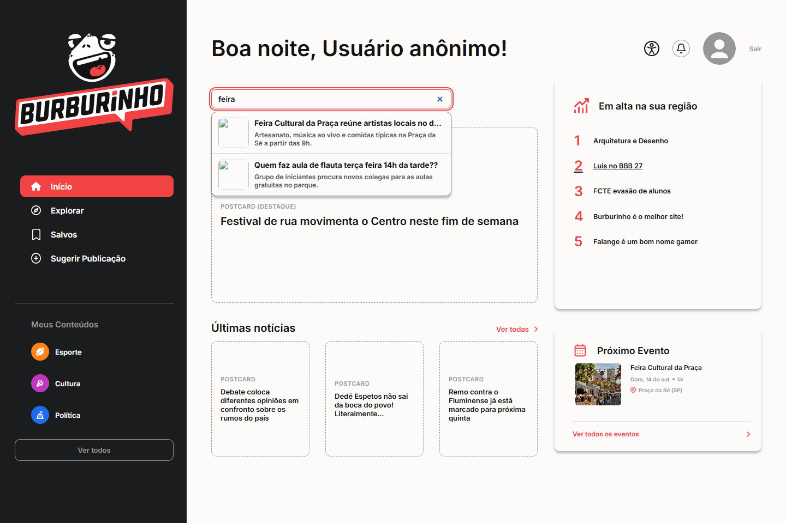 | 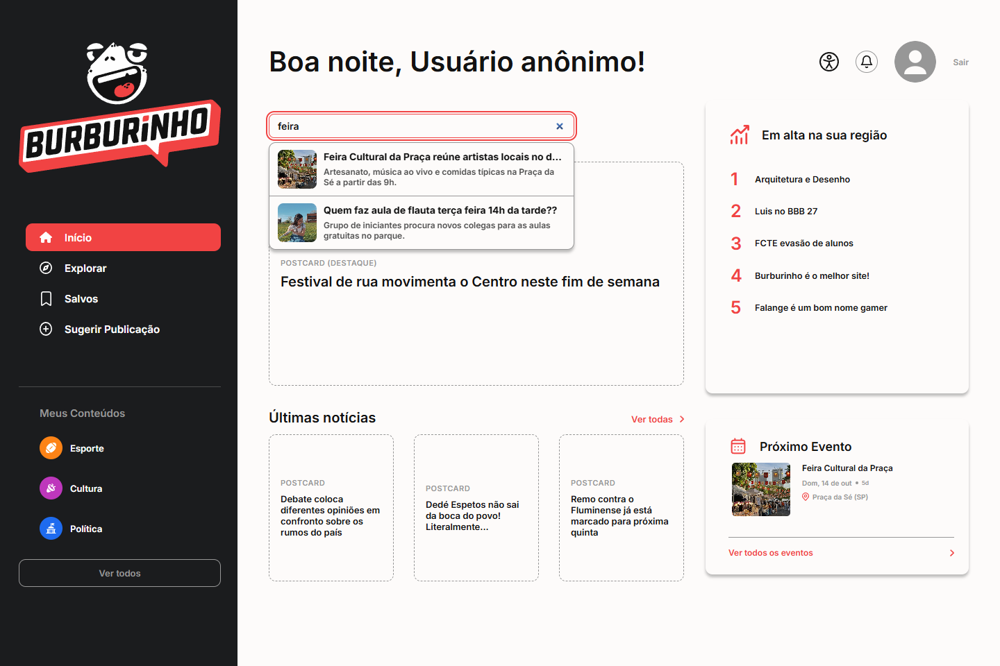 |

**Sino — mesma sequência: abrir as notificações e clicar em “Marcar todas como lidas”.** Antes, o clique também fechava o painel. Depois, as notificações são marcadas e o painel permanece aberto para leitura. As capturas mostram o estado imediatamente após o clique.

| Antes: painel fechado pelo clique | Depois: painel permanece aberto |
| --- | --- |
| 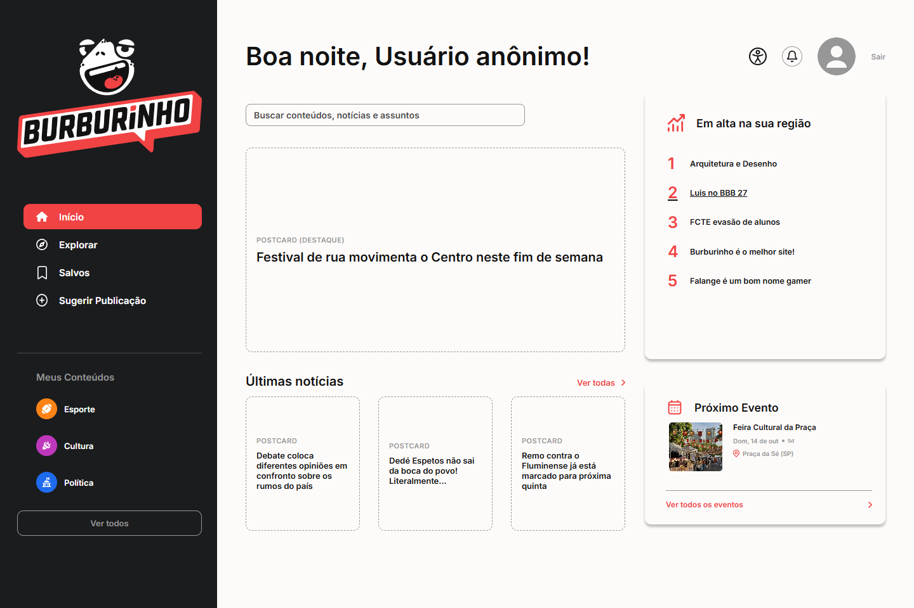 | 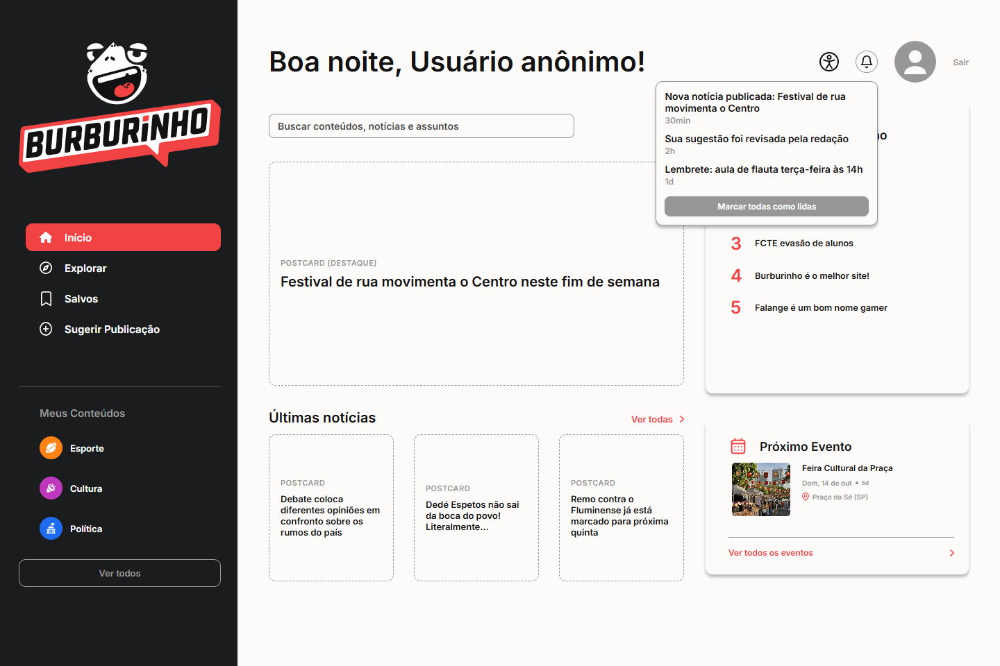 |

Os dois cenários foram reproduzidos no navegador e conferidos por verificações do painel e do carregamento das imagens. Alterações internas, como isolamento do Observer e direção das dependências da fábrica, são demonstradas pelos testes e trechos de código, pois não mudam a aparência da tela.

#### Integração com a contribuição do Luís — PR #18

**Origem:** [PR #18 — Feat/4 noticia sugerir](https://github.com/UnBArqDsw2026-2-Turma01/2026.2-T01-_G3_ProjetoPortalNoticias_Entrega_04/pull/18), versão `ca9aa2809085cd2d13bf3072472c0c6bd3dfadb4`, incorporada ao checkout da branch `feat/comparacao-pedro` do fork de Pedro. As telas de Notícia e Sugerir, o `NoticiaBuilder` e os demais componentes desse PR são contribuição do Luís; esta seção registra somente a integração feita na revisão.

- **Conflito no sino:** foram combinados o fechamento por clique fora e o rótulo com quantidade de não lidas do PR com os IDs únicos, a região acessível e o retorno de foco com Escape da revisão. O clique em marcar como lidas continua sem fechar o painel.
- **Integração de Salvos:** o botão da nova página de notícia usava um booleano local. Foi conectado ao `useSalvos` existente, para compartilhar o estado com `/salvos` e recuperar a escolha ao recarregar a página.
- **Conflito documental:** a linha e a seção do Luís foram trazidas do PR, preservando sua redação. As linhas existentes dos demais colegas foram mantidas. As observações atualizadas sobre esta revisão ficam nesta seção de Pedro.

**Capturas após integrar o PR:** a primeira mostra a notícia ainda marcada como “Salvo” após recarregar; a segunda mostra o envio demonstrativo e a prévia da sugestão. Essas telas são do PR do Luís, com a integração de Salvos descrita acima.

| Notícia: estado Salvo recuperado | Sugerir: confirmação e prévia |
| --- | --- |
| 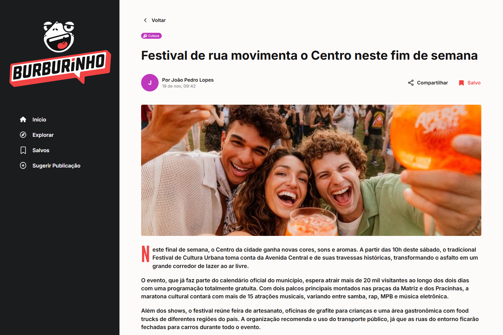 | 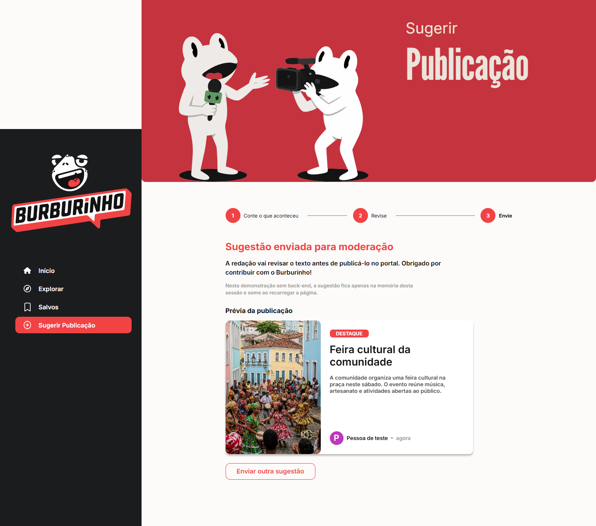 |

**Validação:** 180 testes aprovados em 25 arquivos, lint e build de produção aprovados. O build gera 27 páginas estáticas, incluindo as rotas de notícia e sugestão. No navegador, foram verificados salvar, recarregar e localizar a notícia em Salvos; enviar uma sugestão e visualizar sua prévia; marcar notificações sem fechar o painel; fechar por Escape com retorno de foco e por clique fora; carregar as imagens da busca no prefixo do Pages. 

#### Validação e reprodução

| Verificação | Evidência e comportamento exercitado |
| --- | --- |
| `src/hooks/useSalvos.test.tsx` | Dois consumidores alterando o mesmo conjunto; mudança e limpeza em outra aba; gravação bloqueada; hidratação do HTML estático sem erro recuperável ou perda dos dados. |
| `src/padroes/eventBus.test.ts` | Exceção síncrona, rejeição assíncrona, nome `constructor` e cancelamento durante uma entrega. |
| `src/hooks/useNotificacoes.test.tsx` | Dois eventos com `Date.now()` fixo continuam gerando IDs diferentes. |
| `src/components/BarraBusca/BarraBusca.test.tsx` | Resultados mantêm o prefixo `/repositorio/portal` nas imagens. |
| `src/components/NotificationBell/NotificationBell.test.tsx` | Botão nativo, marcação sem fechar painel, Escape com retorno de foco e duas instâncias com IDs distintos. A semântica nativa é verificada em jsdom; não houve ensaio completo com leitor de tela. |
| `src/padroes/fabricaCategorias.test.ts` | Cultura aciona o renderizador; as demais famílias retornam `null` sem acioná-lo. Os testes existentes de `PaginaCategoria` verificam a agenda renderizada. |

#### Uso da IA Generativa

Usei IA generativa como apoio para ler transcrições extensas de vários vídeos, coletar e organizar informações relevantes e compará-las entre as fontes. Esse uso ajudou a identificar pontos em comum, diferenças e complementações sem precisar reler manualmente cada transcrição inteira. Ai, conferi as informações relevantes nas fontes e validei coisas relacionadas ao sistema. Nas fontes sem transcrição disponível, não atribuí conclusões ao vídeo.


### FOCO_02: IA Generativa

Entrega Mínima: pontos de vista de cada membro da equipe sobre as lições aprendidas e uso da IA Generativa. TODOS DEVEM PARTICIPAR.

### Participantes no Foco_02

<!-- O QUE ESCREVER AQUI: cada um escreve a PRÓPRIA linha, em 1ª pessoa, com 3 a 6 frases por coluna.
- Lições Aprendidas: sobre REUTILIZAÇÃO (o que você entendeu na prática ao construir/usar componentes reutilizáveis).
- Uso da IA Generativa (SENSO CRÍTICO): onde ajudou, onde errou, como você validou (testes, Figma, documentação oficial, slides).
Exemplo do template: "A IA Generativa ajudou a identificar pontos de reutilização no sistema, mas demandou refinamentos na implementação para atendimento adequado do domínio." -->

| Nome do Membro | Lições Aprendidas | Uso da IA Generativa (SENSO CRÍTICO) |
| --- | --- | --- |
| Giovanna Aguiar | Aprendi na prática que dá para compartilhar preferências com o portal inteiro sem passar props por todas as páginas. O hook deixa explícita a dependência do Provider, e as variáveis CSS evitam que cada componente precise saber qual tema está ativo. Também aprendi que a persistência precisa ser recuperada antes da primeira gravação, senão o valor padrão apaga a escolha anterior. Por fim, vi que reutilizar bem depende de manter o Context pequeno, só com preferências. | Usei o OpenAI Codex para ler a issue e o repositório, inspecionar o Figma e gerar o Provider, o hook, o toggle, as páginas, os estilos, a story, os testes e o rascunho da documentação. A IA ajudou a montar rápido a estrutura, mas eu não aceitei o resultado sem validar: rodei testes, lint e build e conferi no navegador e no Figma. Eu mesma decidi o que o protótipo não cobria. Percebi que a inteligência artificial consegue seguir bem as instruções, mas muitas vezes deixa passar detalhes importantes, o que exige correções. Conversas com a IA: [conversa 1](https://chatgpt.com/c/6afedd90-af64-83e8-b3bb-f88520e85ffd) · [conversa 2](https://chatgpt.com/s/cx_6aff258fcd708191aea6780a77dd7f2d). |
| André Henrique | Na prática, reutilizar foi separar estrutura de dados: as 4 telas de categoria do Figma viraram 1 componente (`PaginaCategoria`) e 1 rota (`/categoria/[categoria]`, com `generateStaticParams` gerando as 4 páginas no build), e o que muda entre elas ficou na fábrica de categorias. Revisando a fábrica, percebi que a primeira versão só devolvia dados, o que é uma tabela de configuração e não um Abstract Factory. Corrigi para os produtos terem comportamento (`TemaCategoria.estilo()` e `SecaoCategoria.renderizar()`, com `SecaoEventos` em Cultura e `SecaoVazia` nas outras), retomando a lição da Entrega 03. O `PostCard` mostrou o valor das props: a prop `variante` cobre os 3 formatos do Figma, e o slot `acoes` deixa a vaga 5 encaixar o botão Salvar sem mexer no card. Também aprendi quando não abstrair: o bloco Eventos só existe em Cultura, então virou um produto daquela família e não um `if` na página. O hot spot da aula ficou concreto: a rota `[categoria]` é o ponto que o Next.js chama, e a fábrica é o ponto que nós especializamos. | Usei o Claude Code, ligado ao Figma por MCP, como ferramenta para ler o protótipo e acelerar a escrita de componentes, testes e texto, sempre com a minha revisão. As decisões de escopo e as correções de projeto passaram por mim: manter a troca dos marcadores da Home com a vaga 2 (regra da issue #10), salvar o Seguir no `localStorage` e ligá-lo à SideBar, deixar as páginas com largura total e refazer a fábrica com produtos que têm comportamento. Validei rodando o portal ao lado do Figma, com os testes (que pegaram a data "01 de nov" e a cor do badge descartada pelo jsdom) e com uma busca no código para garantir que nenhum componente cita uma categoria pelo nome. Os problemas mais importantes só apareceram na revisão: a largura fixa, o Seguir que não persistia e a fábrica sem comportamento. A IA não deve ser usada sem revisão para decidir o escopo de outra pessoa nem para afirmar que algo funciona sem rodar. |
| Giovanna Felipe | Como o tipo `Noticia` e o `repositorioNoticias` ficaram prontos antes das outras vagas, Home, categorias, Notícia, busca, Salvos e Sugerir usam os mesmos métodos (`listarPorCategoria`, `buscarPorId`, `buscar`...) em vez de cada tela filtrar o array de notícias por conta própria. Isso também fez com que as mudanças nos dados ficassem num só arquivo. Ao trazer o Singleton da Entrega 03 para TypeScript, troquei a flag `#liberado` por um `private constructor`, que é mais simples, mas só impede o `new` na compilação. O teste de encapsulamento mostrou que devolver `[...lista]` não bastava, porque as notícias dentro da cópia eram os mesmos objetos da lista interna, então passei a copiar cada notícia. No CSS, como os componentes usam `var(--cor-...)`, o modo escuro só redefine as variáveis em `:root[data-tema="escuro"]`, sem mexer em nenhum `.module.css`. | Usei o Claude no VS Code para gerar a configuração do projeto, o repositório, os testes e os workflows de deploy e CI, e o Gemini para entender esse código antes de documentar ([conversa](https://share.gemini.google/wtrhovOXgWjN)). O Claude não conhecia o Next.js 16: a exigência de `dynamicParams = false` com `generateStaticParams()` nas rotas dinâmicas só apareceu quando conferi a documentação do pacote e testei o build. O bug da cópia rasa foi gerado pela IA e passou despercebido até o teste de encapsulamento falhar. O Gemini me corrigiu quando o rascunho chamava a nossa base de "frozen spot" (frozen/hot spot é a relação entre framework e aplicação), mas explicou errado que `[data-tema="escuro"]` sobrescrevia o `:root`: os dois têm a mesma especificidade, e por isso troquei o seletor. Em todos os casos, o que validou foi teste, build ou documentação oficial, não a resposta da IA. |
| João Pedro Lopes | Na prática, percebi que as 4 variantes do Menu de Opções SideBar no Figma eram o mesmo componente com um só ponto de variação (o item ativo), então virou uma prop itemAtivo com o padrão vindo da URL, e os itens do menu viraram o array ITENS_MENU: acrescentar uma opção é uma linha de dados, não um novo bloco de JSX. O AppLayout mostrou a força da composição com children: colocado no layout.tsx raiz (o hot spot do Next.js), leva a SideBar a todas as rotas sem que nenhuma página precise importá-la, o que deixou o Princípio de Hollywood concreto. Também aprendi que reutilizar lógica é diferente de reutilizar tela: o useSessaoSimulada é o mesmo para a SideBar e a Home, e por isso as duas versões do Figma (logado e deslogado) ficam coerentes entre si. Os marcadores provisórios da Home me ensinaram a combinar contratos antes do código: a Home já tinha o lugar do PostCard, da BarraBusca e do NotificationBell antes de esses componentes existirem. Por fim, ao integrar a notícia, vi que um componente só é reutilizado de verdade quando alguém o usa: o Salvar tinha um estado local e passou a usar o useSalvos da vaga 5, para a notícia aparecer em /salvos. | Usei o Claude Code, ligado ao Figma por MCP, para ler os frames da SideBar e da Home, comparar as variantes, exportar os ícones e acelerar a escrita dos componentes, dos testes, dos diagramas de Pacotes e de Componentes e do rascunho desta documentação. A IA ajudou bastante a chegar rápido a uma estrutura, mas as decisões foram minhas: usar marcadores em vez de reimplementar componentes de outras vagas, não mexer no código dos colegas sem combinar e manter o login apenas simulado. Validei rodando o portal lado a lado com o Figma, com os testes da SideBar e da Home (item ativo pela URL, prioridade da prop, "Meus Conteúdos" só logado, Entrar e Sair), com lint e build e conferindo o deploy na subpasta do GitHub Pages. Alguns problemas só apareceram na revisão e na integração: a rolagem da página, o texto do envio do Sugerir e o Salvar da notícia, que não persistia. A IA também tende a afirmar coisas sobre o código e o protótipo com mais certeza do que deveria (contagens de uso, rotas existentes), então tudo o que entrou no relatório foi conferido no Figma ou no código do main. |
| Johnnatan de Salles Sanches | Aprendi que um catálogo não é apenas uma página de demonstração: ele transforma o contrato dos componentes em exemplos que outras pessoas conseguem experimentar antes de reutilizá-los. O Autodocs expõe props e variantes sem duplicar telas do portal. Também aprendi a diferenciar pontos de chamada, instâncias renderizadas e rotas geradas ao montar o mapa de reutilização. No `LogoTema`, a prop `tema` representa uma alternativa de variabilidade e permite trocar a identidade visual sem criar uma `SideBar` diferente para cada data. | Usei o Copilot SDK no VS Code para acelerar a configuração do Storybook, a criação das stories, os testes e o rascunho da documentação. Não tratei as sugestões como evidência: conferi a API `@storybook/nextjs-vite` na documentação oficial e validei o resultado com testes, lint, build do portal, build do Storybook e inspeção local. A revisão também mostrou um limite da solução: os SVGs sazonais são logos completos, e não ornamentos independentes, portanto a composição visual pedida pode ser refinada em uma etapa futura. |
| Júlia Gabriella | Escrever a fundamentação me obrigou a encontrar cada conceito da aula no nosso código, e foi aí que a teoria ficou concreta: o `layout.tsx` e as `page.tsx` são hot spots que o Next.js chama, e por isso o Princípio de Hollywood deixou de ser frase de slide. Percebi que o Next.js é usado como caixa cinza: não herdamos classes dele, mas dependemos de cumprir as convenções que ele espera. No Feature Model, aprendi a separar variação de componente de variação de produto: a `variante` do `PostCard` muda dentro do mesmo portal, enquanto categorias e logos sazonais mostram o que mudaria entre produtos de uma linha. A rastreabilidade mostrou que reutilizar também é adaptar: o Abstract Factory de comunidades da Entrega 03 virou a fábrica de categorias, e o Builder perdeu o Director porque o formulário já conduz os passos. Na responsividade, entendi que reutilizar também vale para regras de estilo: em vez de repetir 44 px em 17 arquivos, um token neutro no desktop e ativo no celular resolveu todos de uma vez, sem mexer no layout do Figma. | Usei o Claude Code (Anthropic) para explorar o repositório e as entregas anteriores, redigir os rascunhos das seções e gerar o Feature Model. A IA tende a escrever teoria genérica, então conferi cada citação no PDF da aula e corrigi três atribuições erradas: uma frase sobre "quanto mais cedo, maior o ganho" que não está no slide 4, a lista do slide 52 que incluía frameworks e a afirmação de que os slides destacavam Template Method e Strategy. Também conferi se cada arquivo citado existe e faz o que o texto diz, e troquei "Modo escuro" por "Tema de cores" no diagrama porque o código sempre aplica um dos dois temas. A IA não conseguiu ler os slides que são só imagem nem abrir o `.drawio` no draw.io, então essas partes eu revisei manualmente. No código da responsividade, foi o teste visual que pegou os erros: a primeira versão deixou o avatar achatado e depois cortado, e a IA havia dito, sem testar, que a barra do topo sumia ao rolar, o que não era verdade. |
| Luís Cunha | Na prática, separar o comportamento variável das ações em props mostrou como um mesmo componente pode atender Voltar, Compartilhar, Salvar e Enviar sem duplicar markup. No formulário, `CampoFormulario` centralizou rótulo, erro e `useId()`, enquanto o `NoticiaBuilder` mostrou que o padrão de montagem deve validar o produto no final e não distribuir validações em 10 parâmetros. | Usei IA para interpretar os frames do Figma e acelerar componentes e testes, mas validei o código com build, 141 testes e inspeção visual em navegador. Corrigi diferenças que a implementação inicial não havia identificado, como larguras, espaçamento da notícia e campos visíveis no Sugerir. Não considerei a primeira sugestão da IA como pronta: a revisão localizou assets incorretos, tipografia desalinhada e documentação pendente. |
| Matheus Eiki | | |

## Versionamentos

<!-- Cada contribuição relevante = 1 linha, com o link do commit ou PR na coluna Contribuição (é o comprobatório que a professora pede). -->

| Nome do Membro | Contribuição | Data |
| --- | --- | --- |
| Pedro Henrique Ferreira Xavier | Revisão comparativa e correções transversais na Entrega 04: centralização do estado compartilhado de Salvos em `lib/noticiasSalvas.ts`; ajustes em `useSalvos`, `useNotificacoes` e `eventBus`; correção dos IDs e da interação da `NotificationBell`; revisão dos caminhos da busca e da `BarraBusca`; desacoplamento e correção da fábrica de categorias e da `PaginaCategoria`; adição de testes e documentação antes/depois. Evidências: [Revisão comparativa e correções de lógica](#revisao-comparativa-e-correcoes-de-logica). Alterações na branch `feat/comparacao-pedro`, pendentes de commit. | 20/11/2026 |
| Giovanna Felipe | Estruturação do GitPages e do relatório com guia de preenchimento por seção ([commit d80fe87](https://github.com/UnBArqDsw2026-2-Turma01/2026.2-T01-_G3_ProjetoPortalNoticias_Entrega_04/commit/d80fe873a9e7410ce85652ea45f53f255e386a89)) e criação das issues #1 a #10, com cronograma e passo a passo de cada vaga ([issues](https://github.com/UnBArqDsw2026-2-Turma01/2026.2-T01-_G3_ProjetoPortalNoticias_Entrega_04/issues?q=is%3Aissue+author%3Agiovannafg)) | 18/11/2026 |
| Giovanna Felipe | Projeto base do portal: Next.js, tipos, notícias de exemplo, `repositorioNoticias` (Singleton da Entrega 03) com testes, variáveis CSS do Figma, deploy e CI, e seção "Reutilização 1" ([PR #11](https://github.com/UnBArqDsw2026-2-Turma01/2026.2-T01-_G3_ProjetoPortalNoticias_Entrega_04/pull/11)) | 19/11/2026 |
| Giovanna Felipe | Fechamento da "Reutilização 1" (recontagem de "Onde é Reutilizado" com o código de todos na `main` e prints do Actions e do portal publicado) e minhas linhas no Foco_01, no Foco_02, em Versionamentos e em Participações ([PR #20](https://github.com/UnBArqDsw2026-2-Turma01/2026.2-T01-_G3_ProjetoPortalNoticias_Entrega_04/pull/20)) | 22/11/2026 |
| João Pedro Lopes | Seção "Reutilização 2: Navegação e Layout" (SideBar, AppLayout, Home) e linha no Foco_01 ([issue #2](https://github.com/UnBArqDsw2026-2-Turma01/2026.2-T01-_G3_ProjetoPortalNoticias_Entrega_04/issues/2)) | 19/11/2026 |
| Giovanna Aguiar | Implementação e documentação da vaga 6: Context de tema e preferências, toggle, Acessibilidade, Perfil, story e testes; evidências locais em Reutilização 6. [Issue #6](https://github.com/UnBArqDsw2026-2-Turma01/2026.2-T01-_G3_ProjetoPortalNoticias_Entrega_04/issues/6). Commit comprobatório: [5633092](https://github.com/UnBArqDsw2026-2-Turma01/2026.2-T01-_G3_ProjetoPortalNoticias_Entrega_04/commit/5633092f7e607016ba8ced40aad8dfbfcd9b7865). | 19/11/2026 |
| André Henrique | Seção "Reutilização 3: Cards e Páginas de Categoria" (PostCard, BadgeCategoria, PaginaCategoria, fábrica de categorias, Explorar) e linhas no Foco_01 e no Foco_02 ([issue #3](https://github.com/UnBArqDsw2026-2-Turma01/2026.2-T01-_G3_ProjetoPortalNoticias_Entrega_04/issues/3)) | 19/11/2026 |
| Luís Cunha | Implementação da vaga 4 (BotaoAcao, CampoFormulario, PaginaNoticia, NoticiaBuilder e PaginaSugerir), correções visuais comparadas ao Figma e seção "Reutilização 4" ([issue #4](https://github.com/UnBArqDsw2026-2-Turma01/2026.2-T01-_G3_ProjetoPortalNoticias_Entrega_04/issues/4)) | 20/11/2026 |
| Matheus Eiki | Seção "Reutilização 5: Busca, Notificações e Salvos" (BarraBusca, NotificationBell + useNotificacoes via eventBus, página Salvos + useSalvos) e linha no Foco_01 ([issue #5](https://github.com/UnBArqDsw2026-2-Turma01/2026.2-T01-_G3_ProjetoPortalNoticias_Entrega_04/issues/5)) | 19/11/2026 |
| Johnnatan de Salles Sanches | Catálogo Storybook, logo sazonal, stories, testes e mapa de reutilização ([issue #7](https://github.com/UnBArqDsw2026-2-Turma01/2026.2-T01-_G3_ProjetoPortalNoticias_Entrega_04/issues/7) · [commit 5639613](https://github.com/UnBArqDsw2026-2-Turma01/2026.2-T01-_G3_ProjetoPortalNoticias_Entrega_04/commit/5639613d855060d80dd68efbd57b573ff3801cc8)). | 19/11/2026 |
| Júlia Gabriella | Seções da vaga 8: Fundamentação Teórica Aplicada ([45cd792](https://github.com/UnBArqDsw2026-2-Turma01/2026.2-T01-_G3_ProjetoPortalNoticias_Entrega_04/commit/45cd792), alinhada aos slides em [6ce2620](https://github.com/UnBArqDsw2026-2-Turma01/2026.2-T01-_G3_ProjetoPortalNoticias_Entrega_04/commit/6ce2620)), Feature Model ([717243a](https://github.com/UnBArqDsw2026-2-Turma01/2026.2-T01-_G3_ProjetoPortalNoticias_Entrega_04/commit/717243a)), Visão Geral e Metodologia ([54faf31](https://github.com/UnBArqDsw2026-2-Turma01/2026.2-T01-_G3_ProjetoPortalNoticias_Entrega_04/commit/54faf31)) e linhas no Foco_01 e no Foco_02 ([#8](https://github.com/UnBArqDsw2026-2-Turma01/2026.2-T01-_G3_ProjetoPortalNoticias_Entrega_04/issues/8)) | 22/11/2026 |
| Júlia Gabriella | Ata da reunião de 22/11 ([37bc7fe](https://github.com/UnBArqDsw2026-2-Turma01/2026.2-T01-_G3_ProjetoPortalNoticias_Entrega_04/commit/37bc7fe)) e seção "Reutilização 8: Responsividade no Celular" com o código ([0b912de](https://github.com/UnBArqDsw2026-2-Turma01/2026.2-T01-_G3_ProjetoPortalNoticias_Entrega_04/commit/0b912dea1cbc32c5b5ed15f97df3b3711d495eb3)), atualização das linhas no Foco_01 e no Foco_02 | 23/11/2026 |
| Júlia Gabriella | Correção da sobreposição da busca sobre a barra do topo no celular ([cc180a5](https://github.com/UnBArqDsw2026-2-Turma01/2026.2-T01-_G3_ProjetoPortalNoticias_Entrega_04/commit/cc180a58ed65415765af27a8f0425f25e6ef8d63)) e registro na Reutilização 8 | 23/11/2026 |

## Referências

<!-- ABNT. Mínimo: PDF da aula "Reutilização & Framework"; documentação do React (https://react.dev), do Next.js (https://nextjs.org/docs) e do Storybook (https://storybook.js.org/docs);
referências do slide 84 que forem usadas (Markiewicz & Lucena; Sommerville; Pressman). Cada pessoa acrescenta o que consultou. -->

META PLATFORMS. **React: Passing JSX as children**. Disponível em: <https://react.dev/learn/passing-props-to-a-component#passing-jsx-as-children>. Acesso em: 19 nov. 2026.

STORYBOOK. **Storybook for Next.js with Vite**. Disponível em: <https://storybook.js.org/docs/get-started/frameworks/nextjs-vite>. Acesso em: 19 nov. 2026.

STORYBOOK. **Automatic documentation and Storybook**. Disponível em: <https://storybook.js.org/docs/writing-docs/autodocs>. Acesso em: 19 nov. 2026.

VERCEL. **Next.js Documentation: Layouts and Pages**. Disponível em: <https://nextjs.org/docs/app/getting-started/layouts-and-pages>. Acesso em: 19 nov. 2026.

VERCEL. **Next.js Documentation: usePathname**. Disponível em: <https://nextjs.org/docs/app/api-reference/functions/use-pathname>. Acesso em: 19 nov. 2026.

SERRANO, Milene. **Reutilização & Framework**. Material de aula da disciplina Arquitetura e Desenho de Software. Brasília: Universidade de Brasília, 2026. Slides 4, 5, 8, 11 a 15, 18, 20, 23, 28, 45 a 50, 52, 60 a 74 e 76 a 78.

GAMMA, Erich; HELM, Richard; JOHNSON, Ralph; VLISSIDES, John. **Design Patterns: Elements of Reusable Object-Oriented Software**. Boston: Addison-Wesley, 1994. (Abstract Factory, p. 87.)

META PLATFORMS. **React: Passing Props to a Component**. Disponível em: <https://react.dev/learn/passing-props-to-a-component>. Acesso em: 19 nov. 2026.

META PLATFORMS. **React: useSyncExternalStore**. Disponível em: <https://react.dev/reference/react/useSyncExternalStore>. Acesso em: 19 nov. 2026.

VERCEL. **Next.js Documentation: Dynamic Routes e generateStaticParams**. Disponível em: <https://nextjs.org/docs/app/api-reference/file-conventions/dynamic-routes>. Acesso em: 19 nov. 2026.

VERCEL. **Next.js Documentation: basePath (Images)**. Disponível em: <https://nextjs.org/docs/app/api-reference/config/next-config-js/basePath#images>. Acesso em: 19 nov. 2026.
