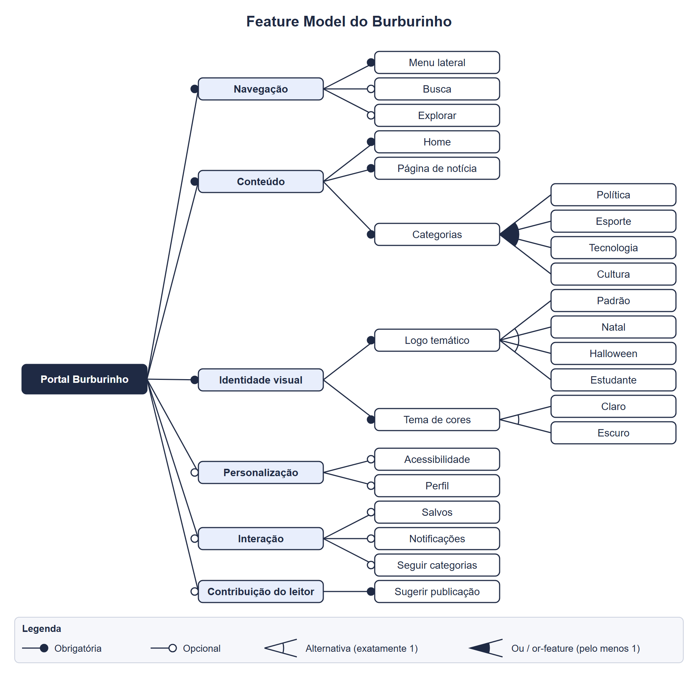

# 1.1.2. Reutilização de Software

<!--
================================================================================
GUIA DE PREENCHIMENTO: comentários HTML como este NÃO aparecem no site.
- Cada pessoa preenche a SUA frente (seções "Reutilização 1" a "Reutilização 7" ou as seções da vaga 8),
  a SUA linha no Foco_02 e a(s) SUA(s) linha(s) em Versionamentos.
- O passo a passo de cada frente está na issue correspondente no GitHub (Issues > milestone "Entrega 04").
- Apague o comentário "O QUE ESCREVER AQUI" depois de preencher. NÃO omita tópicos (orientação da professora).
- Links para código: SEMPRE absolutos (https://github.com/...). Links relativos para fora de docs/ quebram o build do site.
- Referência teórica: PDF da aula "Reutilização & Framework" (Profa. Milene Serrano, no Aprender3). Cite o número do slide.
================================================================================
-->

## Focos do Relatório

### FOCO_01: Reutilização de Software

Entrega Mínima: Evidência de Reutilização (Components do React documentados e demonstrados em uso).

### Participantes no Foco_01

<!-- O QUE ESCREVER AQUI: cada pessoa completa a própria linha (frente assumida e número da issue). -->

| Nome do Membro | Frente | Componentes / Produtos | Issue |
| --- | --- | --- | --- |
| André Henrique | | | |
| Giovanna Aguiar | | | |
| Giovanna Felipe | | | |
| João Pedro Lopes | | | |
| Johnnatan de Salles | | | |
| Júlia Gabriella | | | |
| Luís Cunha | | | |
| Matheus Eiki | | | |

### Metodologia do Foco_01

<!-- O QUE ESCREVER AQUI (vaga 8, com insumos de todos):
1. Como nos organizamos: issues no GitHub (1 por frente + cronograma), dependências entre elas e prazos escalonados até 22/11.
2. Fluxo de trabalho: branch por issue → Pull Request → revisão de outro membro → merge na main → deploy automático no GitPages.
3. Ferramentas: Figma (protótipo), Next.js/React + TypeScript, Storybook, Vitest, GitHub Actions, MkDocs, IA Generativa.
4. Reuniões: link para as atas em 1.3. Iniciativas Extras.
Um print do quadro de issues ou do histórico de PRs ajuda muito. -->

### Reutilização de Software

#### Visão Geral

<!-- O QUE ESCREVER AQUI (vaga 8): 1 parágrafo apresentando o que foi construído (portal Next.js que implementa as telas do Figma reaproveitando componentes)
e a lista dos NÍVEIS de reutilização, cada um com link para a seção abaixo:
1. Componentes com props (PostCard, BadgeCategoria, BotaoAcao, SideBar...)
2. Composição com children (AppLayout)
3. Hooks customizados (useTema, useSalvos, useNotificacoes)
4. Context API (ThemeProvider: modo escuro + acessibilidade)
5. Componente genérico parametrizado (PaginaCategoria gera as 4 telas de categoria)
6. Reaproveitamento dos GoFs da Entrega 03 (Singleton, Abstract Factory, Builder, Observer, Decorator)
Coloque também os links do portal publicado e do Storybook. -->

#### Fundamentação Teórica Aplicada ao Burburinho

<!--
O QUE ESCREVER AQUI (vaga 8): para CADA subtítulo abaixo:
(1) explique o conceito em 2 a 4 frases com suas palavras, citando o slide do PDF da aula;
(2) mostre ONDE ele aparece no NOSSO código (link absoluto para o arquivo);
(3) dê um exemplo concreto. Não copie os slides: aplique ao projeto.
-->

##### Reutilização Além do Código

<!-- Slide 4: reutilização também em requisitos e projeto. Exemplo nosso: o protótipo do Figma já definia componentes ("Menu de Opções SideBar" usado 22 vezes, "Conteúdo Menor" usado 21 vezes) e o código herdou essa decisão; os GoFs da Entrega 03 foram reaproveitados. -->

##### Framework × Biblioteca (Princípio de Hollywood)

<!-- Slides 45 a 50. Next.js/React = FRAMEWORK: ele chama o nosso código ("Don't call us, we'll call you"): roteamento por pastas (src/app), renderização dos componentes, ciclo de vida dos hooks. Bibliotecas = o que NÓS chamamos (confira o package.json, ex.: Testing Library).
Faça uma tabela: | Item | Framework ou Biblioteca | Quem chama quem | Evidência no código | -->

##### Hot Spots e Frozen Spots

<!-- Slides 11 a 15. Frozen spots = o que o Next/React fixa (motor de renderização, roteador, ciclo de vida). Hot spots = onde encaixamos o nosso código (page.tsx e layout.tsx de cada rota, componentes, props, children, hooks, Providers).
Tabela com 4 a 6 exemplos reais. Opcional: diagrama no estilo do slide 13 (kernel + plugues), feito no draw.io. -->

##### Framework Caixa Branca, Preta e Cinza

<!-- Slides 23 a 28. Nosso uso: por COMPOSIÇÃO (passamos componentes/props: caixa preta) e implementando os "contratos" que o Next espera (page.tsx, layout.tsx: hot spots, caixa branca). Conclusão esperada: uso CAIXA CINZA. Justifique com exemplos do código. -->

##### Formas de Reutilização Presentes no Projeto

<!-- Slide 52 (plugins, serviços, componentes, linhas de produto) e slides 60 e 61 (componentes e interfaces). Diga quais aparecem no Burburinho e quais NÃO aparecem (senso crítico). -->

##### Padrões de Projeto × Framework

<!-- Slides 17 a 21 e 76 a 78. Um framework CONTÉM padrões: ex. Context/Provider se parece com Observer; composição de componentes se parece com Composite/Decorator. E os GoFs da Entrega 03 viraram peças do app (link para as seções abaixo). -->

<!--
==================== MODELO DAS SEÇÕES "Reutilização 1 a 7" ====================
Cada responsável preenche os 8 subtítulos da sua seção:
- Contexto (Problema de Repetição): qual repetição existia no Figma? Em quantas telas? Link do nó no Figma + print.
- Ponto de Reutilização e Relação com a Teoria: qual nível de reutilização (props / children / hook / Context / genérico / GoF da Entrega 03)
  e por quê; cite 1 ou 2 slides. Se reaproveitou GoF da Entrega 03, link para o código antigo e diga o que mudou na adaptação para React.
- Contrato do Componente (Props): tabela | Prop | Tipo | Obrigatória? | Padrão | Descrição | (para hooks: parâmetros e retorno).
- Onde é Reutilizado: tabela | Tela/rota | Arquivo que usa (link) | Props passadas |. Mínimo 2 usos. É o CORAÇÃO da evidência.
- Implementação (Código): trecho curto (10 a 30 linhas) em bloco ```tsx + link do arquivo.
- Demonstração em Uso: link da story no Storybook publicado + prints do componente em 2 telas (GIF opcional).
- Uso da IA Generativa na Minha Solução: ferramenta, para quê, o que aceitou, o que corrigiu e POR QUÊ; 1 exemplo concreto.
- Senso Crítico: limites, o que NÃO abstraiu de propósito, o que faria com mais tempo.
===============================================================================
-->

#### Reutilização 1: Projeto Base, Camada de Dados e Identidade Visual

**Responsável:** Giovanna Felipe ([issue #1](https://github.com/UnBArqDsw2026-2-Turma01/2026.2-T01-_G3_ProjetoPortalNoticias_Entrega_04/issues/1) · [PR #11](https://github.com/UnBArqDsw2026-2-Turma01/2026.2-T01-_G3_ProjetoPortalNoticias_Entrega_04/pull/11))

##### Contexto (Problema de Repetição)

No [Figma](https://www.figma.com/design/LnkN55jPy6jk8dsjpmYJSF/Prot%C3%B3tipo?node-id=0-1), a mesma notícia aparece na Home, nas categorias, na tela de Notícia e em Salvos, e **toda tela tem versão DarkMode**. Sem uma base comum, cada tela definiria a própria forma da notícia, filtraria os dados do seu jeito e repetiria cores fixas, o que obrigaria a duplicar estilos para o modo escuro.

##### Ponto de Reutilização e Relação com a Teoria

Esta frente não é um componente visual, e sim a **base que todos os componentes reutilizam**:

| O que é reutilizado | Como | Quem reutiliza |
| --- | --- | --- |
| Contrato (`Noticia`, `Categoria`) | tipos TypeScript em um único arquivo | todo o portal |
| Dados e consultas (`repositorioNoticias`) | **Singleton reaproveitado da Entrega 03** | páginas e componentes que listam notícias |
| Estilo | variáveis CSS extraídas do Figma (`var(--cor-primaria)`) | todos os componentes; o modo escuro troca só as variáveis |

Na aula (slides 11 a 15), *frozen* e *hot spots* são conceitos do framework em relação à aplicação: para o Next.js, todo o nosso `src/` é hot spot, código que o framework chama (Princípio de Hollywood, slides 45 a 50). Dentro da nossa arquitetura, esta base é o **núcleo estável do domínio**, sobre o qual os componentes se apoiam, e o repositório é chamado por nós, não pelo framework. O Singleton mostra um padrão de projeto vivendo dentro do app (slides 76 a 78).

| Singleton na Entrega 03 (JavaScript) | Na Entrega 04 (TypeScript) |
| --- | --- |
| Truque com a flag `#liberado`: bloqueia `new` em tempo de execução | `private constructor`: o compilador impede `new`, mas só na compilação (o `private` some no JavaScript gerado) |
| Objetos sem formato definido | Notícias seguem o contrato `Noticia` |
| Devolvia a lista com os mesmos objetos internos | Devolve cópias de cada notícia (encapsulamento, slide 42) |

##### Contrato do Componente (Props)

| Método | Retorno | Quem usa |
| --- | --- | --- |
| `listarTodas()` / `listarRecentes(n)` | notícias da mais recente para a mais antiga | Home, rotas dinâmicas |
| `buscarPorId(id)` | `Noticia` ou `undefined` | Notícia, Salvos |
| `listarPorCategoria(categoria)` | notícias da categoria | `PaginaCategoria` |
| `listarDestaques()` | notícias com `destaque: true` | card de destaque da Home |
| `buscar(termo)` | busca em título, resumo e autor, sem acentos | `BarraBusca` |
| `adicionarSugestao(noticia)` / `listarSugestoes()` | sugestões de leitores, separadas das publicadas | Sugerir Publicação |

Não há métodos para editar ou apagar notícias, porque nenhuma tela do protótipo usa.

##### Onde é Reutilizado

<!-- PENDENTE (Giovanna, 21/11 à noite): refazer a contagem com o código de todos no main (Ctrl+Shift+F em portal/src por "repositorioNoticias", ignorando .test e .stories). -->

| Item | Arquivos que usam |
| --- | --- |
| `repositorioNoticias` | [`app/page.tsx`](https://github.com/UnBArqDsw2026-2-Turma01/2026.2-T01-_G3_ProjetoPortalNoticias_Entrega_04/blob/main/portal/src/app/page.tsx) (previstos: `PaginaCategoria`, Notícia, `BarraBusca`, Salvos, Sugerir Publicação) |
| `Noticia` / `Categoria` | dados, repositório, página inicial e todos os componentes de conteúdo |
| Variáveis CSS | todos os arquivos `*.module.css` |

##### Implementação (Código)

[`repositorioNoticias.ts`](https://github.com/UnBArqDsw2026-2-Turma01/2026.2-T01-_G3_ProjetoPortalNoticias_Entrega_04/blob/main/portal/src/lib/repositorioNoticias.ts) (trecho):

```ts
export class RepositorioNoticias {
  private static instancia: RepositorioNoticias | null = null;

  private constructor(noticiasIniciaisDoPortal: Noticia[]) {
    this.noticias = noticiasIniciaisDoPortal.map(copiar);
  }

  static getInstancia(): RepositorioNoticias {
    if (RepositorioNoticias.instancia === null) {
      RepositorioNoticias.instancia = new RepositorioNoticias(noticiasIniciais);
    }
    return RepositorioNoticias.instancia;
  }
}

export const repositorioNoticias = RepositorioNoticias.getInstancia();
```

Demais arquivos: [`types/noticia.ts`](https://github.com/UnBArqDsw2026-2-Turma01/2026.2-T01-_G3_ProjetoPortalNoticias_Entrega_04/blob/main/portal/src/types/noticia.ts) · [`globals.css`](https://github.com/UnBArqDsw2026-2-Turma01/2026.2-T01-_G3_ProjetoPortalNoticias_Entrega_04/blob/main/portal/src/app/globals.css) (tokens) · [`data/noticias.ts`](https://github.com/UnBArqDsw2026-2-Turma01/2026.2-T01-_G3_ProjetoPortalNoticias_Entrega_04/blob/main/portal/src/data/noticias.ts) · [workflow de deploy](https://github.com/UnBArqDsw2026-2-Turma01/2026.2-T01-_G3_ProjetoPortalNoticias_Entrega_04/blob/main/.github/workflows/deploy-mkdocs.yml)

##### Demonstração em Uso

[Portal publicado](https://unbarqdsw2026-2-turma01.github.io/2026.2-T01-_G3_ProjetoPortalNoticias_Entrega_04/portal/), atualizado automaticamente a cada merge na `main`, e [14 testes automatizados](https://github.com/UnBArqDsw2026-2-Turma01/2026.2-T01-_G3_ProjetoPortalNoticias_Entrega_04/blob/main/portal/src/lib/repositorioNoticias.test.ts) (instância única, filtros, busca, encapsulamento e sugestões).

<!-- PENDENTE (Giovanna): depois do merge, inserir 1 print do Actions verde e 1 do portal no ar, salvos em docs/assets/reutilizacao/:  -->

##### Uso da IA Generativa na Minha Solução

Usei IA generativa de duas formas. Para **produzir**, o Claude (no VS Code) gerou a configuração do projeto, o repositório, os testes e os workflows, e eu revisei antes do merge. Para **aprender**, usei o Gemini para entender as decisões do código antes de documentá-las ([conversa](https://share.gemini.google/wtrhovOXgWjN)). O que mais pesou:

1. **Versão do framework:** o Next.js 16 é mais novo do que o conhecimento da IA. A configuração foi validada na documentação do próprio pacote, e assim apareceu a regra de rotas dinâmicas (`dynamicParams = false`), testada antes de entrar no README do grupo.
2. **Bug pego por teste:** a primeira versão devolvia uma cópia da lista, mas com os mesmos objetos internos. O teste de encapsulamento falhou e a correção foi copiar cada notícia. Com o Gemini entendi que isso é uma *cópia rasa direcionada*: basta porque a `Noticia` não tem objetos aninhados.
3. **Uma IA corrigindo a outra:** o primeiro rascunho deste relatório chamava a nossa base de "frozen spot". Perguntando ao Gemini, entendi que frozen/hot spot é um conceito do framework em relação à aplicação, então o texto foi corrigido.
4. **E a IA também deixou passar algo:** o Gemini explicou o modo escuro dizendo que `[data-tema="escuro"]` "sobrescreve" o `:root`. Conferindo, os dois seletores têm a mesma especificidade, e quem vence é só a ordem no arquivo. Troquei por `:root[data-tema="escuro"]`, que vence independentemente da ordem.

##### Senso Crítico

- **Sem back-end, o Singleton é único por contexto de execução**, e não no portal: há uma instância no build e uma em cada aba de cada leitor. Por isso uma sugestão some ao recarregar. Com uma API, só este arquivo mudaria, porque as telas falam apenas com os métodos do repositório.
- **Proteções com limites:** o `private constructor` só vale na compilação, e a `copiar` deixaria escapar objetos aninhados se a `Noticia` ganhasse algum (aí valeria `structuredClone` ou tipos `Readonly`).
- **Os tokens dependem de disciplina:** nada impede alguém de usar cor fixa, e toda cor nova precisa ser conferida nos dois temas. Um lint de CSS resolveria a primeira parte.
- Os parágrafos das notícias que o Figma não mostra foram completados para a demonstração.

#### Reutilização 2: Navegação e Layout (SideBar, AppLayout, Home)

<!-- Responsável: vaga 2. Itens: SideBar com as 4 variantes do Figma, AppLayout (composição com children), Home logado e deslogado. -->

**Responsável:**

##### Contexto (Problema de Repetição)

##### Ponto de Reutilização e Relação com a Teoria

##### Contrato do Componente (Props)

##### Onde é Reutilizado

##### Implementação (Código)

##### Demonstração em Uso

##### Uso da IA Generativa na Minha Solução

##### Senso Crítico

#### Reutilização 3: Cards e Páginas de Categoria (PostCard, BadgeCategoria, PaginaCategoria)

<!-- Responsável: vaga 3. Itens: PostCard (variantes "Conteúdos" e "Conteúdo Menor"), BadgeCategoria, PaginaCategoria + fábrica de categorias (Abstract Factory da Entrega 03), tela Explorar. -->

**Responsável:**

##### Contexto (Problema de Repetição)

##### Ponto de Reutilização e Relação com a Teoria

##### Contrato do Componente (Props)

##### Onde é Reutilizado

##### Implementação (Código)

##### Demonstração em Uso

##### Uso da IA Generativa na Minha Solução

##### Senso Crítico

#### Reutilização 4: Notícia e Sugerir Publicação (BotaoAcao, CampoFormulario, NoticiaBuilder)

<!-- Responsável: vaga 4. Itens: página Notícia, BotaoAcao (Salvar/Compartilhar/Voltar), CampoFormulario, Sugerir Publicação com NoticiaBuilder (Builder da Entrega 03). -->

**Responsável:**

##### Contexto (Problema de Repetição)

##### Ponto de Reutilização e Relação com a Teoria

##### Contrato do Componente (Props)

##### Onde é Reutilizado

##### Implementação (Código)

##### Demonstração em Uso

##### Uso da IA Generativa na Minha Solução

##### Senso Crítico

#### Reutilização 5: Busca, Notificações e Salvos (BarraBusca, NotificationBell, useSalvos)

<!-- Responsável: vaga 5. Itens: BarraBusca, NotificationBell + useNotificacoes (Observer da Entrega 03), página Salvos + useSalvos. -->

**Responsável:**

##### Contexto (Problema de Repetição)

##### Ponto de Reutilização e Relação com a Teoria

##### Contrato do Componente (Props)

##### Onde é Reutilizado

##### Implementação (Código)

##### Demonstração em Uso

##### Uso da IA Generativa na Minha Solução

##### Senso Crítico

#### Reutilização 6: Tema e Acessibilidade (ThemeProvider, useTema, ToggleModoEscuro)

<!-- Responsável: vaga 6. Itens: ThemeProvider + useTema (Context API: modo escuro e acessibilidade), ToggleModoEscuro, páginas Acessibilidade e Perfil. -->

**Responsável:**

##### Contexto (Problema de Repetição)

##### Ponto de Reutilização e Relação com a Teoria

##### Contrato do Componente (Props)

##### Onde é Reutilizado

##### Implementação (Código)

##### Demonstração em Uso

##### Uso da IA Generativa na Minha Solução

##### Senso Crítico

#### Reutilização 7: Catálogo e Identidade Temática (Storybook, LogoTema)

<!-- Responsável: vaga 7. Itens: configuração do Storybook (documentação viva dos componentes), LogoTema (Decorator da Entrega 03: Natal, Halloween, Estudante), Mapa de Reutilização (seção abaixo). -->

**Responsável:**

##### Contexto (Problema de Repetição)

##### Ponto de Reutilização e Relação com a Teoria

##### Contrato do Componente (Props)

##### Onde é Reutilizado

##### Implementação (Código)

##### Demonstração em Uso

##### Uso da IA Generativa na Minha Solução

##### Senso Crítico

#### Mapa de Reutilização

<!-- O QUE ESCREVER AQUI (vaga 7): tabela com TODOS os componentes e hooks do portal:
| Componente/Hook | Nível de reutilização | Props principais | Telas onde é usado (nº de usos) | Nó no Figma | Story | Código | Autor(a) |
Conte os usos com uma busca no código (ex.: procurar "<PostCard" em portal/src).
Feche com 1 parágrafo de análise: quais componentes mais economizaram código e quais NÃO valeu abstrair (senso crítico). -->

#### Linha de Produto: Feature Model do Burburinho

<!-- O QUE ESCREVER AQUI (vaga 8): slides 62 a 74. Desenhe o Feature Model com a notação do slide 71 (obrigatória ●, opcional ○, alternativa, or-feature).
Sugestão: Portal Burburinho → Navegação (obrigatória: SideBar, Busca); Conteúdo (obrigatória: Home, Notícia, Categorias [or: Política, Esporte, Tecnologia, Cultura]);
Personalização (opcional: Modo Escuro, Acessibilidade, Tema Sazonal [alternativa: Natal, Halloween, Estudante]); UGC (opcional: Sugerir Publicação); Interação (opcional: Salvos, Notificações).
Ferramenta: draw.io. Salve o .drawio E o .png em docs/assets/diagramas/ e insira a imagem aqui: 
Depois, 1 parágrafo: como as props implementam essa variabilidade (ex.: prop `tema` do LogoTema = feature alternativa; `categoria` da PaginaCategoria = or-feature). -->

### Vídeo Demonstrando o Uso

<!-- O QUE ESCREVER AQUI (vaga 8): vídeo de 4 a 7 min (YouTube não listado ou Google Drive público) mostrando:
1. o portal rodando: Home → categoria → notícia → salvar → modo escuro → acessibilidade → logo temático → sugerir publicação;
2. o Storybook mostrando o MESMO componente com props diferentes;
3. o código de um componente e os 2 lugares onde ele é usado.
Baixe o vídeo para o notebook da apresentação (a internet da UnB pode falhar). -->

### FOCO_02: IA Generativa

Entrega Mínima: pontos de vista de cada membro da equipe sobre as lições aprendidas e uso da IA Generativa. TODOS DEVEM PARTICIPAR.

### Participantes no Foco_02

<!-- O QUE ESCREVER AQUI: cada um escreve a PRÓPRIA linha, em 1ª pessoa, com 3 a 6 frases por coluna.
- Lições Aprendidas: sobre REUTILIZAÇÃO (o que você entendeu na prática ao construir/usar componentes reutilizáveis).
- Uso da IA Generativa (SENSO CRÍTICO): onde ajudou, onde errou, como você validou (testes, Figma, documentação oficial, slides).
Exemplo do template: "A IA Generativa ajudou a identificar pontos de reutilização no sistema, mas demandou refinamentos na implementação para atendimento adequado do domínio." -->

| Nome do Membro | Lições Aprendidas | Uso da IA Generativa (SENSO CRÍTICO) |
| --- | --- | --- |
| André Henrique | | |
| Giovanna Aguiar | | |
| Giovanna Felipe | | |
| João Pedro Lopes | | |
| Johnnatan de Salles | | |
| Júlia Gabriella | | |
| Luís Cunha | | |
| Matheus Eiki | | |

## Versionamentos

<!-- Cada contribuição relevante = 1 linha, com o link do commit ou PR na coluna Contribuição (é o comprobatório que a professora pede). -->

| Nome do Membro | Contribuição | Data |
| --- | --- | --- |
| Giovanna Felipe | Estruturação do relatório com guia de preenchimento por seção | 18/11/2026 |

## Referências

<!-- ABNT. Mínimo: PDF da aula "Reutilização & Framework"; documentação do React (https://react.dev), do Next.js (https://nextjs.org/docs) e do Storybook (https://storybook.js.org/docs);
referências do slide 84 que forem usadas (Markiewicz & Lucena; Sommerville; Pressman). Cada pessoa acrescenta o que consultou. -->
