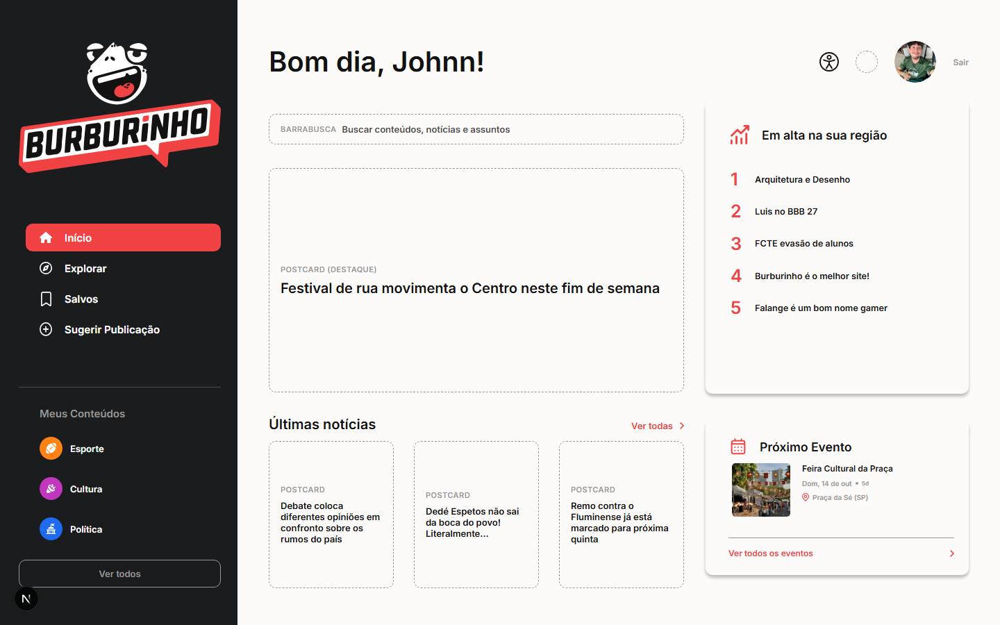
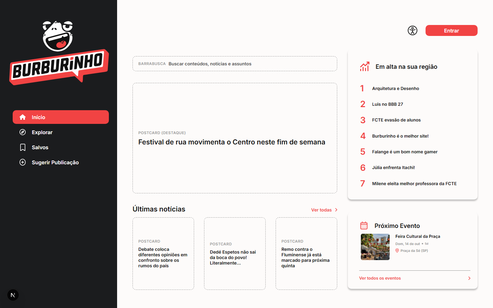
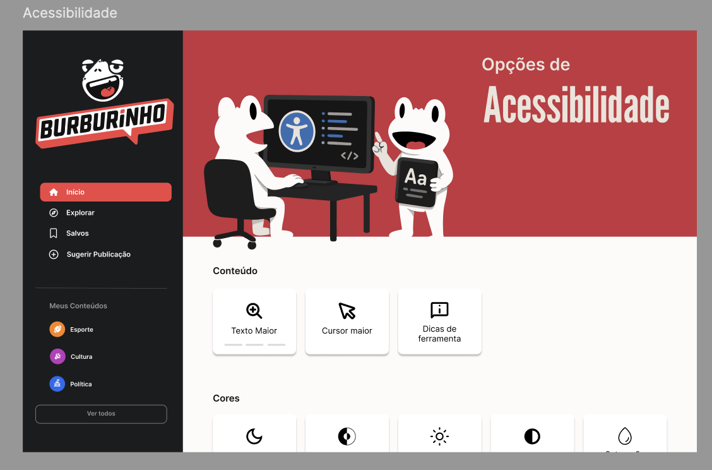
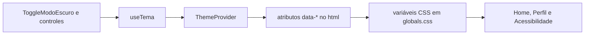
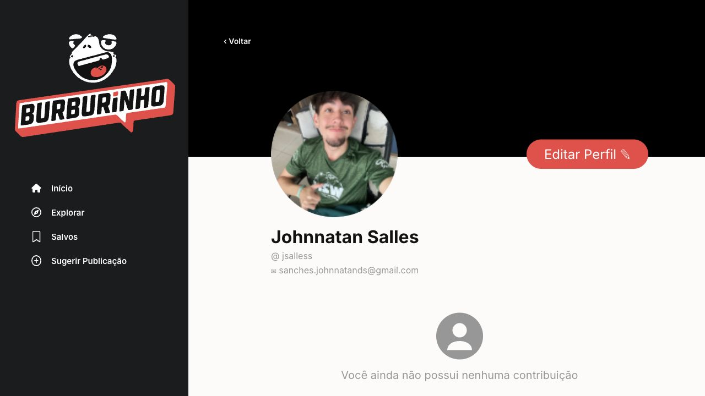
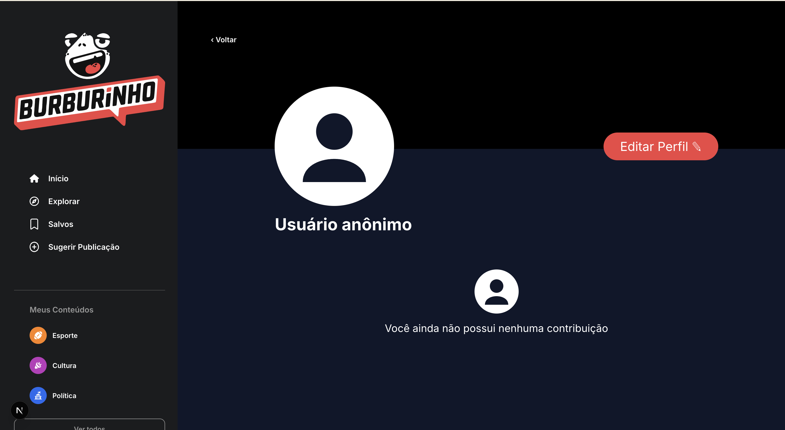

# 1.1.2. Reutilização de Software

<!--
================================================================================
GUIA DE PREENCHIMENTO: comentários HTML como este NÃO aparecem no site.
- Cada pessoa preenche a SUA frente (seções "Reutilização 1" a "Reutilização 7" ou as seções da vaga 8),
  a SUA linha no Foco_02 e a(s) SUA(s) linha(s) em Versionamentos.
- O passo a passo de cada frente está na issue correspondente no GitHub (Issues > milestone "Entrega 04").
- Apague o comentário "O QUE ESCREVER AQUI" depois de preencher. NÃO omita tópicos (orientação da professora).
- Links para código: SEMPRE absolutos (https://github.com/...). Links relativos para fora de docs/ quebram o build do site.
- Referência teórica: PDF da aula "Reutilização & Framework" (Profa. Milene Serrano, no Aprender3). Cite o número do slide.
================================================================================
-->

## Focos do Relatório

### FOCO_01: Reutilização de Software

Entrega Mínima: Evidência de Reutilização (Components do React documentados e demonstrados em uso).

### Participantes no Foco_01

<!-- O QUE ESCREVER AQUI: cada pessoa completa a própria linha (frente assumida e número da issue). -->

| Nome do Membro | Frente | Componentes / Produtos | Issue |
| --- | --- | --- | --- |
| André Henrique | | | |
| Giovanna Aguiar | Tema e Acessibilidade (Reutilização 6) | `ThemeProvider`, `useTema`, `ToggleModoEscuro`, páginas Acessibilidade e Perfil | [#6](https://github.com/UnBArqDsw2026-2-Turma01/2026.2-T01-_G3_ProjetoPortalNoticias_Entrega_04/issues/6) |
| Giovanna Felipe | | | |
| João Pedro Lopes | Navegação e Layout (Reutilização 2) + Elementos de DAS | `SideBar` (4 variantes), `AppLayout`, Home logado/deslogado, `CardEmAlta`, `CardEvento`, `useSessaoSimulada`; diagramas de Pacotes e de Componentes | [#2](https://github.com/UnBArqDsw2026-2-Turma01/2026.2-T01-_G3_ProjetoPortalNoticias_Entrega_04/issues/2) |
| Johnnatan de Salles | | | |
| Júlia Gabriella | | | |
| Luís Cunha | | | |
| Matheus Eiki | | | |

### Metodologia do Foco_01

<!-- O QUE ESCREVER AQUI (vaga 8, com insumos de todos):
1. Como nos organizamos: issues no GitHub (1 por frente + cronograma), dependências entre elas e prazos escalonados até 22/11.
2. Fluxo de trabalho: branch por issue → Pull Request → revisão de outro membro → merge na main → deploy automático no GitPages.
3. Ferramentas: Figma (protótipo), Next.js/React + TypeScript, Storybook, Vitest, GitHub Actions, MkDocs, IA Generativa.
4. Reuniões: link para as atas em 1.3. Iniciativas Extras.
Um print do quadro de issues ou do histórico de PRs ajuda muito. -->

### Reutilização de Software

#### Visão Geral

<!-- O QUE ESCREVER AQUI (vaga 8): 1 parágrafo apresentando o que foi construído (portal Next.js que implementa as telas do Figma reaproveitando componentes)
e a lista dos NÍVEIS de reutilização, cada um com link para a seção abaixo:
1. Componentes com props (PostCard, BadgeCategoria, BotaoAcao, SideBar...)
2. Composição com children (AppLayout)
3. Hooks customizados (useTema, useSalvos, useNotificacoes)
4. Context API (ThemeProvider: modo escuro + acessibilidade)
5. Componente genérico parametrizado (PaginaCategoria gera as 4 telas de categoria)
6. Reaproveitamento dos GoFs da Entrega 03 (Singleton, Abstract Factory, Builder, Observer, Decorator)
Coloque também os links do portal publicado e do Storybook. -->

#### Fundamentação Teórica Aplicada ao Burburinho

<!--
O QUE ESCREVER AQUI (vaga 8): para CADA subtítulo abaixo:
(1) explique o conceito em 2 a 4 frases com suas palavras, citando o slide do PDF da aula;
(2) mostre ONDE ele aparece no NOSSO código (link absoluto para o arquivo);
(3) dê um exemplo concreto. Não copie os slides: aplique ao projeto.
-->

##### Reutilização Além do Código

<!-- Slide 4: reutilização também em requisitos e projeto. Exemplo nosso: o protótipo do Figma já definia componentes ("Menu de Opções SideBar" usado 22 vezes, "Conteúdo Menor" usado 21 vezes) e o código herdou essa decisão; os GoFs da Entrega 03 foram reaproveitados. -->

##### Framework × Biblioteca (Princípio de Hollywood)

<!-- Slides 45 a 50. Next.js/React = FRAMEWORK: ele chama o nosso código ("Don't call us, we'll call you"): roteamento por pastas (src/app), renderização dos componentes, ciclo de vida dos hooks. Bibliotecas = o que NÓS chamamos (confira o package.json, ex.: Testing Library).
Faça uma tabela: | Item | Framework ou Biblioteca | Quem chama quem | Evidência no código | -->

##### Hot Spots e Frozen Spots

<!-- Slides 11 a 15. Frozen spots = o que o Next/React fixa (motor de renderização, roteador, ciclo de vida). Hot spots = onde encaixamos o nosso código (page.tsx e layout.tsx de cada rota, componentes, props, children, hooks, Providers).
Tabela com 4 a 6 exemplos reais. Opcional: diagrama no estilo do slide 13 (kernel + plugues), feito no draw.io. -->

##### Framework Caixa Branca, Preta e Cinza

<!-- Slides 23 a 28. Nosso uso: por COMPOSIÇÃO (passamos componentes/props: caixa preta) e implementando os "contratos" que o Next espera (page.tsx, layout.tsx: hot spots, caixa branca). Conclusão esperada: uso CAIXA CINZA. Justifique com exemplos do código. -->

##### Formas de Reutilização Presentes no Projeto

<!-- Slide 52 (plugins, serviços, componentes, linhas de produto) e slides 60 e 61 (componentes e interfaces). Diga quais aparecem no Burburinho e quais NÃO aparecem (senso crítico). -->

##### Padrões de Projeto × Framework

<!-- Slides 17 a 21 e 76 a 78. Um framework CONTÉM padrões: ex. Context/Provider se parece com Observer; composição de componentes se parece com Composite/Decorator. E os GoFs da Entrega 03 viraram peças do app (link para as seções abaixo). -->

<!--
==================== MODELO DAS SEÇÕES "Reutilização 1 a 7" ====================
Cada responsável preenche os 8 subtítulos da sua seção:
- Contexto (Problema de Repetição): qual repetição existia no Figma? Em quantas telas? Link do nó no Figma + print.
- Ponto de Reutilização e Relação com a Teoria: qual nível de reutilização (props / children / hook / Context / genérico / GoF da Entrega 03)
  e por quê; cite 1 ou 2 slides. Se reaproveitou GoF da Entrega 03, link para o código antigo e diga o que mudou na adaptação para React.
- Contrato do Componente (Props): tabela | Prop | Tipo | Obrigatória? | Padrão | Descrição | (para hooks: parâmetros e retorno).
- Onde é Reutilizado: tabela | Tela/rota | Arquivo que usa (link) | Props passadas |. Mínimo 2 usos. É o CORAÇÃO da evidência.
- Implementação (Código): trecho curto (10 a 30 linhas) em bloco ```tsx + link do arquivo.
- Demonstração em Uso: link da story no Storybook publicado + prints do componente em 2 telas (GIF opcional).
- Uso da IA Generativa na Minha Solução: ferramenta, para quê, o que aceitou, o que corrigiu e POR QUÊ; 1 exemplo concreto.
- Senso Crítico: limites, o que NÃO abstraiu de propósito, o que faria com mais tempo.
===============================================================================
-->

#### Reutilização 1: Projeto Base, Camada de Dados e Identidade Visual

**Responsável:** Giovanna Felipe ([issue #1](https://github.com/UnBArqDsw2026-2-Turma01/2026.2-T01-_G3_ProjetoPortalNoticias_Entrega_04/issues/1) · [PR #11](https://github.com/UnBArqDsw2026-2-Turma01/2026.2-T01-_G3_ProjetoPortalNoticias_Entrega_04/pull/11))

##### Contexto (Problema de Repetição)

No [Figma](https://www.figma.com/design/LnkN55jPy6jk8dsjpmYJSF/Prot%C3%B3tipo?node-id=0-1), a mesma notícia aparece na Home, nas categorias, na tela de Notícia e em Salvos, e **toda tela tem versão DarkMode**. Sem uma base comum, cada tela definiria a própria forma da notícia, filtraria os dados do seu jeito e repetiria cores fixas, o que obrigaria a duplicar estilos para o modo escuro.

##### Ponto de Reutilização e Relação com a Teoria

Esta frente não é um componente visual, e sim a **base que todos os componentes reutilizam**:

| O que é reutilizado | Como | Quem reutiliza |
| --- | --- | --- |
| Contrato (`Noticia`, `Categoria`) | tipos TypeScript em um único arquivo | todo o portal |
| Dados e consultas (`repositorioNoticias`) | **Singleton reaproveitado da Entrega 03** | páginas e componentes que listam notícias |
| Estilo | variáveis CSS extraídas do Figma (`var(--cor-primaria)`) | todos os componentes; o modo escuro troca só as variáveis |

Na aula (slides 11 a 15), *frozen* e *hot spots* são conceitos do framework em relação à aplicação: para o Next.js, todo o nosso `src/` é hot spot, código que o framework chama (Princípio de Hollywood, slides 45 a 50). Dentro da nossa arquitetura, esta base é o **núcleo estável do domínio**, sobre o qual os componentes se apoiam, e o repositório é chamado por nós, não pelo framework. O Singleton mostra um padrão de projeto vivendo dentro do app (slides 76 a 78).

| Singleton na Entrega 03 (JavaScript) | Na Entrega 04 (TypeScript) |
| --- | --- |
| Truque com a flag `#liberado`: bloqueia `new` em tempo de execução | `private constructor`: o compilador impede `new`, mas só na compilação (o `private` some no JavaScript gerado) |
| Objetos sem formato definido | Notícias seguem o contrato `Noticia` |
| Devolvia a lista com os mesmos objetos internos | Devolve cópias de cada notícia (encapsulamento, slide 42) |

##### Contrato do Componente (Props)

| Método | Retorno | Quem usa |
| --- | --- | --- |
| `listarTodas()` / `listarRecentes(n)` | notícias da mais recente para a mais antiga | Home, rotas dinâmicas |
| `buscarPorId(id)` | `Noticia` ou `undefined` | Notícia, Salvos |
| `listarPorCategoria(categoria)` | notícias da categoria | `PaginaCategoria` |
| `listarDestaques()` | notícias com `destaque: true` | card de destaque da Home |
| `buscar(termo)` | busca em título, resumo e autor, sem acentos | `BarraBusca` |
| `adicionarSugestao(noticia)` / `listarSugestoes()` | sugestões de leitores, separadas das publicadas | Sugerir Publicação |

Não há métodos para editar ou apagar notícias, porque nenhuma tela do protótipo usa.

##### Onde é Reutilizado

<!-- PENDENTE (Giovanna, 21/11 à noite): refazer a contagem com o código de todos no main (Ctrl+Shift+F em portal/src por "repositorioNoticias", ignorando .test e .stories). -->

| Item | Arquivos que usam |
| --- | --- |
| `repositorioNoticias` | [`app/page.tsx`](https://github.com/UnBArqDsw2026-2-Turma01/2026.2-T01-_G3_ProjetoPortalNoticias_Entrega_04/blob/main/portal/src/app/page.tsx) (previstos: `PaginaCategoria`, Notícia, `BarraBusca`, Salvos, Sugerir Publicação) |
| `Noticia` / `Categoria` | dados, repositório, página inicial e todos os componentes de conteúdo |
| Variáveis CSS | todos os arquivos `*.module.css` |

##### Implementação (Código)

[`repositorioNoticias.ts`](https://github.com/UnBArqDsw2026-2-Turma01/2026.2-T01-_G3_ProjetoPortalNoticias_Entrega_04/blob/main/portal/src/lib/repositorioNoticias.ts) (trecho):

```ts
export class RepositorioNoticias {
  private static instancia: RepositorioNoticias | null = null;

  private constructor(noticiasIniciaisDoPortal: Noticia[]) {
    this.noticias = noticiasIniciaisDoPortal.map(copiar);
  }

  static getInstancia(): RepositorioNoticias {
    if (RepositorioNoticias.instancia === null) {
      RepositorioNoticias.instancia = new RepositorioNoticias(noticiasIniciais);
    }
    return RepositorioNoticias.instancia;
  }
}

export const repositorioNoticias = RepositorioNoticias.getInstancia();
```

Demais arquivos: [`types/noticia.ts`](https://github.com/UnBArqDsw2026-2-Turma01/2026.2-T01-_G3_ProjetoPortalNoticias_Entrega_04/blob/main/portal/src/types/noticia.ts) · [`globals.css`](https://github.com/UnBArqDsw2026-2-Turma01/2026.2-T01-_G3_ProjetoPortalNoticias_Entrega_04/blob/main/portal/src/app/globals.css) (tokens) · [`data/noticias.ts`](https://github.com/UnBArqDsw2026-2-Turma01/2026.2-T01-_G3_ProjetoPortalNoticias_Entrega_04/blob/main/portal/src/data/noticias.ts) · [workflow de deploy](https://github.com/UnBArqDsw2026-2-Turma01/2026.2-T01-_G3_ProjetoPortalNoticias_Entrega_04/blob/main/.github/workflows/deploy-mkdocs.yml)

##### Demonstração em Uso

[Portal publicado](https://unbarqdsw2026-2-turma01.github.io/2026.2-T01-_G3_ProjetoPortalNoticias_Entrega_04/portal/), atualizado automaticamente a cada merge na `main`, e [14 testes automatizados](https://github.com/UnBArqDsw2026-2-Turma01/2026.2-T01-_G3_ProjetoPortalNoticias_Entrega_04/blob/main/portal/src/lib/repositorioNoticias.test.ts) (instância única, filtros, busca, encapsulamento e sugestões).

<!-- PENDENTE (Giovanna): depois do merge, inserir 1 print do Actions verde e 1 do portal no ar, salvos em docs/assets/reutilizacao/:  -->

##### Uso da IA Generativa na Minha Solução

Usei IA generativa de duas formas. Para **produzir**, o Claude (no VS Code) gerou a configuração do projeto, o repositório, os testes e os workflows, e eu revisei antes do merge. Para **aprender**, usei o Gemini para entender as decisões do código antes de documentá-las ([conversa](https://share.gemini.google/wtrhovOXgWjN)). O que mais pesou:

1. **Versão do framework:** o Next.js 16 é mais novo do que o conhecimento da IA. A configuração foi validada na documentação do próprio pacote, e assim apareceu a regra de rotas dinâmicas (`dynamicParams = false`), testada antes de entrar no README do grupo.
2. **Bug pego por teste:** a primeira versão devolvia uma cópia da lista, mas com os mesmos objetos internos. O teste de encapsulamento falhou e a correção foi copiar cada notícia. Com o Gemini entendi que isso é uma *cópia rasa direcionada*: basta porque a `Noticia` não tem objetos aninhados.
3. **Uma IA corrigindo a outra:** o primeiro rascunho deste relatório chamava a nossa base de "frozen spot". Perguntando ao Gemini, entendi que frozen/hot spot é um conceito do framework em relação à aplicação, então o texto foi corrigido.
4. **E a IA também deixou passar algo:** o Gemini explicou o modo escuro dizendo que `[data-tema="escuro"]` "sobrescreve" o `:root`. Conferindo, os dois seletores têm a mesma especificidade, e quem vence é só a ordem no arquivo. Troquei por `:root[data-tema="escuro"]`, que vence independentemente da ordem.

##### Senso Crítico

- **Sem back-end, o Singleton é único por contexto de execução**, e não no portal: há uma instância no build e uma em cada aba de cada leitor. Por isso uma sugestão some ao recarregar. Com uma API, só este arquivo mudaria, porque as telas falam apenas com os métodos do repositório.
- **Proteções com limites:** o `private constructor` só vale na compilação, e a `copiar` deixaria escapar objetos aninhados se a `Noticia` ganhasse algum (aí valeria `structuredClone` ou tipos `Readonly`).
- **Os tokens dependem de disciplina:** nada impede alguém de usar cor fixa, e toda cor nova precisa ser conferida nos dois temas. Um lint de CSS resolveria a primeira parte.
- Os parágrafos das notícias que o Figma não mostra foram completados para a demonstração.

#### Reutilização 2: Navegação e Layout (SideBar, AppLayout, Home)

**Responsável:** João Pedro Lopes ([issue #2](https://github.com/UnBArqDsw2026-2-Turma01/2026.2-T01-_G3_ProjetoPortalNoticias_Entrega_04/issues/2) · branch [`feat/2-navegacao`](https://github.com/UnBArqDsw2026-2-Turma01/2026.2-T01-_G3_ProjetoPortalNoticias_Entrega_04/tree/feat/2-navegacao))

##### Contexto (Problema de Repetição)

No [Figma](https://www.figma.com/design/LnkN55jPy6jk8dsjpmYJSF/Prot%C3%B3tipo?node-id=115-68), **todas as telas** têm a mesma barra lateral escura: logo, os quatro itens do menu (Início, Explorar, Salvos, Sugerir Publicação) e, para quem está logado, a seção "Meus Conteúdos". O menu é o componente [Menu de Opções SideBar](https://www.figma.com/design/LnkN55jPy6jk8dsjpmYJSF/Prot%C3%B3tipo?node-id=46-573), **usado 22 vezes** no protótipo em **4 variantes**. Comparando as variantes, a única diferença é **qual item fica destacado** (Padrão = Início, Variante 2 = Explorar, Variante 3 = Salvos, Variante 4 = Sugerir Publicação).

Sem reutilização, cada uma das cerca de 10 rotas do portal repetiria a barra lateral e o próprio menu repetiria quatro blocos de JSX quase iguais. Uma mudança simples (um item novo, outra cor de destaque) teria de ser feita em todos os lugares.

A Home tem duas versões no Figma, [logado](https://www.figma.com/design/LnkN55jPy6jk8dsjpmYJSF/Prot%C3%B3tipo?node-id=6-5) e [deslogado](https://www.figma.com/design/LnkN55jPy6jk8dsjpmYJSF/Prot%C3%B3tipo?node-id=115-144), que diferem em poucos pontos: saudação, avatar ou botão "Entrar", quantidade de assuntos em alta e a seção "Meus Conteúdos" da SideBar.

##### Ponto de Reutilização e Relação com a Teoria

Esta frente mostra **dois níveis diferentes** de reutilização de componentes:

| Nível | Onde | Como funciona |
| --- | --- | --- |
| **Props e variantes** | `SideBar` | Um só componente; a prop `itemAtivo` escolhe uma das 4 variantes do Figma. Sem a prop, o item ativo é descoberto pela URL (`usePathname`). |
| **Configuração como dados** | `ITENS_MENU` | Os itens do menu são um array `{ id, rotulo, href, icone }`. O JSX percorre o array uma única vez; incluir uma opção no menu é acrescentar uma linha, sem mexer no componente. |
| **Composição com `children`** | `AppLayout` | Recebe a página como `children` e a coloca ao lado da SideBar. O `AppLayout` não sabe qual página vai receber. |
| **Lógica em hook** | `useSessaoSimulada` | O mesmo hook informa o login simulado à `SideBar` ("Meus Conteúdos") e à Home (saudação, Entrar/Sair). |

**Relação com a teoria:**

- **Hot spot do framework (slides 11 a 14):** o `layout.tsx` raiz é um ponto que o Next.js chama e nós preenchemos. Ao colocar o `AppLayout` ali, a barra lateral aparece em todas as rotas sem que nenhuma `page.tsx` a importe. É o Princípio de Hollywood (slides 45 a 50): não chamamos o layout; o framework chama e encaixa cada página em `{children}`.
- **Composição como reutilização caixa preta (slides 23 a 26):** quem usa o `AppLayout` não conhece nem altera o seu interior; só entrega um conteúdo. Já a `SideBar` é configurada por props, também sem herança nem alteração do código interno.
- **Componentes e interfaces (slides 60 e 61):** cada componente expõe um contrato (as props) e depende de contratos de outros. Isso está desenhado no [diagrama de componentes](1.1.1.DAS.md#visao-de-componentes-diagrama-de-componentes-uml) da página 1.1.1.

##### Contrato do Componente (Props)

**`SideBar`** ([código](https://github.com/UnBArqDsw2026-2-Turma01/2026.2-T01-_G3_ProjetoPortalNoticias_Entrega_04/blob/main/portal/src/components/SideBar/SideBar.tsx))

| Prop | Tipo | Obrigatória? | Padrão | Descrição |
| --- | --- | --- | --- | --- |
| `itemAtivo` | `'inicio' \| 'explorar' \| 'salvos' \| 'sugerir'` | Não | item da URL atual | Força a variante do Figma (item destacado). |
| `logado` | `boolean` | Não | login simulado | Mostra ou esconde "Meus Conteúdos". |
| `categoriasSeguidas` | `Categoria[]` | Não | as do usuário de exemplo | Categorias listadas em "Meus Conteúdos". |

**`AppLayout`** ([código](https://github.com/UnBArqDsw2026-2-Turma01/2026.2-T01-_G3_ProjetoPortalNoticias_Entrega_04/blob/main/portal/src/components/AppLayout/AppLayout.tsx))

| Prop | Tipo | Obrigatória? | Padrão | Descrição |
| --- | --- | --- | --- | --- |
| `children` | `ReactNode` | Sim | — | A página atual, encaixada à direita da SideBar. |

**Componentes da Home**

| Componente | Prop | Tipo | Obrigatória? | Descrição |
| --- | --- | --- | --- | --- |
| [`CardEmAlta`](https://github.com/UnBArqDsw2026-2-Turma01/2026.2-T01-_G3_ProjetoPortalNoticias_Entrega_04/blob/main/portal/src/components/CardEmAlta/CardEmAlta.tsx) | `assuntos` | `string[]` | Sim | Assuntos em alta, em ordem. Cada um leva à busca. |
| | `limite` | `number` | Não (padrão: todos) | Quantos mostrar (logado: 5; deslogado: 7). |
| | `titulo` | `string` | Não (padrão: "Em alta na sua região") | Título do card. |
| [`CardEvento`](https://github.com/UnBArqDsw2026-2-Turma01/2026.2-T01-_G3_ProjetoPortalNoticias_Entrega_04/blob/main/portal/src/components/CardEvento/CardEvento.tsx) | `evento` | `{ titulo, data, publicadoHa, local, imagemUrl, href }` | Sim | Evento exibido no card. |
| | `hrefTodos` | `string` | Sim | Destino de "Ver todos os eventos". |

**Hook `useSessaoSimulada()`** ([código](https://github.com/UnBArqDsw2026-2-Turma01/2026.2-T01-_G3_ProjetoPortalNoticias_Entrega_04/blob/main/portal/src/hooks/useSessaoSimulada.ts)): não recebe parâmetros e devolve `{ logado: boolean, usuario: UsuarioExemplo | null, entrar(), sair() }`.

##### Onde é Reutilizado

| Tela/rota | Arquivo que usa | Como |
| --- | --- | --- |
| **Todas as rotas** | [`app/layout.tsx`](https://github.com/UnBArqDsw2026-2-Turma01/2026.2-T01-_G3_ProjetoPortalNoticias_Entrega_04/blob/main/portal/src/app/layout.tsx) | `<AppLayout>{children}</AppLayout>`: uma única linha leva a SideBar a todas as páginas. |
| Home (`/`) | [`app/page.tsx`](https://github.com/UnBArqDsw2026-2-Turma01/2026.2-T01-_G3_ProjetoPortalNoticias_Entrega_04/blob/main/portal/src/app/page.tsx) | SideBar com `itemAtivo` = Início (pela URL). |
| Explorar (`/explorar`) e Categorias (`/categoria/[categoria]`) | rotas da vaga 3 | SideBar com Explorar ativo, sem nenhuma linha extra na página. |
| Salvos (`/salvos`) e Busca (`/busca`) | rotas da vaga 5 | SideBar com Salvos ativo em `/salvos`. |
| Sugerir Publicação (`/sugerir`) e Notícia (`/noticia/[id]`) | rotas da vaga 4 | SideBar com Sugerir ativo em `/sugerir`. |
| Acessibilidade (`/acessibilidade`) e Perfil (`/perfil`) | rotas da vaga 6 | SideBar presente; nenhum item do menu fica ativo (como no Figma). |
| Storybook (pendente: o Storybook da vaga 7 ainda não está no main) | `SideBar.stories.tsx` | Uma story por variante do Figma (prop `itemAtivo`). |

| Lógica reutilizada | Quem usa |
| --- | --- |
| `useSessaoSimulada` | [`SideBar`](https://github.com/UnBArqDsw2026-2-Turma01/2026.2-T01-_G3_ProjetoPortalNoticias_Entrega_04/blob/main/portal/src/components/SideBar/SideBar.tsx) ("Meus Conteúdos") e [`PaginaInicial`](https://github.com/UnBArqDsw2026-2-Turma01/2026.2-T01-_G3_ProjetoPortalNoticias_Entrega_04/blob/main/portal/src/app/_home/PaginaInicial.tsx) (saudação, avatar, Entrar/Sair, assuntos em alta) |
| `ITENS_MENU` / `itemAtivoPelaRota` | `SideBar` e os testes da SideBar |
| `caminhoPublico` (da vaga 1) | ícones da SideBar, da Home e dos cards, para funcionarem dentro da subpasta do GitHub Pages |

<!-- PENDENTE (João Pedro, 21/11): conferir as rotas acima com o código de todos no main e trocar os marcadores da Home pelos componentes das vagas 3 e 5. -->

##### Implementação (Código)

O menu inteiro sai de um array de configuração ([`itensMenu.ts`](https://github.com/UnBArqDsw2026-2-Turma01/2026.2-T01-_G3_ProjetoPortalNoticias_Entrega_04/blob/main/portal/src/components/SideBar/itensMenu.ts) e [`SideBar.tsx`](https://github.com/UnBArqDsw2026-2-Turma01/2026.2-T01-_G3_ProjetoPortalNoticias_Entrega_04/blob/main/portal/src/components/SideBar/SideBar.tsx), trechos):

```tsx
export const ITENS_MENU: readonly ItemMenu[] = [
  { id: "inicio", rotulo: "Início", href: "/", icone: { /* ... */ } },
  { id: "explorar", rotulo: "Explorar", href: "/explorar", icone: { /* ... */ } },
  { id: "salvos", rotulo: "Salvos", href: "/salvos", icone: { /* ... */ } },
  { id: "sugerir", rotulo: "Sugerir Publicação", href: "/sugerir", icone: { /* ... */ } },
];

// SideBar.tsx: a variante do Figma é só uma prop; sem ela, vem da URL.
const ativo = itemAtivo ?? itemAtivoPelaRota(usePathname());

{ITENS_MENU.map((item) => (
  <Link key={item.id} href={item.href} aria-current={item.id === ativo ? "page" : undefined}>
    {/* ícone + rótulo */}
  </Link>
))}
```

E a composição que leva a SideBar a todas as telas ([`AppLayout.tsx`](https://github.com/UnBArqDsw2026-2-Turma01/2026.2-T01-_G3_ProjetoPortalNoticias_Entrega_04/blob/main/portal/src/components/AppLayout/AppLayout.tsx) e [`layout.tsx`](https://github.com/UnBArqDsw2026-2-Turma01/2026.2-T01-_G3_ProjetoPortalNoticias_Entrega_04/blob/main/portal/src/app/layout.tsx)):

```tsx
export function AppLayout({ children }: AppLayoutProps) {
  return (
    <div className={styles.layout}>
      <div className={styles.lateral}><SideBar /></div>
      <main className={styles.conteudo}>{children}</main>
    </div>
  );
}

// app/layout.tsx: o Next chama este hot spot e encaixa cada página em {children}.
<body>
  <AppLayout>{children}</AppLayout>
</body>
```

##### Demonstração em Uso

- [Portal publicado](https://unbarqdsw2026-2-turma01.github.io/2026.2-T01-_G3_ProjetoPortalNoticias_Entrega_04/portal/): o botão **Entrar** da Home alterna entre as duas versões do Figma.
- Testes automatizados: [`SideBar.test.tsx`](https://github.com/UnBArqDsw2026-2-Turma01/2026.2-T01-_G3_ProjetoPortalNoticias_Entrega_04/blob/main/portal/src/components/SideBar/SideBar.test.tsx) (marca o item ativo pela URL, a prop `itemAtivo` tem prioridade, um link por item da configuração, "Meus Conteúdos" só logado) e [`PaginaInicial.test.tsx`](https://github.com/UnBArqDsw2026-2-Turma01/2026.2-T01-_G3_ProjetoPortalNoticias_Entrega_04/blob/main/portal/src/app/_home/PaginaInicial.test.tsx) (Home logado × deslogado, Entrar e Sair).

<!-- PENDENTE (João Pedro): link das stories da SideBar no Storybook publicado, assim que a vaga 7 publicar o Storybook. -->

| Home logado | Home deslogado |
| --- | --- |
|  |  |

| Mesma SideBar em outra rota (`/explorar`) | Tela menor: a SideBar vira barra no topo |
| --- | --- |
|  |  |

Os retângulos tracejados da Home são **marcadores provisórios** dos componentes das vagas 3 (`PostCard`) e 5 (`BarraBusca`, `NotificationBell`), combinados no cronograma (#10). No print de `/explorar` a página ainda é 404 porque a rota é da vaga 3, mas a SideBar já aparece com o item certo, sem nenhuma linha extra.

##### Uso da IA Generativa na Minha Solução

Usei o **Claude Code** (no VS Code), conectado ao Figma por MCP, para ler o protótipo, gerar os componentes e os testes, e para esboçar os diagramas da página 1.1.1. Revisei o resultado comparando com o Figma, com prints do portal rodando e com a documentação do Next.js instalada no projeto. O que mais pesou:

1. **Variantes do Figma:** a issue sugeria que as 4 variantes podiam ser "expandida/recolhida". Lendo os nós do Figma, a IA confirmou que a única diferença é o item ativo. Por isso não existe prop `recolhida`.
2. **Bug pego ao conferir o build:** a IA usou `next/image` acreditando que ele aplica sozinho o `basePath` do GitHub Pages (o README do portal diz isso). Ao inspecionar o HTML gerado com o `basePath`, os ícones apontavam para `/icones/...`, sem a subpasta, e iam quebrar no site publicado. Com `images.unoptimized`, o Next não prefixa o caminho; a correção foi usar o `caminhoPublico()` da vaga 1.
3. **URL com barra no final:** como o projeto usa `trailingSlash: true`, a rota chega como `/salvos/`. A comparação do item ativo foi feita ignorando a barra final, e há um teste para isso.
4. **Teste que falhou por motivo errado:** o primeiro teste da Home procurava o link de uma notícia na página inteira e achou dois (a mesma notícia estava no destaque). O código estava certo; o teste foi restringido à seção "Últimas notícias".
5. **Notação UML:** conferi um a um, no diagrama de componentes, se a "bola" ficou do lado de quem **fornece** a interface e o "soquete" do lado de quem **requer**.

##### Senso Crítico

- **Login simulado:** a sessão é só uma flag no `localStorage`; serve para alternar as duas versões do Figma, não para autenticar ninguém. Login e Cadastro reais estão fora do escopo da entrega.
- **Um item que não está no Figma:** o link "Sair" ao lado do avatar não existe no protótipo, mas sem ele não seria possível voltar ao estado deslogado na demonstração.
- **Responsividade decidida por nós:** o Figma só tem telas de 1440 px. Abaixo de 900 px a SideBar vira uma barra no topo e, abaixo de 600 px, mostra só os ícones (o nome continua acessível a leitores de tela). Essa decisão não foi validada com o protótipo.
- **Não abstraí de propósito:** os cards "Em alta" e "Próximo Evento" só aparecem na Home, por isso não ganharam variantes nem configurações extras. Os assuntos em alta e o evento são dados fixos, porque o repositório de notícias não tem eventos nem métricas de popularidade.
- **Dependência de outras vagas:** a Home só fica completa com o `PostCard` (vaga 3) e a `BarraBusca`/`NotificationBell` (vaga 5); até lá, usa marcadores. O logo da SideBar é estático e será trocado pelo `LogoTema` da vaga 7.

#### Reutilização 3: Cards e Páginas de Categoria (PostCard, BadgeCategoria, PaginaCategoria)

<!-- Responsável: vaga 3. Itens: PostCard (variantes "Conteúdos" e "Conteúdo Menor"), BadgeCategoria, PaginaCategoria + fábrica de categorias (Abstract Factory da Entrega 03), tela Explorar. -->

**Responsável:**

##### Contexto (Problema de Repetição)

##### Ponto de Reutilização e Relação com a Teoria

##### Contrato do Componente (Props)

##### Onde é Reutilizado

##### Implementação (Código)

##### Demonstração em Uso

##### Uso da IA Generativa na Minha Solução

##### Senso Crítico

#### Reutilização 4: Notícia e Sugerir Publicação (BotaoAcao, CampoFormulario, NoticiaBuilder)

<!-- Responsável: vaga 4. Itens: página Notícia, BotaoAcao (Salvar/Compartilhar/Voltar), CampoFormulario, Sugerir Publicação com NoticiaBuilder (Builder da Entrega 03). -->

**Responsável:**

##### Contexto (Problema de Repetição)

##### Ponto de Reutilização e Relação com a Teoria

##### Contrato do Componente (Props)

##### Onde é Reutilizado

##### Implementação (Código)

##### Demonstração em Uso

##### Uso da IA Generativa na Minha Solução

##### Senso Crítico

#### Reutilização 5: Busca, Notificações e Salvos (BarraBusca, NotificationBell, useSalvos)

<!-- Responsável: vaga 5. Itens: BarraBusca, NotificationBell + useNotificacoes (Observer da Entrega 03), página Salvos + useSalvos. -->

**Responsável:**

##### Contexto (Problema de Repetição)

##### Ponto de Reutilização e Relação com a Teoria

##### Contrato do Componente (Props)

##### Onde é Reutilizado

##### Implementação (Código)

##### Demonstração em Uso

##### Uso da IA Generativa na Minha Solução

##### Senso Crítico

#### Reutilização 6: Tema e Acessibilidade (ThemeProvider, useTema, ToggleModoEscuro)

**Responsável:** Giovanna Aguiar ([issue #6](https://github.com/UnBArqDsw2026-2-Turma01/2026.2-T01-_G3_ProjetoPortalNoticias_Entrega_04/issues/6) · commit: [5633092](https://github.com/UnBArqDsw2026-2-Turma01/2026.2-T01-_G3_ProjetoPortalNoticias_Entrega_04/commit/5633092f7e607016ba8ced40aad8dfbfcd9b7865))

##### Contexto (Problema de Repetição)

No Figma, a página Protótipo tem **10 telas nomeadas DarkMode**: Home, Notícia, Salvos, Acessibilidade, Profile, Sugerir Publicação, Tecnologia, Política, Esporte e Cultura. Ou seja, quase todas as telas existem em duas versões, que mudam só as cores.
 
Se eu implementasse cada uma separadamente, o portal acabaria com duas versões de cada página, e cada componente teria que saber em qual tema está. Qualquer ajuste de estilo teria de ser feito duas vezes, e a cada tela nova o trabalho dobraria. O mesmo vale para as preferências de acessibilidade (fonte maior, alto contraste, menos animações): sem um ponto central, cada tela teria que tratar isso por conta própria.
 
Resolvi isso concentrando **tema e preferências em um único estado**, que vale para o portal inteiro.
 
<!-- PENDENTE (Giovanna): colocar o link do nó do Figma do componente "Modo Escuro" e um print de uma tela clara ao lado da versão DarkMode dela. -->
**Componente no Figma:** [Modo Escuro](https://www.figma.com/design/LnkN55jPy6jk8dsjpmYJSF/Prot%C3%B3tipo?node-id=273-550&t=8EPz5E3qPHDgzlje-4)

| Tela | Claro | Escuro |
| --- | --- | --- |
| Acessibilidade |  |  |

##### Ponto de Reutilização e Relação com a Teoria

O nível de reutilização desta frente é o **estado transversal**: **Context API + variáveis CSS**.
 
O fluxo é este:
 
1. O `ThemeProvider` guarda o estado (tema, fonte, alto contraste, reduzir animações).
2. A cada mudança, ele escreve atributos `data-*` no `<html>`.
3. O `globals.css` troca o valor das variáveis CSS conforme esses atributos.
4. Todos os componentes já usam `var(--cor-...)`, então mudam de aparência sem saber que o tema existe.

 **Relação com a teoria:**
 
- **Parte fixa × pontos flexíveis:** o Provider faz parte da estrutura compartilhada da minha aplicação, e o que varia de rota para rota é o conteúdo que entra por `children`. Isso não quer dizer que o Provider seja parte interna do Next.js; ele é código nosso, encaixado no `layout.tsx`, que é o hot spot que o framework chama.
- **Extensível:** para criar uma nova preferência (por exemplo, o cursor maior que acrescentei depois), eu só adiciono um campo ao estado e uma regra no CSS. Nenhum componente existente muda.
- **Seguro, por encapsulamento:** ninguém lê o Context diretamente; o acesso é só pelo `useTema`. O hook lança um erro claro se for usado fora do Provider, em vez de devolver um valor errado em silêncio.

##### Contrato do Componente (Props)

| Elemento | Contrato |
| --- | --- |
| `ThemeProvider` | Recebe `children: ReactNode`. Deve envolver o `AppLayout` **uma única vez**, no layout raiz. |
| `useTema()` | Retorna `tema`, `fonte`, `altoContraste`, `reduzirAnimacoes` e as funções `definirTema`, `definirFonte`, `definirAltoContraste` e `definirReduzirAnimacoes`, além de `cursorMaior`/`definirCursorMaior` e `dicasFerramenta`/`definirDicasFerramenta`. |
| `tema` | `claro` ou `escuro`. Sem preferência salva, usa o `prefers-color-scheme` do sistema ao montar no navegador. |
| `fonte` | `normal` (16px), `grande` (18px) ou `muito-grande` (22px). O valor de 22px foi definido por mim nesta implementação, porque o Figma não o especifica. |
| `ToggleModoEscuro` | Consome o `useTema`. Por padrão, é um `role="switch"` com `aria-checked`. Com a prop `selecionar`, aplica diretamente o modo escuro, usando um botão com `aria-pressed`, ao lado do Modo Claro. |
 
**Persistência:** as preferências ficam no `localStorage`, na chave `burburinho:preferencias`. Tomei três cuidados:
 
- a leitura valida cada campo antes de aceitar o valor salvo;
- a gravação só começa **depois** da recuperação inicial, para o valor padrão não sobrescrever a escolha anterior do usuário;
- se o armazenamento falhar (por exemplo, navegação privada), o portal continua funcionando na sessão.
Fora do Provider, `useTema` lança `useTema deve ser usado dentro de um ThemeProvider.`
 

##### Onde é Reutilizado

| Tela/rota | Arquivo que usa | Como |
| --- | --- | --- |
| **Todas as rotas** | [`app/layout.tsx`](https://github.com/UnBArqDsw2026-2-Turma01/2026.2-T01-_G3_ProjetoPortalNoticias_Entrega_04/blob/main/portal/src/app/layout.tsx) | `<ThemeProvider><AppLayout>{children}</AppLayout></ThemeProvider>`: uma linha leva o tema a todo o portal. |
| Acessibilidade (`/acessibilidade`) | [`app/acessibilidade`](https://github.com/UnBArqDsw2026-2-Turma01/2026.2-T01-_G3_ProjetoPortalNoticias_Entrega_04/tree/main/portal/src/app/acessibilidade) | Reaproveita o `ToggleModoEscuro` e usa `useTema` nos controles de fonte, contraste, animações, cursor e dicas. |
| Home (`/`) e Perfil (`/perfil`) | [`app/page.tsx`](https://github.com/UnBArqDsw2026-2-Turma01/2026.2-T01-_G3_ProjetoPortalNoticias_Entrega_04/blob/main/portal/src/app/page.tsx) e [`app/perfil`](https://github.com/UnBArqDsw2026-2-Turma01/2026.2-T01-_G3_ProjetoPortalNoticias_Entrega_04/tree/main/portal/src/app/perfil) | Não consomem o hook: recebem as cores só pelas variáveis CSS. |
| Storybook | [`ToggleModoEscuro.stories.tsx`](https://github.com/UnBArqDsw2026-2-Turma01/2026.2-T01-_G3_ProjetoPortalNoticias_Entrega_04/blob/main/portal/src/components/ToggleModoEscuro/ToggleModoEscuro.stories.tsx) | Story do toggle com o mesmo contrato (pendente: depende da configuração do Storybook pela vaga 7). |
 

##### Implementação (Código)

Arquivos principais:
 
- [`ThemeProvider.tsx`](https://github.com/UnBArqDsw2026-2-Turma01/2026.2-T01-_G3_ProjetoPortalNoticias_Entrega_04/blob/main/portal/src/contexts/ThemeProvider.tsx) e [`useTema.ts`](https://github.com/UnBArqDsw2026-2-Turma01/2026.2-T01-_G3_ProjetoPortalNoticias_Entrega_04/blob/main/portal/src/hooks/useTema.ts)
- [`ToggleModoEscuro`](https://github.com/UnBArqDsw2026-2-Turma01/2026.2-T01-_G3_ProjetoPortalNoticias_Entrega_04/tree/main/portal/src/components/ToggleModoEscuro) (componente, estilos, `index.ts` e story)
- [Página Acessibilidade](https://github.com/UnBArqDsw2026-2-Turma01/2026.2-T01-_G3_ProjetoPortalNoticias_Entrega_04/tree/main/portal/src/app/acessibilidade) e [Página Perfil](https://github.com/UnBArqDsw2026-2-Turma01/2026.2-T01-_G3_ProjetoPortalNoticias_Entrega_04/tree/main/portal/src/app/perfil)
- Integração em [`layout.tsx`](https://github.com/UnBArqDsw2026-2-Turma01/2026.2-T01-_G3_ProjetoPortalNoticias_Entrega_04/blob/main/portal/src/app/layout.tsx) e regras em [`globals.css`](https://github.com/UnBArqDsw2026-2-Turma01/2026.2-T01-_G3_ProjetoPortalNoticias_Entrega_04/blob/main/portal/src/app/globals.css)
- Testes: [`ThemeProvider.test.tsx`](https://github.com/UnBArqDsw2026-2-Turma01/2026.2-T01-_G3_ProjetoPortalNoticias_Entrega_04/blob/main/portal/src/contexts/ThemeProvider.test.tsx) e [`useTema.test.tsx`](https://github.com/UnBArqDsw2026-2-Turma01/2026.2-T01-_G3_ProjetoPortalNoticias_Entrega_04/blob/main/portal/src/hooks/useTema.test.tsx)
Trecho do hook, que é o ponto de encapsulamento:
 
```ts
import { useContext } from "react";
import { TemaContext } from "@/contexts/ThemeProvider";
 
export function useTema() {
  const contexto = useContext(TemaContext);
  if (contexto === undefined) {
    throw new Error("useTema deve ser usado dentro de um ThemeProvider.");
  }
  return contexto;
}
```
 
Trecho do `globals.css`, que reage aos atributos `data-*` escritos pelo Provider:
 
```css
:root[data-tema="escuro"] {
  --cor-fundo: #0f172a;
  --cor-texto-sobre-fundo: #ffffff;
}
 
:root[data-fonte="grande"] { --tamanho-fonte-base: 18px; }
:root[data-fonte="muito-grande"] { --tamanho-fonte-base: 22px; }
 
:root[data-contraste="alto"] {
  --cor-fundo: #000000;
  --cor-texto-sobre-fundo: #ffffff;
  --cor-primaria: #ffff00;
  --cor-sobre-primaria: #000000;
  /* ... demais variáveis */
}
 
:root[data-animacoes="reduzidas"],
:root[data-animacoes="reduzidas"] *,
:root[data-animacoes="reduzidas"] *::before,
:root[data-animacoes="reduzidas"] *::after {
  transition: none !important;
  animation: none !important;
  scroll-behavior: auto !important;
}
```
 
O seletor é `:root[data-tema="escuro"]` porque `[data-tema="escuro"]` sozinho tem a mesma especificidade de `:root`, e aí só a ordem no arquivo decidiria qual regra vence.
 
 
##### Demonstração em Uso

Comparação do build local nas duas aparências. 
 
| Tela | Claro | Escuro |
| --- | --- | --- |
| Home |  |  |
| Perfil |  |  |
 
**O que validei:**
 
- **45 testes passaram**, dos quais 9 são casos novos da vaga 6 (inclusive "alternar muda `data-tema` no `html`" e "`useTema` fora do Provider lança erro");
- o lint passou sem avisos e o build estático foi concluído;
- no navegador, conferi a alternância de tema, a persistência após recarregar, as fontes de 18px e 22px, os atributos de contraste e animações e a navegação da Home para Acessibilidade e Perfil;
- varri o CSS procurando cores fixas fora do `globals.css` e não encontrei nenhuma, então não precisei abrir aviso para ninguém.

##### Uso da IA Generativa na Minha Solução

Usei o **OpenAI Codex** para ler a issue e o repositório, inspecionar o Figma e gerar o Provider, o hook, o toggle, as duas páginas, os estilos, a story, os testes e o rascunho desta documentação, além de ajustes pontuais no layout e no CSS global. Não aceitei o resultado sem conferir: rodei testes, lint e build e comparei no navegador com as telas do Figma que consegui acessar.

##### Senso Crítico

- **Context × Decorator (Entrega 03):** os dois evitam duplicação, mas fazem coisas diferentes. O Decorator **acrescenta comportamento** a um objeto por composição, e foi o que usamos para os temas da Home. O Context **fornece estado compartilhado**. Aqui, usar Decorator exigiria decorar cada página; com Context, nenhuma página precisa saber do tema, nem receber o tema por props.
- **Risco de colocar coisas demais no Context:** quando o valor do Context muda, todos os consumidores renderizam de novo. Por isso o meu Context guarda **só as preferências**, sem notícias nem dados de sessão. Os componentes que usam só variáveis CSS nem assinam esse estado (conforme a documentação de [useContext](https://react.dev/reference/react/useContext)).
- **Possível flash de tema claro:** a leitura do `localStorage` fica num `useEffect`, para o primeiro render ser compatível com a exportação estática do Next. O custo é que o tema claro pode aparecer por um instante antes da preferência ser recuperada. **Não garanto ausência de flash.** Os efeitos rodam no cliente, como explica a documentação de [useEffect](https://react.dev/reference/react/useEffect).
- **O hook não é uma barreira de segurança:** ele melhora o diagnóstico de uso incorreto, mas nada impede alguém de importar o Context direto.
- **Alto contraste não é auditoria:** defini o alto contraste separado do modo escuro, mas isso não equivale a uma auditoria completa de acessibilidade.
- **O que eu faria com mais tempo:** evitar o flash com um script inline no `<head>`, validar o contraste com uma ferramenta de acessibilidade e criar um lint de CSS que barre cor fixa.


#### Reutilização 7: Catálogo e Identidade Temática (Storybook, LogoTema)

<!-- Responsável: vaga 7. Itens: configuração do Storybook (documentação viva dos componentes), LogoTema (Decorator da Entrega 03: Natal, Halloween, Estudante), Mapa de Reutilização (seção abaixo). -->

**Responsável:**

##### Contexto (Problema de Repetição)

##### Ponto de Reutilização e Relação com a Teoria

##### Contrato do Componente (Props)

##### Onde é Reutilizado

##### Implementação (Código)

##### Demonstração em Uso

##### Uso da IA Generativa na Minha Solução

##### Senso Crítico

#### Mapa de Reutilização

<!-- O QUE ESCREVER AQUI (vaga 7): tabela com TODOS os componentes e hooks do portal:
| Componente/Hook | Nível de reutilização | Props principais | Telas onde é usado (nº de usos) | Nó no Figma | Story | Código | Autor(a) |
Conte os usos com uma busca no código (ex.: procurar "<PostCard" em portal/src).
Feche com 1 parágrafo de análise: quais componentes mais economizaram código e quais NÃO valeu abstrair (senso crítico). -->

#### Linha de Produto: Feature Model do Burburinho

<!-- O QUE ESCREVER AQUI (vaga 8): slides 62 a 74. Desenhe o Feature Model com a notação do slide 71 (obrigatória ●, opcional ○, alternativa, or-feature).
Sugestão: Portal Burburinho → Navegação (obrigatória: SideBar, Busca); Conteúdo (obrigatória: Home, Notícia, Categorias [or: Política, Esporte, Tecnologia, Cultura]);
Personalização (opcional: Modo Escuro, Acessibilidade, Tema Sazonal [alternativa: Natal, Halloween, Estudante]); UGC (opcional: Sugerir Publicação); Interação (opcional: Salvos, Notificações).
Ferramenta: draw.io. Salve o .drawio E o .png em docs/assets/diagramas/ e insira a imagem aqui: 
Depois, 1 parágrafo: como as props implementam essa variabilidade (ex.: prop `tema` do LogoTema = feature alternativa; `categoria` da PaginaCategoria = or-feature). -->

### Vídeo Demonstrando o Uso

<!-- O QUE ESCREVER AQUI (vaga 8): vídeo de 4 a 7 min (YouTube não listado ou Google Drive público) mostrando:
1. o portal rodando: Home → categoria → notícia → salvar → modo escuro → acessibilidade → logo temático → sugerir publicação;
2. o Storybook mostrando o MESMO componente com props diferentes;
3. o código de um componente e os 2 lugares onde ele é usado.
Baixe o vídeo para o notebook da apresentação (a internet da UnB pode falhar). -->

### FOCO_02: IA Generativa

Entrega Mínima: pontos de vista de cada membro da equipe sobre as lições aprendidas e uso da IA Generativa. TODOS DEVEM PARTICIPAR.

### Participantes no Foco_02

<!-- O QUE ESCREVER AQUI: cada um escreve a PRÓPRIA linha, em 1ª pessoa, com 3 a 6 frases por coluna.
- Lições Aprendidas: sobre REUTILIZAÇÃO (o que você entendeu na prática ao construir/usar componentes reutilizáveis).
- Uso da IA Generativa (SENSO CRÍTICO): onde ajudou, onde errou, como você validou (testes, Figma, documentação oficial, slides).
Exemplo do template: "A IA Generativa ajudou a identificar pontos de reutilização no sistema, mas demandou refinamentos na implementação para atendimento adequado do domínio." -->

| Nome do Membro | Lições Aprendidas | Uso da IA Generativa (SENSO CRÍTICO) |
| --- | --- | --- |
| André Henrique | | |
| Giovanna Aguiar | Aprendi na prática que dá para compartilhar preferências com o portal inteiro sem passar props por todas as páginas. O hook deixa explícita a dependência do Provider, e as variáveis CSS evitam que cada componente precise saber qual tema está ativo. Também aprendi que a persistência precisa ser recuperada antes da primeira gravação, senão o valor padrão apaga a escolha anterior. Por fim, vi que reutilizar bem depende de manter o Context pequeno, só com preferências. | Usei o OpenAI Codex para ler a issue e o repositório, inspecionar o Figma e gerar o Provider, o hook, o toggle, as páginas, os estilos, a story, os testes e o rascunho da documentação. A IA ajudou a montar rápido a estrutura, mas eu não aceitei o resultado sem validar: rodei testes, lint e build e conferi no navegador e no Figma. Eu mesma decidi o que o protótipo não cobria. Percebi que a inteligência artificial consegue seguir bem as instruções, mas muitas vezes deixa passar detalhes importantes, o que exige correções. Conversas com a IA: [conversa 1](https://chatgpt.com/c/6afedd90-af64-83e8-b3bb-f88520e85ffd) · [conversa 2](https://chatgpt.com/s/cx_6aff258fcd708191aea6780a77dd7f2d). |
| Giovanna Felipe | | |
| João Pedro Lopes | | |
| Johnnatan de Salles | | |
| Júlia Gabriella | | |
| Luís Cunha | | |
| Matheus Eiki | | |

## Versionamentos

<!-- Cada contribuição relevante = 1 linha, com o link do commit ou PR na coluna Contribuição (é o comprobatório que a professora pede). -->

| Nome do Membro | Contribuição | Data |
| --- | --- | --- |
| Giovanna Felipe | Estruturação do relatório com guia de preenchimento por seção | 18/11/2026 |
| João Pedro Lopes | Seção "Reutilização 2: Navegação e Layout" (SideBar, AppLayout, Home) e linha no Foco_01 ([issue #2](https://github.com/UnBArqDsw2026-2-Turma01/2026.2-T01-_G3_ProjetoPortalNoticias_Entrega_04/issues/2)) | 19/11/2026 |
| Giovanna Aguiar | Implementação e documentação da vaga 6: Context de tema e preferências, toggle, Acessibilidade, Perfil, story e testes; evidências locais em Reutilização 6. [Issue #6](https://github.com/UnBArqDsw2026-2-Turma01/2026.2-T01-_G3_ProjetoPortalNoticias_Entrega_04/issues/6). Commit comprobatório: [5633092](https://github.com/UnBArqDsw2026-2-Turma01/2026.2-T01-_G3_ProjetoPortalNoticias_Entrega_04/commit/5633092f7e607016ba8ced40aad8dfbfcd9b7865). | 19/11/2026 |

## Referências

<!-- ABNT. Mínimo: PDF da aula "Reutilização & Framework"; documentação do React (https://react.dev), do Next.js (https://nextjs.org/docs) e do Storybook (https://storybook.js.org/docs);
referências do slide 84 que forem usadas (Markiewicz & Lucena; Sommerville; Pressman). Cada pessoa acrescenta o que consultou. -->

META PLATFORMS. **React: Passing JSX as children**. Disponível em: <https://react.dev/learn/passing-props-to-a-component#passing-jsx-as-children>. Acesso em: 19 nov. 2026.

VERCEL. **Next.js Documentation: Layouts and Pages**. Disponível em: <https://nextjs.org/docs/app/getting-started/layouts-and-pages>. Acesso em: 19 nov. 2026.

VERCEL. **Next.js Documentation: usePathname**. Disponível em: <https://nextjs.org/docs/app/api-reference/functions/use-pathname>. Acesso em: 19 nov. 2026.
